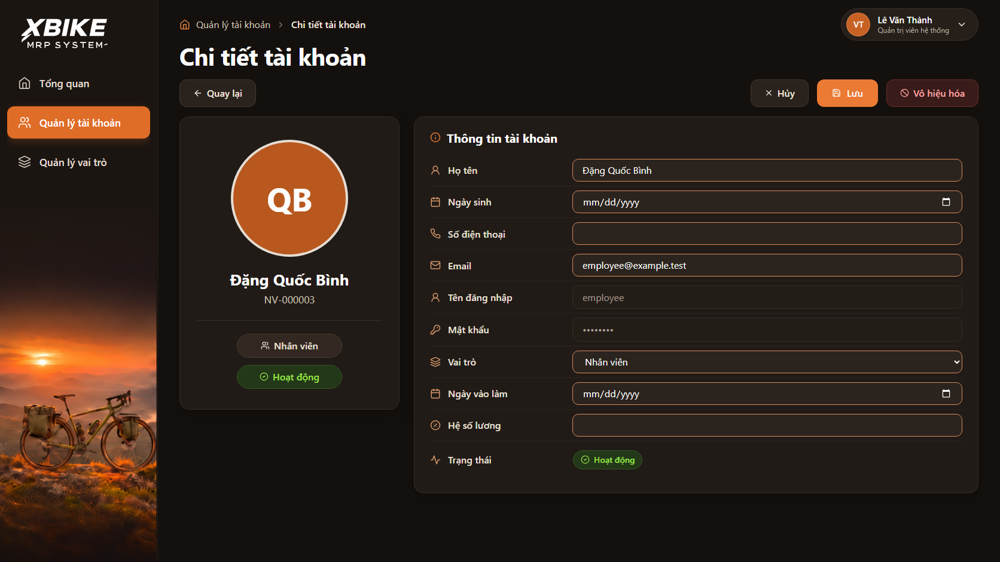
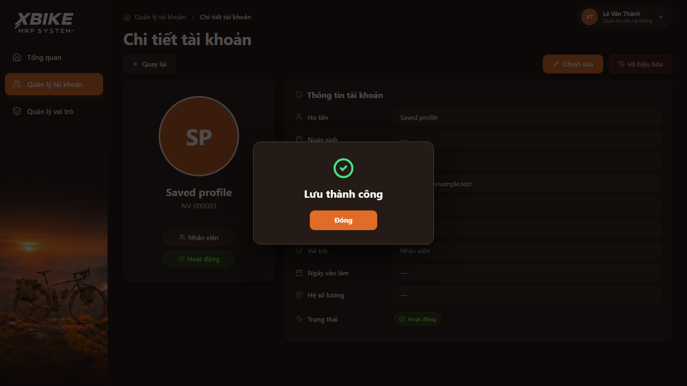
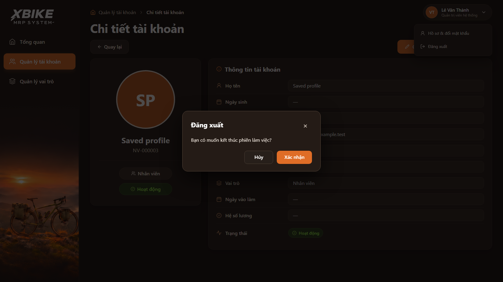

# Báo cáo triển khai UI Admin — xBike MRP

Ngày báo cáo: **08/11/2026**. Branch: **`feature/UI-admin`**.

**Kết quả:** đã hoàn thành và qua review Codex trong phạm vi frontend được dev chấp thuận. Giao diện sử dụng API hiện có; các phần thiếu API vẫn được theo dõi riêng. Chưa kết luận toàn bộ chức năng admin hoặc E2E với backend/database thật đã hoàn tất.

## 1. Căn cứ và phạm vi

- [Đặc tả giao diện admin](./dac-ta-giao-dien-admin.md), năm ảnh gốc trong [ui-spec-admin](./ui-spec-admin/) và các quyết định của dev trong cuộc trò chuyện.
- [Quy tắc frontend](./FRONTEND_RULES.md), `AGENTS.md` và [danh sách còn thiếu](./MISSING.md).
- [Kế hoạch triển khai ban đầu](./admin-ui-plan.md) và [review ban đầu](./admin-ui-review-round-2.md).
- [Kế hoạch chỉnh sửa trực tiếp](./admin-ui-inline-edit-plan.md) và [bằng chứng các vòng review tiếp theo](./admin-ui-inline-edit-review.md).

Phần UI admin ban đầu đã có trong commit `f1085ae`; bản sửa biểu tượng mắt trùng của Edge có trong `373ecae`. Báo cáo này đi cùng phần cập nhật chỉnh sửa trực tiếp, phản hồi khi lưu, popup đăng xuất, nút vai trò và kiểm thử tương ứng.

Không thay đổi backend, hợp đồng API, schema, dependency hoặc dữ liệu ứng dụng trong đợt cập nhật frontend này.

## 2. Các phần đã triển khai

| Khu vực | Đường dẫn | Trạng thái và hành vi |
| --- | --- | --- |
| Tổng quan | `/admin` | Bốn thẻ thống kê, biểu đồ lưu lượng truy cập theo 3 khoảng thời gian, donut phân bổ tài khoản theo vai trò và hoạt động gần đây, tất cả lấy từ API. |
| Quản lý tài khoản | `/admin/tai-khoan` | Danh sách, checkbox trên trang hiện tại, tìm kiếm bằng Enter, bộ lọc khi chọn, phân trang chỉ 10 dòng/trang và các hành động theo quyền. |
| Chi tiết tài khoản | `/admin/tai-khoan/:id` | Khối danh tính bên trái và mười hàng thông tin bên phải; mật khẩu luôn là dấu chấm cố định. |
| Chỉnh sửa tài khoản | `/admin/tai-khoan/:id?mode=edit` | Sửa trực tiếp trong các hàng chi tiết, nút Hủy/Lưu ở thanh hành động; thay thế form sửa hai cột cũ. |
| Tạo tài khoản | `/admin/tai-khoan/moi` | Giữ form tạo và validation hiện có; không xóa luồng này khi thay form sửa. |
| Quản lý vai trò | `/admin/vai-tro` | Danh sách thật có mô tả từ API (null hiện `—`), tìm kiếm cả mô tả và phân trang; Tạo/Sửa/Xóa disabled theo D-VT-01, bộ ba vai trò cố định. |
| Lịch sử | `/admin/lich-su` | Giữ trang và khả năng đọc API lịch sử theo quyền; không đưa dữ liệu snapshot nghiệp vụ bị hạn chế vào giao diện admin. |
| Hồ sơ bản thân | `/ho-so` | Giữ luồng hồ sơ/đổi mật khẩu hiện có. |

- [x] Theme nâu tối/cam, sidebar XBIKE, artwork xe đạp, breadcrumb, avatar chữ cái và bố cục bám thiết kế đã chốt.
- [x] Form sửa cũ với các khối Phân quyền/Trạng thái tài khoản tách riêng đã được thay bằng chỉnh sửa trực tiếp; trang chi tiết và form tạo mới vẫn được giữ.
- [x] Sáu trường hồ sơ được sửa: họ tên, ngày sinh, số điện thoại, email, ngày vào làm, hệ số lương. Vai trò là dropdown trong chính hàng Vai trò.
- [x] Tên đăng nhập, mật khẩu che cố định và trạng thái giữ chế độ chỉ đọc tương ứng; không tự thêm chức năng sửa tên đăng nhập hoặc reset mật khẩu.
- [x] Nút Sửa của `quan_tri_vien`, `quan_ly`, `nhan_vien` dùng `disabled` thật. Tìm kiếm hoặc thay thứ tự hiển thị không bỏ được bảo vệ theo mã vai trò.
- [x] Popup đăng xuất chỉ hỏi **“Bạn có muốn kết thúc phiên làm việc?”**, có Hủy/Xác nhận và X đóng; bỏ nhắc lưu và notice tồn kho riêng ở popup này.
- [x] Ô mật khẩu đăng nhập giữ một nút hiện/ẩn của ứng dụng; biểu tượng mặc định bị trùng trên Edge đã được ẩn.

## 3. Luồng lưu hồ sơ và vai trò

Dev đã chốt **một nút Lưu cho cả hồ sơ và vai trò**, đồng thời **giữ xác nhận trước khi ghi**.

1. Bấm Lưu mở popup xác nhận; chưa gửi request ghi.
2. Hủy/X trong popup không ghi và giữ bản nháp; Hủy chế độ chỉnh sửa bỏ phần nháp chưa lưu để quay về xem chi tiết.
3. Xác nhận mới gửi những phần thực sự thay đổi. Không gửi request hồ sơ/vai trò dư thừa khi phần đó không đổi.
4. Chỉ sau khi mọi phần yêu cầu lưu thành công mới hiện popup **“Lưu thành công”**, dấu check xanh và một nút **Đóng**.
5. Nếu hồ sơ đã lưu nhưng đổi vai trò lỗi, thông báo rõ phần đã lưu và phần còn lỗi. Không giả lập rollback, không báo thành công toàn bộ; hủy hoặc mở sửa lại vẫn phản ánh hồ sơ đã lưu.

| Thao tác | API hiện có | Điều kiện phiên bản |
| --- | --- | --- |
| Lưu hồ sơ | `PATCH /api/v1/nhan_vien/{id}` | Gửi `If-Match` của snapshot đã được người dùng kiểm tra. |
| Lưu vai trò | `PUT /api/v1/nhan_vien/{id}/vai_tro` | Dùng ETag đã kiểm tra nếu chỉ đổi vai trò; nếu sau PATCH thì dùng ETag của response PATCH thành công trong chính chuỗi lưu này. |
| Khóa/mở khóa | API nhân viên hiện có | Giữ snapshot/ETag, yêu cầu lý do và chặn thao tác không được phép. |

Hai API lưu là **hai lần ghi riêng**, không phải một transaction chung. Nếu phản hồi lần ghi đầu thiếu ETag cần cho bước sau, frontend dừng bước tiếp theo và báo đúng phần đã lưu. Lỗi mạng có thể chưa xác định kết quả ghi; không tự retry thao tác ghi.

## 4. Bảo toàn dữ liệu và quyền

- [x] Cố định baseline của phiên sửa và snapshot trong popup xác nhận; refetch nền không âm thầm thay ETag để ghi đè dữ liệu mới của người khác.
- [x] Lỗi `412`/`428` không bị vượt qua bằng GET lấy ETag mới rồi tự gửi lại.
- [x] Chống gửi lặp và giữ trạng thái đang xử lý; không mất phần nháp chưa lưu khi có lỗi.
- [x] Phần đã lưu được phản ánh trong baseline và cache; thử lại phần còn lỗi không tự PATCH lại hồ sơ đã lưu.
- [x] Cache cập nhật đúng user/vai trò hiện tại, không ghi đè projection của user hoặc vai trò khác.
- [x] Giữ chặn khóa chính mình/quản trị viên và chặn đổi vai trò quản trị viên theo luồng hiện có; không làm yếu phân quyền backend.
- [x] Chỉ Xác nhận đăng xuất mới kết thúc phiên và xóa cache theo luồng hiện có; Hủy/X giữ phiên.
- [x] Các kiểm tra ghi dùng browser fixture cô lập; fixture không được import vào ứng dụng chạy thật. Không seed/reset hoặc xóa database/volume để kiểm thử.

## 5. Kết quả kiểm chứng

| Kiểm tra | Kết quả | Phạm vi bằng chứng |
| --- | --- | --- |
| `npm run lint` | Đạt | Frontend, vòng sửa cuối. |
| `npm test` | 27/27 đạt | Unit tests frontend. |
| `npm run build` | Đạt | Build production frontend. |
| `admin-ui.spec.js` và `mutations.spec.js` | 20/20 đạt | Vòng cuối: 10 admin UI và 10 mutation test. |
| Năm suite admin/mutations/navigation/record-dialog/sidebar | 54/54 đạt ở vòng 2 | Kết quả trước bước thu hẹp cache cuối; không khẳng định đã chạy lại cả 54 test ở vòng cuối. |
| Kiểm chứng độc lập của Codex | Đạt | ETag khi refetch trong lúc xác nhận, thông báo partial save, Hủy/mở sửa lại sau partial save và cô lập cache user khác. |
| Đối chiếu ảnh thực tế | Đạt phạm vi frontend | Xem chi tiết, sửa trực tiếp, xác nhận trước lưu, popup thành công, popup đăng xuất và bảng vai trò. |
| Ghi E2E với FastAPI/PostgreSQL thật | Chưa thực hiện | Browser fixture không thay thế bằng chứng E2E backend/database. |

Các lệnh chạy từ `frontend/`:

```sh
npm run lint
npm test
npm run build
npx playwright test tests/browser/admin-ui.spec.js tests/browser/mutations.spec.js
```

Lịch sử review có hai lần Codex yêu cầu sửa tiếp trước khi kết luận đạt: lỗi ETag dùng phiên bản mới khi xác nhận, sai chữ ký `ApiError`, cache không phản ánh partial save, test mở menu đăng xuất và phạm vi cache chưa giới hạn user/vai trò. Các lỗi này đã được sửa và có kiểm chứng hồi quy trong [báo cáo review](./admin-ui-inline-edit-review.md).

## 6. Ảnh giao diện đã triển khai

Ảnh dưới đây chụp từ frontend chạy thật với **API fixture kiểm thử trong trình duyệt**, viewport 1672 × 941. Đây là ảnh triển khai, không phải mockup AI hoặc bằng chứng đã ghi vào database thật.

| Trạng thái | Ảnh |
| --- | --- |
| Xem chi tiết | [Mở ảnh](./ui-admin-screenshots/01-account-detail.png) |
| Chỉnh sửa trực tiếp | [Mở ảnh](./ui-admin-screenshots/02-inline-edit.png) |
| Xác nhận trước khi lưu | [Mở ảnh](./ui-admin-screenshots/03-confirm-before-save.png) |
| Lưu thành công | [Mở ảnh](./ui-admin-screenshots/04-save-success.png) |
| Xác nhận kết thúc phiên | [Mở ảnh](./ui-admin-screenshots/05-logout.png) |
| Ba nút Sửa vai trò bị vô hiệu hóa | [Mở ảnh](./ui-admin-screenshots/06-disabled-role-edit.png) |







## 7. Các phần chưa hoàn tất hoặc cần backend

Các mục sau vẫn mở tại [MISSING.md](./MISSING.md); hoàn thiện UI không có nghĩa đã cung cấp API còn thiếu:

- [x] **FE-MISS-001:** dữ liệu lưu lượng truy cập website theo giờ và theo khoảng thời gian. Đã có API `GET /api/v1/luu_luong_truy_cap`; biểu đồ vẽ theo `Hôm nay` / `7 ngày` / `30 ngày` (D-LL-01).
- [x] **FE-MISS-002:** đã bổ sung mô tả chỉ đọc từ API và seed theo SRS_v4 §2; Tạo/Sửa/Xóa vô hiệu hóa vì bộ vai trò cố định (D-VT-01). Không mở API ghi vai trò; không xác nhận DB đang chạy đã có cột mới.
- [ ] **FE-MISS-003:** API chưa cung cấp ảnh đại diện nhân viên. Giữ avatar chữ cái như đã thống nhất, không tự thêm upload ảnh.
- [ ] **FE-MISS-004:** mô tả hoạt động gần đây ngoài projection API audit hiện có. Không tự bịa nội dung hoặc lấy snapshot nghiệp vụ bị hạn chế.
- [ ] **FE-MISS-005:** API admin đặt lại mật khẩu nhân viên. Hàng mật khẩu vẫn chỉ hiển thị dấu chấm cố định.
- [ ] Kiểm chứng ghi E2E trên backend/database test riêng phù hợp hợp đồng hiện tại.

## 8. Các file trong đợt bàn giao này

| Nhóm | File | Mục đích |
| --- | --- | --- |
| Giao diện/luồng tài khoản | `frontend/src/features/auth/UsersPage.jsx` | Chỉnh sửa trực tiếp, lưu hồ sơ/vai trò, ETag, cache và partial save. |
| Thông báo dùng chung | `frontend/src/components/FeedbackProvider.jsx` | Popup thành công, đóng bằng bàn phím và trả focus. |
| Vai trò | `frontend/src/features/auth/RolesPage.jsx` | Hiển thị/tìm mô tả API, disabled Tạo và giữ disabled Sửa/Xóa của ba vai trò hệ thống theo D-VT-01. |
| Khung ứng dụng | `frontend/src/layouts/MainLayout.jsx` | Nội dung và phạm vi popup đăng xuất. |
| Kiểu hiển thị | `frontend/src/app/App.css` | Input trực tiếp, popup thành công và logout có phạm vi. |
| Kiểm thử | `frontend/tests/browser/admin-ui.spec.js`, `api-fixture.js`, `mutations.spec.js` | Kiểm tra luồng mới và hồi quy an toàn dữ liệu. |
| Tài liệu | `doc/MISSING.md`, `dac-ta-giao-dien-admin.md`, `admin-ui-inline-edit-plan.md`, `admin-ui-inline-edit-review.md` | Yêu cầu, quyết định, checklist và bằng chứng. |
| Bàn giao | `doc/bao-cao-ui-admin.md`, `doc/ui-admin-screenshots/*.png` | Báo cáo tổng hợp và ảnh kiểm chứng có thể xem cùng repository. |

**Kết luận bàn giao:** đạt yêu cầu frontend đã chốt; còn các phụ thuộc API và kiểm chứng E2E nêu trên. Dev đã yêu cầu commit/push báo cáo cùng code lên `feature/UI-admin`; không bao gồm merge vào `main` hoặc thay đổi môi trường dữ liệu.

## 9. Bổ sung FE-MISS-002 — Mô tả vai trò (09/11/2026)

Thực thi `.handoff/plan-vai-tro-mo-ta.md` theo D-VT-01. `GET /api/v1/vai_tro` bổ sung `mo_ta` (`string | null`), giữ quyền admin/quản lý, thứ tự và phân trang. ORM dùng cột thường `varchar(255) NULL`, không default; seed có ba mô tả tóm tắt SRS_v4 §2. Tạo/Sửa/Xóa vô hiệu hóa vì bộ vai trò cố định. Đóng FE-MISS-002, ROL-03/04/06, ROL-Q01..Q05 và QA-10 theo phạm vi này.

Các file sửa trong riêng tác vụ này (giữ nguyên thay đổi có sẵn của dev):

| File | Mục đích |
| --- | --- |
| `backend/app/modules/nhan_vien/models.py` | Thêm ORM `VaiTro.mo_ta`, đồng bộ cột đã có trong bootstrap. |
| `backend/app/modules/nhan_vien/schemas.py` | Bổ sung field nullable trong `VaiTroRead`. |
| `infra/postgres/seed.sql` | Seed ba mô tả theo P1; giữ nguyên các phần seed khác. |
| `frontend/src/features/auth/RolesPage.jsx` | Đặt disabled cho Tạo; dùng CSS độ mờ sẵn có. |
| `frontend/tests/browser/api-fixture.js` | Fixture ba mô tả khớp seed. |
| `frontend/tests/browser/admin-ui.spec.js` | Kiểm tra mô tả, tìm BOM, null, nút Tạo disabled và không phát sinh request; chụp lại ADM-04. |
| `docs/sequence/nhan_vien.md` | Cập nhật mô tả response; giữ nguyên tám khối Mermaid. |
| `docs/api_contract_v3.md` | Cập nhật field và phạm vi vai trò chỉ đọc. |
| `docs/DECISION.md` | Ghi D-VT-01, các quyết định P1–P5 và giới hạn triển khai. |
| `doc/MISSING.md` | Đóng FE-MISS-002, ghi căn cứ và giới hạn. |
| `doc/dac-ta-giao-dien-admin.md` | Cập nhật ROL/QA và các khác biệt đã chốt với ảnh. |
| `doc/bao-cao-ui-admin.md` | Đồng bộ báo cáo, danh sách file và kết quả kiểm chứng. |

`infra/postgres/init.sql` đã có cột/comment `mo_ta` trước phiên này; không sửa thêm. Repository/service/ports không cần đổi vì đã chuyển ORM sang `VaiTroRead`. Không giữ test backend mới trong repo theo lựa chọn dev; tám file test bị xóa trước phiên được giữ nguyên trạng thái.

Kết quả kiểm chứng:

- Backend: 14/14 ca pytest tạm đạt trên database có hậu tố `_test`, schema ngẫu nhiên được dọn sau mỗi ca. Bao gồm mô tả seed/null cho admin/quản lý, nhân viên 403, thiếu token 401, POST/PATCH/DELETE trả 405, phân trang và hồi quy đăng nhập, `/auth/me`, chi tiết nhân viên cho cả ba vai trò. Chạy bằng venv tạm từ manifest backend và công cụ kiểm thử; không dùng database ứng dụng.
- Bootstrap: nguyên bản `init.sql` rồi `seed.sql` đều exit 0 trên container `postgres:16-alpine` tạm không mount volume ứng dụng. SELECT xác nhận ba mô tả dài lần lượt 135/136/124 ký tự; metadata cột là `character varying`, 255, nullable YES, không default; CHECK ba mã giữ nguyên. Container tạm đã được dừng và tự xóa.
- Ruff toàn backend đạt; mypy hai file backend sửa đạt. Chạy trực tiếp tương đương phần lint của Makefile, không khởi động backend trên DB cũ.
- Frontend: `npm run lint` đạt; `npm test` đạt 27/27. `npm run test:browser` đạt 103/105, trong đó ADM-04 đạt. Hai lỗi ở `workflows.spec.js:57` (kỳ vọng heading “Việc được giao” nhưng trang hiện “Tổng quan”) và `workflows.spec.js:90` (locator “Nhà cung cấp” chọn link sidebar thay vì select). Đã chạy lại hai ca với fixture trước tác vụ và test workflow không đổi ở thư mục/cổng riêng: cả hai tái hiện cùng lỗi. Không sửa các phần ngoài phạm vi để làm xanh toàn bộ suite.
- Đã xem ảnh thiết kế `quan_ly_vai_tro.png` và ảnh mới `frontend/test-results/adm-04-roles-1670x941.png`, `adm-04-roles-375x812.png`; có đủ mô tả, Tạo mờ, Sửa/Xóa disabled. Ảnh 1440×900 cũng được chụp. Mobile giữ bảng cuộn ngang hiện có. Dev đồng ý kiểm tra trực tiếp thay hai skill ui-consistency không có sẵn.
- Sequence đã đối chiếu router/service/schema/model/dependency; tám khối Mermaid giữ nguyên. Không có công cụ Mermaid sẵn có nên chưa render/kiểm tra cú pháp bằng Mermaid. `git diff --check` đạt.

Giới hạn: DB ứng dụng chưa được cập nhật. Backend mới chạy trên DB thiếu `mo_ta` sẽ lỗi ở đăng nhập và mọi request có token do selectin `NhanVien.role`; cần triển khai cùng DB đã có cột. Chỉ cập nhật bootstrap cho DB mới/trống, không migration, ALTER, seed lại hoặc xóa volume đang dùng. Dev cập nhật riêng API contract/data model trên Drive. Kiểm thử API PostgreSQL và UI fixture là hai lớp riêng, chưa xác nhận browser E2E kết nối backend thật. Tác vụ này chưa commit/push hoặc accept thay đổi.
