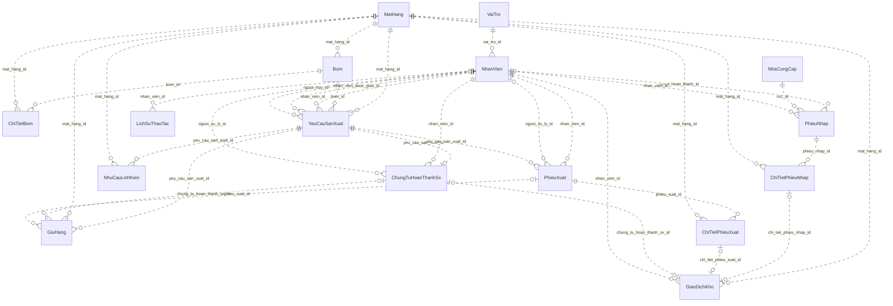

# xBike MRP — Data model v4 (schema hiện tại)

Xuất ngày 2026-11-18 từ CSDL PostgreSQL đang chạy (`xbike_mrp`, schema `public`), khớp `infra/postgres/init.sql`.
Gồm **17 bảng**, **162 cột**, **34 khóa ngoại**.
Đặc tả nghiệp vụ (BR/UC, vòng đời trạng thái) xem `specs/entity_model/data_model_v4.md`.

## Quy ước

- `PK` khóa chính, `FK` khóa ngoại, `UK` duy nhất một cột. Chú thích cột: `NULL`/`NOT NULL`, độ dài, `DEFAULT`, giá trị cho phép (CHECK dạng liệt kê).
- Quan hệ: `||` bắt buộc, `|o` FK được NULL; `o{` nhiều, `o|` tối đa một (FK có UNIQUE). Nhãn là tên cột FK ở bảng con.

## 1. Danh sách bảng theo bounded context

| Context | Bảng |
|---|---|
| `identity_access` | `VaiTro`, `NhanVien` |
| `catalog` | `NhaCungCap`, `MatHang` |
| `bom` | `Bom`, `ChiTietBom` |
| `goods_receipt` | `PhieuNhap`, `ChiTietPhieuNhap` |
| `production` | `YeuCauSanXuat`, `NhuCauLinhKien`, `GiuHang`, `ChungTuHoanThanhSx` |
| `goods_issue` | `PhieuXuat`, `ChiTietPhieuXuat` |
| `reporting` | `GiaoDichKho` |
| `audit` | `LichSuThaoTac`, `LuuLuongTruyCap` |

## 2. Sơ đồ ERD đầy đủ

```mermaid
erDiagram
  direction TB
  VaiTro {
    int id PK "IDENTITY"
    varchar ma_vai_tro UK "NOT NULL; quan_tri_vien | quan_ly | nhan_vien"
    varchar ten_vai_tro "NOT NULL"
    varchar mo_ta "NULL; varchar(255)"
  }
  NhanVien {
    int id PK "IDENTITY"
    int vai_tro_id FK "NOT NULL"
    varchar ten_dang_nhap UK "NOT NULL"
    varchar mat_khau "NOT NULL"
    varchar ma_nhan_vien UK "NOT NULL"
    varchar ho_ten "NULL"
    date ngay_sinh "NULL"
    varchar so_dien_thoai "NULL"
    varchar email "NULL"
    date ngay_vao_lam "NULL"
    decimal he_so_luong "NULL; decimal(5,2)"
    varchar trang_thai "NOT NULL; DEFAULT hoat_dong; hoat_dong | bi_khoa"
    int phien_ban_dang_nhap "NOT NULL; DEFAULT 0"
    timestamptz created_at "NOT NULL; DEFAULT now()"
  }
  NhaCungCap {
    int id PK "IDENTITY"
    varchar ma_ncc UK "NOT NULL"
    varchar ten_ncc "NOT NULL"
    varchar so_dien_thoai "NOT NULL"
    varchar dia_chi "NOT NULL"
    varchar phuong "NOT NULL"
    varchar tinh "NOT NULL"
    timestamptz created_at "NOT NULL; DEFAULT now()"
  }
  MatHang {
    int id PK "IDENTITY"
    varchar ma_mat_hang UK "NOT NULL"
    varchar ten_mat_hang "NOT NULL"
    varchar sku UK "NOT NULL"
    varchar loai_mat_hang "NOT NULL; thanh_pham | linh_kien"
    varchar don_vi_tinh "NOT NULL"
    varchar mau_sac "NULL"
    varchar mo_ta "NULL"
    bigint don_gia "NOT NULL"
    boolean is_active "NOT NULL; DEFAULT true"
    int so_luong_ton "NOT NULL; DEFAULT 0"
    int so_luong_dang_giu "NOT NULL; DEFAULT 0"
    int so_luong_con_dung "GENERATED: so_luong_ton - so_luong_dang_giu"
    timestamptz ton_kho_updated_at "NULL"
    timestamptz created_at "NOT NULL; DEFAULT now()"
  }
  Bom {
    int id PK "IDENTITY"
    int mat_hang_id FK "NOT NULL"
    int version "NOT NULL"
    boolean is_active "NOT NULL; DEFAULT true"
    timestamptz created_at "NOT NULL; DEFAULT now()"
    timestamptz kich_hoat_gan_nhat_at "NOT NULL; DEFAULT now()"
  }
  ChiTietBom {
    int id PK "IDENTITY"
    int bom_id FK "NOT NULL"
    int mat_hang_id FK "NOT NULL"
    int so_luong "NOT NULL"
  }
  PhieuNhap {
    int id PK "IDENTITY"
    varchar ma_phieu_nhap UK "NOT NULL"
    int nhan_vien_id FK "NOT NULL"
    int ncc_id FK "NOT NULL"
    date ngay_nhap "NOT NULL"
    text ghi_chu "NULL"
    bigint tong_tien "NULL"
    varchar trang_thai "NOT NULL; DEFAULT nhap; nhap | hoan_thanh"
    timestamptz created_at "NOT NULL; DEFAULT now()"
    timestamptz updated_at "NOT NULL; DEFAULT now()"
    timestamptz hoan_thanh_at "NULL"
    int nguoi_hoan_thanh_id FK "NULL"
    int phien_ban "NOT NULL; DEFAULT 1"
  }
  ChiTietPhieuNhap {
    int id PK "IDENTITY"
    int phieu_nhap_id FK "NOT NULL"
    int mat_hang_id FK "NOT NULL"
    int so_luong "NOT NULL"
    bigint don_gia_thuc "NOT NULL"
    bigint tong_gia "NOT NULL"
  }
  YeuCauSanXuat {
    int id PK "IDENTITY"
    varchar ma_yeu_cau_san_xuat UK "NOT NULL"
    varchar loai_yeu_cau "NOT NULL; DEFAULT xuat_giao; xuat_giao | nhap_kho"
    int mat_hang_id FK "NOT NULL"
    int so_luong "NOT NULL"
    date han_hoan_thanh "NOT NULL"
    int nhan_vien_id FK "NOT NULL"
    int nhan_vien_duoc_giao_id FK "NOT NULL"
    int bom_id FK "NULL"
    varchar trang_thai "NOT NULL; DEFAULT nhap; nhap | da_gui | cho_bo_sung_linh_kien | dang_thuc_hien | hoan_thanh | da_huy"
    int so_luong_dung_thanh_pham "NULL"
    int so_luong_can_san_xuat "NULL"
    timestamptz created_at "NOT NULL; DEFAULT now()"
    timestamptz updated_at "NOT NULL; DEFAULT now()"
    timestamptz gui_at "NULL"
    timestamptz kiem_tra_lan_dau_at "NULL"
    timestamptz started_at "NULL"
    timestamptz completed_at "NULL"
    timestamptz huy_at "NULL"
    int nguoi_huy_id FK "NULL"
    text ly_do_huy "NULL"
    int phien_ban "NOT NULL; DEFAULT 1"
  }
  NhuCauLinhKien {
    int id PK "IDENTITY"
    int yeu_cau_san_xuat_id FK "NOT NULL"
    int mat_hang_id FK "NOT NULL"
    int so_luong_can "NOT NULL"
  }
  GiuHang {
    int id PK "IDENTITY"
    int yeu_cau_san_xuat_id FK "NOT NULL"
    int mat_hang_id FK "NOT NULL"
    varchar loai_giu "NOT NULL; thanh_pham_co_san | linh_kien | thanh_pham_san_xuat"
    int so_luong "NOT NULL"
    varchar trang_thai "NOT NULL; DEFAULT dang_giu; dang_giu | da_xuat | da_tra"
    int chung_tu_hoan_thanh_sx_id FK "NULL"
    int phieu_xuat_id FK "NULL"
    timestamptz created_at "NOT NULL; DEFAULT now()"
    timestamptz ket_thuc_at "NULL"
  }
  ChungTuHoanThanhSx {
    int id PK "IDENTITY"
    varchar ma_phieu UK "NOT NULL"
    int yeu_cau_san_xuat_id FK, UK "NOT NULL"
    int so_luong_hoan_thanh "NOT NULL"
    int nhan_vien_id FK "NOT NULL"
    varchar trang_thai "NOT NULL; DEFAULT nhap; nhap | cho_duyet | da_duyet | tu_choi"
    timestamptz finish_time "NULL"
    timestamptz created_at "NOT NULL; DEFAULT now()"
    timestamptz updated_at "NOT NULL; DEFAULT now()"
    int nguoi_xu_ly_id FK "NULL"
    timestamptz xu_ly_at "NULL"
    text ly_do_tu_choi "NULL"
    int phien_ban "NOT NULL; DEFAULT 1"
  }
  PhieuXuat {
    int id PK "IDENTITY"
    varchar ma_phieu_xuat UK "NOT NULL"
    int nhan_vien_id FK "NOT NULL"
    varchar loai_phieu "NOT NULL; xuat_linh_kien | xuat_thanh_pham"
    int yeu_cau_san_xuat_id FK "NOT NULL"
    bigint tong_tien "NULL"
    varchar trang_thai "NOT NULL; DEFAULT nhap; nhap | cho_duyet | da_duyet | tu_choi"
    timestamptz created_at "NOT NULL; DEFAULT now()"
    timestamptz updated_at "NOT NULL; DEFAULT now()"
    timestamptz gui_at "NULL"
    int nguoi_xu_ly_id FK "NULL"
    timestamptz xu_ly_at "NULL"
    text ly_do_tu_choi "NULL"
    int phien_ban "NOT NULL; DEFAULT 1"
  }
  ChiTietPhieuXuat {
    int id PK "IDENTITY"
    int phieu_xuat_id FK "NOT NULL"
    int mat_hang_id FK "NOT NULL"
    int so_luong "NOT NULL"
    bigint don_gia_thuc "NULL"
    bigint tong_gia "NULL"
  }
  GiaoDichKho {
    int id PK "IDENTITY"
    int mat_hang_id FK "NOT NULL"
    varchar loai_giao_dich "NOT NULL; nhap_linh_kien | xuat_linh_kien | nhap_san_pham_san_xuat | xuat_thanh_pham"
    int so_luong_bien_dong "NOT NULL"
    int so_luong_ton_sau "NOT NULL"
    int chi_tiet_phieu_nhap_id FK, UK "NULL"
    int chi_tiet_phieu_xuat_id FK, UK "NULL"
    int chung_tu_hoan_thanh_sx_id FK, UK "NULL"
    int nhan_vien_id FK "NOT NULL"
    timestamptz posted_at "NOT NULL; DEFAULT now()"
  }
  LichSuThaoTac {
    int id PK "IDENTITY"
    int nhan_vien_id FK "NOT NULL"
    varchar loai_doi_tuong "NOT NULL; nhan_vien | mat_hang | nha_cung_cap | cong_thuc | phieu_nhap | phieu_xuat | yeu_cau_san_xuat | chung_tu_hoan_thanh_san_xuat"
    int doi_tuong_id "NOT NULL"
    varchar thao_tac "NOT NULL; dang_nhap | tao | sua | xoa_nhap | gui | gui_lai | kiem_tra | duyet | tu_choi | hoan_tat | bat_dau | huy | khoa | mo_khoa | doi_vai_tro | doi_mat_khau | ngung | dung_lai | tao_phien_ban | dung_lai_phien_ban"
    varchar trang_thai_truoc "NULL"
    varchar trang_thai_sau "NULL"
    jsonb du_lieu_truoc "NULL"
    jsonb du_lieu_sau "NULL"
    text ly_do "NULL"
    timestamptz created_at "NOT NULL; DEFAULT now()"
  }
  LuuLuongTruyCap {
    timestamptz gio_bat_dau PK "NOT NULL"
    bigint so_request "NOT NULL; DEFAULT 0"
  }

  VaiTro ||..o{ NhanVien : "vai_tro_id"
  MatHang ||..o{ Bom : "mat_hang_id"
  Bom ||..o{ ChiTietBom : "bom_id"
  MatHang ||..o{ ChiTietBom : "mat_hang_id"
  NhanVien |o..o{ PhieuNhap : "nguoi_hoan_thanh_id"
  NhaCungCap ||..o{ PhieuNhap : "ncc_id"
  NhanVien ||..o{ PhieuNhap : "nhan_vien_id"
  PhieuNhap ||..o{ ChiTietPhieuNhap : "phieu_nhap_id"
  MatHang ||..o{ ChiTietPhieuNhap : "mat_hang_id"
  MatHang ||..o{ YeuCauSanXuat : "mat_hang_id"
  Bom |o..o{ YeuCauSanXuat : "bom_id"
  NhanVien ||..o{ YeuCauSanXuat : "nhan_vien_id"
  NhanVien ||..o{ YeuCauSanXuat : "nhan_vien_duoc_giao_id"
  NhanVien |o..o{ YeuCauSanXuat : "nguoi_huy_id"
  YeuCauSanXuat ||..o{ NhuCauLinhKien : "yeu_cau_san_xuat_id"
  MatHang ||..o{ NhuCauLinhKien : "mat_hang_id"
  YeuCauSanXuat ||..o{ GiuHang : "yeu_cau_san_xuat_id"
  MatHang ||..o{ GiuHang : "mat_hang_id"
  ChungTuHoanThanhSx |o..o{ GiuHang : "chung_tu_hoan_thanh_sx_id"
  PhieuXuat |o..o{ GiuHang : "phieu_xuat_id"
  YeuCauSanXuat ||..o| ChungTuHoanThanhSx : "yeu_cau_san_xuat_id"
  NhanVien ||..o{ ChungTuHoanThanhSx : "nhan_vien_id"
  NhanVien |o..o{ ChungTuHoanThanhSx : "nguoi_xu_ly_id"
  NhanVien ||..o{ PhieuXuat : "nhan_vien_id"
  NhanVien |o..o{ PhieuXuat : "nguoi_xu_ly_id"
  YeuCauSanXuat ||..o{ PhieuXuat : "yeu_cau_san_xuat_id"
  PhieuXuat ||..o{ ChiTietPhieuXuat : "phieu_xuat_id"
  MatHang ||..o{ ChiTietPhieuXuat : "mat_hang_id"
  MatHang ||..o{ GiaoDichKho : "mat_hang_id"
  ChiTietPhieuNhap |o..o| GiaoDichKho : "chi_tiet_phieu_nhap_id"
  ChiTietPhieuXuat |o..o| GiaoDichKho : "chi_tiet_phieu_xuat_id"
  ChungTuHoanThanhSx |o..o| GiaoDichKho : "chung_tu_hoan_thanh_sx_id"
  NhanVien ||..o{ GiaoDichKho : "nhan_vien_id"
  NhanVien ||..o{ LichSuThaoTac : "nhan_vien_id"
```

## 3. Sơ đồ quan hệ rút gọn (không cột)

## 4. Ràng buộc nhiều cột và CHECK khác

### `NhanVien`

- `CHECK ((he_so_luong >= (0)::numeric))`
- `CHECK ((phien_ban_dang_nhap >= 0))`
- `CHECK ((((ma_nhan_vien)::text ~ '^NV-[0-9]{6}$'::text) AND ("right"((ma_nhan_vien)::text, 6) <> '000000'::text)))`

### `NhaCungCap`

- `CHECK ((((ma_ncc)::text ~ '^NCC-[0-9]{6}$'::text) AND ("right"((ma_ncc)::text, 6) <> '000000'::text)))`
- `CHECK (((btrim((ten_ncc)::text) <> ''::text) AND (btrim((so_dien_thoai)::text) <> ''::text) AND (btrim((dia_chi)::text) <> ''::text) AND (btrim((phuong)::text) <> ''::text) AND (btrim((tinh)::text) <> ''::text)))`

### `MatHang`

- `CHECK ((((loai_mat_hang)::text = 'thanh_pham'::text) OR is_active))`
- `CHECK (((so_luong_ton >= 0) AND (so_luong_dang_giu >= 0) AND (so_luong_dang_giu <= so_luong_ton)))`
- `CHECK ((don_gia >= 0))`
- `CHECK (((ten_mat_hang)::text ~ '[^[:space:]]'::text))`
- `CHECK ((btrim((don_vi_tinh)::text) <> ''::text))`
- `CHECK ((((ma_mat_hang)::text ~ '^MH-[0-9]{6}$'::text) AND ("right"((ma_mat_hang)::text, 6) <> '000000'::text)))`

### `Bom`

- `UNIQUE INDEX uq_bom_version (mat_hang_id, version)`
- `UNIQUE INDEX uq_bom_dang_dung (mat_hang_id) WHERE is_active`
- `CHECK ((version > 0))`

### `ChiTietBom`

- `UNIQUE INDEX uq_chi_tiet_bom (bom_id, mat_hang_id)`
- `CHECK ((so_luong > 0))`

### `PhieuNhap`

- `CHECK ((tong_tien >= 0))`
- `CHECK ((phien_ban > 0))`
- `CHECK ((((trang_thai)::text = 'hoan_thanh'::text) = ((hoan_thanh_at IS NOT NULL) AND (nguoi_hoan_thanh_id IS NOT NULL))))`
- `CHECK ((((ma_phieu_nhap)::text ~ '^PN-[0-9]{4}(0[1-9]|1[0-2])-[0-9]{6}$'::text) AND ("right"((ma_phieu_nhap)::text, 6) <> '000000'::text)))`

### `ChiTietPhieuNhap`

- `UNIQUE INDEX uq_chi_tiet_phieu_nhap (phieu_nhap_id, mat_hang_id)`
- `CHECK ((so_luong > 0))`
- `CHECK (((don_gia_thuc >= 0) AND (tong_gia = ((so_luong)::bigint * don_gia_thuc))))`

### `YeuCauSanXuat`

- `CHECK ((((loai_yeu_cau)::text = 'xuat_giao'::text) OR (COALESCE(so_luong_dung_thanh_pham, 0) = 0)))`
- `CHECK ((so_luong > 0))`
- `CHECK ((phien_ban > 0))`
- `CHECK ((((trang_thai)::text = 'nhap'::text) OR ((bom_id IS NOT NULL) AND (gui_at IS NOT NULL))))`
- `CHECK ((((so_luong_dung_thanh_pham IS NULL) AND (so_luong_can_san_xuat IS NULL) AND (kiem_tra_lan_dau_at IS NULL)) OR ((so_luong_dung_thanh_pham >= 0) AND (so_luong_can_san_xuat >= 0) AND ((so_luong_dung_thanh_pham + so_luong_can_san_xuat) = so_luong) AND (kiem_tra_lan_dau_at IS NOT NULL))))`
- `CHECK ((((trang_thai)::text <> ALL ((ARRAY['cho_bo_sung_linh_kien'::character varying, 'dang_thuc_hien'::character varying, 'hoan_thanh'::character varying])::text[])) OR (so_luong_can_san_xuat IS NOT NULL)))`
- `CHECK (((started_at IS NULL) OR ((so_luong_can_san_xuat > 0) AND ((trang_thai)::text = ANY ((ARRAY['dang_thuc_hien'::character varying, 'hoan_thanh'::character varying])::text[])))))`
- `CHECK ((((trang_thai)::text = 'hoan_thanh'::text) = (completed_at IS NOT NULL)))`
- `CHECK ((((trang_thai)::text = 'da_huy'::text) = ((huy_at IS NOT NULL) AND (nguoi_huy_id IS NOT NULL) AND (COALESCE(btrim(ly_do_huy), ''::text) <> ''::text))))`
- `CHECK ((((ma_yeu_cau_san_xuat)::text ~ '^YCSX-[0-9]{4}(0[1-9]|1[0-2])-[0-9]{6}$'::text) AND ("right"((ma_yeu_cau_san_xuat)::text, 6) <> '000000'::text)))`

### `NhuCauLinhKien`

- `UNIQUE INDEX uq_nhu_cau_linh_kien (yeu_cau_san_xuat_id, mat_hang_id)`
- `CHECK ((so_luong_can > 0))`

### `GiuHang`

- `UNIQUE INDEX uq_giu_hang (yeu_cau_san_xuat_id, mat_hang_id, loai_giu)`
- `CHECK ((so_luong > 0))`
- `CHECK ((((trang_thai)::text = 'dang_giu'::text) = (ket_thuc_at IS NULL)))`
- `CHECK ((((trang_thai)::text = 'da_xuat'::text) = (phieu_xuat_id IS NOT NULL)))`
- `CHECK ((((loai_giu)::text = 'thanh_pham_san_xuat'::text) = (chung_tu_hoan_thanh_sx_id IS NOT NULL)))`

### `ChungTuHoanThanhSx`

- `CHECK ((so_luong_hoan_thanh > 0))`
- `CHECK ((phien_ban > 0))`
- `CHECK ((((trang_thai)::text = 'nhap'::text) OR (finish_time IS NOT NULL)))`
- `CHECK ((((trang_thai)::text <> ALL ((ARRAY['da_duyet'::character varying, 'tu_choi'::character varying])::text[])) OR ((nguoi_xu_ly_id IS NOT NULL) AND (xu_ly_at IS NOT NULL))))`
- `CHECK ((((trang_thai)::text <> 'tu_choi'::text) OR (COALESCE(btrim(ly_do_tu_choi), ''::text) <> ''::text)))`
- `CHECK ((((ma_phieu)::text ~ '^HTSX-[0-9]{4}(0[1-9]|1[0-2])-[0-9]{6}$'::text) AND ("right"((ma_phieu)::text, 6) <> '000000'::text)))`

### `PhieuXuat`

- `UNIQUE INDEX uq_phieu_xuat_yeu_cau_loai (yeu_cau_san_xuat_id, loai_phieu)`
- `CHECK ((phien_ban > 0))`
- `CHECK ((((trang_thai)::text = 'nhap'::text) OR (gui_at IS NOT NULL)))`
- `CHECK ((((trang_thai)::text <> ALL ((ARRAY['da_duyet'::character varying, 'tu_choi'::character varying])::text[])) OR ((nguoi_xu_ly_id IS NOT NULL) AND (xu_ly_at IS NOT NULL))))`
- `CHECK ((((trang_thai)::text <> 'tu_choi'::text) OR (COALESCE(btrim(ly_do_tu_choi), ''::text) <> ''::text)))`
- `CHECK ((tong_tien >= 0))`
- `CHECK ((((trang_thai)::text <> 'da_duyet'::text) OR (tong_tien IS NOT NULL)))`
- `CHECK ((((ma_phieu_xuat)::text ~ '^PX-[0-9]{4}(0[1-9]|1[0-2])-[0-9]{6}$'::text) AND ("right"((ma_phieu_xuat)::text, 6) <> '000000'::text)))`

### `ChiTietPhieuXuat`

- `UNIQUE INDEX uq_chi_tiet_phieu_xuat (phieu_xuat_id, mat_hang_id)`
- `CHECK ((so_luong > 0))`
- `CHECK ((((don_gia_thuc IS NULL) AND (tong_gia IS NULL)) OR ((don_gia_thuc >= 0) AND (tong_gia = ((so_luong)::bigint * don_gia_thuc)))))`

### `GiaoDichKho`

- `CHECK ((so_luong_ton_sau >= 0))`
- `CHECK ((num_nonnulls(chi_tiet_phieu_nhap_id, chi_tiet_phieu_xuat_id, chung_tu_hoan_thanh_sx_id) = 1))`
- `CHECK (((((loai_giao_dich)::text = 'nhap_linh_kien'::text) AND (chi_tiet_phieu_nhap_id IS NOT NULL) AND (so_luong_bien_dong > 0)) OR (((loai_giao_dich)::text = ANY ((ARRAY['xuat_linh_kien'::character varying, 'xuat_thanh_pham'::character varying])::text[])) AND (chi_tiet_phieu_xuat_id IS NOT NULL) AND (so_luong_bien_dong < 0)) OR (((loai_giao_dich)::text = 'nhap_san_pham_san_xuat'::text) AND (chung_tu_hoan_thanh_sx_id IS NOT NULL) AND (so_luong_bien_dong > 0))))`

### `LichSuThaoTac`

- `CHECK ((((thao_tac)::text <> ALL ((ARRAY['tu_choi'::character varying, 'huy'::character varying])::text[])) OR (COALESCE(btrim(ly_do), ''::text) <> ''::text)))`

### `LuuLuongTruyCap`

- `CHECK ((so_request >= 0))`
