# Sequence diagram — audit

Nguồn: `audit/{router,service,repository,ports,schemas,models}.py`, `app/dependencies.py`, `auth/service.py`, `nhan_vien/service.py`, `core/{persistence,exceptions}.py`.
Module audit sở hữu ORM `LichSuThaoTac` ánh xạ bảng `"LichSuThaoTac"`. Ghi lịch sử là public method nội bộ `AuditService.append`; không có endpoint HTTP ghi/sửa/xóa lịch sử.

## GET /api/v1/audit — Danh sách lịch sử

Bearer JWT bắt buộc; chỉ `quan_tri_vien`, `quan_ly` được đọc. Query dùng dependency chung: page (mặc định 1, tối thiểu 1), page_size (mặc định 20, tối đa 100), search, sort_by (mặc định created_at), sort_order (asc/desc, mặc định desc). Không áp quy tắc reject_query riêng của auth/nhân viên cho route này.

```mermaid
sequenceDiagram
    actor C as Client
    participant R as audit.router và dependencies
    participant A as auth.service
    participant N as nhan_vien.service
    participant NP as nhan_vien.repository
    participant S as audit.service
    participant P as audit.repository
    participant DB as PostgreSQL
    C->>R: GET /api/v1/audit, Bearer JWT, query
    R->>A: current_payload(token)
    A->>A: Verify JWT và sub
    A->>N: get_auth_identity(id, pwdv)
    N->>NP: get_credentials_by_id(id)
    NP->>DB: SELECT NhanVien và VaiTro
    DB-->>N: Credentials qua repository
    N->>N: Kiểm tra account, role, pwdv
    alt Token/account mất hoặc pwdv cũ
        R-->>C: 401 UNAUTHORIZED
    else Account khóa hoặc role không hợp lệ
        R-->>C: 403 FORBIDDEN
    else Xác thực hợp lệ
        A-->>R: Payload với roles hiện tại
        R->>R: require_roles và validate PageParams
        alt Role là nhan_vien
            R-->>C: 403 FORBIDDEN
        else Query số trang/kích thước/chiều sort không hợp lệ
            R-->>C: 422 VALIDATION_ERROR
        else Có quyền và input hợp lệ
            R->>S: list_entries(params)
            S->>P: list_entries(params)
            P->>DB: COUNT và SELECT LichSuThaoTac qua select_page
            DB-->>P: Tổng và các dòng lịch sử
            P-->>S: RecordPage các AuditLogResponse
            S->>S: create_paginated_response
            S-->>R: PaginatedResponse
            R-->>C: 200 success, data, pagination, message
        end
    end
```

Response dùng envelope nghiệp vụ hiện tại, khác envelope `data/meta` của auth/nhân viên. Không có ETag hoặc transaction ghi cho GET này. SQL lỗi không dự kiến được handler chung trả 500 an toàn. Khi request sai nhiều điều kiện, thứ tự ưu tiên validation/auth không được cố định bởi sơ đồ.

`created_at` là TIMESTAMPTZ; hai trường dữ liệu trước/sau là JSONB. SQL bootstrap tạo hai index phục vụ tìm lịch sử và trigger `trg_audit_bat_bien` chặn UPDATE/DELETE. Tạo bảng bằng ORM đơn thuần không tạo trigger này.
Theo quyết định ngày 01/11/2026, hai cột `du_lieu_truoc` và `du_lieu_sau` dùng
`JSONB(none_as_null=True)`: Python `None` được lưu thành SQL `NULL`, còn `{}` vẫn
là một đối tượng JSON rỗng. Thay đổi chỉ áp dụng khi ORM ghi dữ liệu mới; không
chuyển đổi các bản ghi JSON null đã tồn tại.
Trong luồng đổi mật khẩu, `append` chỉ `session.add` record và không commit riêng; transaction nhân viên flush INSERT và commit cùng UPDATE password. Nếu append/commit lỗi, rollback cả hai; xem [auth.md](auth.md). Không log password/hash/token vào dữ liệu audit.
