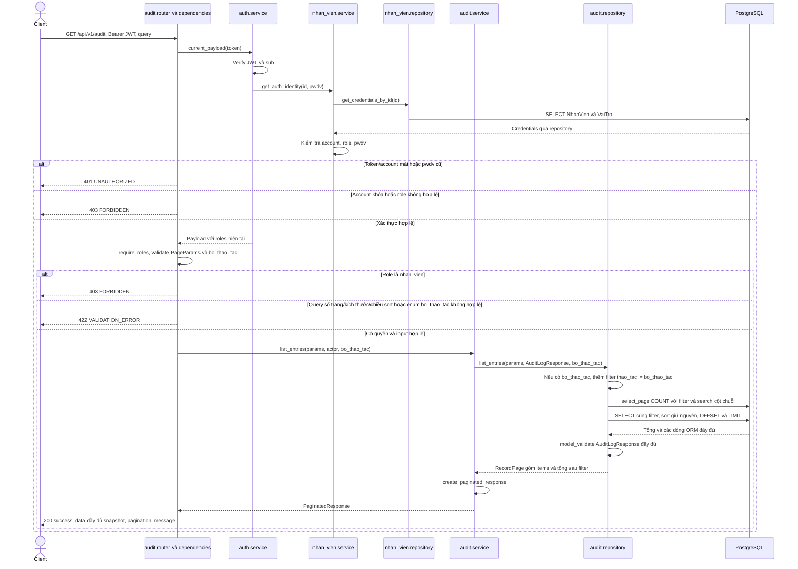

# Sequence diagram — audit

Nguồn: `audit/{router,service,repository,ports,schemas,models}.py`, `app/dependencies.py`, `auth/service.py`, `nhan_vien/service.py`, `core/{persistence,exceptions}.py`.
Module audit sở hữu ORM `LichSuThaoTac` ánh xạ bảng `"LichSuThaoTac"`. Ghi lịch sử là public method nội bộ `AuditService.append`; không có endpoint HTTP ghi/sửa/xóa lịch sử.

## GET /api/v1/audit — Danh sách lịch sử

Bearer JWT bắt buộc; chỉ `quan_tri_vien`, `quan_ly` được đọc. Query dùng dependency chung: page (mặc định 1, tối thiểu 1), page_size (mặc định 20, tối đa 100), search, sort_by (mặc định created_at), sort_order (asc/desc, mặc định desc); thêm `bo_thao_tac: ThaoTac | None` loại một thao tác hợp lệ (gồm `dang_nhap`) trước COUNT/phân trang, sai enum trả 422. Không áp quy tắc reject_query riêng của auth/nhân viên. Theo D-HD-01 (`docs/DECISION.md`, thay D-PQ-02), admin và quản lý đều thấy mọi loại đối tượng và đủ hai key du_lieu_truoc/du_lieu_sau, gồm giá trị null; nhân viên nhận 403.

Response dùng envelope nghiệp vụ hiện tại, khác envelope `data/meta` của auth/nhân viên. Không có ETag hoặc transaction ghi cho GET này. SQL lỗi không dự kiến được handler chung trả 500 an toàn. Khi request sai nhiều điều kiện, thứ tự ưu tiên validation/auth không được cố định bởi sơ đồ.

`created_at` là TIMESTAMPTZ; hai trường dữ liệu trước/sau là JSONB. SQL bootstrap tạo hai index phục vụ tìm lịch sử và trigger `trg_audit_bat_bien` chặn UPDATE/DELETE. Tạo bảng bằng ORM đơn thuần không tạo trigger này.
Theo quyết định ngày 01/11/2026, hai cột `du_lieu_truoc` và `du_lieu_sau` dùng
`JSONB(none_as_null=True)`: Python `None` được lưu thành SQL `NULL`, còn `{}` vẫn
là một đối tượng JSON rỗng. Thay đổi chỉ áp dụng khi ORM ghi dữ liệu mới; không
chuyển đổi các bản ghi JSON null đã tồn tại.
Trong luồng đổi mật khẩu, `append` chỉ `session.add` record và không commit riêng; transaction nhân viên flush INSERT và commit cùng UPDATE password. Nếu append/commit lỗi, rollback cả hai; xem [auth.md](auth.md). Không log password/hash/token vào dữ liệu audit.

Theo D-HD-01, response model dùng duy nhất `PaginatedResponse[AuditLogResponse]`; không lọc loại đối tượng cho admin. `ly_do` vẫn hiển thị và được search; hai cột JSON không tham gia search nhưng admin/quản lý đều sort được như nhau. ADM-01 dùng `bo_thao_tac=thu_hoi_quyen`, dashboard kho không gửi filter này. Không có endpoint `/lich_su_thao_tac` hoặc filter v3 khác trong phạm vi FE-MISS-004.

Luồng đăng nhập dùng public method `NhanVienService.record_login`: append đúng một dòng `dang_nhap` với hai snapshot/ly_do null, commit transaction trước khi auth ký token. Append/commit lỗi trả 500 và không cấp token; không ghi audit cho đăng nhập bị từ chối. CHECK SQL đã có thao tác này từ commit `2ef564c`; volume cũ hơn có thể khiến commit lỗi, không tự ALTER/seed. Xem `auth.md`.
