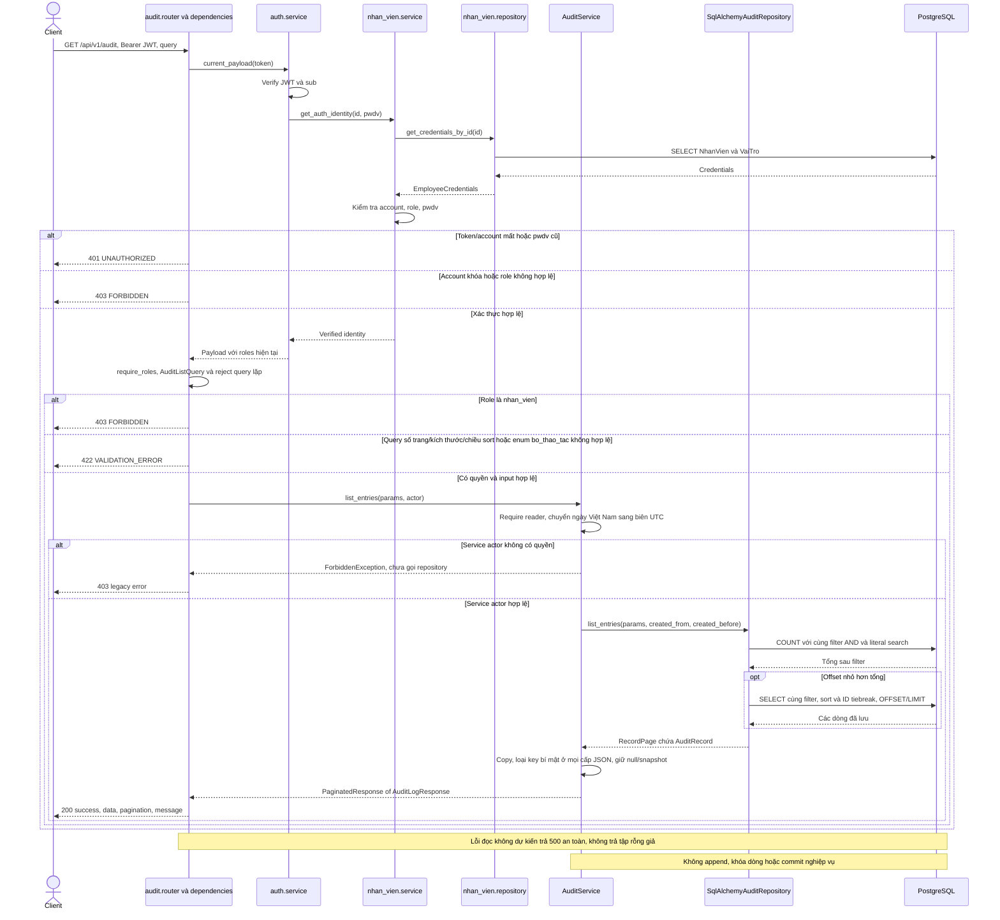
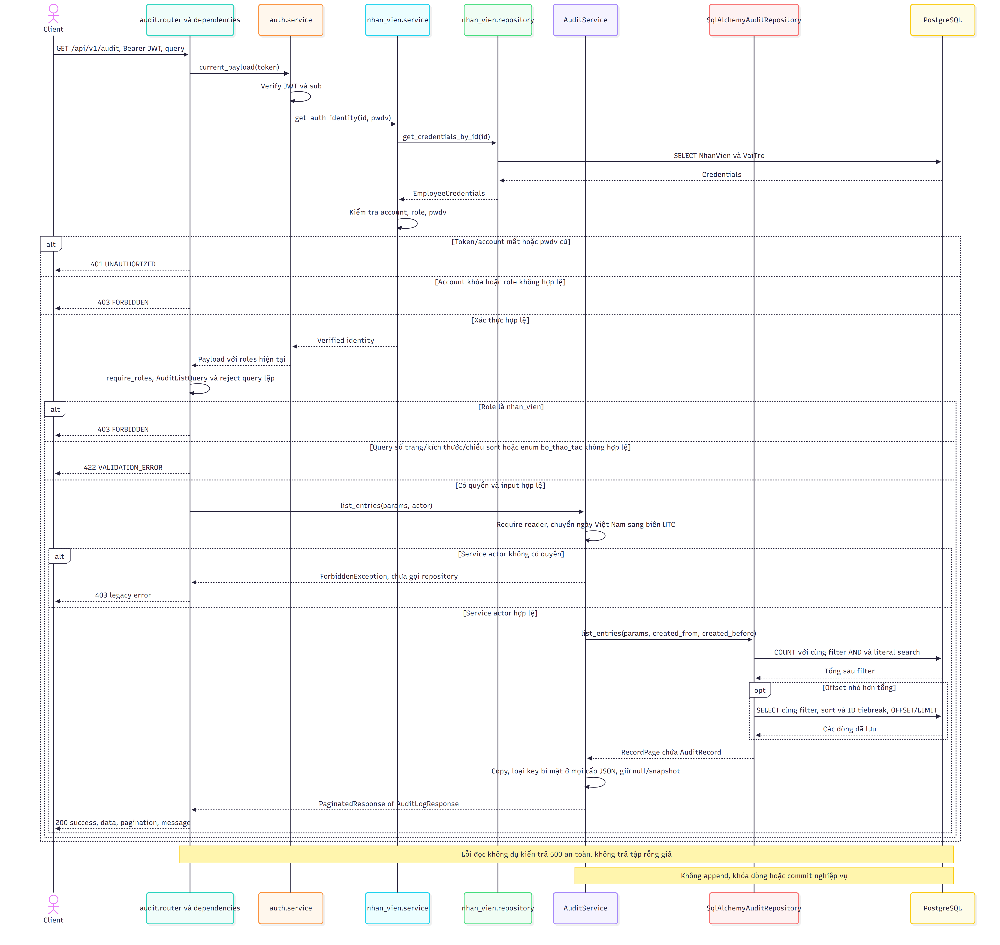
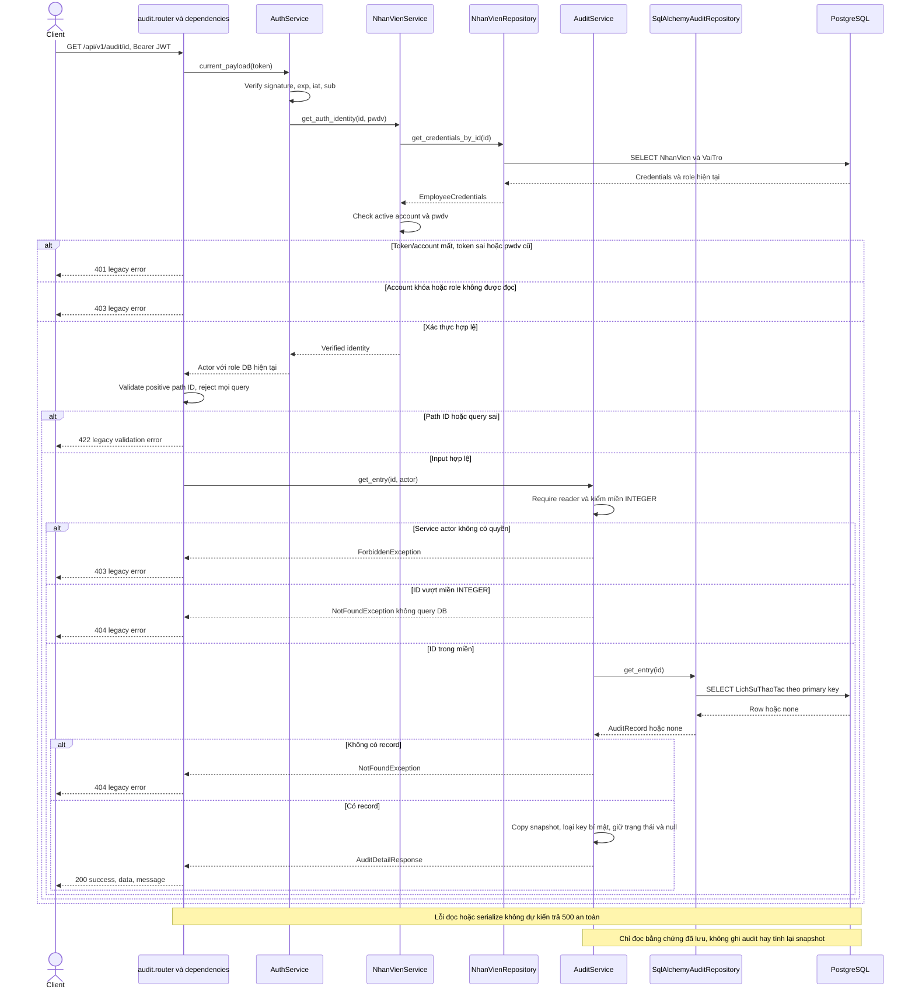
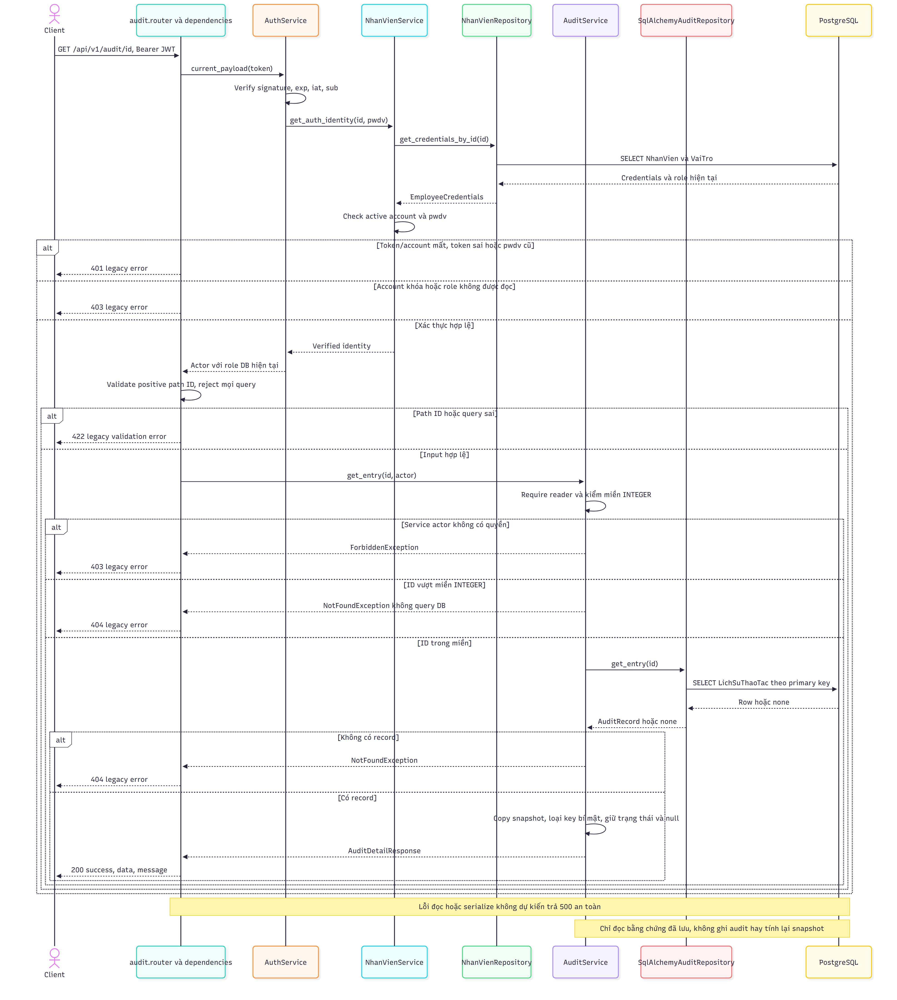

# Sequence diagram — audit / UC-43

Nguồn: [spec UC-43](../../specs/use_cases/audit/UC-43.md), [plan backend](../plans/UC-43.md), `audit/{router,service,repository,ports,schemas,models}.py`, `app/dependencies.py`, `auth/service.py`, `nhan_vien/{service,repository}.py`, `core/{persistence,exceptions}.py`.
Runtime: **Router → AuditService → AuditRepository (Protocol) → SqlAlchemyAuditRepository → PostgreSQL**. Spec dùng để truy vết/test, không được gọi lúc chạy. Audit sở hữu ORM `LichSuThaoTac` ánh xạ SQL v4; không có migration hoặc thay database đang chạy. API nội bộ `append` giữ caller transaction, không tự commit; không có HTTP ghi/sửa/xóa audit.

## GET /api/v1/audit — Danh sách lịch sử

Bearer JWT bắt buộc; chỉ `quan_tri_vien`, `quan_ly` được đọc, cùng scope và cùng snapshot đã loại bí mật. Query riêng audit: `page=1`, `page_size=20` (1–100), `search`, `sort_by=id|created_at` (mặc định created_at), `sort_order=asc|desc` (mặc định desc), `nhan_vien_id`, `loai_doi_tuong`, `doi_tuong_id`, `thao_tac`, `bo_thao_tac`, `tu_ngay`, `den_ngay`.

Filter AND trước COUNT/phân trang. Search literal không phân biệt hoa/thường trên loại/thao tác/lý do, không search JSON. ID tiebreak cùng chiều sort. Ngày YYYY-MM-DD quy về Asia/Ho_Chi_Minh: từ đầu ngày ≥ đến trước đầu ngày tiếp theo <; hỗ trợ một đầu. Từ ngày tối thiểu Python và đến ngày tối đa bị từ chối tránh overflow. Query lạ/lặp, ID/enum/sort/ngày/page sai trả 422. `bo_thao_tac` chấp nhận bộ mã loại trừ legacy (kể cả `thu_hoi_quyen`) nhưng không thêm các mã đó vào giá trị ghi v4; chọn và loại cùng một thao tác trả tập rỗng.

200 giữ `{success, data: [...], pagination: {page, page_size, total_items, total_pages, has_next, has_prev}, message}`. Trang vượt tổng trả tập rỗng, total vẫn đúng; thứ tự phân trang xác định với tập dữ liệu không đổi, không hứa ổn định khi có INSERT xen kẽ các request.

## GET /api/v1/audit/{id} — Chi tiết lịch sử

Bearer JWT, role và tài khoản được kiểm tra như danh sách. Detail không nhận query. Path phải integer > 0; sai cấu trúc trả 422. ID dương vượt miền INTEGER hoặc không có record trả 404. Không yêu cầu ETag/If-Match.

200: `{success: true, data: AuditLogResponse, message}`. Hai trường trạng thái, hai snapshot và lý do giữ null theo SQL. Danh sách thiếu đọc từ `du_lieu_sau.danh_sach_thieu`; không truy dữ liệu hiện tại để dựng lại lịch sử. Hai vai trò nhận cùng dữ liệu đã redaction.

## Transaction, lỗi và giới hạn

- Giữ lỗi audit legacy: 401/403/404/422 dạng `{success:false,error,timestamp}`, lỗi không dự kiến 500 dạng `{detail:"Internal Server Error"}`. Không trả tập rỗng giả khi DB lỗi. Khi request sai nhiều điều kiện, thứ tự validation/auth tùy dependency thực tế, không suy từ thứ tự sơ đồ.
- GET không có transaction ghi/khóa dòng và không gọi append/commit nghiệp vụ. Middleware hiện có có thể đếm request vào bảng kỹ thuật `LuuLuongTruyCap`, không vào lịch sử nghiệp vụ.
- `created_at` là TIMESTAMPTZ; hai snapshot JSONB(none_as_null=True). SQL v4 có ba index và trigger `trg_audit_bat_bien`; ORM create_all đơn thuần không tạo trigger này. HTTP POST/PUT/PATCH/DELETE không được đăng ký, trả 405; PostgreSQL chặn UPDATE/DELETE.
- Luồng ghi giữ `Service UC nguồn → AuditService.append → SqlAlchemyAuditRepository.append` cùng caller transaction; append không commit. Lỗi caller/flush/commit rollback cả nghiệp vụ và audit. Không refactor các producer khác trong UC-43.
- Redaction nhận key password/mat_khau/hash/token/authorization/cookie/secret/pwdv/credential_version và biến thể snake/camel/kebab case ở mọi cấp dict/mảng. `da_doi_mat_khau` là kết quả nghiệp vụ được giữ. Không sửa dữ liệu DB; không bảo đảm tìm được bí mật giấu trong field văn bản tự do có tên vô hại. UC nguồn vẫn phải tuân thủ BR-016 không lưu bí mật.
- Auth hiện dùng `pwdv` và role/trạng thái đọc lại DB; chưa nâng toàn auth sang `phien_ban_dang_nhap` v4. Các producer v3 với mã `ve_nhap`, `vo_hieu_hoa`, đối tượng `lenh_san_xuat`… vẫn là dependency ngoài phạm vi, chưa được xác nhận E2E với SQL v4.
- **Frontend UC-43 hoãn theo dev**; không khẳng định AC-19 giao diện đã đạt. Sequence này mô tả hai endpoint backend thực sự hiện có.
