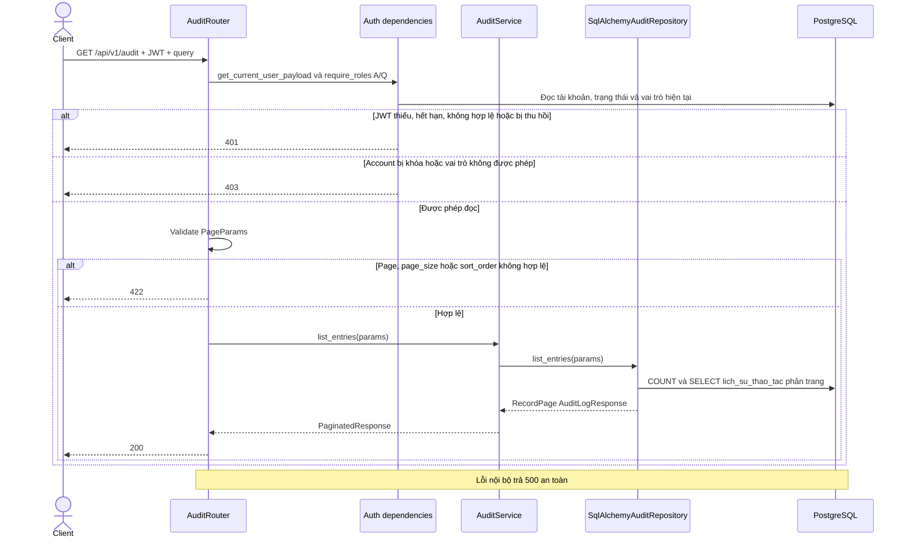

# Luồng module audit

## GET /api/v1/audit

Endpoint đọc lịch sử dành cho A/Q. PageParams: page>=1, page_size 1..100, search, sort_by, sort_order asc/desc. Giữ response `{success,data,pagination,message}`; không có ETag. Không ghi audit khi đọc lịch sử. Sort theo cột có thật, fallback id; COUNT và truy vấn trang không bảo đảm chung snapshot khi có ghi đồng thời.

## API nội bộ ghi audit

`AuditService.append(CreationAudit)` là phương thức nội bộ, không phải endpoint HTTP. Phiếu nhập gọi service này thay vì inject repository trực tiếp. AuditService chuyển tiếp append xuống repository dùng chung session của phiếu nhập. Repository thêm bản ghi vào session; transaction phiếu nhập flush/commit, hoặc rollback toàn bộ khi lỗi. AuditService không tự flush, commit, rollback hay mở session mới. Các endpoint ghi phiếu nhập được mô tả tại [phieu_nhap.md](phieu_nhap.md).
