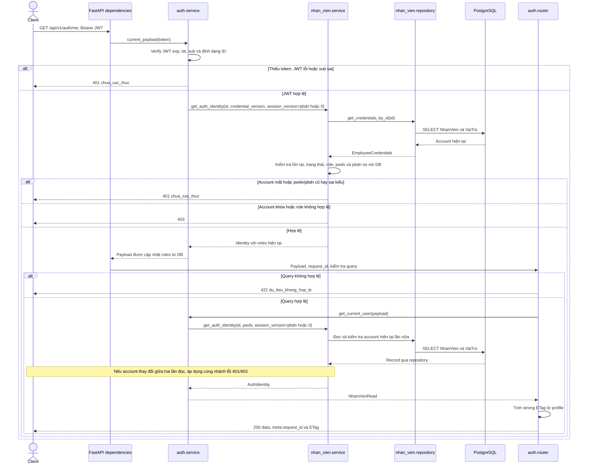

# Sequence diagram — auth

Nguồn: `auth/{router,schema,service}.py`, `nhan_vien/{service,ports,repository,schemas,models}.py`, `audit/{service,repository}.py`, `app/dependencies.py`, `core/{security,exceptions,sqlalchemy_transaction}.py`.
Auth gọi public service nhân viên; ORM `NhanVien`, `VaiTro` thuộc nhân viên, ORM `LichSuThaoTac` thuộc audit. Các repository dùng chung session theo request. Validation và authentication là dependency của FastAPI; không quy định thứ tự ưu tiên khi request đồng thời sai nhiều điều kiện.

Theo [UC-06](../../specs/use_cases/identity_access/UC-06.md), A3 và quyết định D1, JWT cấp mới mang `pbdn=NhanVien.phien_ban_dang_nhap`. Mỗi request cần xác thực so `payload.get("pbdn", 0)` với phiên bản DB; lệch hoặc claim không phải số nguyên trả 401 `chua_xac_thuc`, thông báo `Please sign in again`. Tài khoản đang khóa vẫn trả 403 `tai_khoan_bi_vo_hieu_hoa`. Khóa tăng phiên bản trong cùng transaction; mở khóa giữ nguyên, nên phiên trước khi khóa không dùng lại được. `pwdv` vẫn được kiểm tra như trước; hồ sơ response không lộ phiên bản đăng nhập.

## POST /api/v1/auth/dang_nhap

Nguồn use case: [UC-01 — Đăng nhập](../../specs/use_cases/identity_access/UC-01.md), Main 2–6, A1–A4.

JSON bắt buộc `ten_dang_nhap`, `mat_khau`; không nhận field dư hoặc query. Username trim, dài 1–255 ký tự; password không trim, dài 1–1024 ký tự.

```mermaid
sequenceDiagram
    actor C as Client
    participant R as auth.router
    participant A as auth.service
    participant N as nhan_vien.service
    participant P as nhan_vien.repository
    participant T as SqlAlchemyTransaction
    participant U as audit.service
    participant AP as audit.repository
    participant DB as PostgreSQL
    C->>R: POST /api/v1/auth/dang_nhap, JSON
    R->>R: Validate LoginInput, reject_query
    alt Input hoặc query không hợp lệ
        R-->>C: 422 du_lieu_khong_hop_le
    else Input hợp lệ
        R->>A: login(username, password)
        A->>N: authenticate_employee(username, password)
        N->>P: find_by_username(username)
        P->>DB: SELECT NhanVien và tải VaiTro
        DB-->>P: Record hoặc không tồn tại
        P-->>N: EmployeeCredentials hoặc None
        N->>N: Verify password trong worker thread
        alt Không có account hoặc sai password
            N-->>C: 401 thong_tin_dang_nhap_khong_hop_le
        else Account không hoạt động hoặc role không hợp lệ
            N-->>C: 403 tai_khoan_bi_vo_hieu_hoa hoặc khong_co_quyen
        else Xác thực thành công
            N-->>A: AuthIdentity, không có password hash
            A->>N: record_login(identity.profile.id)
            N->>T: Mở phạm vi transaction ghi audit
            N->>U: append(CreationAudit dang_nhap)
            Note over N,U: nhan_vien_id = doi_tuong_id = id đăng nhập; hai snapshot và ly_do null
            U->>AP: append(entry)
            AP->>AP: session.add(LichSuThaoTac)
            N->>T: Kết thúc phạm vi transaction
            T->>DB: Flush INSERT audit và COMMIT
            alt Append hoặc commit lỗi
                T->>DB: ROLLBACK
                Note over N,T: record_login chuyển ConflictException của adapter thành lỗi nội bộ
                R-->>C: 500 loi_noi_bo, không cấp token
            else Commit thành công
                T-->>N: Đã commit
                N-->>A: record_login hoàn tất
                A->>A: Ký JWT với sub, roles, pwdv, pbdn, iat, exp
                A-->>R: TokenRead
                R-->>C: 200 data và meta.request_id
            end
        end
    end
```

Response gồm `access_token`, `token_type=bearer`, `expires_in` tính bằng giây và `nhan_vien` là hồ sơ bản thân đầy đủ cho cả ba vai trò. Không fallback email ở endpoint này. Theo D-HD-01, ghi đúng một audit đăng nhập trong transaction riêng, commit xong mới cấp token; không ghi khi xác thực bị từ chối. JWT/hash/password không được đưa vào audit hoặc lỗi validation.

## POST /api/v1/auth/token

OAuth2 form gồm `username` (chỉ tên đăng nhập, không fallback email theo UC-01 R1/D1), `password`. Endpoint phục vụ Swagger/OAuth2, trả token trực tiếp, không có envelope/hồ sơ. Không áp dụng `reject_query` hoặc schema JSON của `dang_nhap` cho endpoint này.

```mermaid
sequenceDiagram
    actor C as Client hoặc Swagger
    participant R as auth.router
    participant A as auth.service
    participant N as nhan_vien.service
    participant P as nhan_vien.repository
    participant T as SqlAlchemyTransaction
    participant U as audit.service
    participant AP as audit.repository
    participant DB as PostgreSQL
    C->>R: POST /api/v1/auth/token, OAuth2 form
    R->>R: Validate OAuth2PasswordRequestForm
    alt Form không hợp lệ
        R-->>C: 422 du_lieu_khong_hop_le
    else Form hợp lệ
        R->>A: authenticate(identifier, password)
        A->>N: authenticate_employee(identifier, password)
        N->>P: find_by_username(identifier)
        P->>DB: SELECT NhanVien và VaiTro
        DB-->>P: Record hoặc None
        P-->>N: Credential record
        N->>N: Verify password, kiểm tra account và role
        alt Không có username hoặc sai password
            N-->>C: 401 thong_tin_dang_nhap_khong_hop_le
        else Account khóa hoặc role không hợp lệ
            N-->>C: 403
        else Hợp lệ
            N-->>A: AuthIdentity
            A->>N: record_login(identity.profile.id)
            N->>T: Mở phạm vi transaction ghi audit
            N->>U: append(CreationAudit dang_nhap)
            Note over N,U: nhan_vien_id = doi_tuong_id = id đăng nhập; hai snapshot và ly_do null
            U->>AP: append(entry)
            AP->>AP: session.add(LichSuThaoTac)
            N->>T: Kết thúc phạm vi transaction
            T->>DB: Flush INSERT audit và COMMIT
            alt Append hoặc commit lỗi
                T->>DB: ROLLBACK
                Note over N,T: record_login chuyển ConflictException của adapter thành lỗi nội bộ
                R-->>C: 500 loi_noi_bo, không cấp token
            else Commit thành công
                T-->>N: Đã commit
                N-->>A: record_login hoàn tất
                A->>A: Ký JWT có pwdv và pbdn từ identity
                A-->>R: TokenResponse
                R-->>C: 200 access_token, token_type, expires_in
            end
        end
    end
```

Chỉ tra cứu tên đăng nhập; không tra cứu hoặc fallback email. `/api/v1/auth/login` không được triển khai, trả 404.

Cả hai endpoint đăng nhập giữ response/header hiện hành. Append/commit lỗi trả 500 và không có `access_token`, kể cả lỗi CHECK được adapter transaction chuyển thành ConflictException. Volume tạo trước commit `2ef564c` có thể chưa cho phép `dang_nhap`; không tự ALTER/seed DB.

## GET /api/v1/auth/me

Bearer token bắt buộc; không nhận query. `ETag` là SHA-256 của JSON hồ sơ, không chứa `request_id`.



## Đăng xuất (UC-02)

Theo [UC-02 — Đăng xuất](../../specs/use_cases/identity_access/UC-02.md), D1a chỉ kết thúc phiên phía client, không có endpoint đăng xuất. Sau khi người dùng xác nhận, client xóa token khỏi `localStorage`, hủy truy vấn, xóa cache và chuyển về `/dang-nhap`; đóng hộp hỏi giữ nguyên phiên và trang hiện tại (A3). Khi mở lại trang cần đăng nhập, `Protected` chuyển về trang đăng nhập nếu không còn token, kể cả khi còn hồ sơ cũ trong bộ nhớ (R1, A1).

API cần đăng nhập vẫn kiểm tra token và tài khoản như `GET /api/v1/auth/me` ở trên: thiếu/hỏng/hết hạn token, phiên bản mật khẩu hoặc phiên bản đăng nhập cũ trả 401 `chua_xac_thuc` với `WWW-Authenticate: Bearer`; tài khoản khóa trả 403 `tai_khoan_bi_vo_hieu_hoa`. Client nhận 401 hoặc mã tài khoản khóa từ request có Bearer token sẽ kết thúc phiên; thao tác đăng xuất vẫn xóa phiên phía client khi token đã hết hiệu lực (A2). Không ghi lịch sử đăng xuất. Cơ chế `phien_ban_dang_nhap` được triển khai tại UC-06 D1/A3, thay lịch triển khai UC-07 trong quyết định D2 của plan UC-01; UC-07/UC-08 dùng lại khi đổi vai trò/đổi mật khẩu.

Giới hạn D1a: đăng xuất không thu hồi JWT trên server; token còn hạn đã được sao chép vẫn dùng được đến khi hết hạn (TTL hiện tại 60 phút), trừ khi bị từ chối bởi kiểm tra tài khoản, phiên bản mật khẩu hoặc phiên bản đăng nhập hiện có.

Theo [UC-08 — Đổi mật khẩu tài khoản](../../specs/use_cases/identity_access/UC-08.md), R3 và D1, endpoint tự đổi mật khẩu `POST /api/v1/auth/doi_mat_khau` đã gỡ; gọi lại trả 404. Trang Hồ sơ chỉ hiển thị thông tin nhân viên. Chỉ QTV đổi mật khẩu trong quản trị tài khoản qua `POST /api/v1/nhan_vien/{id}/dat_lai_mat_khau`, kể cả của chính mình, không cần mật khẩu hiện tại. Đổi mật khẩu tăng `phien_ban_dang_nhap` trong cùng UPDATE với hash và cùng transaction với audit `doi_mat_khau`; mọi token cũ bị 401 qua kiểm tra `pwdv`/`pbdn`. QTV tự đổi cũng kết thúc phiên và phải đăng nhập lại; API không cấp token mới.

Mọi response auth thành công/lỗi do handler auth xử lý có `Cache-Control: no-store`, `Pragma: no-cache`; lỗi 401 thêm `WWW-Authenticate: Bearer`. Exception không dự kiến được trả 500 an toàn; lỗi DB khi đọc không được đưa chi tiết nội bộ ra client. Đăng nhập thành công commit audit trong `record_login` trước khi cấp token; GET không ghi/commit. Dependency đóng session khi kết thúc request.
