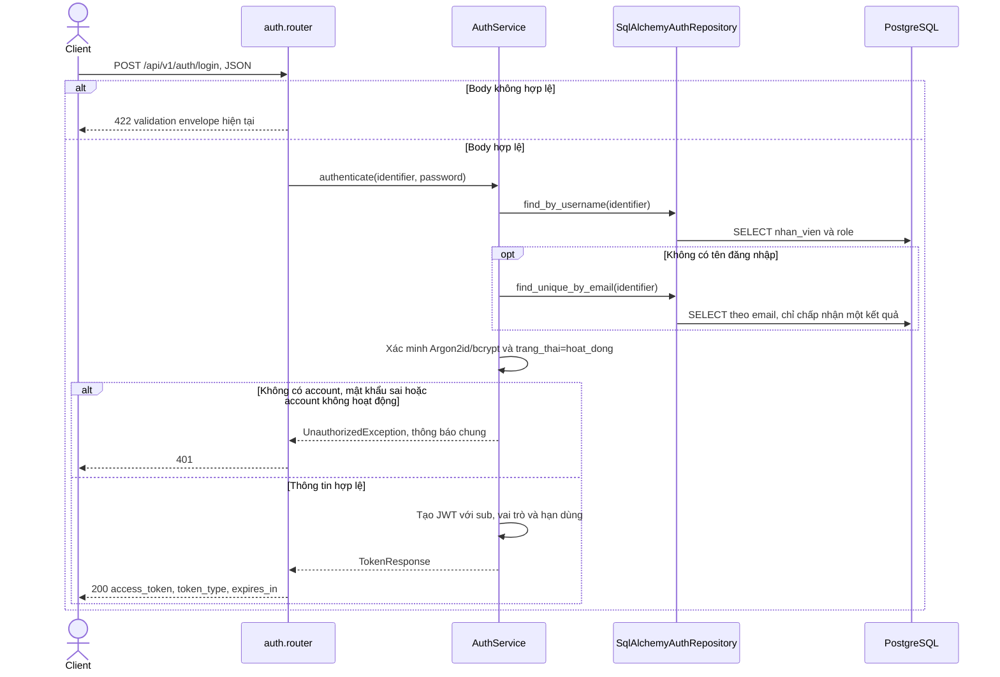
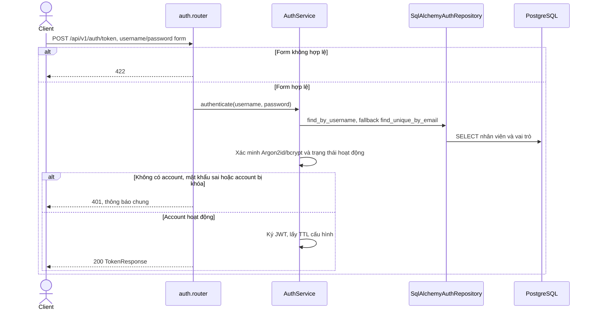
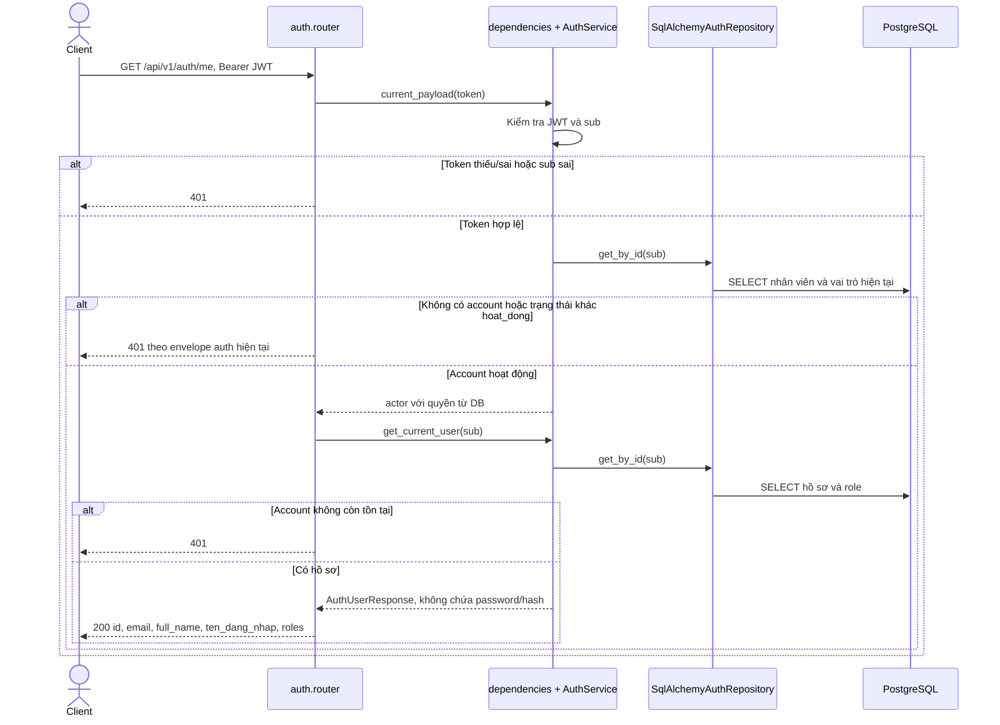

# Sequence diagram — auth

Nguồn: `modules/auth/{router,service,repository,schemas}.py`, `dependencies.py`, `core/security.py`.
Các endpoint auth hiện giữ đường dẫn và envelope đang triển khai; chưa có `/auth/dang_nhap`
hay `/auth/doi_mat_khau`. Mật khẩu mới dùng Argon2id, bộ xác minh vẫn nhận bcrypt cũ.

## POST /api/v1/auth/login — Đăng nhập JSON

Body hiện tại `{email, password}`; `email` được dùng như tên đăng nhập hoặc email.

## POST /api/v1/auth/token — Đăng nhập OAuth2 form

## GET /api/v1/auth/me — Hồ sơ xác thực hiện tại

Ba endpoint chỉ đọc dữ liệu, không có audit/transaction ghi. Quyền/trạng thái được đọc lại từ DB
trên mỗi request được bảo vệ; không tin quyền ghi sẵn trong JWT. Nhóm `/nhan_vien` và `/vai_tro`
dịch trạng thái account bị khóa thành 403 theo contract v2; auth giữ mã 401 hiện tại.
