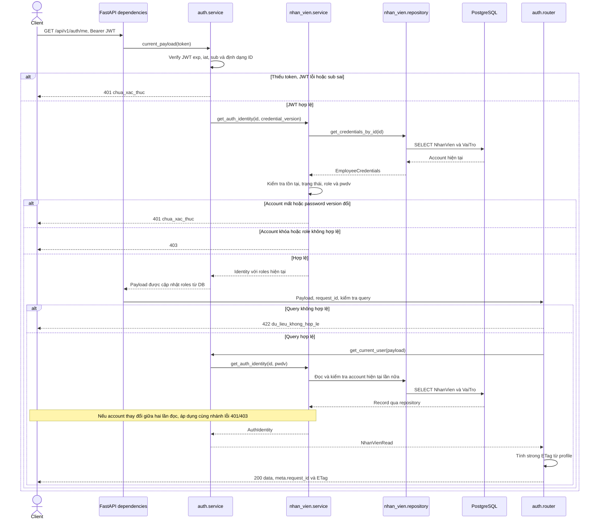
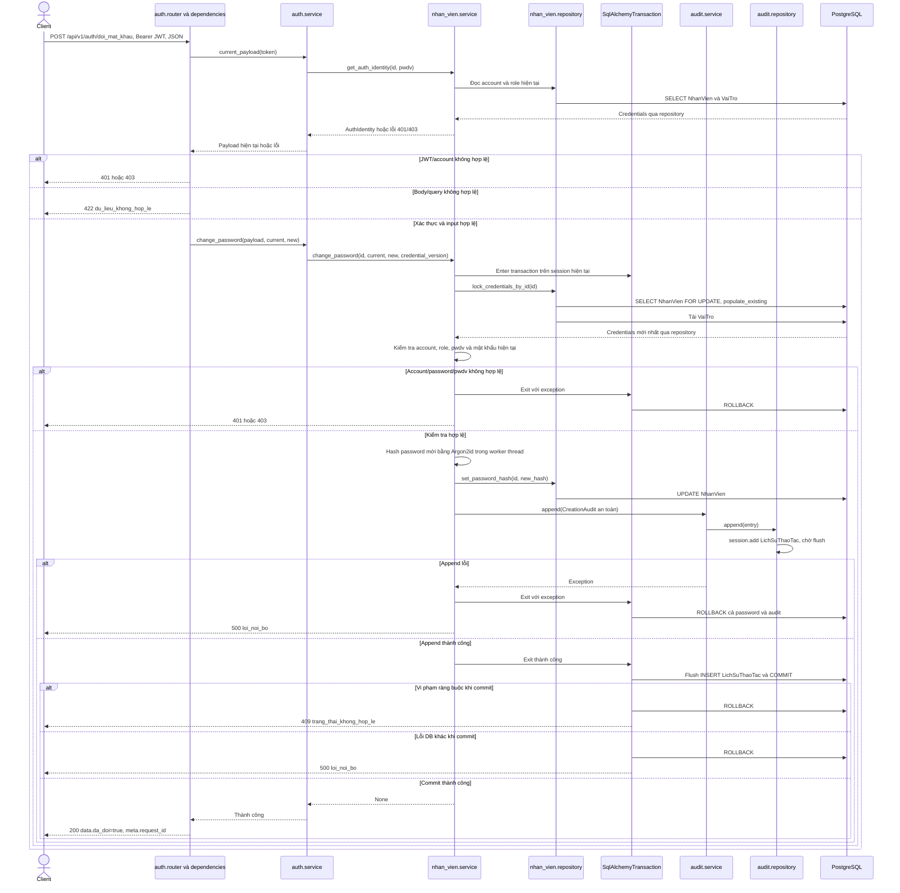

# Sequence diagram — auth

Nguồn: `auth/{router,schema,service}.py`, `nhan_vien/{service,ports,repository,schemas,models}.py`, `audit/{service,repository}.py`, `app/dependencies.py`, `core/{security,exceptions,sqlalchemy_transaction}.py`.
Auth gọi public service nhân viên; ORM `NhanVien`, `VaiTro` thuộc nhân viên, ORM `LichSuThaoTac` thuộc audit. Các repository dùng chung session theo request. Validation và authentication là dependency của FastAPI; không quy định thứ tự ưu tiên khi request đồng thời sai nhiều điều kiện.

## POST /api/v1/auth/dang_nhap

JSON bắt buộc `ten_dang_nhap`, `mat_khau`; không nhận field dư hoặc query. Username trim, dài 1–255 ký tự; password không trim, dài 1–1024 ký tự.

```mermaid
sequenceDiagram
    actor C as Client
    participant R as auth.router
    participant A as auth.service
    participant N as nhan_vien.service
    participant P as nhan_vien.repository
    participant T as SqlAlchemyTransaction
    participant U as audit.service
    participant AP as audit.repository
    participant DB as PostgreSQL
    C->>R: POST /api/v1/auth/dang_nhap, JSON
    R->>R: Validate LoginInput, reject_query
    alt Input hoặc query không hợp lệ
        R-->>C: 422 du_lieu_khong_hop_le
    else Input hợp lệ
        R->>A: login(username, password)
        A->>N: authenticate_employee(username, password)
        N->>P: find_by_username(username)
        P->>DB: SELECT NhanVien và tải VaiTro
        DB-->>P: Record hoặc không tồn tại
        P-->>N: EmployeeCredentials hoặc None
        N->>N: Verify password trong worker thread
        alt Không có account hoặc sai password
            N-->>C: 401 thong_tin_dang_nhap_khong_hop_le
        else Account không hoạt động hoặc role không hợp lệ
            N-->>C: 403 tai_khoan_bi_vo_hieu_hoa hoặc khong_co_quyen
        else Xác thực thành công
            N-->>A: AuthIdentity, không có password hash
            A->>N: record_login(identity.profile.id)
            N->>T: Mở phạm vi transaction ghi audit
            N->>U: append(CreationAudit dang_nhap)
            Note over N,U: nhan_vien_id = doi_tuong_id = id đăng nhập; hai snapshot và ly_do null
            U->>AP: append(entry)
            AP->>AP: session.add(LichSuThaoTac)
            N->>T: Kết thúc phạm vi transaction
            T->>DB: Flush INSERT audit và COMMIT
            alt Append hoặc commit lỗi
                T->>DB: ROLLBACK
                Note over N,T: record_login chuyển ConflictException của adapter thành lỗi nội bộ
                R-->>C: 500 loi_noi_bo, không cấp token
            else Commit thành công
                T-->>N: Đã commit
                N-->>A: record_login hoàn tất
                A->>A: Ký JWT với sub, roles, pwdv, iat, exp
                A-->>R: TokenRead
                R-->>C: 200 data và meta.request_id
            end
        end
    end
```

Response gồm `access_token`, `token_type=bearer`, `expires_in` tính bằng giây và `nhan_vien` là hồ sơ bản thân đầy đủ cho cả ba vai trò. Không fallback email ở endpoint này. Theo D-HD-01, ghi đúng một audit đăng nhập trong transaction riêng, commit xong mới cấp token; không ghi khi xác thực bị từ chối. JWT/hash/password không được đưa vào audit hoặc lỗi validation.

## POST /api/v1/auth/token

OAuth2 form gồm `username`, `password`. Endpoint phục vụ Swagger/OAuth2, trả token trực tiếp, không có envelope/hồ sơ. Không áp dụng `reject_query` hoặc schema JSON của `dang_nhap` cho endpoint này.

```mermaid
sequenceDiagram
    actor C as Client hoặc Swagger
    participant R as auth.router
    participant A as auth.service
    participant N as nhan_vien.service
    participant P as nhan_vien.repository
    participant T as SqlAlchemyTransaction
    participant U as audit.service
    participant AP as audit.repository
    participant DB as PostgreSQL
    C->>R: POST /api/v1/auth/token, OAuth2 form
    R->>R: Validate OAuth2PasswordRequestForm
    alt Form không hợp lệ
        R-->>C: 422 du_lieu_khong_hop_le
    else Form hợp lệ
        R->>A: authenticate(identifier, password)
        A->>N: authenticate_employee(..., allow_email=True)
        N->>P: find_by_username(identifier)
        P->>DB: SELECT NhanVien và VaiTro
        DB-->>P: Record hoặc None
        P-->>N: Credential record
        opt Không tìm thấy username
            N->>P: find_unique_by_email(identifier)
            P->>DB: SELECT tối đa 2 account cùng email
            DB-->>P: Kết quả
            P-->>N: Record nếu duy nhất, ngược lại None
        end
        N->>N: Verify password, kiểm tra account và role
        alt Không có record duy nhất hoặc sai password
            N-->>C: 401 thong_tin_dang_nhap_khong_hop_le
        else Account khóa hoặc role không hợp lệ
            N-->>C: 403
        else Hợp lệ
            N-->>A: AuthIdentity
            A->>N: record_login(identity.profile.id)
            N->>T: Mở phạm vi transaction ghi audit
            N->>U: append(CreationAudit dang_nhap)
            Note over N,U: nhan_vien_id = doi_tuong_id = id đăng nhập; hai snapshot và ly_do null
            U->>AP: append(entry)
            AP->>AP: session.add(LichSuThaoTac)
            N->>T: Kết thúc phạm vi transaction
            T->>DB: Flush INSERT audit và COMMIT
            alt Append hoặc commit lỗi
                T->>DB: ROLLBACK
                Note over N,T: record_login chuyển ConflictException của adapter thành lỗi nội bộ
                R-->>C: 500 loi_noi_bo, không cấp token
            else Commit thành công
                T-->>N: Đã commit
                N-->>A: record_login hoàn tất
                A->>A: Ký JWT có credential version
                A-->>R: TokenResponse
                R-->>C: 200 access_token, token_type, expires_in
            end
        end
    end
```

Username ưu tiên hơn email; nếu username tồn tại nhưng password sai thì không thử account khác qua email. Email trùng bị từ chối. `/api/v1/auth/login` không được triển khai, trả 404.

Cả hai endpoint đăng nhập giữ response/header hiện hành. Append/commit lỗi trả 500 và không có `access_token`, kể cả lỗi CHECK được adapter transaction chuyển thành ConflictException. Volume tạo trước commit `2ef564c` có thể chưa cho phép `dang_nhap`; không tự ALTER/seed DB.

## GET /api/v1/auth/me

Bearer token bắt buộc; không nhận query. `ETag` là SHA-256 của JSON hồ sơ, không chứa `request_id`.



## POST /api/v1/auth/doi_mat_khau

JSON gồm `mat_khau_hien_tai` dài 1–1024 và `mat_khau_moi` dài 8–1024 ký tự, giữ nguyên Unicode/khoảng trắng. Không nhận field dư/query; không cần If-Match. Payload xác thực được kiểm tra như `/me` trước khi gọi action.



Audit lưu `loai_doi_tuong=nhan_vien`, `thao_tac=sua`, `du_lieu_sau={da_doi_mat_khau: true}`; không lưu password/hash/token. Không phát token mới. Tất cả token có password version cũ bị từ chối ở request tiếp theo. Hai action đồng thời dùng cùng token được tuần tự hóa bằng khóa dòng; chỉ bên đầu tiên commit thành công, bên sau nhận 401.

Mọi response auth thành công/lỗi do handler auth xử lý có `Cache-Control: no-store`, `Pragma: no-cache`; lỗi 401 thêm `WWW-Authenticate: Bearer`. Exception không dự kiến được trả 500 an toàn; lỗi DB khi đọc không được đưa chi tiết nội bộ ra client. Đăng nhập thành công commit audit trong `record_login` trước khi cấp token; GET không ghi/commit. Dependency đóng session khi kết thúc request.
