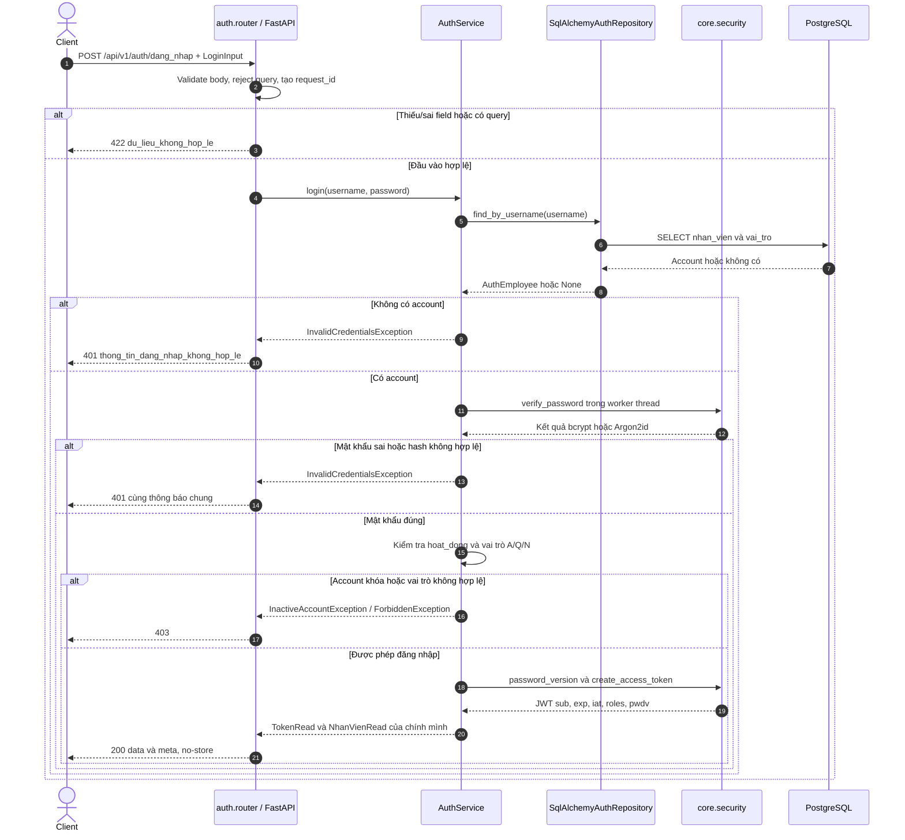
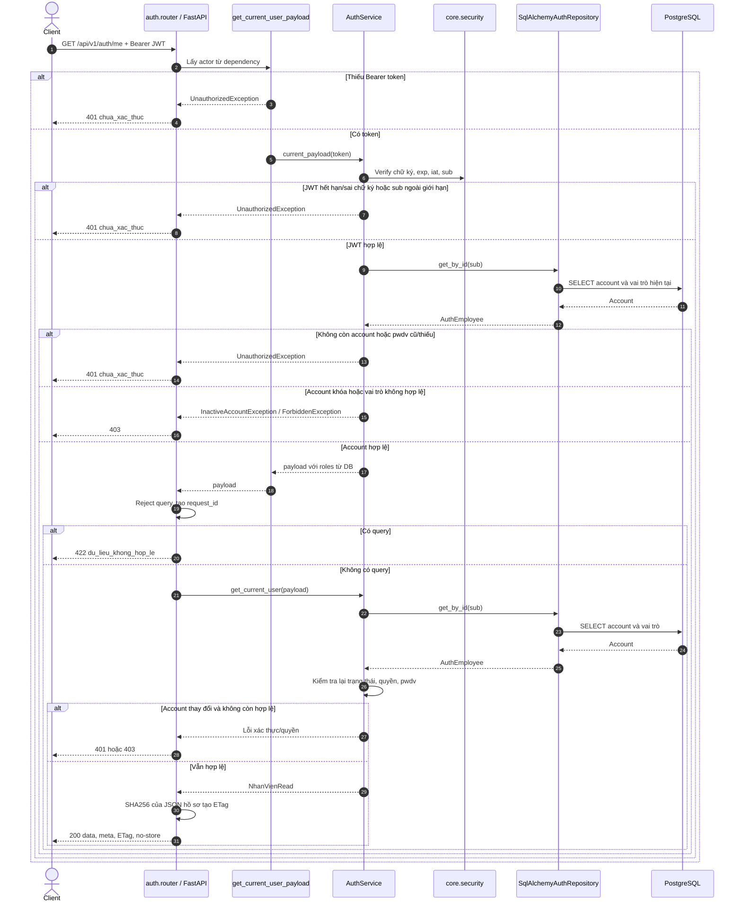
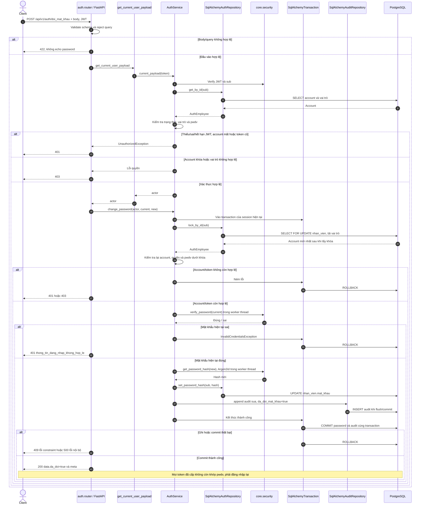
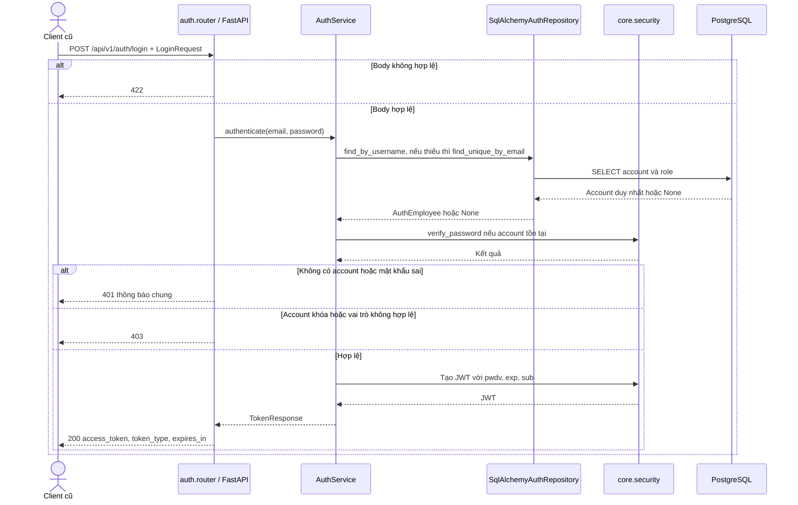
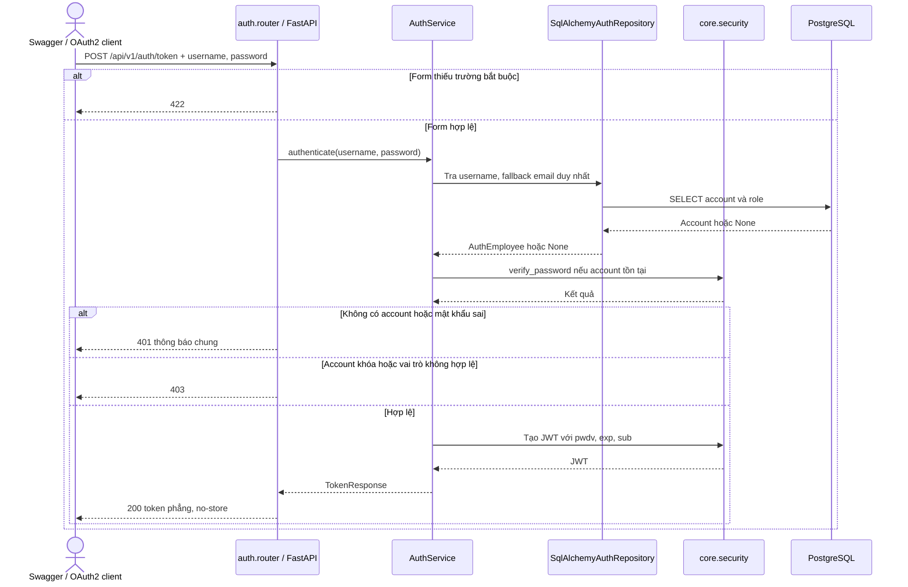

# Sequence diagram — auth

Nguồn: `backend/app/modules/auth/{router,service,schemas,ports,repository}.py`,
`app/dependencies.py`, `app/core/{security,exceptions,request_context,sqlalchemy_transaction}.py`,
ORM `users` và repository `audit`. Đối chiếu phần 2, 3, 4, 14 của
[API contract v2](https://drive.google.com/file/d/16hj1yTLvhQ4peRENCLjbCKhNdGy_L2Xz/view).

Quyết định dev xác nhận ngày 18/10/2026: theo contract v2 và ORM hiện tại;
JWT mặc định 60 phút; đổi mật khẩu vô hiệu hóa mọi token đã cấp;
đọc bcrypt cũ, ghi mật khẩu mới bằng Argon2id.

- Ba API contract trả `{data, meta: {request_id}}`; lỗi auth trả
  `{error: {code, message, details}, meta: {request_id}}`.
- Tất cả response auth có `Cache-Control: no-store`, `Pragma: no-cache`;
  lỗi 401 có `WWW-Authenticate: Bearer`. Validation trả 422 với `field`, `reason`,
  không chứa giá trị password/token hoặc input gốc.
- A/Q/N đều được dùng API của chính mình; quyền và trạng thái đọc lại từ DB.
  Account không hoạt động trả 403 `tai_khoan_bi_vo_hieu_hoa`; không có vai trò
  hợp lệ trả 403 `khong_co_quyen`.
- `pwdv` trong JWT là HMAC-SHA256 của password hash bằng khóa ký và tiền tố riêng,
  không phải hash mật khẩu gốc. Mọi request có xác thực so sánh với phiên bản
  hiện tại trong DB. Token thiếu `pwdv` hoặc phiên bản cũ trả 401.
- Password giữ nguyên khoảng trắng/Unicode, không trim; tối đa 1024 ký tự.
  Tên đăng nhập trim, từ 1 đến 255 ký tự. Không tự nâng hash bcrypt khi đăng nhập,
  nên thao tác đọc/login không ghi DB. Đổi mật khẩu mới ghi Argon2id.
- Thứ tự validation/auth có thể phụ thuộc dependency của FastAPI nếu request
  đồng thời sai đầu vào và xác thực. Không cam kết ưu tiên lỗi trong trường hợp này.

## POST /api/v1/auth/dang_nhap

Công khai. JSON `LoginInput`: `ten_dang_nhap`, `mat_khau` bắt buộc;
không nhận field dư hoặc query. Chỉ đăng nhập bằng tên đăng nhập ở endpoint mới.

`TokenRead` gồm `access_token`, `token_type: bearer`, `expires_in: 3600`
với cấu hình mặc định, `nhan_vien: NhanVienRead`. Không trả hash, `tai_khoan_id`
hoặc `loai_nhan_vien`. Lỗi DB/nội bộ trả 500 `loi_noi_bo`, không lộ SQL.

## GET /api/v1/auth/me

Bearer JWT bắt buộc; không nhận query. A/Q/N đều nhận hồ sơ đầy đủ của chính mình,
không áp dụng projection giao việc của endpoint danh sách nhân viên.

ETag bao trong dấu ngoặc kép và không chứa `meta.request_id`; chưa xử lý
`If-None-Match`/304. Không có phân trang, không sửa account, tồn kho hoặc audit.
Account đã xóa trả 401 vì đây là resource của người xác thực, không phải GET ID tùy ý.
Lỗi DB/nội bộ trả 500 với envelope auth.

## POST /api/v1/auth/doi_mat_khau

Bearer JWT và `DoiMatKhauInput` bắt buộc: `mat_khau_hien_tai`, `mat_khau_moi`.
Mật khẩu mới từ 8 đến 1024 ký tự; không nhận ID nhân viên/role/query trong request.
Không yêu cầu `If-Match` theo contract; xác minh mật khẩu hiện tại dưới khóa account.

Hai request đồng thời được tuần tự hóa bằng khóa dòng. Request thua cuộc đọc lại hash
mới và bị từ chối 401 trước khi ghi. Audit chỉ chứa ID, thao tác `sua` và cờ
`da_doi_mat_khau`; không lưu password/hash/JWT. Không sửa quyền hoặc dữ liệu kho.
Không trả token thay thế; client đăng nhập lại sau thành công.

## POST /api/v1/auth/login — endpoint tương thích

Giữ JSON `{email, password}` và response `TokenResponse` phẳng để tương thích.
`email` có thể là tên đăng nhập hoặc email duy nhất. Áp dụng trạng thái/quyền,
JWT có `pwdv`, no-store và error envelope auth như endpoint mới.

Không ghi dữ liệu. Lỗi DB/nội bộ trả 500; endpoint cũ không áp dụng reject query.

## POST /api/v1/auth/token — OAuth2 cho Swagger

Giữ form `application/x-www-form-urlencoded`: `username`, `password` theo
`OAuth2PasswordRequestForm`. Response token phẳng để nút Authorize của Swagger dùng được.

Không ghi dữ liệu. Lỗi DB/nội bộ trả 500; endpoint cũ không áp dụng reject query.
