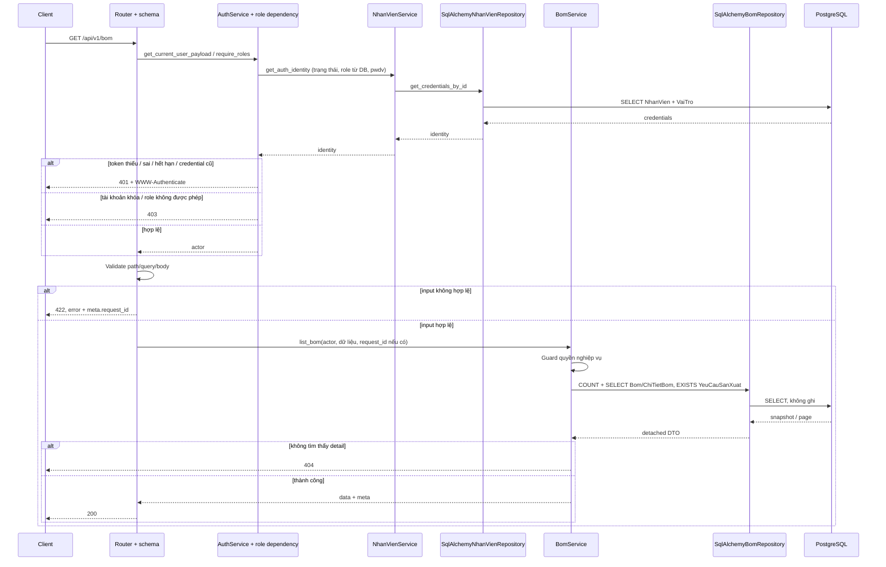
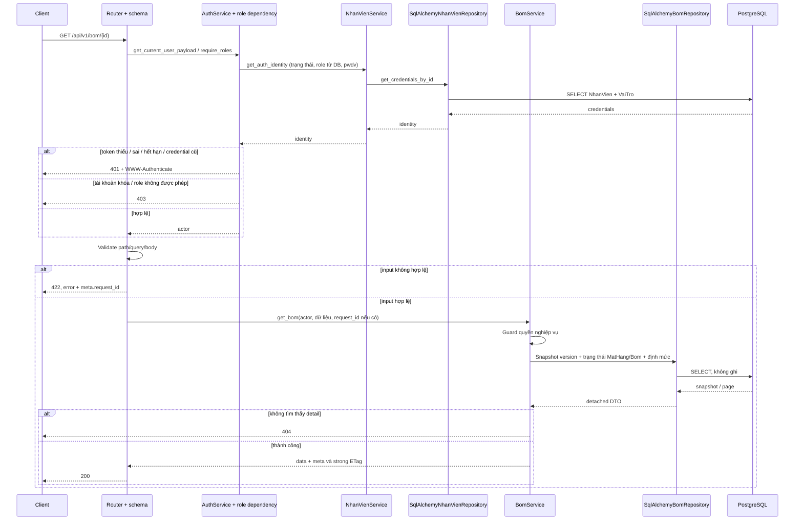
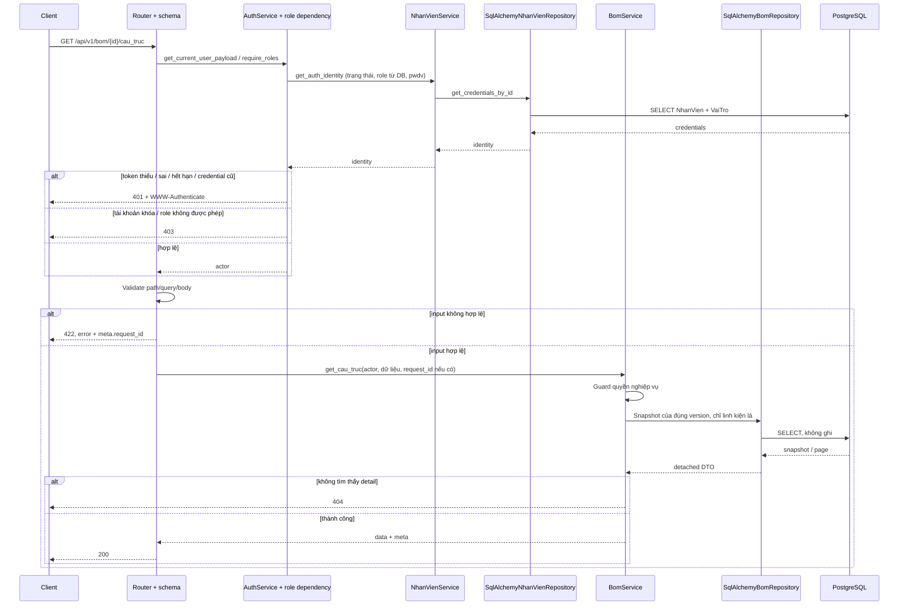
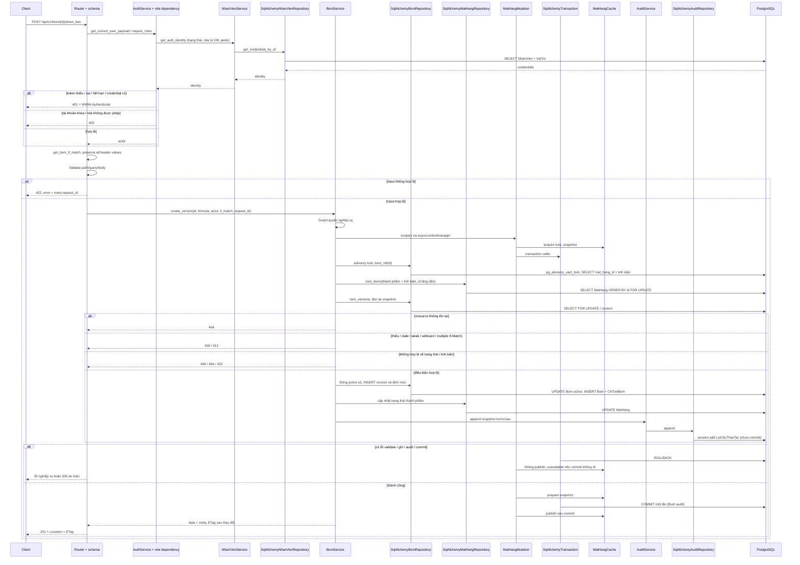
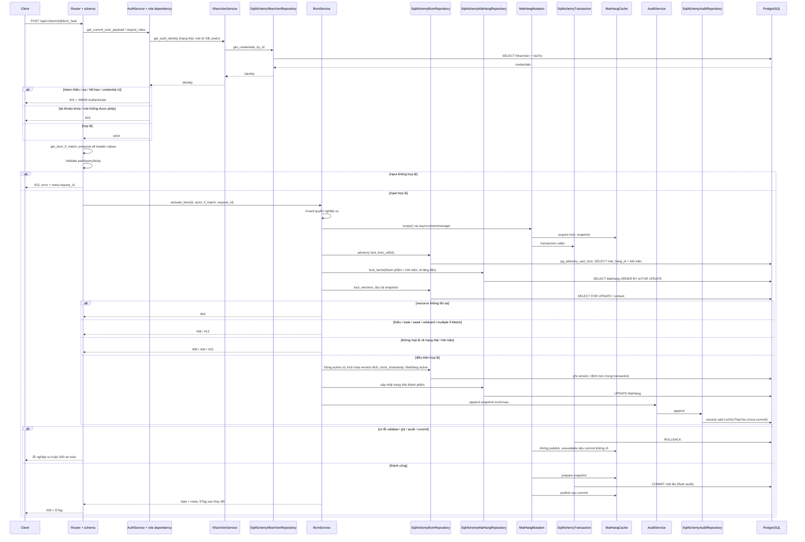
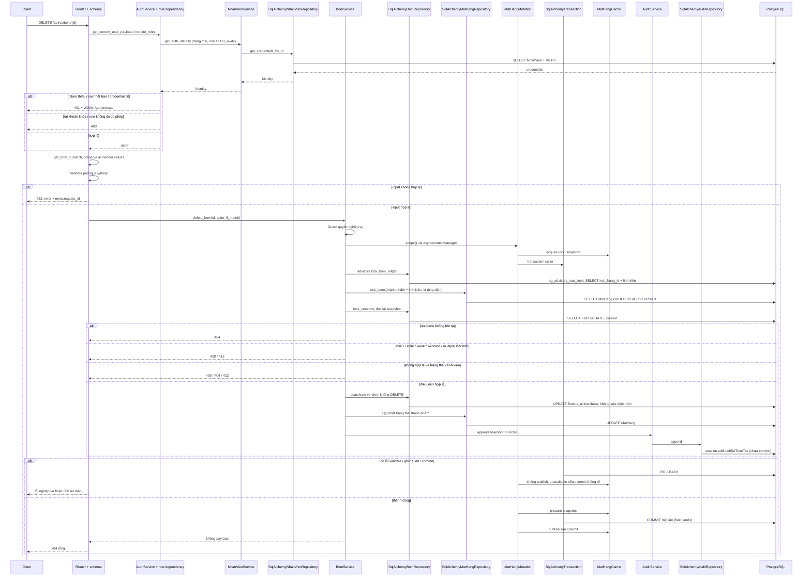

# Sequence — bom

Backend UC-15–19 theo [spec](../../specs/use_cases/bom/README.md). Chỉ mô tả endpoint đã triển khai. `POST /api/v1/bom` cũ đã gỡ (405); v1 chỉ tạo cùng thành phẩm tại UC-10/16, xem [mat_hang](mat_hang.md).

QLK=`quan_ly`, NV=`nhan_vien`; QTV không truy cập BOM. Auth kiểm tra account/role từ DB mỗi request theo cơ chế hiện tại. Không refactor auth hoặc sản xuất v4 trong tác vụ này.

GET list mặc định page=1/page_size=20 (max 100), lọc AND theo mat_hang_id/version/is_active; sort whitelist v4, ID là khóa phụ. GET detail trả strong ETag bao gồm version được đọc và trạng thái hiện tại của công thức; dùng tag cùng ID cho ba mutation. Cây cấu trúc chỉ một cấp, không ETag dùng cho mutation.

Tất cả mutation dùng một session/transaction chung cho MatHang, Bom, ChiTietBom và audit; thứ tự cache lock → advisory lock → item → version. Cache publish sau commit, lỗi commit không chắc chắn làm cache unavailable. Không đổi tồn/giữ hàng/ledger/yêu cầu đã chốt.

Rà soát 14/11/2026 theo T04/T06/T07/T09: `MatHangMutation.scope()` dùng
`@asynccontextmanager` để các service vào/ra transaction đúng bằng `async with`.
Dependency `get_bom_if_match` chỉ gom mọi giá trị header, kể cả các header vật lý
lặp tên, rồi chuyển xuống service. `verify_if_match` vẫn so sánh sau khi khóa và đọc
lại resource: thiếu/rỗng 428, stale/weak/wildcard/nhiều giá trị 412. Không lấy riêng
header đầu tiên; không đổi cách xử lý header của các module khác.

## GET /api/v1/bom

UC-15; quyền QLK / NV. Đầu vào: BomListQuery; reject duplicate query / body. [PNG](assets/bom/bom-1.png).

## GET /api/v1/bom/{id}

UC-15; quyền QLK / NV. Đầu vào: ID positif; không query/body. [PNG](assets/bom/bom-2.png).

## GET /api/v1/bom/{id}/cau_truc

UC-15; quyền QLK / NV. Đầu vào: ID positif; không query/body. [PNG](assets/bom/bom-3.png).

## POST /api/v1/bom/{id}/phien_ban

UC-17; quyền QLK. Đầu vào: BomFormula; If-Match của GET cùng ID. [PNG](assets/bom/bom-4.png).

## POST /api/v1/bom/{id}/kich_hoat

UC-18; quyền QLK. Đầu vào: Body {} bắt buộc; If-Match của GET cùng ID. [PNG](assets/bom/bom-5.png).

## DELETE /api/v1/bom/{id}

UC-19; quyền QLK. Đầu vào: Không query/body; If-Match của GET cùng ID. [PNG](assets/bom/bom-6.png).

