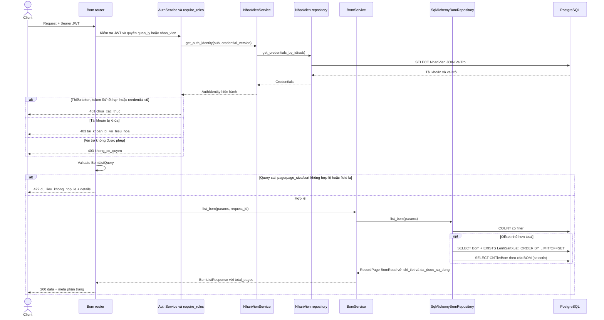
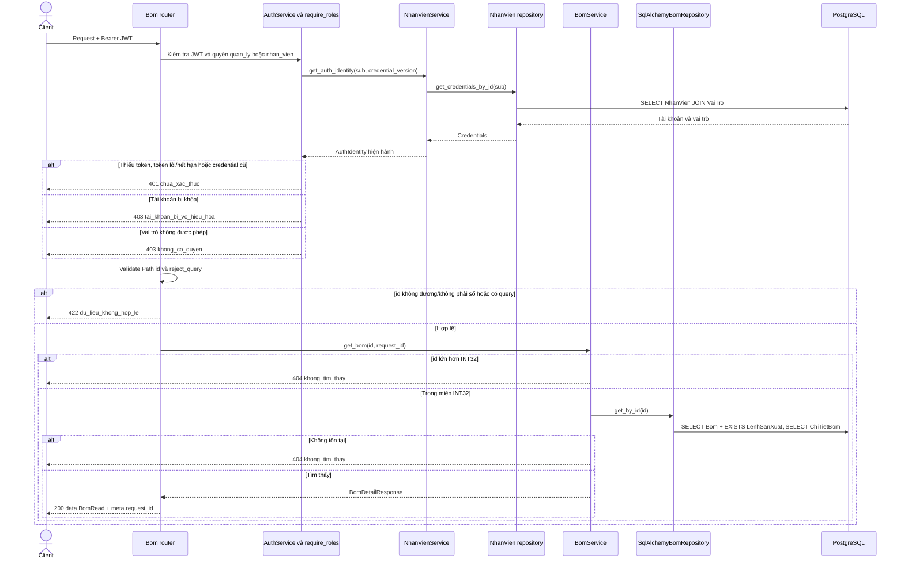
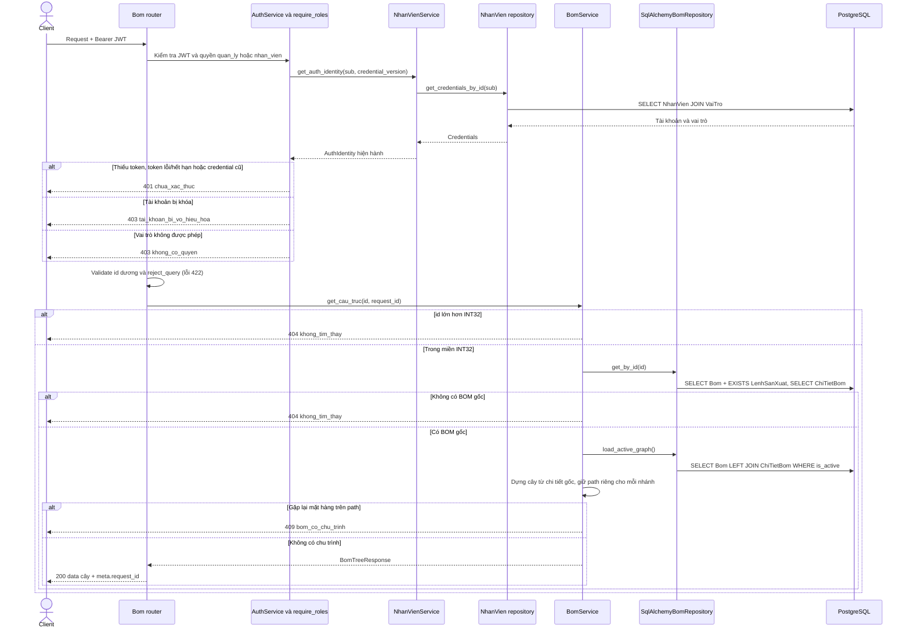
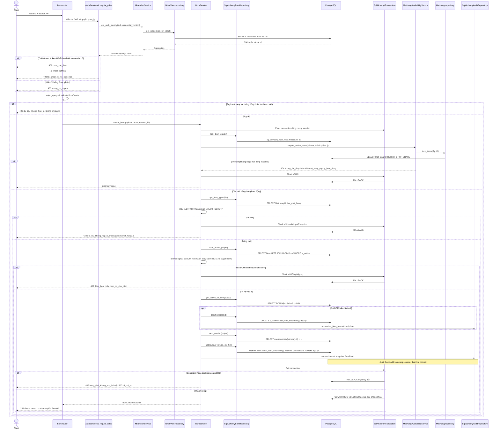
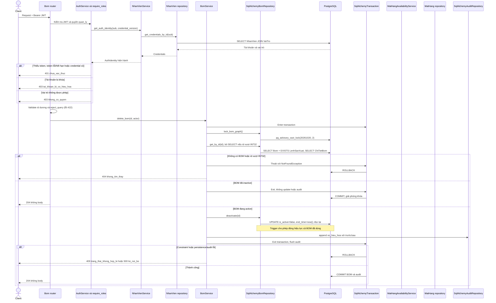
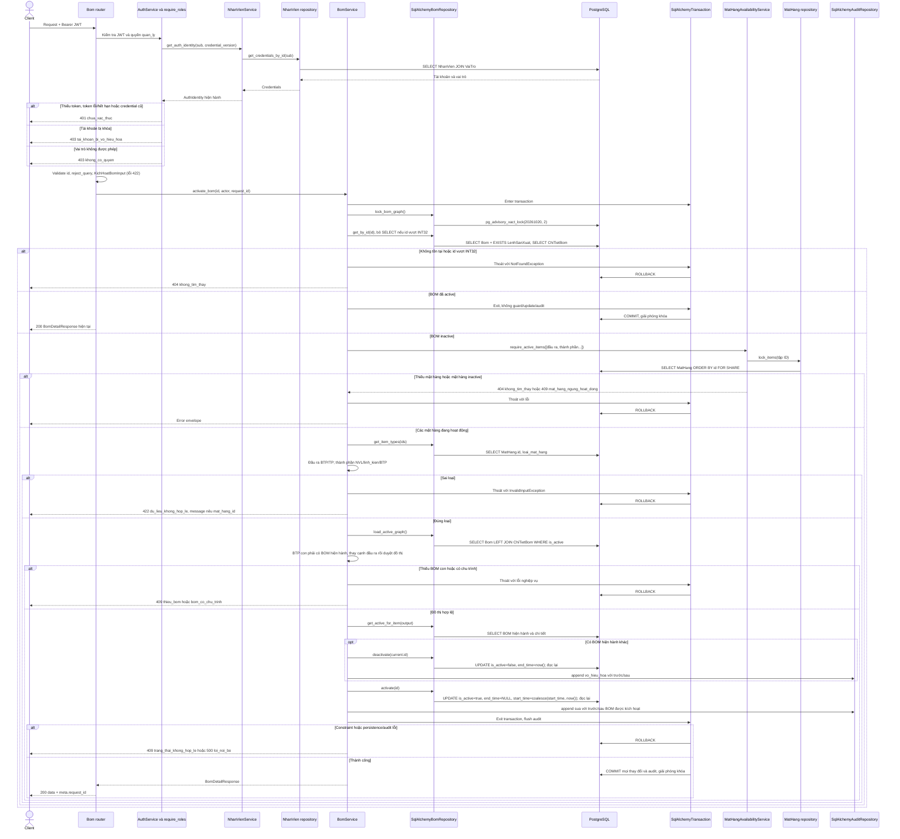

# Sequence — bom

Module có 6 endpoint theo contract v2 §6 và các quyết định [D-BOM-01 đến D-BOM-12](../DECISION.md#module-bom-chốt-ngày-02112026). Các ngoại lệ so với contract nằm tại [D-BOM-10](../DECISION.md#d-bom-10-điểm-lệch-so-với-contract-v2-6): POST tạo version active ngay; không có PATCH; không ETag/If-Match; DELETE là xóa mềm kể cả BOM đã dùng; tự tham chiếu trả 422, chu trình gián tiếp trả 409.

Đọc cho `quan_ly`/`nhan_vien`; ghi chỉ `quan_ly`. `quan_tri_vien` nhận 403 ở cả 6 endpoint. Auth đọc danh tính, trạng thái và credential hiện hành qua public `NhanVienService`; nhân viên service dùng repository của chính module đó. Không có projection khác nhau giữa hai vai trò được đọc BOM.

Response thành công có `{data, meta: {request_id}}`; list bổ sung `page`, `page_size`, `total`, `total_pages`. Lỗi ứng dụng/validation có `{error: {code, message, details}, meta: {request_id}}`. Lỗi constraint trong transaction được chuyển thành 409 `trang_thai_khong_hop_le`; lỗi bất ngờ là 500 `loi_noi_bo`. Gọi PATCH nhận 405 mặc định FastAPI, không thuộc error envelope này.

Mọi ghi dùng chung session/transaction với audit, giữ `pg_advisory_xact_lock(20261020, 2)` tới COMMIT/ROLLBACK. POST và kích hoạt BOM inactive kiểm tra đầu ra và thành phần bằng `MatHangAvailabilityService` (`FOR SHARE`, thứ tự ID), loại mặt hàng, BOM con và chu trình trước khi đóng BOM hiện hành. DELETE và kích hoạt BOM đã active không chạy lại guard. Không cập nhật tồn kho hoặc sửa chi tiết công thức.

## GET /api/v1/bom

Query: `page` ≥ 1 (mặc định 1), `page_size` 1–100 (mặc định 20); filter `mat_hang_id`, `version`, `is_active`; sort `id`, `version`, `start_time` và tiền tố `-`. Tham số lạ bị từ chối. ID làm tiêu chí phụ; trang ngoài phạm vi trả data rỗng. Không có nhánh 404 cho danh sách.

## GET /api/v1/bom/{id}

`id` phải dương; lớn hơn INT32 hoặc không tồn tại trả 404. Không nhận query. `da_duoc_su_dung` được tính bằng EXISTS trên bảng SQL `"LenhSanXuat"`, không dùng ORM production cũ. BOM inactive và mặt hàng bị khóa vẫn đọc được lịch sử.

## GET /api/v1/bom/{id}/cau_truc

Gốc dùng đúng chi tiết của version được chọn, kể cả inactive. BOM con tra hiện hành tại thời điểm đọc; node thiếu BOM con trả `bom_id: null`, `children: []`. Số lượng node là định mức trên một đơn vị cha, không nhân dồn. Đây là cấu trúc công thức, không phải kế hoạch đã chốt của lệnh sản xuất.

## POST /api/v1/bom

`BomCreate` chỉ nhận `mat_hang_id` và `chi_tiet` không rỗng; từng dòng có ID dương, số lượng integer > 0. Field thừa, dòng trùng và tự tham chiếu trả 422 trước khi ghi DB; lỗi trùng/tự tham chiếu có `details[].field=chi_tiet` và chỉ số dòng (từ 0). Server cấp version tăng dần theo đầu ra. Đóng cũ trước khi insert mới để không vi phạm partial unique index. Thành công trả 201 và `Location`.

## DELETE /api/v1/bom/{id}

Xóa mềm cho cả BOM đã được lệnh sử dụng; không xóa Bom/ChiTietBom hoặc quan hệ của lệnh. BOM đã inactive trả 204 và không thêm audit. Không yêu cầu If-Match; không kiểm tra trạng thái mặt hàng hoặc BOM cha.

## POST /api/v1/bom/{id}/kich_hoat

Body `{}` tùy chọn; field thừa bị từ chối. Kích hoạt một BOM đã active trả 200 và không ghi audit. Khi mở lại, `start_time` giữ nguyên (nếu null mới gán now); `end_time=NULL`. Việc này tương thích trigger bảo vệ BOM đã dùng. Audit lưu toàn bộ lịch sử đóng/mở. BOM cũ có cạnh tự trỏ trả 409 `bom_co_chu_trinh`, kể cả đầu ra chưa có version hiện hành khác.

