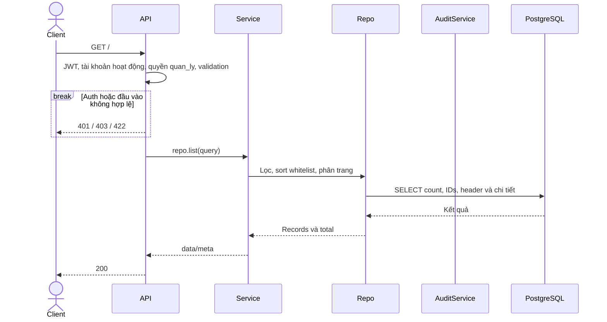
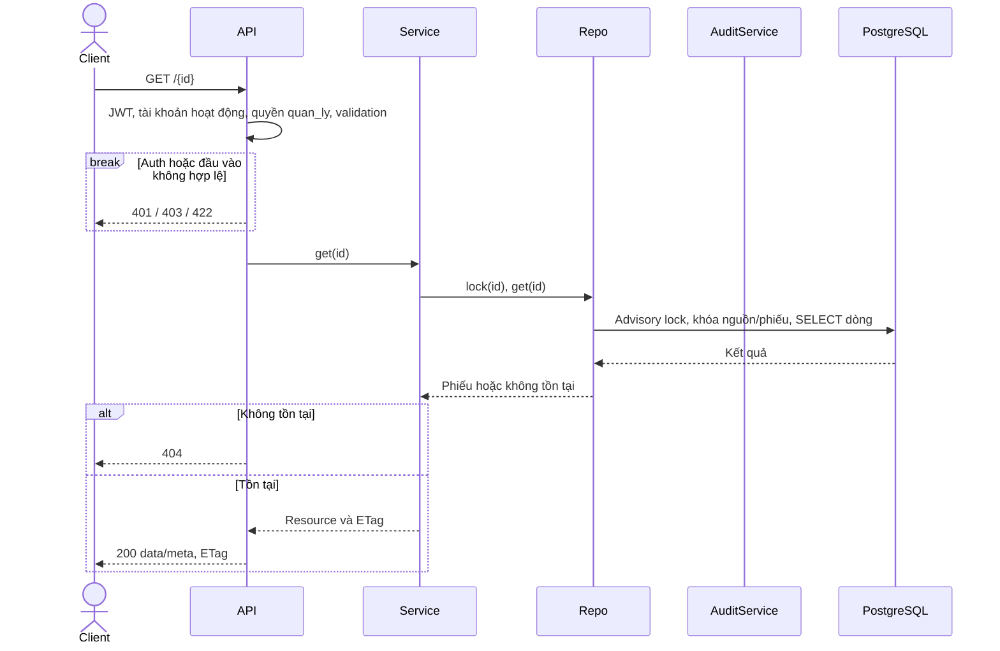
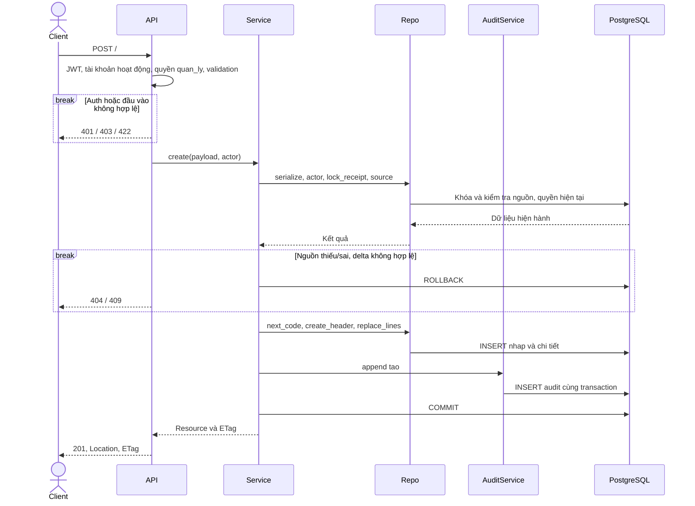
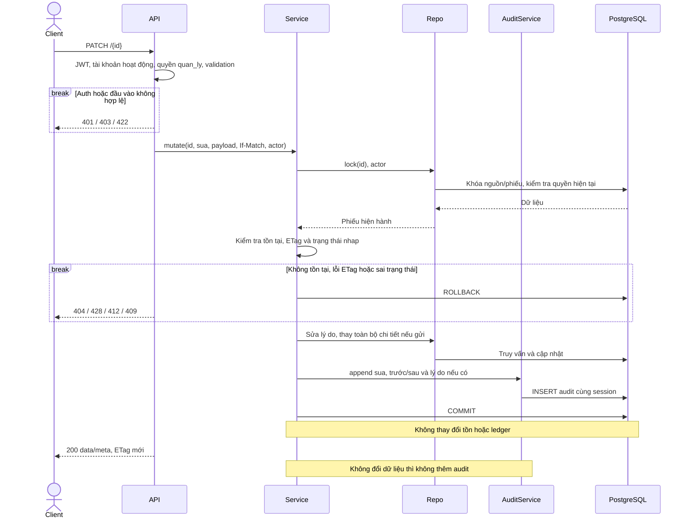
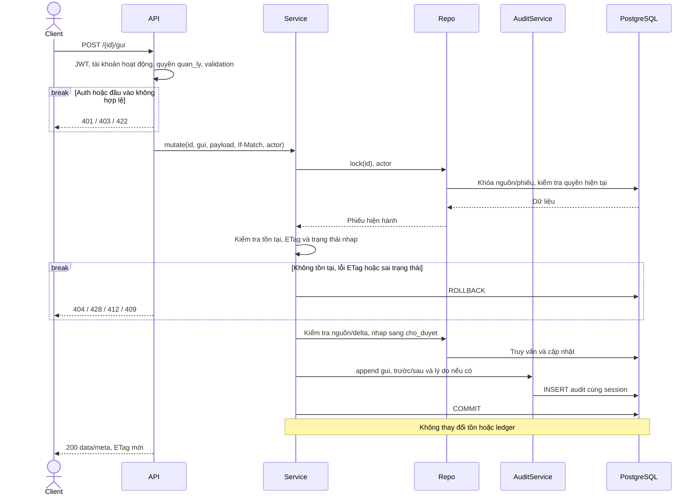
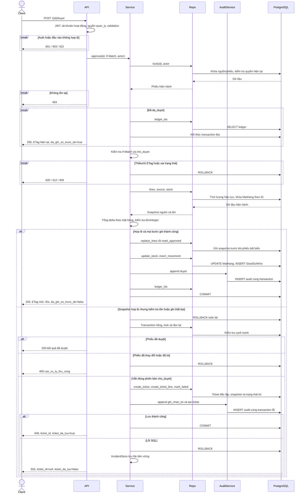
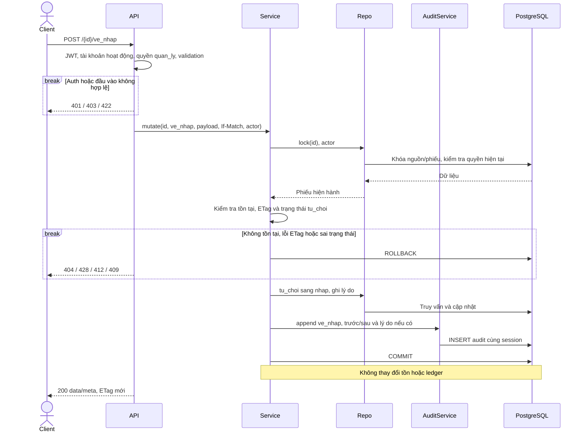

# Điều chỉnh kho

Nguồn: contract v2 dev cung cấp và xbike_mrp_data_model_v3.1_mermaid.md. Quyết định 03/11/2026: giữ 9 endpoint, chỉ quan_ly, dùng so_luong_dung, ticket độc lập, phiếu loi bất biến. Đây là luồng đã triển khai trong backend/app/modules/dieu_chinh_kho.

## Payload và response

POST tạo nhận `{"phieu_nhap_id":1,"ly_do":"Đối chiếu","chi_tiet":[{"giao_dich_goc_id":12,"so_luong_dung":986}]}`. PATCH chỉ nhận ly_do và chi_tiet; bỏ qua giữ nguyên, null bị từ chối; array thay toàn bộ. Gửi/duyệt nhận `{}`; từ chối/về nháp nhận `{"ly_do":"Lý do"}`. ID dòng, mặt hàng, lượng trước, biến động, mã, người tạo và thời gian do server xác định. ID dương, số lượng đúng nguyên không âm; không nhận bool/số lẻ, dòng trùng nguồn, array rỗng, lý do trắng hoặc field dư (422).

Chỉ sửa giao dịch nhap_vat_tu của đúng phiếu nhập hoan_thanh, mặt hàng NVL/linh kiện. Lượng hiệu lực = lượng nhập gốc + điều chỉnh đã ghi ledger. Delta = lượng đúng - lượng hiệu lực. Delta bằng 0/ngoài miền integer trả 409 trước ghi kho và ticket. Server tính lại dưới khóa khi duyệt.

Danh sách: q tìm mã phiếu; trang_thai, nhan_vien_id, tu_ngay, den_ngay; page mặc định 1, page_size mặc định 20/tối đa 100; sort id/created_at/ma_phieu với tiền tố -; ID làm tiêu chí phụ. Query dư, sort sai/ngày đảo trả 422. Ngày Asia/Ho_Chi_Minh đổi thành UTC [đầu ngày, đầu ngày sau). Response data/meta gồm request_id, page, page_size, total, total_pages.

GET chi tiết trả strong ETag bao gồm header và dòng; confirmed_at null được giữ. PATCH/DELETE/action so ETag dưới khóa, thiếu 428, cũ/weak/wildcard 412. Chỉ duyệt đã thành công được trả kết quả cũ trước kiểm tra ETag: giao_dich_kho_ids, da_ghi_so_truoc_do=true. Lần ghi sổ mới trả false. POST tạo trả 201 với Location; DELETE 204; còn lại 200. Một resource trả data/meta.request_id; action fields nằm cùng cấp data/meta.

## Transaction và ticket

Mutation dùng cùng session với AuditService; lỗi luôn rollback. Advisory transaction lock 73421 tuần tự hóa module, sau đó khóa phiếu nhập, phiếu điều chỉnh và MatHang theo ID tăng dần. Kiểm tra lại quyền quản lý sau chờ khóa. GET chi tiết giữ khóa để đọc header/dòng cùng phiên bản. Repository dùng SQL tham số hóa trên bảng PascalCase, không tạo ORM trùng legacy inventory. Nghiệp vụ module cũ không chuyển đổi.

DCK/TKDC dùng sequence identity không rollback, không tái dùng mã sau xóa nháp; hậu tố giới hạn 6 chữ số, dùng sequence toàn cục không reset theo tháng.

Ticket chỉ tham chiếu phiếu nhập, không FK tới phiếu điều chỉnh. DieuChinhRead không có ticket_id; response lỗi của lần thất bại có ticket_id khi đã commit. Không tự đóng/mở ticket; API quản lý ticket ngoài phạm vi 9 endpoint. /tu_choi chỉ cho_duyet, /ve_nhap chỉ tu_choi. Phiếu loi và da_duyet bất biến.

Nguồn/delta không hợp lệ ở tạo/sửa/gửi hoặc trước khi lập snapshot duyệt trả 404/409 không tạo ticket. Khi có snapshot hợp lệ mà kiểm tra tồn/ghi kho/audit thất bại: rollback kho, mở transaction riêng và kiểm tra lại phiên bản. Phiếu đã duyệt trả kết quả cũ; phiếu đã đổi trả 409 can_xu_ly_thu_cong. Nếu vẫn cho_duyet đúng phiên bản thì ghi ticket, mọi dòng snapshot, trạng thái loi và audit; commit rồi trả 409 dieu_chinh_khong_hop_le, ticket_da_luu=true. Lỗi SQL chưa có snapshot trả 503.

Nếu transaction lưu ticket lỗi SQL, snapshot được ghi file bằng fsync và atomic rename. DIEU_CHINH_INCIDENT_DIR chọn thư mục bền vững, mặc định .runtime/dieu_chinh_kho theo working directory; container cần mount đường dẫn này vào volume bền vững. Khi database phục hồi, chạy từ backend:

```sh
python -m app.modules.dieu_chinh_kho.incidents
```

Lệnh chỉ lưu lại ticket, không chạy lại duyệt hoặc đổi tồn. File được xóa sau lưu ticket thành công hoặc phát hiện phiếu đã duyệt; phiên bản khác/phiếu loi cần đối soát thủ công. Không suy đoán liên kết ticket từ phiếu nhập. Nếu cả database và ổ lưu sự cố đều hỏng, không bảo đảm lưu được snapshot; lỗi ổ đĩa được giữ để giám sát phát hiện.

## Sequence

API gồm router và dependency auth/validation. S là DieuChinhService, R là repository, U là AuditService. Lỗi SQL trả 503 bằng route handler; lỗi khác ngoài dự kiến trả 500 handler chung. Các nhánh ghi chỉ trả thành công sau COMMIT.

### API-73 — GET /api/v1/phieu_dieu_chinh_kho

Danh sách.



### API-74 — GET /api/v1/phieu_dieu_chinh_kho/{id}

Chi tiết.



### API-75 — POST /api/v1/phieu_dieu_chinh_kho

Tạo nháp.



### API-76 — PATCH /api/v1/phieu_dieu_chinh_kho/{id}

Sửa nháp.



### API-77 — DELETE /api/v1/phieu_dieu_chinh_kho/{id}

Xóa nháp.


### API-78 — POST /api/v1/phieu_dieu_chinh_kho/{id}/gui

Gửi.



### API-79 — POST /api/v1/phieu_dieu_chinh_kho/{id}/duyet

Duyệt.



### API-80 — POST /api/v1/phieu_dieu_chinh_kho/{id}/tu_choi

Từ chối.


### API-81 — POST /api/v1/phieu_dieu_chinh_kho/{id}/ve_nhap

Về nháp.


