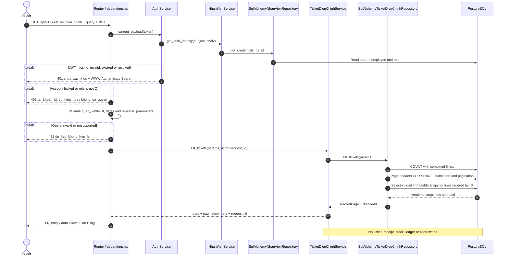
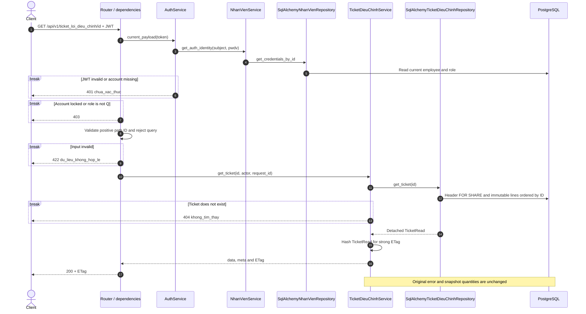
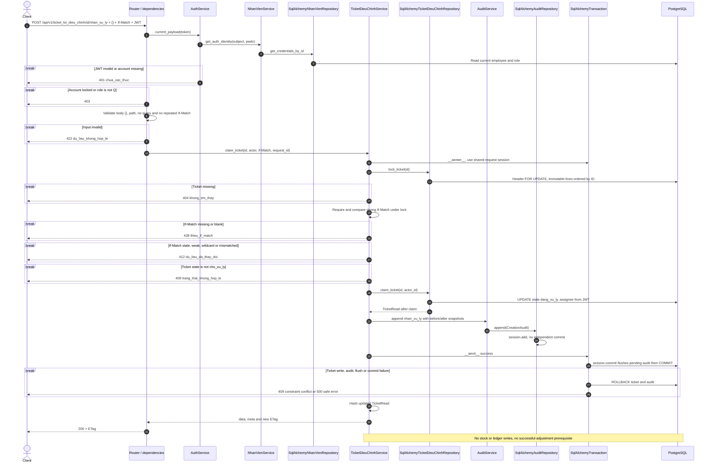
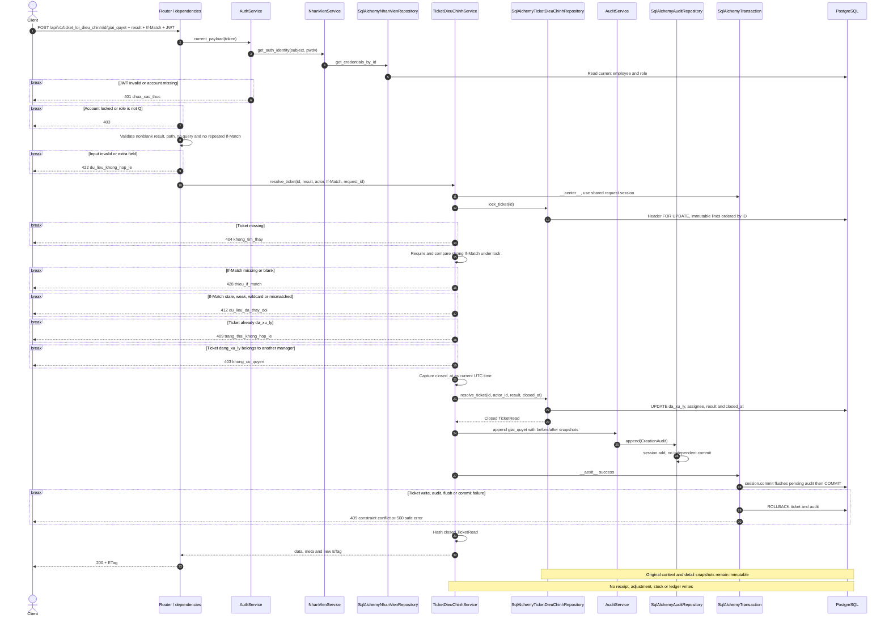

# Luồng API điều chỉnh kho và ticket lỗi — contract v3

## Quy ước phiếu điều chỉnh kho

Sáu endpoint phiếu và bốn endpoint ticket thuộc module `backend/app/modules/dieu_chinh_kho/`.
Nguồn: `docs/api_contract_v3.md` §2.2, §2.5, §12, §14; schema bootstrap `infra/postgres/init.sql`;
quyết định D-DCK-01 đến D-DCK-09 tại `docs/DECISION.md`.

- Chỉ Q (`quan_ly`); AuthService đọc lại nhân viên/vai trò/phiên bản mật khẩu từ DB mỗi request. Không token hoặc token không hợp lệ: 401; A/N hoặc tài khoản khóa: 403. Service kiểm tra lại quyền Q.
- Response `{data, meta}`; danh sách có `page`, `page_size`, `total`, `total_pages`. Thời điểm UTC. Lỗi `{error: {code, message, details}, meta}`; riêng thiếu tồn có thêm thông tin phiếu và ticket đã commit.
- Strong ETag là SHA-256 của PhieuDieuChinhRead, gồm dòng và trạng thái. PATCH, DELETE, xác nhận cần If-Match: thiếu/rỗng 428, stale/weak/wildcard 412, header lặp 422. Replay phiếu đã ghi sổ thành công được xét trước If-Match; ETag action vẫn là ETag resource, không gồm các field tính toán của action.
- Khóa theo thứ tự `PhieuNhap` nguồn → phiếu điều chỉnh → `MatHang` theo ID tăng dần. Tạo/PATCH/DELETE dùng `FOR SHARE` trên nguồn; xác nhận dùng `FOR UPDATE`. Phiếu ghi dùng `FOR UPDATE`.
- GET phiếu rollback transaction đọc xác thực, rồi câu đầu của transaction resource là `SET TRANSACTION ISOLATION LEVEL REPEATABLE READ, READ ONLY`. Header/dòng/tổng cùng snapshot, không `FOR SHARE`. Ticket giữ cơ chế đọc cũ ở các mục dưới.
- Nguồn chỉ là giao dịch `nhap_vat_tu` thuộc phiếu nhập `hoan_thanh`. Lượng hiệu lực bằng lượng gốc cộng ledger điều chỉnh đã ghi; biến động bằng lượng đúng trừ lượng hiệu lực, phải khác 0 và nằm trong INT32. Không kiểm tra `MatHang.is_active`.
- InventoryWriter sở hữu ghi tồn/ledger; service điều chỉnh không tự ghi kho. Audit và dữ liệu nghiệp vụ dùng chung session/transaction. Không thay đổi SQL bootstrap, không migration, không lưu sự cố bền vững khi DB lỗi.

## GET /api/v1/phieu_dieu_chinh_kho

Query: page/page_size (1–100), `q` tìm mã hoặc lý do với ILIKE có escape, `trang_thai`,
`phieu_nhap_id`, `nhan_vien_id`, `tu_ngay`, `den_ngay`. Ngày theo Asia/Ho_Chi_Minh,
tính cả hai đầu, đổi thành khoảng UTC nửa mở. Sort `id`, `created_at`, `ma_phieu` với
tiền tố `-`, mặc định `-created_at`; ID là tiêu chí phụ. Không trả ETag.

```mermaid
sequenceDiagram
    actor C as Client Q
    participant R as Router và dependencies
    participant A as AuthService
    participant S as PhieuDieuChinhKhoService
    participant P as SqlAlchemyPhieuDieuChinhRepository
    participant DB as PostgreSQL
    C->>R: GET /api/v1/phieu_dieu_chinh_kho
    R->>A: Xác thực token và đọc quyền từ DB
    A->>DB: Đọc NhanVien và VaiTro
    alt Token sai hoặc không có quyền hoặc tài khoản khóa
        R-->>C: 401 hoặc 403
    else Query lặp, lạ, sai enum, sort hoặc ngày
        R-->>C: 422 du_lieu_khong_hop_le
    else Đầu vào hợp lệ
        R->>S: list_phieu(query, actor, request_id)
        S->>P: begin_read_snapshot()
        P->>DB: ROLLBACK đọc auth; BEGIN REPEATABLE READ READ ONLY
        S->>P: list_phieu(query)
        P->>DB: COUNT theo filter
        opt Offset nhỏ hơn total
            P->>DB: SELECT trang header theo sort và ID, không khóa
            P->>DB: SELECT mọi dòng của cả trang bằng IN, ORDER BY phiếu và ID
        end
        P-->>S: RecordPage, cùng một snapshot
        S-->>C: 200 data và meta phân trang
    end
    Note over R,DB: Kết thúc request đóng session đọc; lỗi DB trả 500, không audit
```

## GET /api/v1/phieu_dieu_chinh_kho/{id}

ID dương; ID lớn hơn INT_MAX hoặc không tồn tại trả 404. Query không được hỗ trợ.

```mermaid
sequenceDiagram
    actor C as Client Q
    participant R as Router và dependencies
    participant A as AuthService
    participant S as PhieuDieuChinhKhoService
    participant P as SqlAlchemyPhieuDieuChinhRepository
    participant DB as PostgreSQL
    C->>R: GET /api/v1/phieu_dieu_chinh_kho/{id}
    R->>A: Xác thực và đọc quyền từ DB
    A->>DB: Đọc NhanVien và VaiTro
    alt Không xác thực hoặc bị cấm
        R-->>C: 401 hoặc 403
    else ID hoặc query không hợp lệ
        R-->>C: 422
    else Hợp lệ
        R->>S: get_phieu(id, actor, request_id)
        S->>P: begin_read_snapshot()
        P->>DB: ROLLBACK đọc auth; BEGIN REPEATABLE READ READ ONLY
        S->>P: get_phieu(id), nếu ID trong INT32
        P->>DB: SELECT header, sau đó dòng ORDER BY id, không khóa
        alt Không có phiếu hoặc ID vượt INT_MAX
            S-->>C: 404 khong_tim_thay
        else Có phiếu
            S-->>C: 200 PhieuDieuChinhRead, ETag
        end
    end
    Note over R,DB: Header và dòng cùng snapshot; không audit; lỗi DB trả 500
```

## POST /api/v1/phieu_dieu_chinh_kho

Body bắt buộc `phieu_nhap_id`, `ly_do` trim không rỗng, ít nhất một dòng
`{giao_dich_goc_id, so_luong_dung}`. ID là strict integer dương trong INT32;
lượng đúng strict integer 0..INT_MAX. Không trùng nguồn và không nhận field lạ.
Không cần If-Match. Tạo phiếu không kiểm tra thiếu tồn, không tạo ticket.

```mermaid
sequenceDiagram
    actor C as Client Q
    participant R as Router và dependencies
    participant A as AuthService
    participant S as PhieuDieuChinhKhoService
    participant P as SqlAlchemyPhieuDieuChinhRepository
    participant AU as AuditService và SqlAlchemyAuditRepository
    participant T as SqlAlchemyTransaction
    participant DB as PostgreSQL
    C->>R: POST /api/v1/phieu_dieu_chinh_kho, body
    R->>A: Xác thực và quyền từ DB
    A->>DB: Đọc NhanVien và VaiTro
    alt Không xác thực hoặc không có quyền
        R-->>C: 401 hoặc 403
    else Query hoặc body không hợp lệ
        R-->>C: 422
    else Hợp lệ
        R->>S: create(payload, actor, request_id)
        S->>T: Vào transaction dùng chung session
        S->>P: lock_phieu_nhap(FOR SHARE)
        P->>DB: Khóa nguồn
        alt Không có nguồn hoặc nguồn chưa hoan_thanh
            S->>T: ROLLBACK
            S-->>C: 404 hoặc 409 trang_thai_khong_hop_le
        else Nguồn hoàn thành
            S->>P: nguon(nguồn, mọi giao_dich_goc_id)
            P->>DB: Một truy vấn lượng gốc cộng ledger điều chỉnh
            S->>S: Tính lượng hiệu lực và biến động từng dòng
            alt Nguồn sai, biến động 0 hoặc ngoài INT32
                S->>T: ROLLBACK
                S-->>C: 422 details vị trí dòng, không ticket
            else Hợp lệ
                S->>P: add_phieu và replace_lines
                P->>DB: nextval và tháng địa phương; INSERT header và dòng
                S->>AU: append tao, snapshot sau
                AU->>DB: Pending audit trong cùng session
                S->>T: COMMIT phiếu, dòng và audit
                S-->>C: 201 data, meta, Location và ETag
            end
        end
    end
    Note over T,DB: Bất kỳ lỗi ghi hoặc commit đều rollback; lỗi DB không tạo ticket
```

## PATCH /api/v1/phieu_dieu_chinh_kho/{id}

Chỉ nháp. `ly_do`, `chi_tiet` optional nhưng không nhận null; cấm đổi nguồn.
Gửi chi tiết thì thay cả danh sách và tính lại từ ledger. Body rỗng hoặc dữ liệu
không đổi là no-op, giữ dòng/ETag và không audit.

```mermaid
sequenceDiagram
    actor C as Client Q
    participant R as Router và dependencies
    participant A as AuthService
    participant S as PhieuDieuChinhKhoService
    participant P as SqlAlchemyPhieuDieuChinhRepository
    participant AU as AuditService và SqlAlchemyAuditRepository
    participant T as SqlAlchemyTransaction
    participant DB as PostgreSQL
    C->>R: PATCH /api/v1/phieu_dieu_chinh_kho/{id}, If-Match và body
    R->>A: Xác thực và quyền từ DB
    A->>DB: Đọc NhanVien và VaiTro
    alt Không xác thực hoặc không có quyền
        R-->>C: 401 hoặc 403
    else ID, query, header lặp hoặc body sai
        R-->>C: 422
    else Hợp lệ
        R->>S: patch
        S->>T: Vào transaction
        S->>P: peek nguồn; lock nguồn FOR SHARE; lock phiếu FOR UPDATE
        P->>DB: Đọc nguồn bất biến, khóa và đọc phiếu cùng dòng
        alt Không có phiếu
            S-->>C: 404
        else Thiếu hoặc sai If-Match
            S-->>C: 428 hoặc 412
        else Không còn nhap
            S-->>C: 409 trang_thai_khong_hop_le
        else Nháp và ETag hiện hành
            opt Có chi_tiet
                S->>P: nguon mọi dòng
                P->>DB: Đọc nguồn và tổng ledger
                S->>S: Tính lại; sai nguồn, lượng 0 hoặc tràn trả 422
                opt Danh sách thực sự đổi
                    S->>P: replace_lines
                    P->>DB: DELETE dòng cũ; INSERT dòng mới
                end
            end
            opt Lý do thực sự đổi
                S->>P: update_ly_do
                P->>DB: UPDATE header
            end
            S->>P: Đọc snapshot sau
            opt Snapshot thay đổi
                S->>AU: append sua, trước và sau
            end
            S->>T: COMMIT dữ liệu và audit
            S-->>C: 200 data và ETag hiện hành
        end
    end
    Note over S,DB: Mọi lỗi rollback, không ticket; lỗi DB trả 500 hoặc 409 nếu vi phạm ràng buộc
```

## DELETE /api/v1/phieu_dieu_chinh_kho/{id}

Chỉ nháp, cần If-Match. Xóa cứng dòng trước, header sau; audit giữ snapshot trước khi xóa.

```mermaid
sequenceDiagram
    actor C as Client Q
    participant R as Router và dependencies
    participant A as AuthService
    participant S as PhieuDieuChinhKhoService
    participant P as SqlAlchemyPhieuDieuChinhRepository
    participant AU as AuditService và SqlAlchemyAuditRepository
    participant T as SqlAlchemyTransaction
    participant DB as PostgreSQL
    C->>R: DELETE /api/v1/phieu_dieu_chinh_kho/{id}, If-Match
    R->>A: Xác thực và quyền từ DB
    A->>DB: Đọc NhanVien và VaiTro
    alt Không xác thực hoặc không có quyền
        R-->>C: 401 hoặc 403
    else ID, query hoặc header lặp không hợp lệ
        R-->>C: 422
    else Hợp lệ
        R->>S: delete
        S->>T: Vào transaction
        S->>P: peek nguồn; lock nguồn FOR SHARE; lock phiếu FOR UPDATE
        P->>DB: Khóa theo nguồn rồi phiếu, đọc snapshot
        alt Không có phiếu
            S-->>C: 404
        else Thiếu hoặc sai If-Match
            S-->>C: 428 hoặc 412
        else Không còn nhap
            S-->>C: 409 trang_thai_khong_hop_le
        else Nháp hợp lệ
            S->>AU: append xoa_nhap, snapshot trước
            S->>P: delete_draft
            P->>DB: DELETE dòng; DELETE header
            S->>T: COMMIT xóa và audit
            S-->>C: 204 không body
        end
    end
    Note over S,DB: Mọi lỗi rollback; lỗi DB trả 500 hoặc 409 khi vi phạm ràng buộc; không ticket
```

## POST /api/v1/phieu_dieu_chinh_kho/{id}/xac_nhan

Body `{}` bắt buộc, không nhận query. Action trả PhieuDieuChinhRead cộng
`giao_dich_kho_ids` và `da_ghi_so_truoc_do`. Mọi dòng được kiểm tra trước ghi kho.
Chỉ `StockShortage` dẫn đến transaction 2; nguồn sai, lượng tính lại bằng 0,
ETag, trạng thái, tràn INT32, lệch ledger hoặc lỗi DB không tạo ticket.

```mermaid
sequenceDiagram
    actor C as Client Q
    participant R as Router và dependencies
    participant A as AuthService
    participant S as PhieuDieuChinhKhoService
    participant P as SqlAlchemyPhieuDieuChinhRepository
    participant I as SqlAlchemyInventoryRepository
    participant K as SqlAlchemyTicketDieuChinhRepository
    participant AU as AuditService và SqlAlchemyAuditRepository
    participant T as SqlAlchemyTransaction
    participant DB as PostgreSQL
    C->>R: POST /api/v1/phieu_dieu_chinh_kho/{id}/xac_nhan, body và If-Match
    R->>A: Xác thực và quyền từ DB
    A->>DB: Đọc NhanVien và VaiTro
    alt Không xác thực hoặc không có quyền
        R-->>C: 401 hoặc 403
    else ID, query, header lặp hoặc body sai
        R-->>C: 422
    else Hợp lệ
        R->>S: xac_nhan
        S->>T: Transaction 1
        S->>P: peek nguồn; lock PhieuNhap FOR UPDATE; lock phiếu FOR UPDATE
        P->>DB: Khóa và đọc header cùng dòng
        alt Không có phiếu
            S-->>C: 404
        else Phiếu đã da_xac_nhan
            S->>P: ledger_ids
            S->>T: Kết thúc transaction, không ghi
            S-->>C: 200 replay=true, bỏ qua If-Match, không audit mới
        else Thiếu hoặc sai If-Match, phiếu không còn nhap
            S->>T: ROLLBACK
            S-->>C: 428, 412 hoặc 409, không ticket
        else Nháp và ETag khớp
            S->>P: nguon và tính lại từ so_luong_dung
            P->>DB: Đọc lượng gốc và tổng ledger
            alt Nguồn sai, lượng bằng 0 hoặc ngoài INT32
                S->>T: ROLLBACK
                S-->>C: 422 hoặc 409, giữ nhap, không ticket
            else Dòng hợp lệ
                opt Lượng hiệu lực thay đổi
                    S->>P: replace_lines khi còn nhap
                end
                S->>I: lock_balances theo ID tăng dần
                I->>DB: MatHang FOR UPDATE; đối chiếu tổng ledger
                S->>P: mark_confirmed và đọc lại ID dòng
                P->>DB: UPDATE da_xac_nhan, confirmed_at
                S->>I: adjust_stock mọi dòng
                I->>DB: Tái khóa số dư, kiểm tra mọi dòng trước ghi
                alt Đủ tồn và không tràn
                    I->>DB: UPDATE MatHang; INSERT GiaoDichKho từng dòng
                    S->>AU: append xac_nhan, trước và sau
                    S->>P: ledger_ids
                    S->>T: COMMIT trạng thái, kho, ledger và audit
                    S-->>C: 200 replay=false, ledger IDs và ETag
                else StockShortage
                    I-->>S: Dòng thiếu và số dư mọi mặt hàng
                    S->>T: ROLLBACK toàn bộ transaction 1
                    Note over S,T: Giữ dòng đã tính, số dư và ETag đã kiểm tra bằng giá trị thuần
                    S->>T: Transaction 2 sau rollback
                    S->>P: Khóa lại PhieuNhap FOR UPDATE rồi phiếu FOR UPDATE
                    alt Tiến trình khác đã xác nhận
                        S->>P: ledger_ids
                        S->>T: Kết thúc, không ticket
                        S-->>C: 200 replay=true
                    else Phiếu không còn nhap hoặc ETag đổi
                        S->>T: ROLLBACK
                        S-->>C: 409 hoặc 412, không ticket
                    else Phiếu vẫn khớp lần thử
                        opt Dòng đã tính khác dòng nháp
                            S->>P: replace_lines
                        end
                        S->>P: mark_failed
                        P->>DB: UPDATE loi, confirmed_at giữ NULL
                        S->>K: add_ticket với mọi dòng đề nghị và số dư đã chụp
                        K->>DB: nextval mã TKDC; INSERT ticket và mọi dòng snapshot
                        S->>AU: append ghi_nhan_loi cho phiếu và ticket
                        S->>T: COMMIT transaction 2
                        S-->>C: 409 dieu_chinh_khong_hop_le, ticket_id, ticket_da_luu=true
                    end
                else Tràn tồn, lệch ledger hoặc lỗi DB
                    S->>T: ROLLBACK
                    S-->>C: 409 hoặc 500, giữ nhap, không ticket
                end
            end
        end
    end
    Note over S,DB: Nếu transaction 2 lỗi, rollback cả loi, ticket và audit; không trả ticket_da_luu=true
```

## Bốn endpoint ticket lỗi điều chỉnh

## Ảnh PNG cho từng endpoint

| Endpoint | Ảnh sequence |
|---|---|
| GET `/api/v1/ticket_loi_dieu_chinh` | [01 — Danh sách](assets/dieu_chinh_kho/01-danh-sach.png) |
| GET `/api/v1/ticket_loi_dieu_chinh/{id}` | [02 — Chi tiết](assets/dieu_chinh_kho/02-chi-tiet.png) |
| POST `/api/v1/ticket_loi_dieu_chinh/{id}/nhan_xu_ly` | [03 — Nhận xử lý](assets/dieu_chinh_kho/03-nhan-xu-ly.png) |
| POST `/api/v1/ticket_loi_dieu_chinh/{id}/giai_quyet` | [04 — Giải quyết](assets/dieu_chinh_kho/04-giai-quyet.png) |

Module `backend/app/modules/dieu_chinh_kho/` triển khai bốn endpoint dưới tiền tố `/api/v1/ticket_loi_dieu_chinh`, theo `docs/api_contract_v3.md` §2, §3, §12.2, §14 và bảng `"TicketLoiDieuChinh"`, `"ChiTietTicketLoiDieuChinh"` trong `infra/postgres/init.sql`.

## Quy ước đang triển khai

- Chỉ Q (`quan_ly`) được gọi cả bốn endpoint. A và N nhận 403. Mỗi request xác minh JWT, phiên bản mật khẩu, trạng thái tài khoản và vai trò hiện tại trong DB thông qua AuthService → NhanVienService → SqlAlchemyNhanVienRepository.
- Response thành công `{data, meta: {request_id}}`; danh sách thêm page, page_size, total, total_pages vào meta. Lỗi `{error: {code, message, details}, meta: {request_id}}`; 401 có `WWW-Authenticate: Bearer`. Validation 422 không echo input nhạy cảm.
- TicketRead gồm header, người tạo/người xử lý, thời gian và các dòng snapshot. Dòng chi tiết sắp theo ID; trường số lượng là integer, `so_luong_bien_dong` có thể âm. Các timestamp trả UTC có `Z`. Không có trường tiền, giao dịch kho hoặc cờ ghi sổ trong response ticket.
- GET chi tiết và hai action trả strong ETag trên toàn bộ TicketRead, gồm trạng thái, người xử lý, kết quả, thời gian đóng và snapshot chi tiết. `request_id` không tham gia ETag.
- Hai action yêu cầu If-Match. Sau khi khóa và đọc resource, kiểm tra header và ETag trước điều kiện trạng thái/người xử lý. Thiếu/rỗng trả 428; stale, weak, wildcard hoặc không khớp trả 412. Header lặp trả 422. Ticket không thuộc nhóm action ghi sổ cho retry bỏ qua ETag: không có nhánh idempotent trả kết quả cũ khi header stale.
- `nhan_xu_ly` chỉ từ `cho_xu_ly` sang `dang_xu_ly`, người xử lý lấy từ JWT. `giai_quyet` đóng trực tiếp từ `cho_xu_ly`, hoặc từ `dang_xu_ly` nếu người gọi chính là người đã nhận. Khi đóng từ `cho_xu_ly`, người đóng trở thành người xử lý. Ticket đã `da_xu_ly` không sửa, đóng lại hoặc mở lại.
- Bối cảnh gốc và chi tiết snapshot bất biến. Không có endpoint tạo, PATCH, DELETE hoặc mở lại ticket. Việc hệ thống tạo ticket khi xác nhận điều chỉnh thất bại thuộc luồng phiếu điều chỉnh, ngoài phạm vi bốn endpoint này.
- Nhận xử lý/đóng ticket chỉ cập nhật header cho phép và audit. Không đọc điều kiện thành công của phiếu điều chỉnh mới, không cập nhật phiếu nhập, tồn kho, ledger hoặc tiến độ.
- GET giữ khóa FOR SHARE trên header; SQLAlchemy select-in load các dòng snapshot bất biến theo ID. Danh sách COUNT trước, sau đó truy vấn trang header và nạp chi tiết; tổng có thể thay đổi giữa các truy vấn nếu hệ thống tạo ticket đồng thời. GET không ghi trạng thái hoặc audit.
- Action giữ khóa FOR UPDATE trên header đến hết transaction, rồi đọc snapshot chi tiết. So sánh ETag và ghi dưới cùng khóa. Hai quản lý cùng nhận/đóng với một ETag: một request thành công, request còn lại đọc phiên bản mới và nhận 412.
- Luồng audit là TicketDieuChinhService → AuditService.append → SqlAlchemyAuditRepository.append. Repository audit chỉ session.add; SqlAlchemyTransaction.__aexit__ gọi session.commit, flush pending audit rồi COMMIT. Ticket và audit dùng chung session/transaction, bất kỳ lỗi ghi/flush/commit nào đều rollback cả hai. Các dependency của FastAPI có thể được giải quyết xen kẽ với validation trước handler.

## GET /api/v1/ticket_loi_dieu_chinh

Q đọc toàn bộ ticket. Query: `page` mặc định 1, `page_size` mặc định 20 (tối đa 100), `trang_thai`, `phieu_nhap_id`, `nguoi_tao_id`, `nguoi_xu_ly_id`, `tu_ngay`, `den_ngay`, `sort`. Sort cho phép `id`, `created_at`, `ma_ticket` và dạng giảm dần với tiền tố `-`; ID là tiêu chí phụ. Không có `q`, `search`, `sort_by` hoặc `sort_order`. Ngày lọc theo `created_at`, lấy cả hai đầu ngày Asia/Ho_Chi_Minh bằng khoảng UTC nửa mở. Query lặp, trường lạ, sort/enum/ngày không hợp lệ trả 422. Danh sách rỗng trả 200, không trả ETag.



## GET /api/v1/ticket_loi_dieu_chinh/{id}

Q đọc được ticket ở cả ba trạng thái. Không nhận query. ID path phải là integer dương; không tồn tại trả 404. Response chứa snapshot của sự việc thất bại, không tính lại số lượng hoặc tồn hiện tại.



## POST /api/v1/ticket_loi_dieu_chinh/{id}/nhan_xu_ly

Chỉ Q; body JSON object rỗng `{}` bắt buộc. Chỉ nhận ticket đang `cho_xu_ly`. Người nhận lấy từ JWT đã xác minh, client không được gửi người xử lý hoặc trạng thái. Thành công trả TicketRead ở `dang_xu_ly`, ETag mới và audit `nhan_xu_ly`.



## POST /api/v1/ticket_loi_dieu_chinh/{id}/giai_quyet

Chỉ Q; body bắt buộc `{ket_qua_xu_ly: string}`, trim không rỗng, cấm trường lạ. Đóng trực tiếp ticket `cho_xu_ly` hoặc ticket `dang_xu_ly` đã được chính người gọi nhận. Người xử lý là người đóng lấy từ JWT; ghi kết quả và `closed_at`, audit `giai_quyet`. Không mở lại ticket đã đóng và không yêu cầu điều chỉnh mới thành công.


