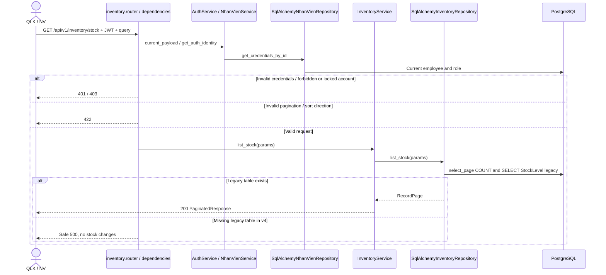
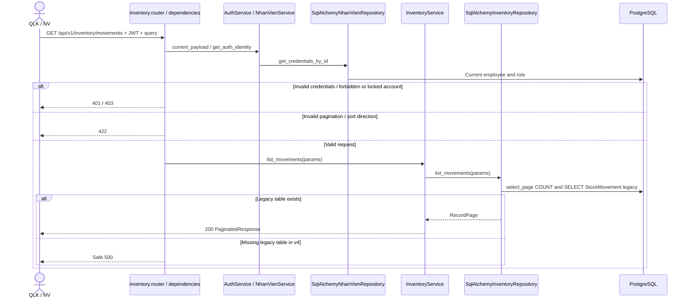
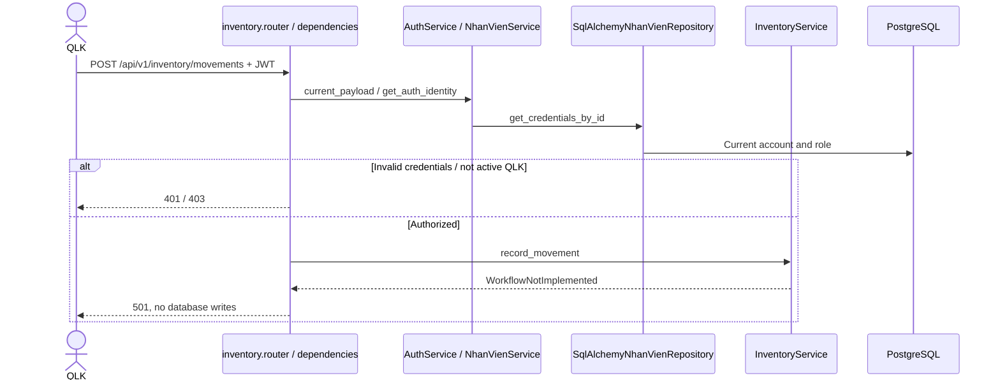

# Sequence inventory — phạm vi phiếu xuất v4 và giới hạn legacy

Đối chiếu `inventory/{router,service,repository,ports,models}.py`, `dependencies.py`,
`core/persistence.py` và [phiếu xuất](phieu_xuat.md). Chỉ đường ghi xuất đã nâng v4.
Các endpoint đọc còn dùng ORM `StockLevel`/`StockMovement` của bảng legacy lowercase
`ton_kho`/`giao_dich_kho`, không tồn tại trong bootstrap v4; trên DB v4 chúng có thể
trả 500. Không mô tả chúng như API tồn v4 đã nghiệm thu. Luồng nhập/điều chỉnh tồn
cũ cũng chưa nâng trong tác vụ này.

## GET /api/v1/inventory/stock

Ảnh: [Đọc tồn legacy](assets/inventory/01-stock.png).
QLK/NV, PageParams chung (page 1, size 20 tối đa 100, search, sort_by, sort_order).
Không ETag; không ghi kho. Envelope success/data/pagination/message hiện hữu.

## GET /api/v1/inventory/movements

Ảnh: [Đọc giao dịch legacy](assets/inventory/02-movements.png).
Cùng quyền/query/envelope với GET stock; chưa chuyển read model sang GiaoDichKho v4.

## POST /api/v1/inventory/movements

Ảnh: [Workflow chưa triển khai](assets/inventory/03-record-movement.png).
Route cũ còn đăng ký nhưng service luôn báo WorkflowNotImplemented (501), không ghi DB.
Ghi ledger v4 chỉ qua use case có chứng từ nguồn, không qua endpoint này.

## Port ghi xuất nội bộ — không phải endpoint

`PhieuXuatService → InventoryIssueWriter → SqlAlchemyInventoryRepository → PostgreSQL`.
Service gọi `lock_issue_stock` sau khi đã khóa YCSX/phiếu/chứng từ hoàn thành.
Repository khóa MatHang tăng dần ID rồi toàn bộ GiuHang đang giữ của các item đó
theo item/ID, đọc tổng ledger và trả snapshot detached. Service kiểm tra chính sách
nguồn/giữ/lượng/giá/tồn. `issue_stock` ghi các thay đổi đã được kiểm tra: giảm tồn và
đang giữ trong cùng UPDATE, kết thúc đúng khoản giữ nguồn, INSERT ledger âm với
`so_luong_ton_sau`. Không sửa giữ của yêu cầu khác, không tự commit, không lấy cache
làm chuẩn. Transaction do PhieuXuatService sở hữu; lỗi ở bất kỳ bước nào rollback
toàn bộ. Xem sequence duyệt và test GI-AC-08/09/13–17 tại module phiếu xuất.
