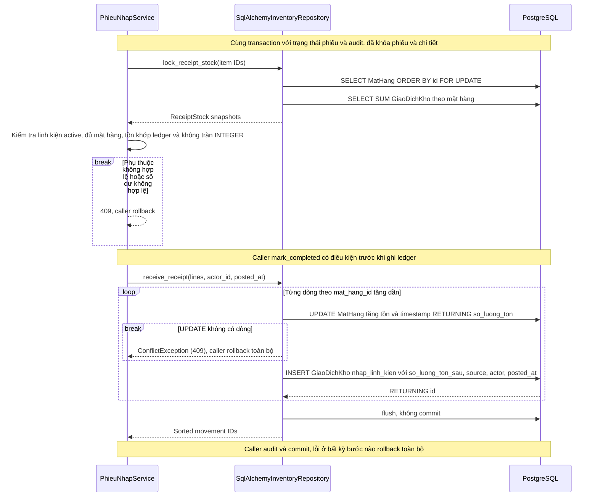

# Sequence inventory — writer tồn kho v4

Đối chiếu `inventory/{repository,ports}.py`, `dependencies.py`,
[phiếu xuất](phieu_xuat.md) và [sản xuất](san_xuat.md).
Module inventory không còn endpoint HTTP: router, service, ORM và schema legacy
(`ton_kho`/`giao_dich_kho` lowercase, `GET /inventory/stock`, `POST /inventory/movements`)
đã gỡ vì không khớp bootstrap v4. Module chỉ còn writer dùng chung transaction của
service gọi: ghi xuất, nhập thành phẩm sản xuất UC-31, nhập linh kiện UC-21 và điều chỉnh
tồn. Tồn hiện tại đọc qua `MatHang.so_luong_ton`; lịch sử biến động qua
[reporting](reporting.md).

## Port ghi xuất nội bộ — không phải endpoint

`PhieuXuatService → InventoryIssueWriter → SqlAlchemyInventoryRepository → PostgreSQL`.
Service gọi `lock_issue_stock` sau khi đã khóa YCSX/phiếu/chứng từ hoàn thành.
Repository khóa MatHang tăng dần ID rồi toàn bộ GiuHang đang giữ của các item đó
theo item/ID, đọc tổng ledger và trả snapshot detached. Service kiểm tra chính sách
nguồn/giữ/lượng/giá/tồn. `issue_stock` ghi các thay đổi đã được kiểm tra: giảm tồn và
đang giữ trong cùng UPDATE, kết thúc đúng khoản giữ nguồn, INSERT ledger âm với
`so_luong_ton_sau`. Không sửa giữ của yêu cầu khác, không tự commit, không lấy cache
làm chuẩn. Transaction do PhieuXuatService sở hữu; lỗi ở bất kỳ bước nào rollback
toàn bộ. Xem sequence duyệt và test GI-AC-08/09/13–17 tại module phiếu xuất.

## Port nhập thành phẩm sản xuất UC-31 — không phải endpoint

`ChungTuHoanThanhService → InventoryProductionWriter.receive_production →
SqlAlchemyInventoryRepository → PostgreSQL`. Caller đã kiểm QLK, If-Match,
chứng từ Chờ duyệt, yêu cầu Đang thực hiện và đã khóa theo thứ tự yêu cầu →
chứng từ → MatHang thành phẩm. Caller cập nhật và flush chứng từ `da_duyet`
**trước** khi gọi inventory, vì trigger `kiem_tra_nguon_giao_dich` kiểm trạng thái này.

```mermaid
sequenceDiagram
    participant S as ChungTuHoanThanhService
    participant I as SqlAlchemyInventoryRepository
    participant DB as PostgreSQL
    Note over S,DB: Một transaction chung, đã khóa yêu cầu, chứng từ và MatHang
    Note over S,DB: Chứng từ đã da_duyet, có người xử lý và xu_ly_at, phien_ban + 1, flush
    S->>I: receive_production(item_id, n, completion_id, actor_id, posted_at, hold)
    I->>DB: UPDATE MatHang SET tồn + n, giữ + (n nếu hold), ton_kho_updated_at
    DB-->>I: RETURNING so_luong_ton
    I->>DB: INSERT GiaoDichKho nhap_san_pham_san_xuat, +n, tồn sau, nguồn chứng từ, QLK, posted_at
    Note over I,DB: Trigger kiểm chứng từ đã duyệt và item/lượng khớp, UNIQUE nguồn chống ghi lại
    DB-->>I: RETURNING id
    I->>DB: flush, không commit
    I-->>S: giao_dich_kho_id, so_luong_ton_sau
    Note over S,DB: Xuất giao tạo giữ; nhập kho hoàn thành yêu cầu; caller ghi audit
    alt Bất kỳ bước ghi hoặc commit lỗi
        S->>DB: ROLLBACK toàn bộ
    else Thành công
        S->>DB: COMMIT
    end
```

`hold=True` chỉ cho `xuat_giao`: cộng tồn và giữ cùng n; caller INSERT
`GiuHang.thanh_pham_san_xuat` đang giữ, gắn đúng chứng từ. `hold=False` cho
`nhap_kho`: giữ không đổi, caller không tạo giữ và chuyển yêu cầu `hoan_thanh`
cùng `completed_at`. Không ghi linh kiện. Hàm trả `(giao_dich_kho_id,
so_luong_ton_sau)` cho audit chứng từ; không tự mở transaction hay commit.
Đường `issue_stock` và các đường legacy giữ nguyên. Kiểm chứng UC-31 không dùng DB:
ASGI/service với trạng thái giả và câu SQL thật, kiểm thứ tự UPDATE/INSERT,
tham số số dư/nguồn/người/thời điểm, khóa và rollback; không chạy tranh chấp PostgreSQL thật.


## Port nhận hàng nội bộ — không phải endpoint

`PhieuNhapService` nhận `SqlAlchemyInventoryRepository` qua hợp đồng
`InventoryWriter`; đây là port, không phải một tầng thực thi riêng.
Service đã khóa phiếu/chi tiết trước khi gọi lock_receipt_stock. Repository khóa
MatHang tăng dần ID, đọc tồn/đang giữ/loại/active và SUM ledger, trả ReceiptStock frozen
detached. Service quyết định loại đúng/số dư khớp/giới hạn INTEGER. receive_receipt chỉ
ghi dữ liệu đã kiểm tra dưới cùng khóa: tăng tồn + timestamp, lấy tồn sau, INSERT
nhap_linh_kien với line FK duy nhất/actor/time/so_luong_ton_sau. Không đổi held/GiuHang,
giá danh mục hoặc nguồn sản xuất. Không commit riêng, không đọc/ghi cache trong TX.
Xem sequence hoàn tất để theo dõi AuditService và một commit/rollback toàn luồng.


