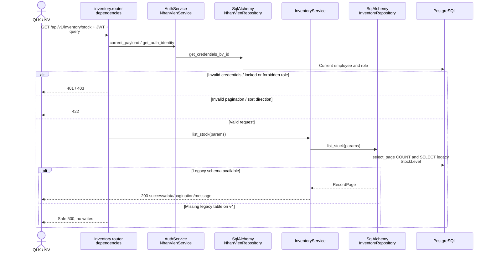
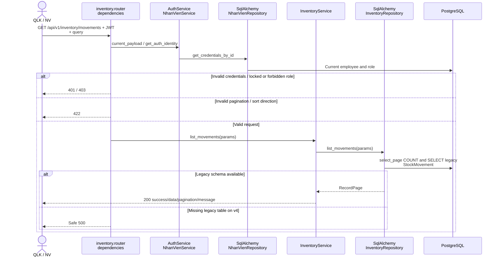
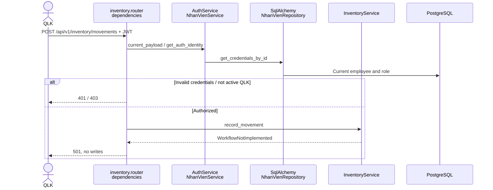

# Sequence inventory — đường nhận v4 và các endpoint legacy

Nguồn: `inventory/{router,service,repository,ports,models}.py`, `dependencies.py`,
core persistence và [phiếu nhập](phieu_nhap.md). Chỉ đường nhận hàng nội bộ được nâng v4
trong tác vụ Goods Receipt. Endpoint đọc vẫn dùng StockLevel/StockMovement, bảng legacy
`ton_kho`/`giao_dich_kho` lowercase, không tồn tại trong bootstrap v4. Không coi chúng
là API tồn v4 đã nghiệm thu; trên DB v4 chúng có thể trả 500. Đường xuất/điều chỉnh
legacy cũng giữ nguyên theo Q5.

## GET /api/v1/inventory/stock

Ảnh: [GET stock](assets/inventory/01-stock.png). QLK/NV; query PageParams chung:
page1/size20/max100, search, sort_by, sort_order. Không ETag, không ghi kho.

## GET /api/v1/inventory/movements

Ảnh: [GET movements](assets/inventory/02-movements.png). Cùng quyền/query/envelope
với GET stock. Read model chưa chuyển sang GiaoDichKho v4 trong tác vụ này.

## POST /api/v1/inventory/movements

Ảnh: [POST movements](assets/inventory/03-record-movement.png). Route legacy còn đăng
ký nhưng service luôn báo WorkflowNotImplemented (501). Không ghi ledger qua route này.

## Port nhận hàng nội bộ — không phải endpoint

`PhieuNhapService → InventoryWriter → SqlAlchemyInventoryRepository → PostgreSQL`.
Service đã khóa phiếu/chi tiết trước khi gọi lock_receipt_stock. Repository khóa
MatHang tăng dần ID, đọc tồn/đang giữ/loại/active và SUM ledger, trả ReceiptStock frozen
detached. Service quyết định loại đúng/số dư khớp/giới hạn INTEGER. receive_receipt chỉ
ghi dữ liệu đã kiểm tra dưới cùng khóa: tăng tồn + timestamp, lấy tồn sau, INSERT
nhap_linh_kien với line FK duy nhất/actor/time/so_luong_ton_sau. Không đổi held/GiuHang,
giá danh mục hoặc nguồn sản xuất. Không commit riêng, không đọc/ghi cache trong TX.
Xem sequence hoàn tất để theo dõi AuditService và một commit/rollback toàn luồng.
