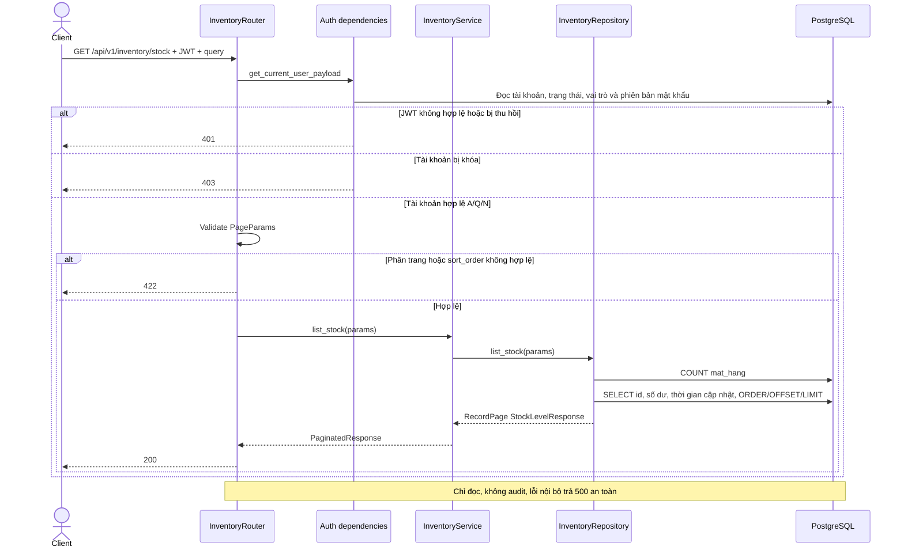
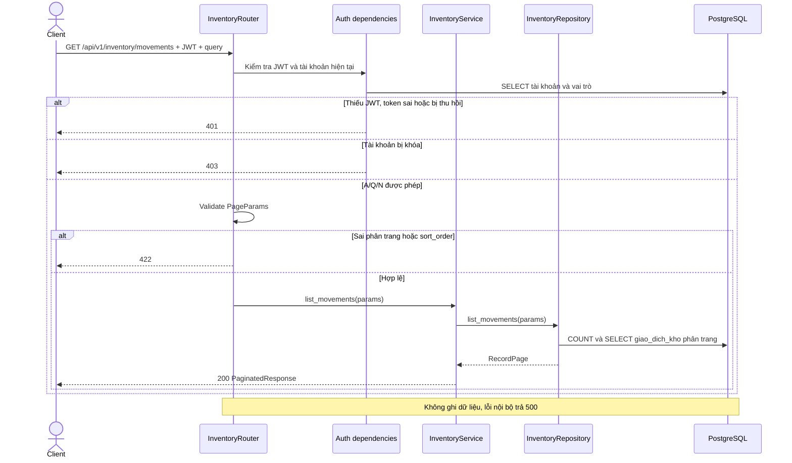
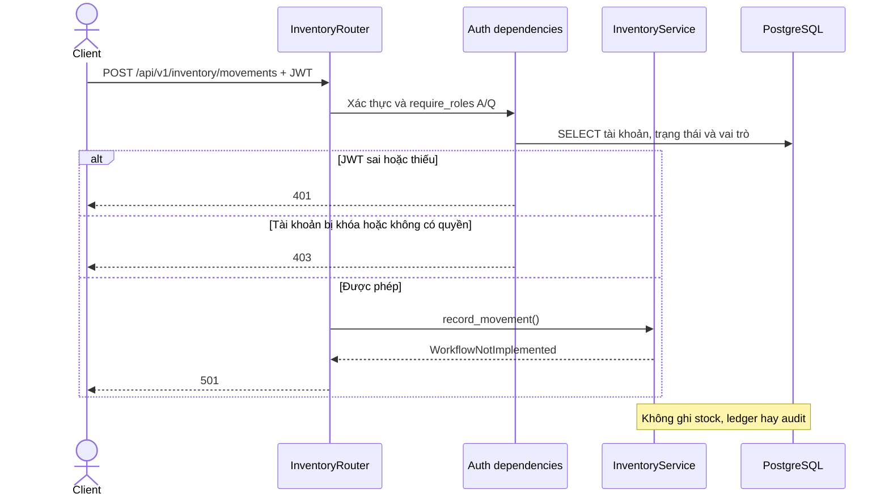

# Luồng API inventory

Đối chiếu router/service/repository/schema và dependency ngày 03/11/2026. `StockLevel`/`ton_kho` chỉ giữ để đối soát lịch sử. Số dư hiện hành nằm trên `mat_hang`; API liệt kê cả mặt hàng có tồn 0. Không thay đổi quyền của các route cũ.

## GET /api/v1/inventory/stock

Giữ response `{success,data,pagination,message}` và field `id,mat_hang_id,so_luong,updated_at`; `id` nay bằng ID mặt hàng. `updated_at` lấy từ `ton_kho_updated_at` có múi giờ. Query page>=1, page_size 1..100, sort_order asc/desc; sort_by ánh xạ bốn field, không hợp lệ fallback id như trước. Search vẫn không lọc vì projection số dư không có cột text. COUNT/trang là hai truy vấn, không bảo đảm snapshot giữa hai lần đọc khi có ghi đồng thời.

## GET /api/v1/inventory/movements

Giữ nguyên đọc giao dịch đã lưu; không thay đổi tồn hoặc trạng thái. Cùng PageParams/envelope với stock. Sắp theo cột có thật, fallback id; không có cột text để search. `so_luong_bien_dong` là biến động ledger, không phải lượng hiệu lực sau điều chỉnh.

## POST /api/v1/inventory/movements

Route cũ tồn tại nhưng nghiệp vụ chưa triển khai; không phải đường tạo ledger thay thế hoàn tất phiếu nhập.

