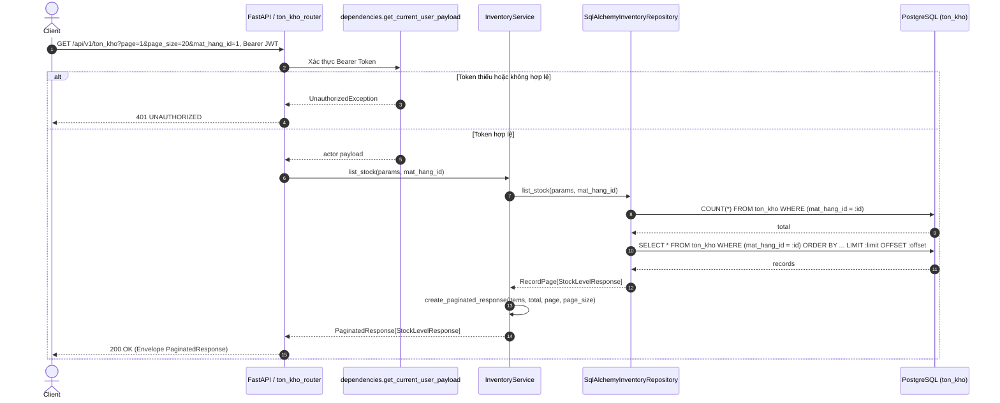
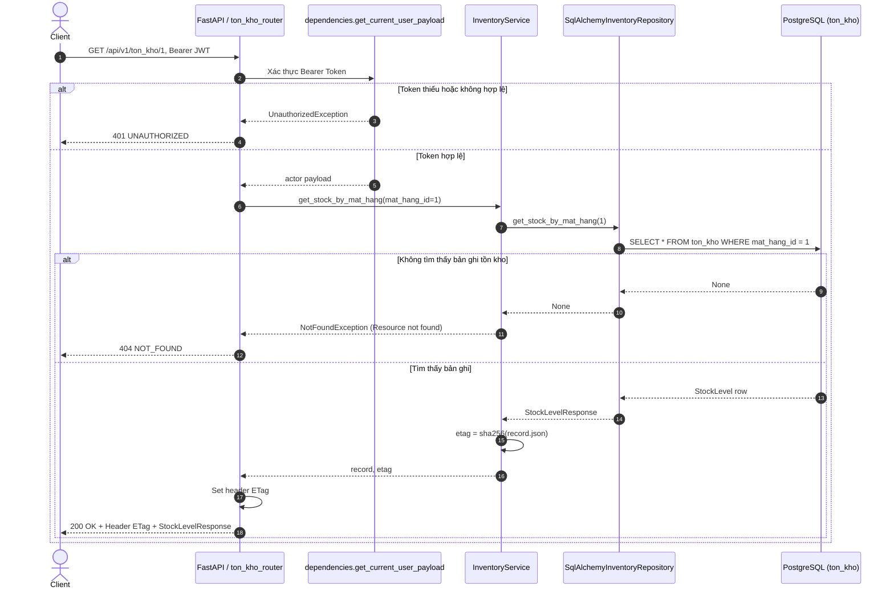
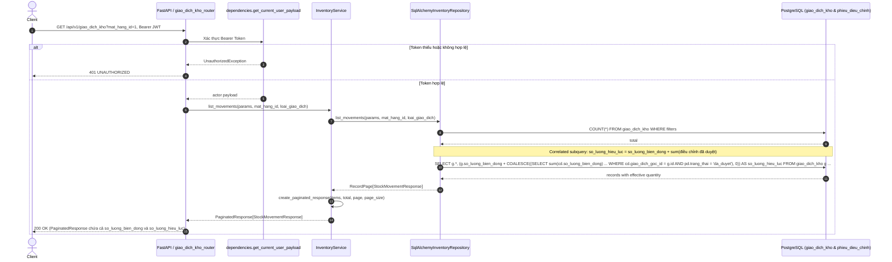
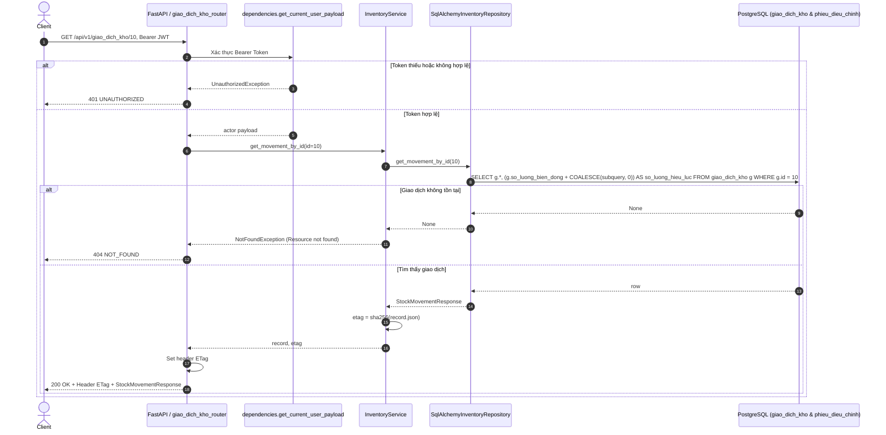

# Sequence diagram — inventory

Nguồn triển khai: `backend/app/modules/inventory/{router,service,schemas,ports,repository,models}.py`,
`backend/app/dependencies.py`, `backend/app/core/errors.py` và `backend/app/main.py`.
Đối chiếu quy tắc nghiệp vụ với `infra/postgres/init.sql` và `docs/api-conventions.md`.

Các sơ đồ mô tả luồng qua các tầng Clean Architecture:
- Presentation / Routing: `ton_kho_router` và `giao_dich_kho_router`
- Authentication / Authorization: `get_current_user_payload`
- Use Cases: `InventoryService`
- Persistence Abstraction: `InventoryRepository` / `SqlAlchemyInventoryRepository`
- Database: PostgreSQL tables `ton_kho`, `giao_dich_kho`, `phieu_dieu_chinh_kho`, `chi_tiet_phieu_dieu_chinh_kho`

---

## 1. API-029: GET /api/v1/ton_kho — Lấy danh sách tồn kho phân trang

Query params: `page` (mặc định 1, >= 1), `page_size` (mặc định 20, 1..100), `mat_hang_id` (tùy chọn, > 0), `sort_by` (mặc định id), `sort_order` (asc|desc, mặc định desc).

---

## 2. API-030: GET /api/v1/ton_kho/{mat_hang_id} — Chi tiết tồn kho theo mặt hàng kèm ETag

Path param: `mat_hang_id` (bắt buộc, số nguyên > 0).

---

## 3. API-031: GET /api/v1/giao_dich_kho — Lấy sổ giao dịch kho phân biệt lượng hiệu lực và biến động ledger

Query params: `page` (mặc định 1), `page_size` (mặc định 20), `mat_hang_id` (tùy chọn, > 0), `loai_giao_dich` (tùy chọn), `sort_by`, `sort_order`.

---

## 4. API-032: GET /api/v1/giao_dich_kho/{id} — Chi tiết giao dịch kho kèm ETag

Path param: `id` (bắt buộc, số nguyên > 0).

