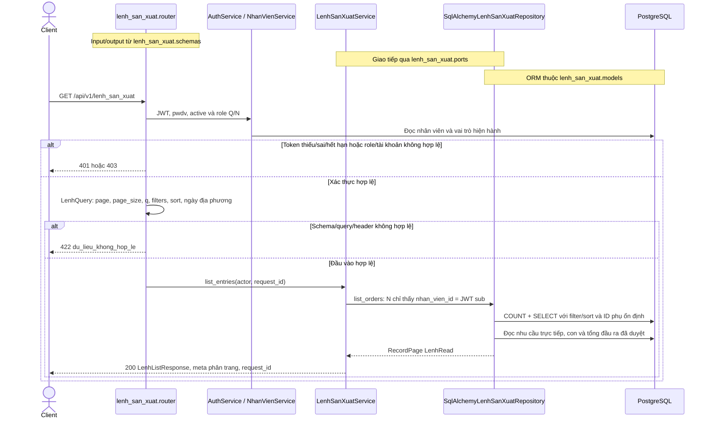
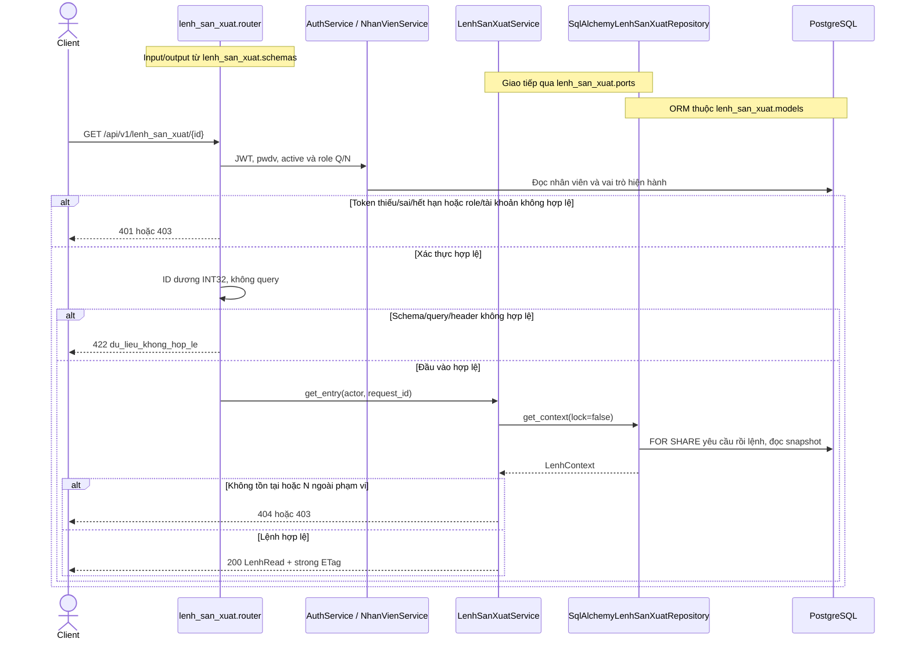
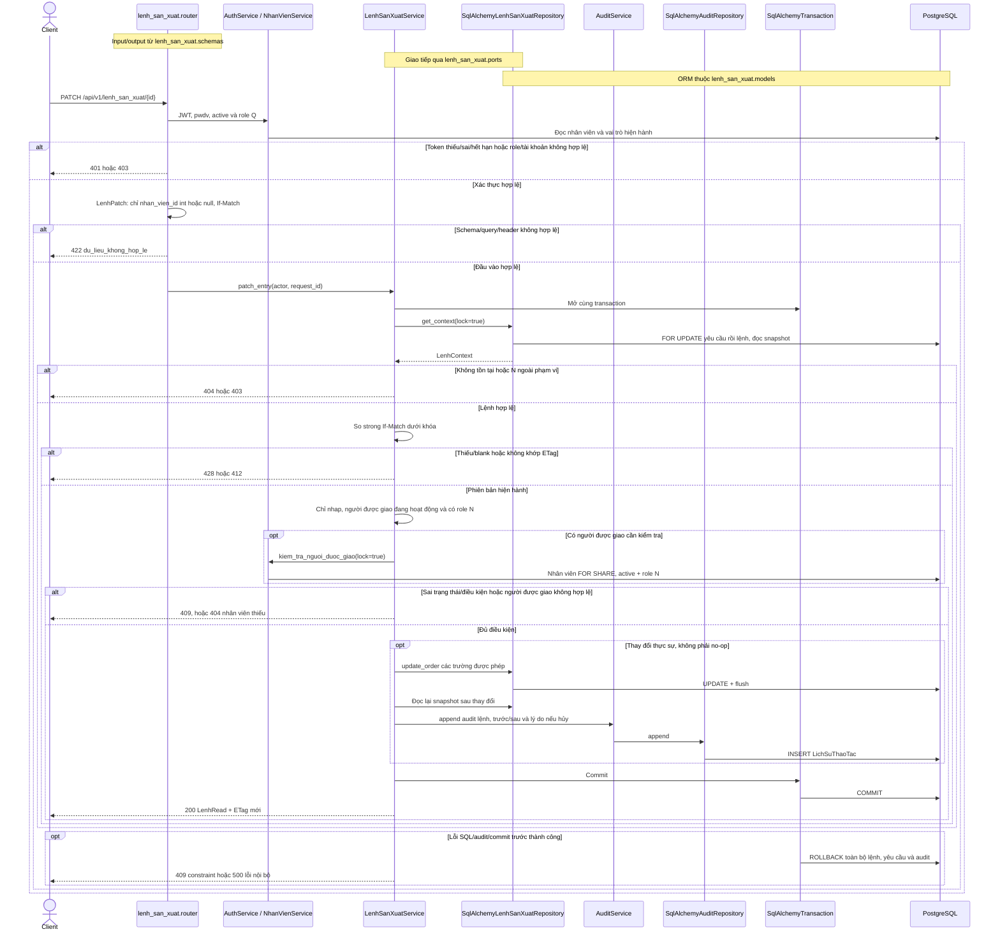
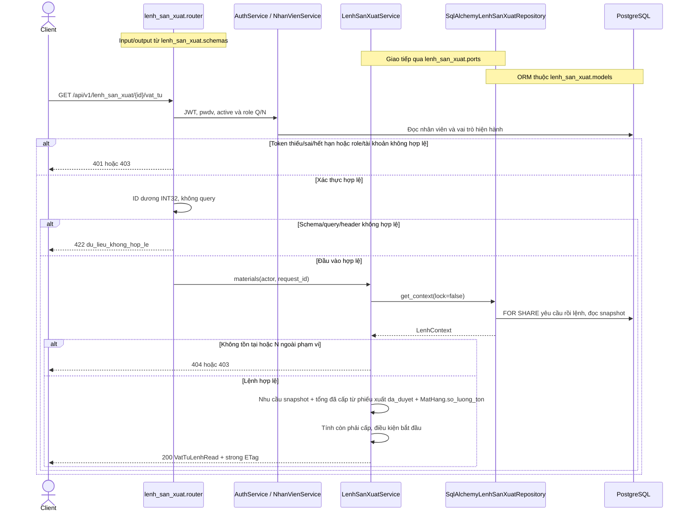
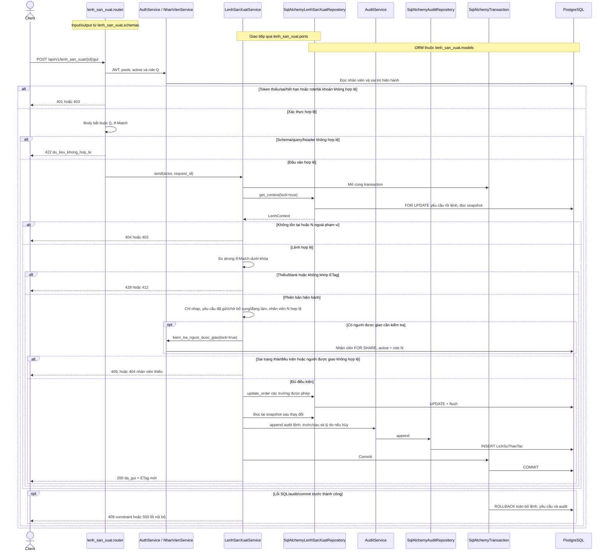
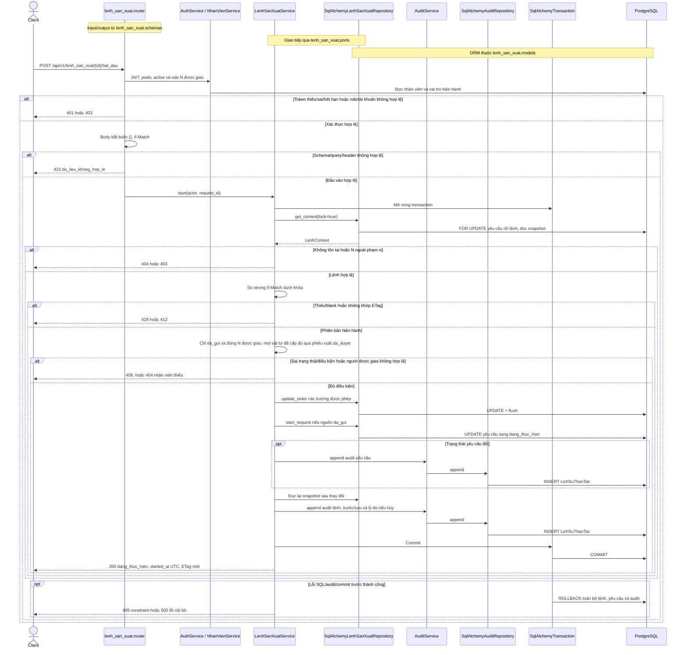
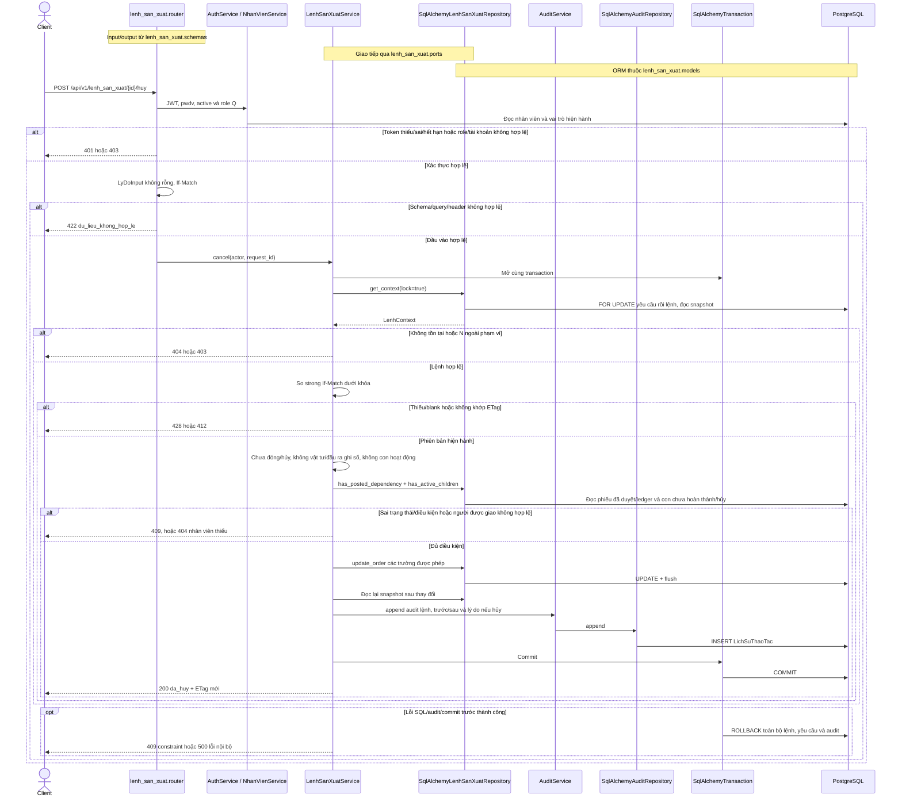

# Sequence — lenh_san_xuat

## Lệnh sản xuất — contract v3 §9, API-045–051

Bảy endpoint được triển khai trong module `lenh_san_xuat`, qua `router.py`, `LenhSanXuatService` và `SqlAlchemyLenhSanXuatRepository`. Lệnh chỉ sinh khi gửi yêu cầu, không có POST tạo thủ công hoặc endpoint hoàn tất trực tiếp. `AuditService.append → SqlAlchemyAuditRepository.append` dùng chung session/transaction. Không endpoint nào dưới đây ghi tồn/ledger. Hoàn tất vẫn do duyệt chứng từ đầu ra hiện có.

Module sở hữu đủ `models.py` (LenhSanXuat/ChiTietLenhSanXuat), `ports.py` (LenhContext/repository/kiểm tra nhân viên) và `schemas.py` (input/output/envelope). ORM đăng ký qua `app/models.py`; yêu cầu/kế hoạch, phiếu xuất và hoàn thành dùng cùng các class này. Không có khai báo ORM lệnh trùng trong `san_xuat`.

Q đọc toàn bộ, N chỉ đọc/bắt đầu lệnh có `nhan_vien_id` của mình, A bị chặn. Thiếu/sai/hết hạn/thu hồi JWT trả 401, tài khoản khóa hoặc sai role/phạm vi trả 403, ID không tồn tại 404, input/query/header lặp sai 422.

GET chi tiết và vật tư cùng trả strong ETag từ lệnh (BOM/nhu cầu/tiến độ/ID con), trạng thái yêu cầu và snapshot vật tư đã cấp/tồn hiện tại. Khi một phần snapshot đổi, tải lại để lấy ETag mới. PATCH/actions bắt buộc If-Match: thiếu/blank 428, cũ/weak/wildcard/list 412. So sánh dưới khóa `yêu cầu → lệnh`, cùng thứ tự phiếu xuất và hoàn thành sản xuất. GET dùng khóa chia sẻ, không thay đổi trạng thái.

`du_dieu_kien_bat_dau` chỉ true khi lệnh da_gui, nguồn cho phép và đã cấp đủ, không dựa vào tồn hiện tại. Lệnh bắt đầu chuyển yêu cầu da_gui sang dang_thuc_hien, nhưng giữ cho_bo_sung_vat_tu. Hủy chỉ đổi trạng thái lệnh và ghi lý do trong audit, không tự xóa hoặc đổi chứng từ nháp/chờ duyệt liên quan. Phân công không thay đổi là no-op, không audit trùng.

| Endpoint | Ảnh PNG |
|---|---|
| `GET /api/v1/lenh_san_xuat` | [danh-sach](assets/lenh_san_xuat/lenh-01-danh-sach.png) |
| `GET /api/v1/lenh_san_xuat/{id}` | [chi-tiet](assets/lenh_san_xuat/lenh-02-chi-tiet.png) |
| `PATCH /api/v1/lenh_san_xuat/{id}` | [phan-cong](assets/lenh_san_xuat/lenh-03-phan-cong.png) |
| `GET /api/v1/lenh_san_xuat/{id}/vat_tu` | [vat-tu](assets/lenh_san_xuat/lenh-04-vat-tu.png) |
| `POST /api/v1/lenh_san_xuat/{id}/gui` | [gui](assets/lenh_san_xuat/lenh-05-gui.png) |
| `POST /api/v1/lenh_san_xuat/{id}/bat_dau` | [bat-dau](assets/lenh_san_xuat/lenh-06-bat-dau.png) |
| `POST /api/v1/lenh_san_xuat/{id}/huy` | [huy](assets/lenh_san_xuat/lenh-07-huy.png) |

## GET /api/v1/lenh_san_xuat

## GET /api/v1/lenh_san_xuat/{id}

## PATCH /api/v1/lenh_san_xuat/{id}

## GET /api/v1/lenh_san_xuat/{id}/vat_tu

## POST /api/v1/lenh_san_xuat/{id}/gui

## POST /api/v1/lenh_san_xuat/{id}/bat_dau

## POST /api/v1/lenh_san_xuat/{id}/huy

