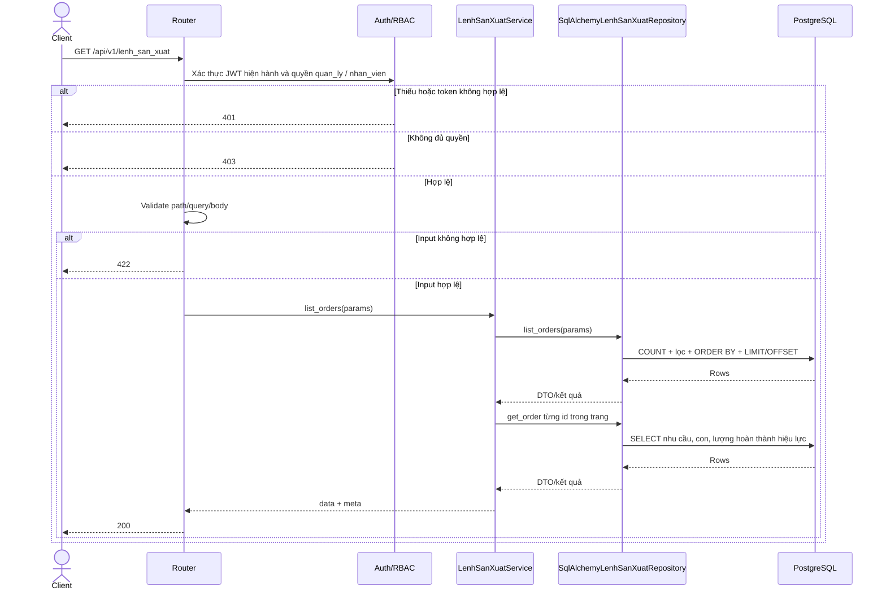
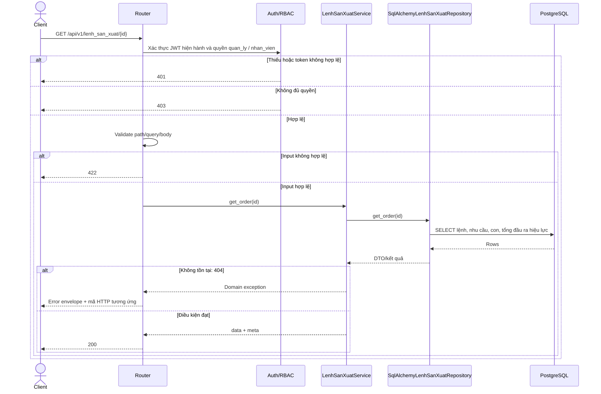

# Module lenh_san_xuat

Nguồn: ảnh contract mục 9 do dev cung cấp và `mrp_xbike_data_model_v2.dbml`, xác nhận ngày 03/11/2026. Dev yêu cầu chỉ sửa code, giữ nguyên SQL/datamodel.

Tên bảng PascalCase theo AGENTS.md; số dư đọc `MatHang.so_luong_ton` theo quyết định hợp nhất hiện có. Adapter dùng SQL có tham số để không phụ thuộc các ORM production cũ. Chưa chuyển đổi hoặc gỡ API `/production/*`.

**Điều kiện database:** cần `ChiTietPhieuDieuChinhKho.giao_dich_goc_id` và trạng thái `PhieuDieuChinhKho.da_duyet` theo v2. `infra/postgres/init.sql` hiện thiếu quan hệ này và dùng trạng thái khác; database chỉ bootstrap bằng file hiện tại chưa chạy được các truy vấn tiến độ mới. Không bỏ qua điều chỉnh để che sai khác. Không sửa schema/database trong tác vụ này.

Không có endpoint tạo tay, sửa lượng/BOM/cha/đầu ra, hay hoàn tất trực tiếp ở module mới. Response thành công `{data, meta}`; lỗi `{error, meta}` theo handler contract hiện có. Không thêm ETag/If-Match vì ảnh contract không quy định. GET không đổi dữ liệu. Ghi lệnh và audit dùng chung session/transaction: lỗi rollback toàn bộ. Các luồng ghi sổ/điều chỉnh khác phải tuân thủ khóa lệnh khi kiểm tra và cập nhật lượng như datamodel v2; tác vụ này chưa chuyển đổi các module đó.

Lượng hoàn thành hiệu lực = giao dịch nhập sản phẩm sản xuất đã ghi sổ + tổng giao dịch điều chỉnh đã ghi sổ trỏ về nguồn, thuộc phiếu điều chỉnh da_duyet. Các giao dịch được cộng đúng một lần. Module này chỉ đọc tiến độ; việc duyệt đầu ra và cập nhật trạng thái hoàn thành thuộc luồng chứng từ hoàn thành, chưa triển khai trong module mới.

## GET /api/v1/lenh_san_xuat

Lọc q, yeu_cau_san_xuat_id, lenh_san_xuat_cha_id, nhan_vien_id, mat_hang_id, trang_thai, tu_ngay, den_ngay. Sort id/created_at/ma_lenh_san_xuat; tiền tố - giảm dần. page mặc định 1, page_size 20 tối đa 100; ngày không có múi giờ được hiểu UTC. Response meta có page, page_size, total, total_pages.



## GET /api/v1/lenh_san_xuat/{id}

id phải dương; id vượt INT32 trả 404. Response gồm nhu_cau_truc_tiep, so_luong_da_hoan_thanh, so_luong_con_phai_hoan_thanh, lenh_con_ids; giữ cả con đã hủy để tra cứu lịch sử.



## PATCH /api/v1/lenh_san_xuat/{id}

Chỉ nhận nhan_vien_id dương, không nhận trường khác. Chỉ nhap được sửa. Ghi audit sua.

```mermaid
sequenceDiagram
    actor C as Client
    participant R as Router
    participant A as Auth/RBAC
    participant S as LenhSanXuatService
    participant P as SqlAlchemyLenhSanXuatRepository
    participant L as AuditRepository
    participant T as SqlAlchemyTransaction
    participant D as PostgreSQL
    C->>R: PATCH /api/v1/lenh_san_xuat/{id}
    R->>A: Xác thực JWT hiện hành và quyền quan_ly
    alt Thiếu hoặc token không hợp lệ
        A-->>C: 401
    else Không đủ quyền
        A-->>C: 403
    else Hợp lệ
        R->>R: Validate path/query/body
        alt Input không hợp lệ
            R-->>C: 422
        else Input hợp lệ
            R->>S: assign(id, nhan_vien_id, actor)
            S->>T: Enter transaction chung session
            S->>P: lock_order(id)
            P->>D: SELECT yêu cầu FOR UPDATE, lệnh FOR UPDATE; đọc DTO
            D-->>P: Rows
            P-->>S: DTO/kết quả
            S->>P: employee_active(employee_id)
            P->>D: SELECT NhanVien hoat_dong FOR SHARE
            D-->>P: Rows
            P-->>S: DTO/kết quả
            alt Không tồn tại: 404; khác nhap: 409; nhân viên không hoạt động: 422
                T->>D: ROLLBACK
                S-->>R: Domain exception
                R-->>C: Error envelope + mã HTTP tương ứng
            else Điều kiện đạt
                S->>P: assign/transition
                P->>D: UPDATE nhan_vien_id
                S->>P: get_order(id)
                P->>D: SELECT lại lệnh và tiến độ
                P-->>S: DTO sau cập nhật
                S->>L: append actor, thao tác, trước/sau, lý do khi hủy
                L->>D: INSERT LichSuThaoTac trong session chung
                S->>T: Exit transaction
                alt Ghi hoặc commit lỗi
                    T->>D: ROLLBACK
                    R-->>C: 409 constraint hoặc 500
                else Commit thành công
                    T->>D: COMMIT
                    S-->>R: data + meta.request_id
                    R-->>C: 200
                end
            end
        end
    end
```

## GET /api/v1/lenh_san_xuat/{id}/vat_tu

Response chi_tiet: mat_hang_id, so_luong_can, so_luong_da_cap, so_luong_con_phai_cap, ton_hien_tai. Lượng cấp là âm tổng giao dịch xuất vật tư hiệu lực, chỉ từ phiếu da_duyet. Điều chỉnh phải trỏ giao dịch gốc, có giao dịch ghi sổ và phiếu da_duyet; kiểm kê độc lập không tham gia. du_dieu_kien_bat_dau khi có nhu cầu và mọi dòng đã cấp đủ.

```mermaid
sequenceDiagram
    actor C as Client
    participant R as Router
    participant A as Auth/RBAC
    participant S as LenhSanXuatService
    participant P as SqlAlchemyLenhSanXuatRepository
    participant D as PostgreSQL
    C->>R: GET /api/v1/lenh_san_xuat/{id}/vat_tu
    R->>A: Xác thực JWT hiện hành và quyền quan_ly / nhan_vien
    alt Thiếu hoặc token không hợp lệ
        A-->>C: 401
    else Không đủ quyền
        A-->>C: 403
    else Hợp lệ
        R->>R: Validate path/query/body
        alt Input không hợp lệ
            R-->>C: 422
        else Input hợp lệ
            R->>S: get_materials(id)
            S->>P: get_order(id)
            P->>D: SELECT lệnh và tiến độ
            D-->>P: Rows
            P-->>S: DTO/kết quả
            S->>P: materials(order)
            P->>D: SELECT nhu cầu, tồn tham khảo; tổng xuất + điều chỉnh nguồn đã duyệt
            D-->>P: Rows
            P-->>S: DTO/kết quả
            alt Không tồn tại: 404
                S-->>R: Domain exception
                R-->>C: Error envelope + mã HTTP tương ứng
            else Điều kiện đạt
                S-->>R: data + meta
                R-->>C: 200
            end
        end
    end
```

## POST /api/v1/lenh_san_xuat/{id}/gui

Body {} bắt buộc. Không chặn gửi vì thiếu tồn/vật tư cấp. Kiểm tra nhu cầu trực tiếp đúng ChiTietBom.so_luong nhân lượng lệnh; không tự tính lại snapshot. Chuyển nhap → da_gui, audit gui.

```mermaid
sequenceDiagram
    actor C as Client
    participant R as Router
    participant A as Auth/RBAC
    participant S as LenhSanXuatService
    participant P as SqlAlchemyLenhSanXuatRepository
    participant L as AuditRepository
    participant T as SqlAlchemyTransaction
    participant D as PostgreSQL
    C->>R: POST /api/v1/lenh_san_xuat/{id}/gui
    R->>A: Xác thực JWT hiện hành và quyền quan_ly
    alt Thiếu hoặc token không hợp lệ
        A-->>C: 401
    else Không đủ quyền
        A-->>C: 403
    else Hợp lệ
        R->>R: Validate path/query/body
        alt Input không hợp lệ
            R-->>C: 422
        else Input hợp lệ
            R->>S: send(id, actor)
            S->>T: Enter transaction chung session
            S->>P: lock_bom_graph()
            P->>D: pg_advisory_xact_lock dùng chung BOM
            D-->>P: Rows
            P-->>S: DTO/kết quả
            S->>P: lock_order(id)
            P->>D: SELECT yêu cầu và lệnh FOR UPDATE; đọc DTO
            D-->>P: Rows
            P-->>S: DTO/kết quả
            S->>P: employee_active(id)
            P->>D: SELECT NhanVien hoat_dong FOR SHARE
            D-->>P: Rows
            P-->>S: DTO/kết quả
            S->>P: request_active(id), formula_matches(order)
            P->>D: SELECT trạng thái yêu cầu, BOM active đúng đầu ra, ChiTietBom
            D-->>P: Rows
            P-->>S: DTO/kết quả
            alt Không tồn tại: 404; nhân viên thiếu/khóa: 422; khác nhap hoặc kế hoạch không hợp lệ: 409
                T->>D: ROLLBACK
                S-->>R: Domain exception
                R-->>C: Error envelope + mã HTTP tương ứng
            else Điều kiện đạt
                S->>P: assign/transition
                P->>D: UPDATE da_gui
                S->>P: get_order(id)
                P->>D: SELECT lại lệnh và tiến độ
                P-->>S: DTO sau cập nhật
                S->>L: append actor, thao tác, trước/sau, lý do khi hủy
                L->>D: INSERT LichSuThaoTac trong session chung
                S->>T: Exit transaction
                alt Ghi hoặc commit lỗi
                    T->>D: ROLLBACK
                    R-->>C: 409 constraint hoặc 500
                else Commit thành công
                    T->>D: COMMIT
                    S-->>R: data + meta.request_id
                    R-->>C: 200
                end
            end
        end
    end
```

## POST /api/v1/lenh_san_xuat/{id}/bat_dau

Body {} bắt buộc. Chỉ nhan_vien được giao, quản lý bị 403. Chuyển da_gui → dang_thuc_hien, started_at = now(), audit bat_dau. Không ghi/trừ kho lần nữa. Đầu ra lệnh con được cấp cho cha qua phiếu xuất đã ghi sổ, không cộng trực tiếp số lượng hoàn thành của con vào cấp cho cha.

```mermaid
sequenceDiagram
    actor C as Client
    participant R as Router
    participant A as Auth/RBAC
    participant S as LenhSanXuatService
    participant P as SqlAlchemyLenhSanXuatRepository
    participant L as AuditRepository
    participant T as SqlAlchemyTransaction
    participant D as PostgreSQL
    C->>R: POST /api/v1/lenh_san_xuat/{id}/bat_dau
    R->>A: Xác thực JWT hiện hành và quyền nhan_vien được giao
    alt Thiếu hoặc token không hợp lệ
        A-->>C: 401
    else Không đủ quyền
        A-->>C: 403
    else Hợp lệ
        R->>R: Validate path/query/body
        alt Input không hợp lệ
            R-->>C: 422
        else Input hợp lệ
            R->>S: start(id, actor)
            S->>T: Enter transaction chung session
            S->>P: lock_order(id)
            P->>D: SELECT yêu cầu và lệnh FOR UPDATE; đọc DTO
            D-->>P: Rows
            P-->>S: DTO/kết quả
            S->>P: materials(order)
            P->>D: SELECT lượng đã cấp hiệu lực từ xuất và điều chỉnh nguồn đã ghi sổ
            D-->>P: Rows
            P-->>S: DTO/kết quả
            alt Không tồn tại: 404; actor khác người được giao: 403; khác da_gui hoặc thiếu vật tư: 409
                T->>D: ROLLBACK
                S-->>R: Domain exception
                R-->>C: Error envelope + mã HTTP tương ứng
            else Điều kiện đạt
                S->>P: assign/transition
                P->>D: UPDATE dang_thuc_hien, started_at
                S->>P: get_order(id)
                P->>D: SELECT lại lệnh và tiến độ
                P-->>S: DTO sau cập nhật
                S->>L: append actor, thao tác, trước/sau, lý do khi hủy
                L->>D: INSERT LichSuThaoTac trong session chung
                S->>T: Exit transaction
                alt Ghi hoặc commit lỗi
                    T->>D: ROLLBACK
                    R-->>C: 409 constraint hoặc 500
                else Commit thành công
                    T->>D: COMMIT
                    S-->>R: data + meta.request_id
                    R-->>C: 200
                end
            end
        end
    end
```

## POST /api/v1/lenh_san_xuat/{id}/huy

ly_do được trim, tối thiểu 3 ký tự. Có ghi sổ thì chặn kể cả tổng hiệu lực đã điều chỉnh về 0. Chuyển sang da_huy, audit huy có lý do; không cập nhật trạng thái yêu cầu và không tạo lệnh thay thế.

```mermaid
sequenceDiagram
    actor C as Client
    participant R as Router
    participant A as Auth/RBAC
    participant S as LenhSanXuatService
    participant P as SqlAlchemyLenhSanXuatRepository
    participant L as AuditRepository
    participant T as SqlAlchemyTransaction
    participant D as PostgreSQL
    C->>R: POST /api/v1/lenh_san_xuat/{id}/huy
    R->>A: Xác thực JWT hiện hành và quyền quan_ly
    alt Thiếu hoặc token không hợp lệ
        A-->>C: 401
    else Không đủ quyền
        A-->>C: 403
    else Hợp lệ
        R->>R: Validate path/query/body
        alt Input không hợp lệ
            R-->>C: 422
        else Input hợp lệ
            R->>S: cancel(id, ly_do, actor)
            S->>T: Enter transaction chung session
            S->>P: lock_order(id)
            P->>D: SELECT yêu cầu và lệnh FOR UPDATE; đọc DTO
            D-->>P: Rows
            P-->>S: DTO/kết quả
            S->>P: has_postings(id), has_active_children(id)
            P->>D: SELECT EXISTS chứng từ đã duyệt/giao dịch nguồn và con chưa hủy
            D-->>P: Rows
            P-->>S: DTO/kết quả
            alt Không tồn tại: 404; lệnh kết thúc, đã ghi sổ hoặc con còn hoạt động: 409
                T->>D: ROLLBACK
                S-->>R: Domain exception
                R-->>C: Error envelope + mã HTTP tương ứng
            else Điều kiện đạt
                S->>P: assign/transition
                P->>D: UPDATE da_huy
                S->>P: get_order(id)
                P->>D: SELECT lại lệnh và tiến độ
                P-->>S: DTO sau cập nhật
                S->>L: append actor, thao tác, trước/sau, lý do khi hủy
                L->>D: INSERT LichSuThaoTac trong session chung
                S->>T: Exit transaction
                alt Ghi hoặc commit lỗi
                    T->>D: ROLLBACK
                    R-->>C: 409 constraint hoặc 500
                else Commit thành công
                    T->>D: COMMIT
                    S-->>R: data + meta.request_id
                    R-->>C: 200
                end
            end
        end
    end
```

## Kiểm chứng ngày 03/11/2026

- Ruff lint và format cho các file mới/thay đổi; `git diff --check` đạt.
- OpenAPI của app import thành công, có đủ đúng 7 operation trong `/api/v1/lenh_san_xuat`.
- `pytest tests/test_lenh_san_xuat.py tests/test_lenh_san_xuat_repository.py tests/test_lenh_san_xuat_postgres.py -q`: **46 passed** khi đặt `LSX_V2_TEST_DATABASE_URL` trỏ database `_test` riêng. PostgreSQL 16 dùng TEMP tables tối thiểu theo v2, không bootstrap từ `init.sql`, không chứng minh database ứng dụng hiện tại tương thích. Fixture kiểm tra namespace `_test`, dùng transaction ngoài và savepoint để rollback; không sửa dữ liệu ứng dụng.
- Repository tests kiểm tra SQL aggregate bằng SQLite in-memory; PostgreSQL tests kiểm tra truy vấn, khóa, timestamp, ghi audit, rollback khi lỗi audit. Chưa kiểm thử cạnh tranh giữa nhiều connection hoặc E2E với toàn bộ schema v2.
- Regression toàn backend: **156 passed, 107 skipped, 1 failed**. Các ca skip phụ thuộc cấu hình database kiểm thử riêng; `test_application_lifespan_starts` fail vì xác thực PostgreSQL của cấu hình ứng dụng bị từ chối cho `xbike_admin`. Không sửa cấu hình mật khẩu hoặc source ngoài phạm vi để làm xanh suite.
- Môi trường kiểm thử cách ly: Python 3.14, FastAPI 0.162, Pydantic 2.14, SQLAlchemy 2.1; không thay manifest/lockfile của project.
- Không có `mmdc` trên PATH; đã đối chiếu source với 7 sơ đồ, chưa render/kiểm tra bằng Mermaid CLI.
- Chưa triển khai việc tự hoàn thành lệnh khi duyệt chứng từ đầu ra, tự tính lại trạng thái sau điều chỉnh, hoặc chuyển đổi các module `production`/kho cũ. Chúng thuộc các luồng khác; module này cung cấp 7 endpoint và đọc đúng tiến độ hiệu lực theo v2.
