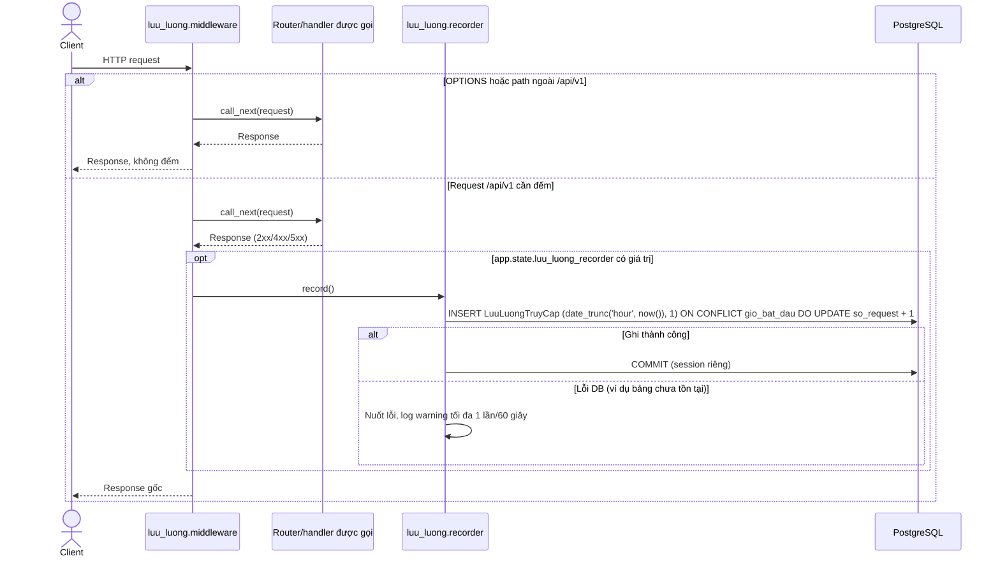
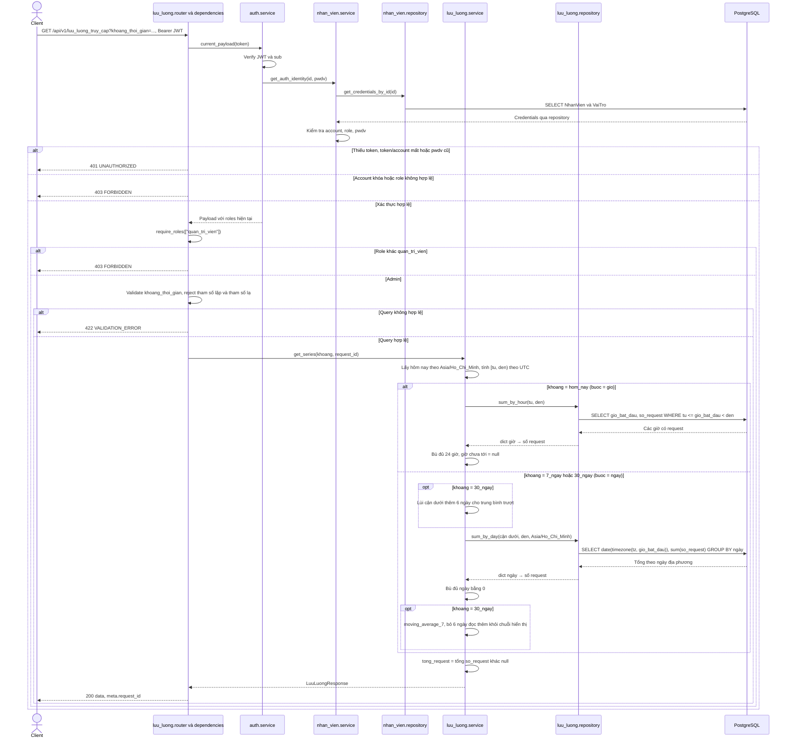

# Sequence diagram — luu_luong

Nguồn: `luu_luong/{router,service,repository,ports,schemas,models,recorder,middleware}.py`, `app/main.py`, `app/dependencies.py`, `core/request_context.py`, `auth/service.py`, `nhan_vien/service.py`.
Module luu_luong sở hữu ORM `LuuLuongTruyCap` ánh xạ bảng `"LuuLuongTruyCap"` (mỗi giờ một dòng `gio_bat_dau`, `so_request`). Không có endpoint ghi; số đếm do middleware HTTP ghi. Quyết định nghiệp vụ: [D-LL-01](../DECISION.md#d-ll-01-lưu-lượng-truy-cập-cho-tổng-quan-admin).

## Middleware ghi số đếm (không phải endpoint)

Middleware `dem_luu_luong` bọc mọi request. Chỉ đếm path `/api/v1` hoặc `/api/v1/...` với method khác `OPTIONS`; đếm cả response lỗi 4xx/5xx và chính endpoint lưu lượng. Không đếm `/`, `/health`, `/docs`, `/redoc`. Recorder chỉ được gán vào `app.state` trong lifespan của ứng dụng; khi không có recorder (test không chạy lifespan) middleware bỏ qua. Ghi số đếm dùng session và transaction riêng, tách khỏi transaction của request. Lỗi khi ghi không đổi response gốc; log warning tối đa 1 lần mỗi 60 giây.

## GET /api/v1/luu_luong_truy_cap — Chuỗi lưu lượng cho biểu đồ Tổng quan

Bearer JWT bắt buộc; chỉ `quan_tri_vien` được đọc, `quan_ly` và `nhan_vien` nhận 403. Query duy nhất `khoang_thoi_gian` ∈ `hom_nay` (mặc định) / `7_ngay` / `30_ngay`; giá trị khác, tham số lặp lại hoặc tham số lạ trả 422. Ranh giới ngày và giờ theo Asia/Ho_Chi_Minh, thời điểm trả về theo UTC. Response `data` gồm `khoang_thoi_gian`, `buoc` (`gio`/`ngay`), `timezone`, `tu_thoi_diem`, `den_thoi_diem_exclusive`, `tong_request`, `diem[]` (`bat_dau`, `so_request`, `trung_binh_7_ngay`); `meta.request_id`. Không phân trang, không ETag. Đọc chỉ dùng session của request, không mở transaction ghi.

- `hom_nay`: 24 điểm theo giờ của hôm nay; giờ sau giờ hiện tại có `so_request = null`.
- `7_ngay`: 7 điểm theo ngày, điểm cuối là hôm nay (số tạm tính); `trung_binh_7_ngay = null`.
- `30_ngay`: 30 điểm theo ngày, điểm cuối là hôm nay; `trung_binh_7_ngay` là trung bình của ngày đó và 6 ngày trước, làm tròn 1 chữ số. Repository đọc thêm 6 ngày trước khoảng hiển thị; 6 ngày này không vào `tong_request`.

