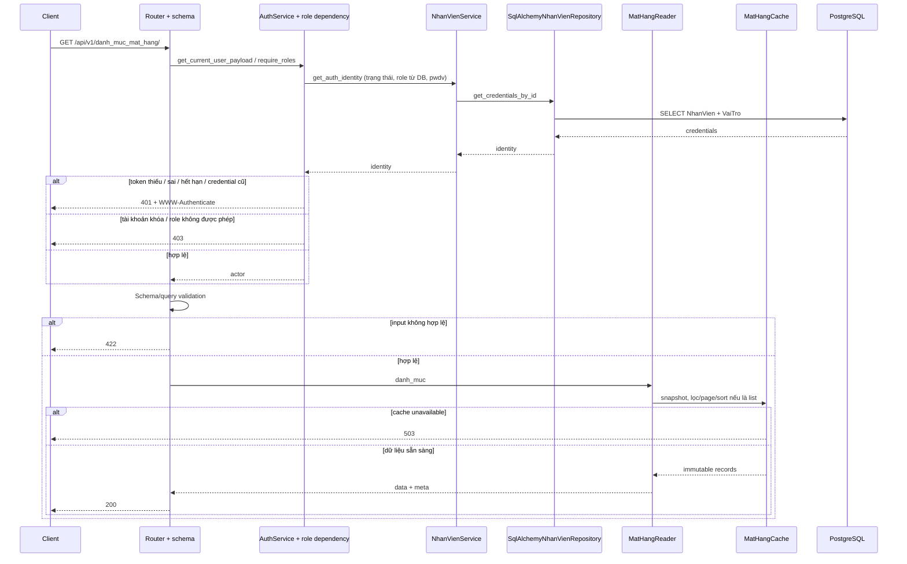
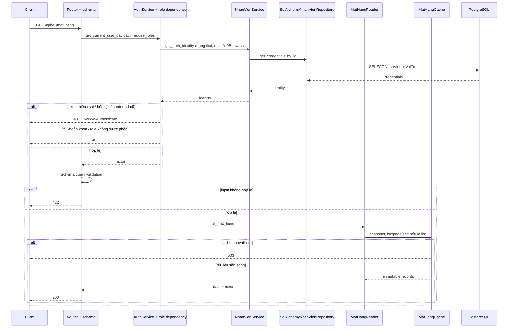
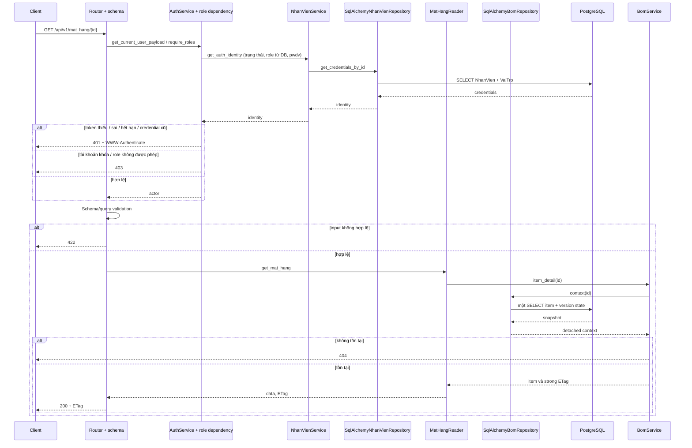
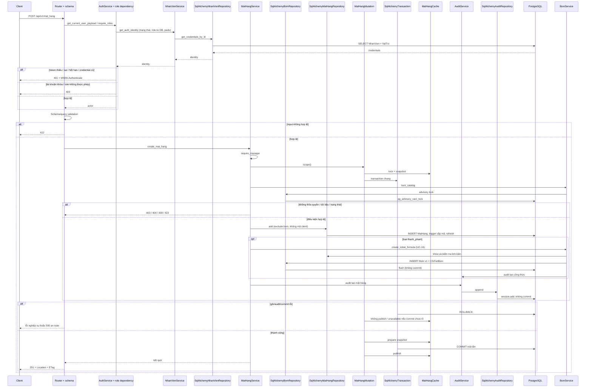
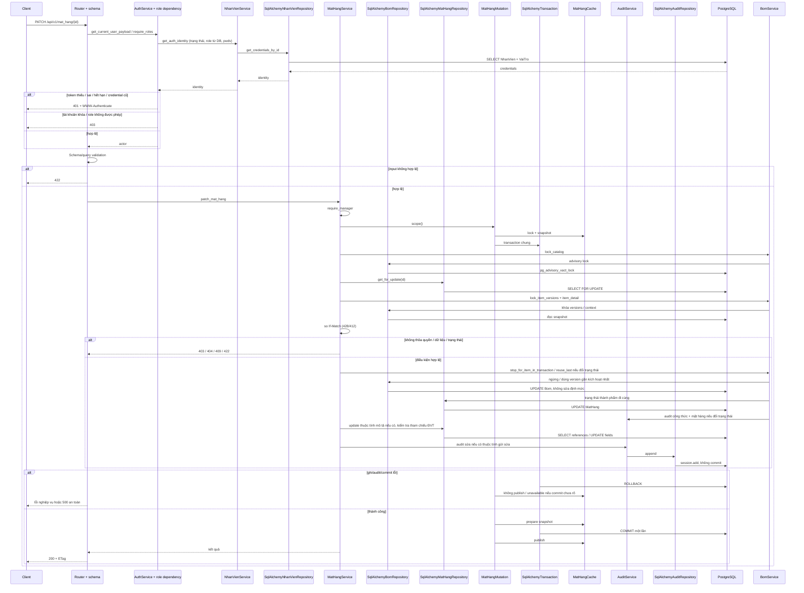
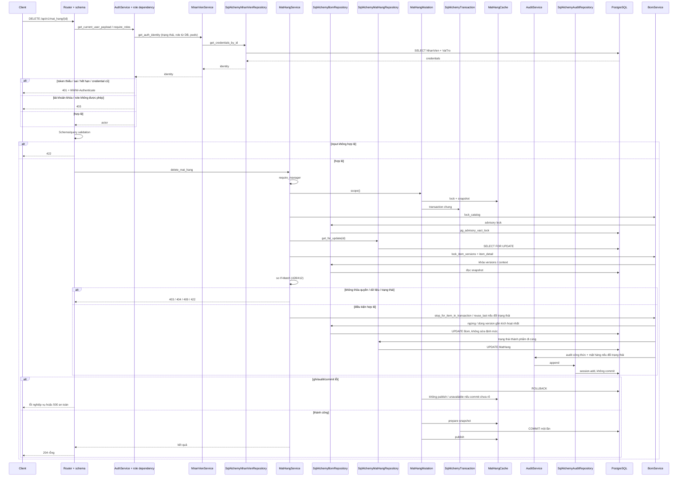

# Sequence — mat_hang

Endpoint thực tế; phần phụ thuộc BOM theo [plan đã duyệt](../../specs/use_cases/bom/PLAN.md). Không mô tả toàn bộ catalog như đã đạt UC v4. Role đọc hiện có QLK/NV, ghi QLK; không thay quyền QTV trong tác vụ BOM.

Tạo chỉ nhận hai loại thanh_pham/linh_kien; mã do Identity/trigger cấp. Thành phẩm bắt buộc có `bom.chi_tiet`, không nhận mã/trạng thái/số tồn từ client. Linh kiện không có công thức. MatHangRead giữ các field đang công khai.

GET danh mục/list dùng cache hiện tại; filter/page/sort giữ nguyên (list page 1/20, max 100). GET detail đọc DB qua BomService.item_detail để body và ETag dùng cùng snapshot; tag thành phẩm có ngữ cảnh BOM. PATCH/DELETE so sánh tag của GET mặt hàng, không dùng tag BOM. Cache của instance xử lý được publish sau commit; instance khác theo LISTEN/NOTIFY và reconciliation hiện có.

## GET /api/v1/danh_muc_mat_hang/

[PNG](assets/mat_hang/mat-hang-1.png). Quyền QLK/NV.

## GET /api/v1/mat_hang

[PNG](assets/mat_hang/mat-hang-2.png). Quyền QLK/NV.

## GET /api/v1/mat_hang/{id}

[PNG](assets/mat_hang/mat-hang-3.png). Quyền QLK/NV.

## POST /api/v1/mat_hang

[PNG](assets/mat_hang/mat-hang-4.png). Quyền QLK. UC-10/16: tạo thành phẩm và công thức cùng lúc.

## PATCH /api/v1/mat_hang/{id}

[PNG](assets/mat_hang/mat-hang-5.png). Quyền QLK. Phần UC-12/18/19 liên quan trạng thái công thức.

## DELETE /api/v1/mat_hang/{id}

[PNG](assets/mat_hang/mat-hang-6.png). Quyền QLK. Phần UC-12/18/19 liên quan trạng thái công thức.

