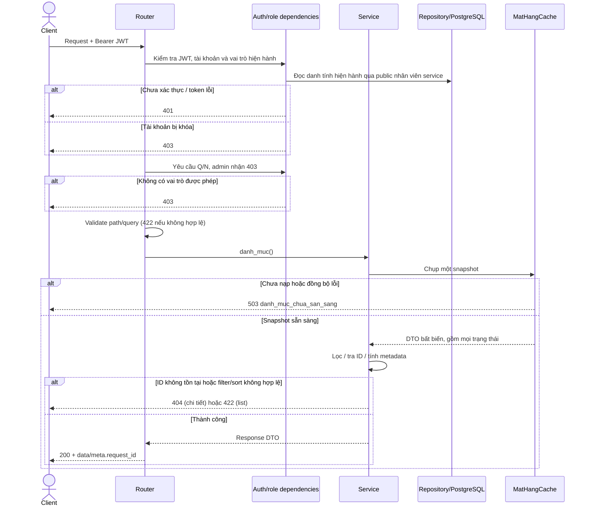
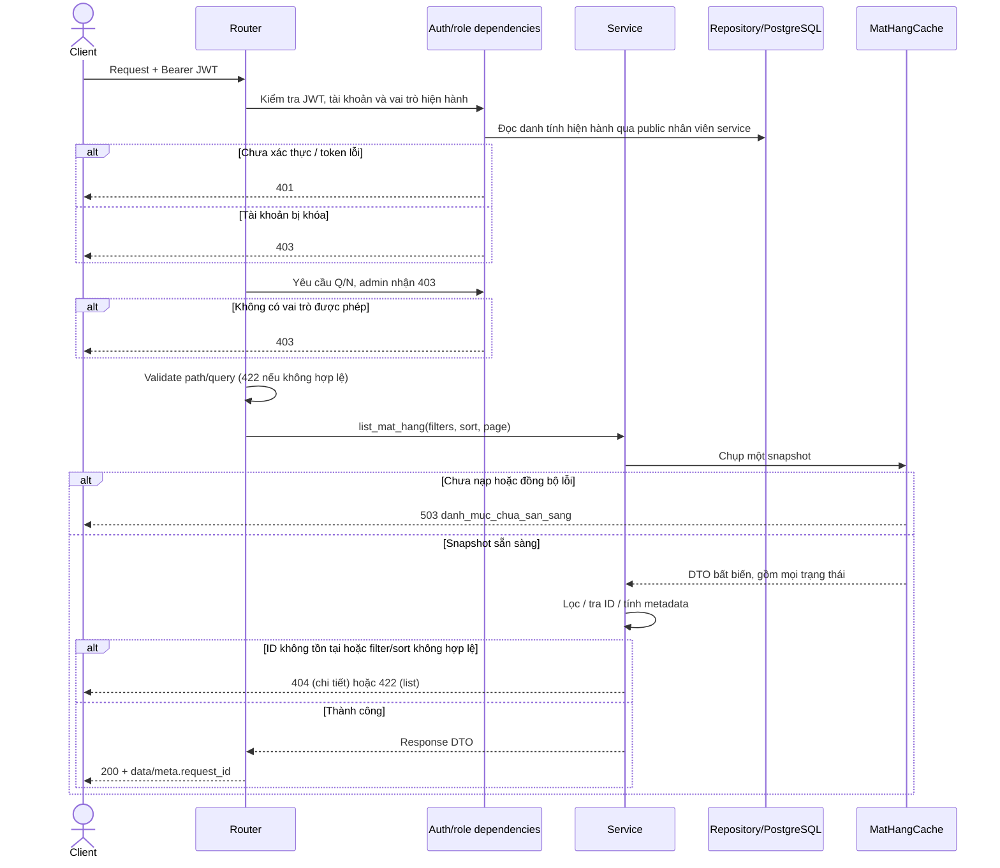
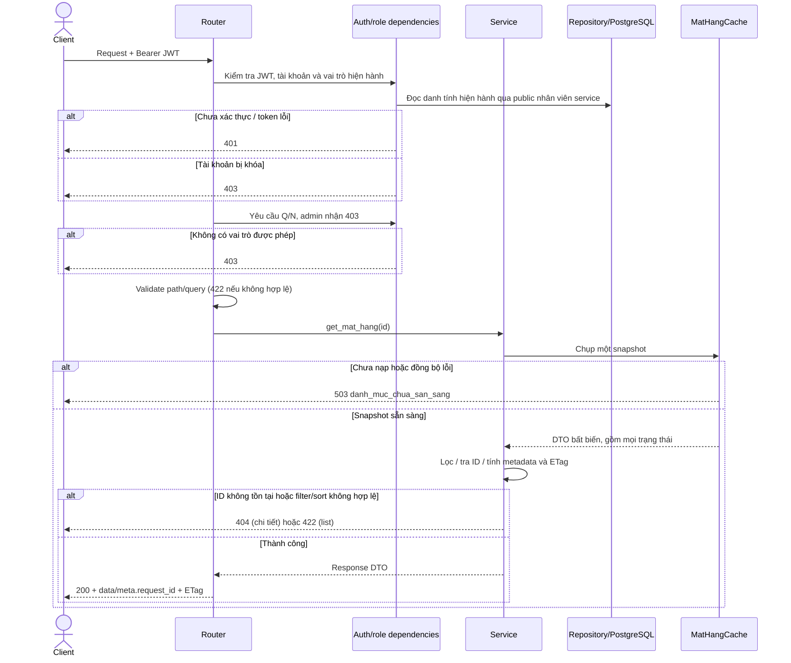
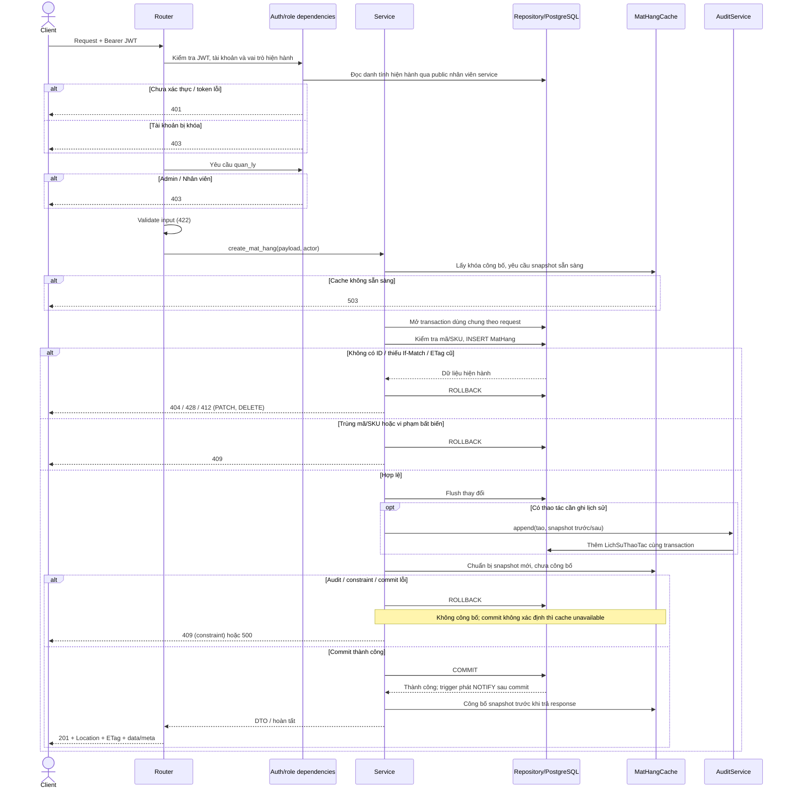
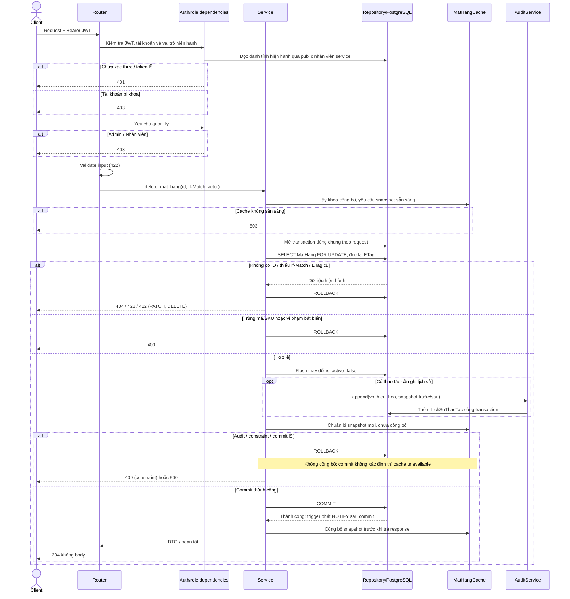
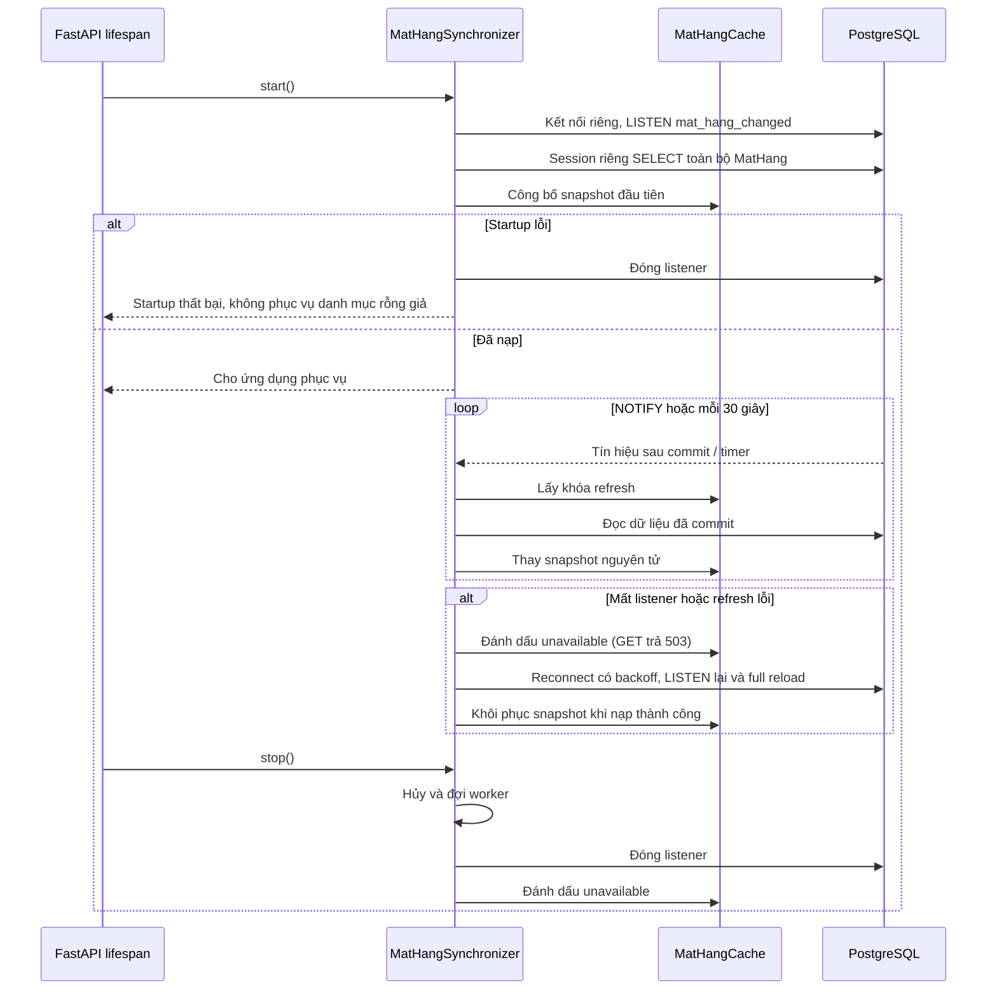

# Sequence — mat_hang

Module sở hữu ORM `MatHang` ánh xạ bảng `"MatHang"`. Có sáu endpoint thực tế; đường dẫn danh mục cũng thuộc router này. Q/N được đọc, admin nhận 403, chỉ Q (`quan_ly`) được ghi.

GET trả cả bản ghi hoạt động và bị khóa; `is_active=false` không làm mất khả năng đọc. GET mặt hàng không truy vấn bảng MatHang; auth vẫn đọc DB để kiểm tra danh tính hiện hành. Giá là chuỗi decimal hai chữ số hoặc null; số dư và thời điểm tồn chỉ đọc. Snapshot gồm DTO bất biến, không giữ ORM/session.

## GET /api/v1/danh_muc_mat_hang/

Trả toàn bộ snapshot, không phân trang; meta.total và meta.request_id.

## GET /api/v1/mat_hang

Tìm mã/tên/SKU, lọc trạng thái chỉ khi được gửi; sort whitelist có ID làm tie-break; meta phân trang. Không lọc is_active mặc định.

## GET /api/v1/mat_hang/{id}

Trả envelope data/meta và ETag; ID không có trong snapshot trả 404, kể cả khi client biết ID từ nguồn khác.

## POST /api/v1/mat_hang

Tên bắt buộc không trắng, mã/SKU duy nhất; số dư server mặc định 0.

## PATCH /api/v1/mat_hang/{id}

PATCH bỏ qua field giữ nguyên; field NOT NULL không được gửi null; giữ các field bất biến sau tham chiếu.

## DELETE /api/v1/mat_hang/{id}

Chỉ UPDATE is_active=false; cho phép có BOM/chứng từ/tồn dương. Không DELETE SQL hoặc sửa số dư. Nếu đã false, ETag hiện hành trả 204 và không thêm audit.

## Startup, đồng bộ và shutdown

Listener riêng đăng ký trước khi đọc dữ liệu; refresh dùng session ngắn riêng. Tín hiệu được gom bằng Event; tín hiệu đến trong lúc refresh sẽ kích hoạt lần đọc kế tiếp. Khóa refresh dùng cùng thứ tự với ghi cục bộ để dữ liệu đọc trước không ghi đè commit mới. GET giữ snapshot cũ nguyên vẹn trong khi một lần refresh bình thường đang chạy.

NOTIFY không lưu bền cho client đã mất kết nối; full reload khi reconnect và đối soát định kỳ bù khoảng trống này. Tính GET thấy ngay sau API ghi được kiểm chứng cho một worker. Nhiều worker có snapshot riêng, đồng bộ bất đồng bộ; chưa cam kết tính thấy-ngay giữa các worker.

Các module dùng ton_kho/ORM cũ chưa chuyển đổi. Public MatHangAvailabilityService kiểm tra/khóa DB khi tạo tài liệu, không dùng cache làm quyết định ghi; xem sequence các module liên quan. Chưa có endpoint yêu cầu sản xuất theo contract và không mô tả nó như đã triển khai.
