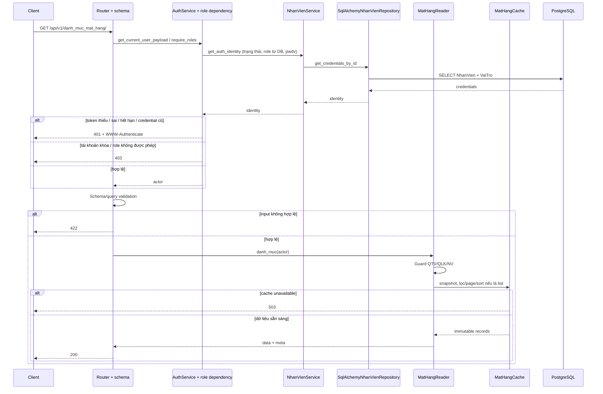
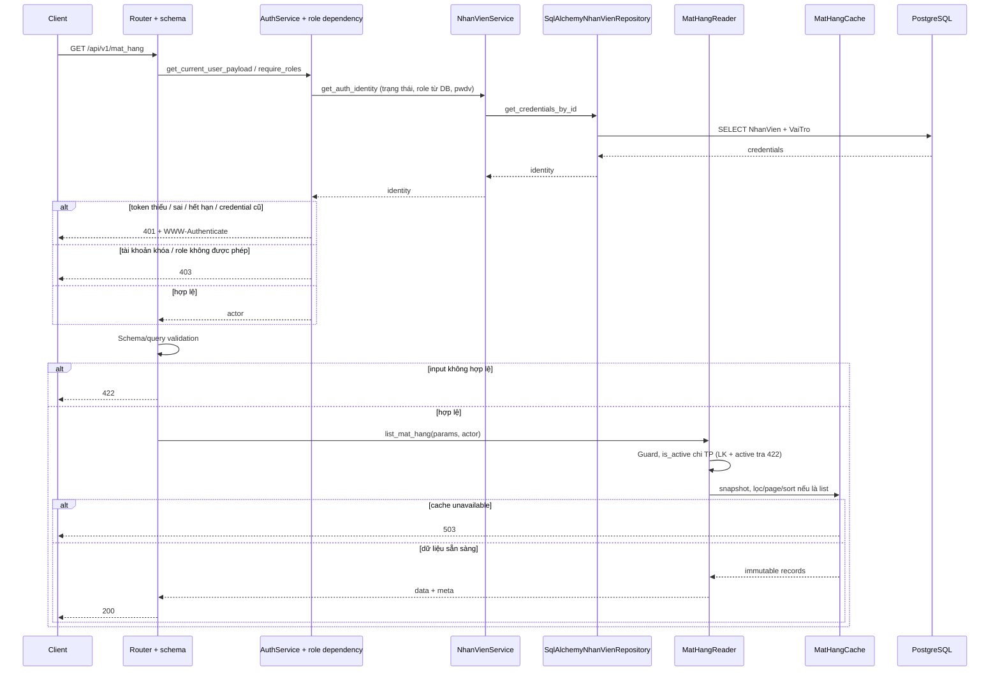
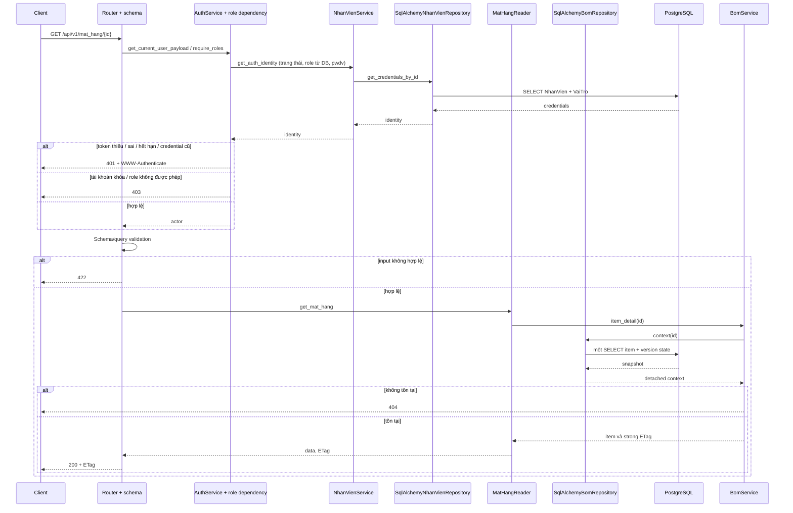
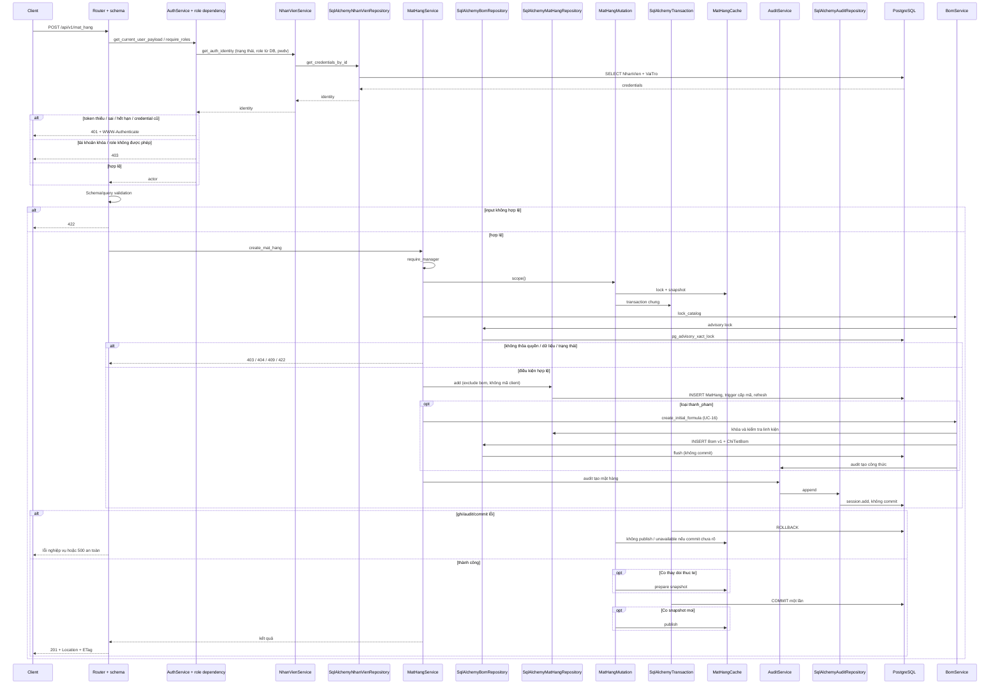
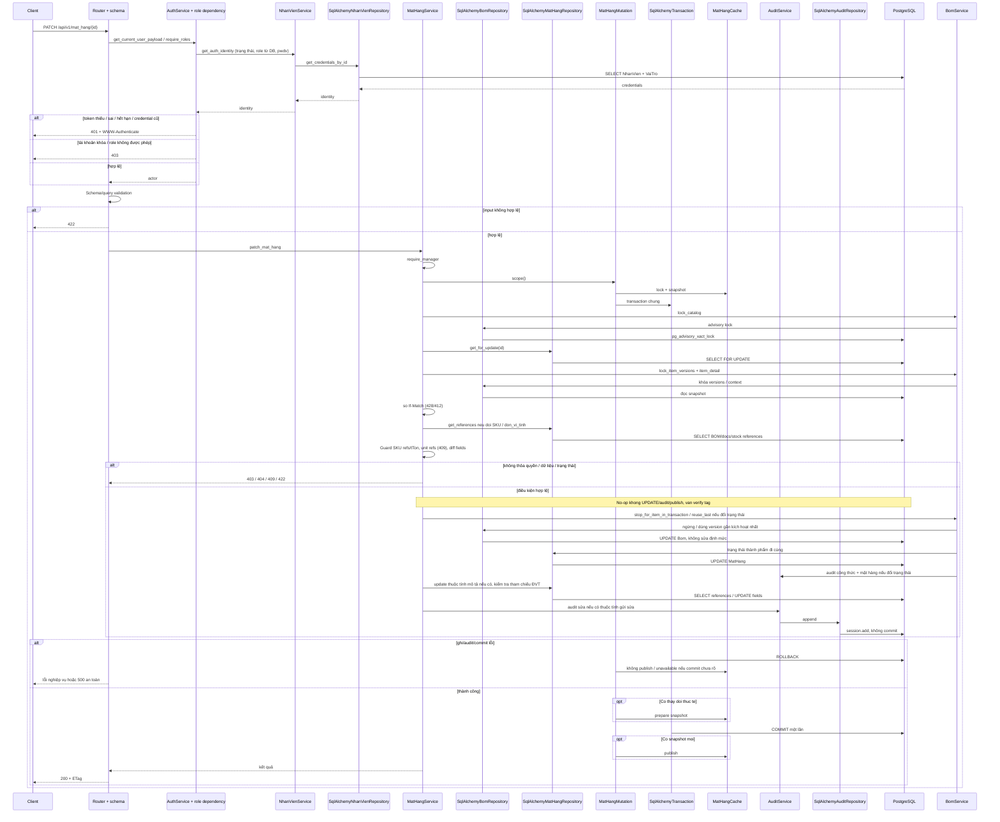
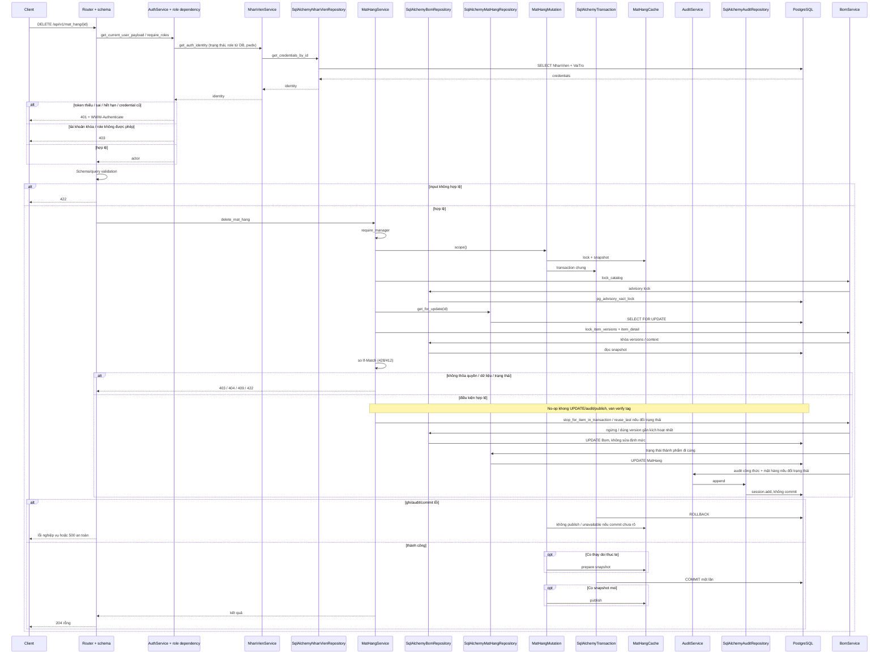

# Sequence — mat_hang

Đối chiếu code ngày 14/11/2026 theo [spec Catalog](../../specs/use_cases/catalog/README.md), [plan Catalog](../../specs/use_cases/catalog/PLAN.md) và phần BOM đã có. Đọc QTV/QLK/NV, ghi chỉ QLK; service kiểm tra lại quyền trước I/O. Frontend và E2E sản xuất/duyệt giá xuất chưa thuộc lần kiểm chứng này.

Tạo chỉ nhận hai loại thanh_pham/linh_kien; mã do Identity/trigger cấp. Thành phẩm bắt buộc có `bom.chi_tiet`, không nhận mã/trạng thái/số tồn từ client. Linh kiện không có công thức. MatHangRead trả ba số chỉ đọc: so_luong_ton, so_luong_dang_giu, so_luong_con_dung = tồn - giữ.

GET danh mục/list dùng cache hiện tại; list page 1/20, max 100, sort id/ma_mat_hang/ten_mat_hang/don_gia và tiền tố `-`, ID ASC khi giá trị bằng nhau. Query DTO cấm tham số lạ/lặp; mọi GET/DELETE cấm body, detail/write cấm query. q là literal substring mã/tên không phân biệt hoa/thường, không tìm SKU; AND các filter. is_active chỉ áp dụng TP, kết hợp loại LK trả 422. GET detail đọc DB qua BomService.item_detail để body và ETag dùng cùng snapshot; tag TP có ngữ cảnh BOM. PATCH/DELETE dùng tag GET mặt hàng, không dùng tag BOM. Thiếu/blank 428, cũ/weak/wildcard/nhiều tag 412. Cache publish sau commit, no-op không prepare/publish; instance khác theo LISTEN/NOTIFY và reconciliation hiện có.

SKU chỉ đổi khi không có tham chiếu hoặc tồn; ĐVT không đổi khi đã có công thức/chứng từ. Mã/loại/số dư bất biến. PATCH không đổi giá trị trả 200 cùng tag, không UPDATE/audit/publish. Ngừng TP đã ngừng với tag hiện tại cũng không ghi lại. Source audit: MatHangService/BomService → AuditService → SqlAlchemyAuditRepository, cùng transaction. UPDATE refresh cột tồn tính toán trước khi dựng DTO để tránh async lazy I/O.

## GET /api/v1/danh_muc_mat_hang/

[PNG](assets/mat_hang/mat-hang-1.png). UC-09, quyền QTV/QLK/NV.

## GET /api/v1/mat_hang

[PNG](assets/mat_hang/mat-hang-2.png). UC-09, quyền QTV/QLK/NV.

## GET /api/v1/mat_hang/{id}

[PNG](assets/mat_hang/mat-hang-3.png). Quyền QLK/NV.

## POST /api/v1/mat_hang

[PNG](assets/mat_hang/mat-hang-4.png). Quyền QLK. UC-10/16: tạo thành phẩm và công thức cùng lúc.

## PATCH /api/v1/mat_hang/{id}

[PNG](assets/mat_hang/mat-hang-5.png). Quyền QLK. Phần UC-12/18/19 liên quan trạng thái công thức.

## DELETE /api/v1/mat_hang/{id}

[PNG](assets/mat_hang/mat-hang-6.png). Quyền QLK. Phần UC-12/18/19 liên quan trạng thái công thức.

