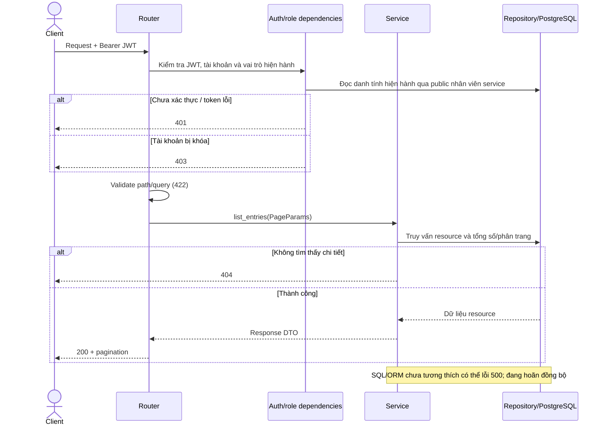
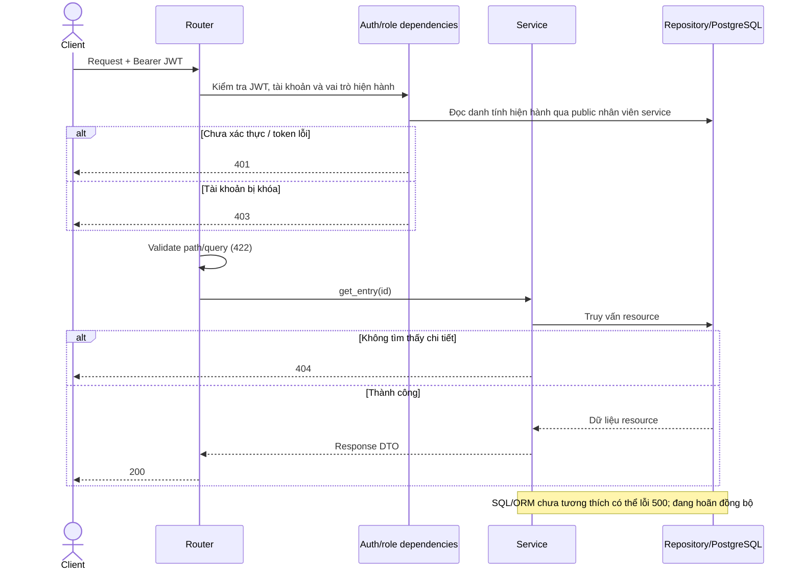
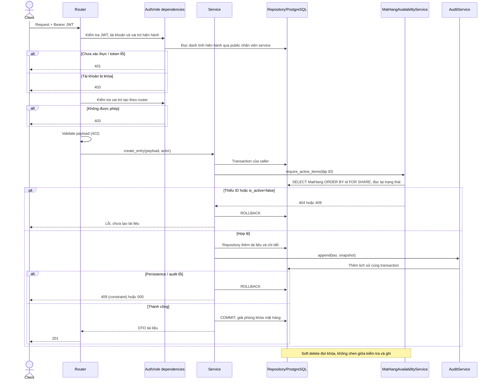

# Sequence — material_issuing

Đối chiếu router/service/repository/schema hiện có. Các tên bảng/ORM nghiệp vụ cũ trong module này chưa được chuyển sang SQL đã chốt; tác vụ hiện tại chỉ thêm guard mặt hàng và sửa FK trực tiếp cần thiết. Các sơ đồ mô tả luồng code khi persistence tương thích; không phải xác nhận E2E với init.sql hiện tại. Endpoint chưa triển khai không được bổ sung vào đây.

GET giữ response và pagination hiện có, vẫn đọc DB của module; yêu cầu GET từ cache chỉ áp dụng danh mục/mặt hàng. GET có auth, không thêm giới hạn vai trò mới. POST giữ nhóm vai trò cũ: quan_tri_vien / quan_ly / nhan_vien. Auth dùng public nhân viên service và kiểm tra trạng thái/credential hiện hành.

## GET /api/v1/material-issuing

## GET /api/v1/material-issuing/{issue_id}

## POST /api/v1/material-issuing

Guard kiểm tra cả đầu ra và các dòng đối với BOM/work order; các dòng đối với phiếu nhập/xuất. Caller giữ transaction; guard dùng cùng session và không commit. ID không có trả 404; mặt hàng bị khóa trả 409 `mat_hang_ngung_hoat_dong`. Các dòng bị khóa vẫn có thể được đọc trong chứng từ cũ. Kiểm tra loai_phieu đúng luồng trước khi tạo; sai loại trả 422.

Không cộng/trừ tồn kho khi tạo các tài liệu này; không tự hủy/chỉnh sửa tài liệu cũ khi mặt hàng bị khóa. Chưa bổ sung chính sách mới cho các bước workflow chưa triển khai.
