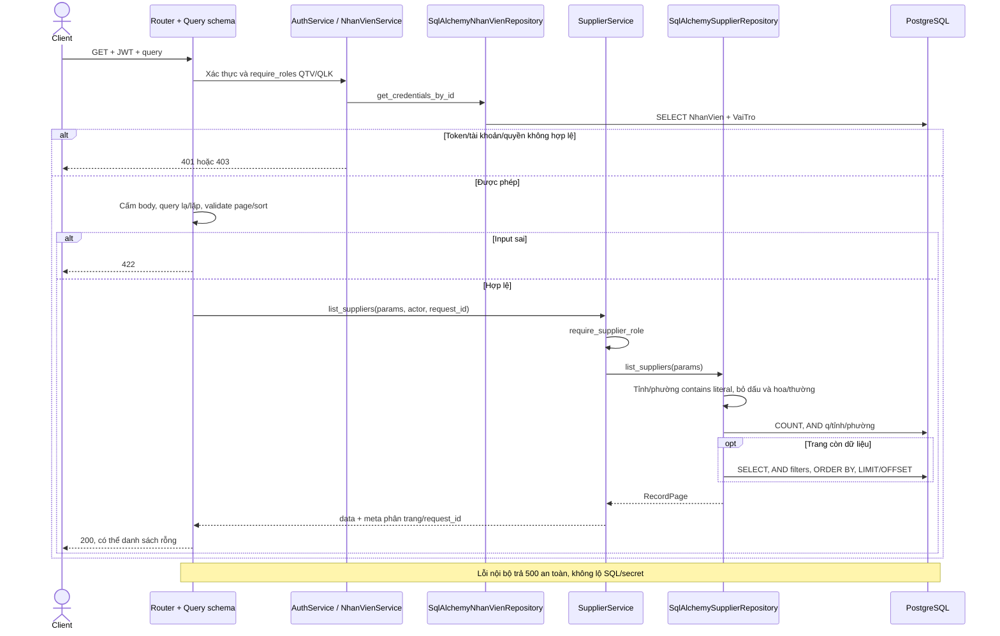
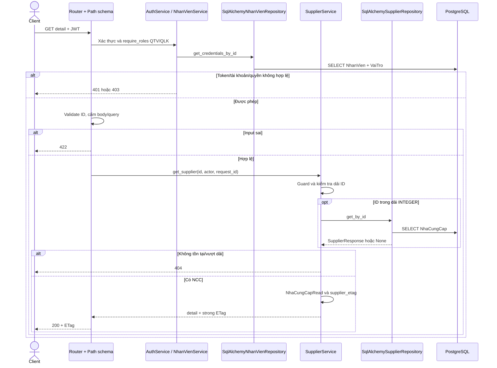
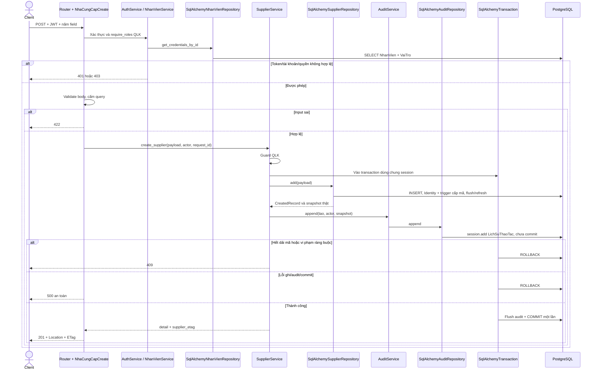
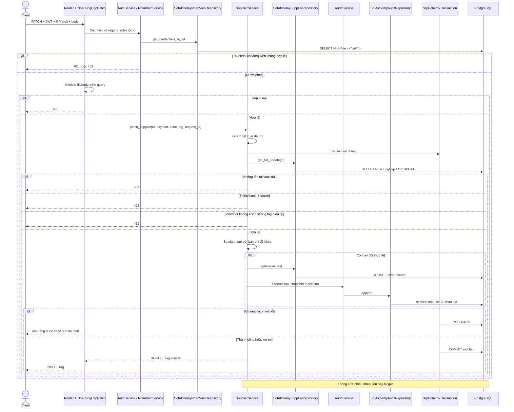

# Sequence — nha_cung_cap

Đối chiếu code ngày 17/11/2026 theo [spec Catalog](../../specs/use_cases/catalog/README.md)
và [plan đã duyệt](../../specs/use_cases/catalog/PLAN.md). QTV = quan_tri_vien,
QLK = quan_ly, NV = nhan_vien. Chỉ bốn endpoint dưới đây, không có DELETE.

GET cho QTV/QLK, ghi chỉ QLK; service kiểm tra quyền lại trước truy cập dữ liệu.
Auth đọc vai trò/trạng thái hiện tại từ DB, không tin role JWT. Token thiếu/sai/hết
hạn/thu hồi trả 401 + WWW-Authenticate; tài khoản khóa hoặc sai quyền trả 403.
Các mũi tên HTTP lỗi là response qua exception handler, repository không xử lý HTTP.

## GET /api/v1/nha_cung_cap

[PNG](assets/nha_cung_cap/nha-cung-cap-1.png). UC-13.
Query mặc định page=1/page_size=20, tối đa 100; sort id/ma_ncc/ten_ncc và tiền tố `-`.
ID ASC là khóa phụ. q chỉ tìm literal mã/tên, không phân biệt hoa/thường;
tinh/phuong tìm một phần, không phân biệt hoa/thường và dấu tiếng Việt theo UC-13
R6/AC-6 đã duyệt 17/11/2026, hỗ trợ Unicode dựng sẵn/tổ hợp. Query bỏ whitespace
ngoài; `%`, `_`, `/` được escape để tìm literal. Chỉ chuẩn hóa predicate, giữ nguyên
địa chỉ trong DB/response. Không cần extension hoặc thay đổi schema.
Các bộ lọc kết hợp AND; blank filter không áp dụng; phuong được dùng riêng.
Không ghi dữ liệu/audit, không yêu cầu If-Match. COUNT và trang là hai truy vấn.

## GET /api/v1/nha_cung_cap/{id}

[PNG](assets/nha_cung_cap/nha-cung-cap-2.png). UC-13. ID dương, không body/query.
Trả strong ETag từ canonical JSON của NhaCungCapRead, không gồm request_id.

## POST /api/v1/nha_cung_cap

[PNG](assets/nha_cung_cap/nha-cung-cap-3.png). UC-14. Bắt buộc đủ năm chuỗi
ten_ncc/so_dien_thoai/dia_chi/phuong/tinh không null/trắng, lưu nguyên văn.
Không nhận id/ma_ncc/created_at/field lạ; không tự kiểm tra địa giới hoặc định dạng
điện thoại. IDENTITY và trigger cấp mã NCC-NNNNNN, không dùng MAX ID/advisory lock.

## PATCH /api/v1/nha_cung_cap/{id}

[PNG](assets/nha_cung_cap/nha-cung-cap-4.png). UC-44. Chỉ sửa từng phần năm field
thông tin, field vắng giữ nguyên. Explicit null/trắng hoặc mã/field lạ trả 422.
`{}` và giá trị không đổi là no-op sau kiểm tra If-Match: không UPDATE/audit.
Thiếu/blank tag trả 428; tag cũ/weak/wildcard/nhiều validator trả 412, kể cả no-op.
So sánh dưới FOR UPDATE; hai session cùng tag chỉ một thay đổi thắng.

Phiếu nhập đọc thông tin NCC hiện tại qua quan hệ chỉ đọc, không lưu snapshot NCC.
Sửa NCC làm representation/ETag phiếu nhập đổi; client cần GET lại trước khi ghi.
Luồng audit: SupplierService → AuditService → SqlAlchemyAuditRepository → PostgreSQL,
trong cùng transaction với tạo/sửa NCC. Không có commit riêng trong audit/repository.
