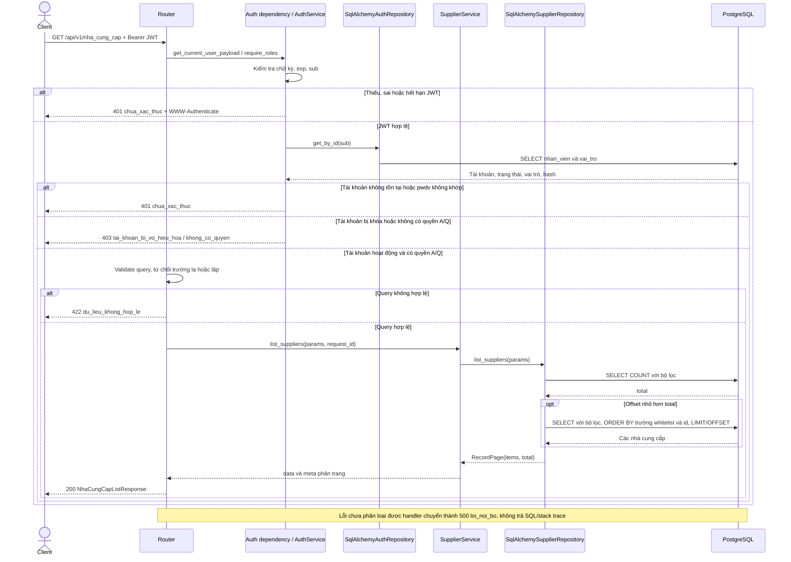
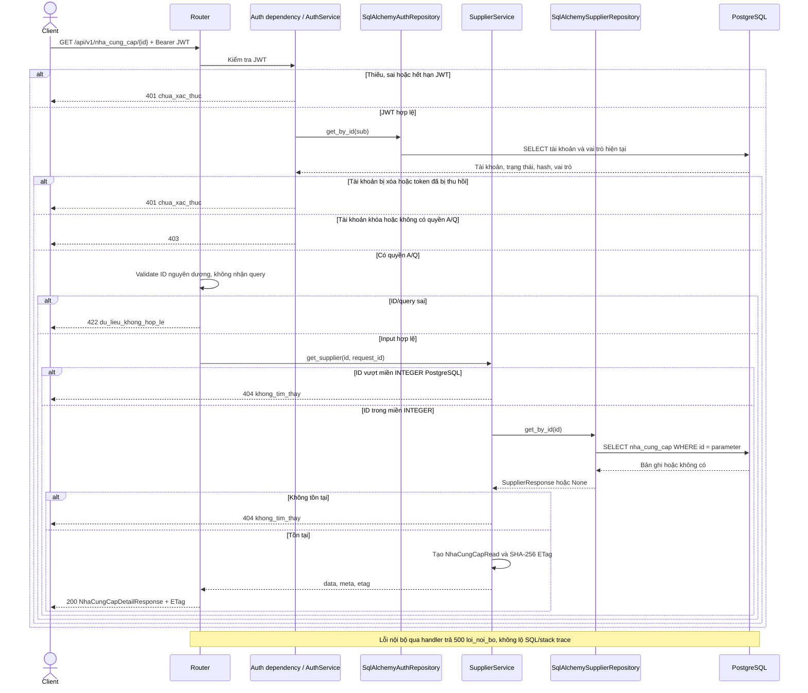
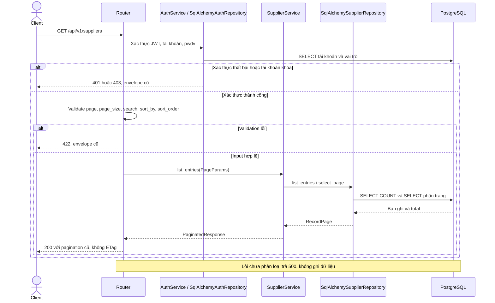
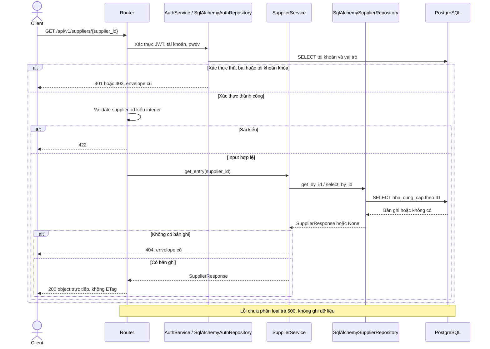
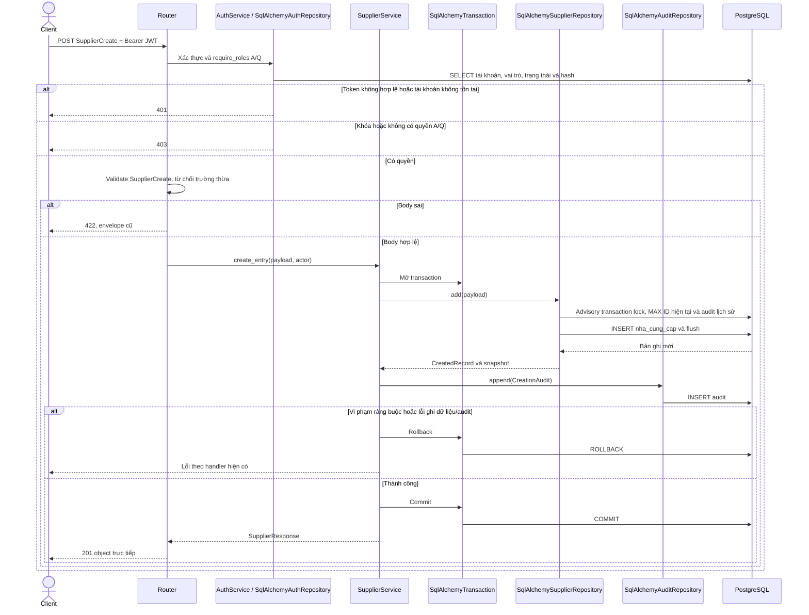
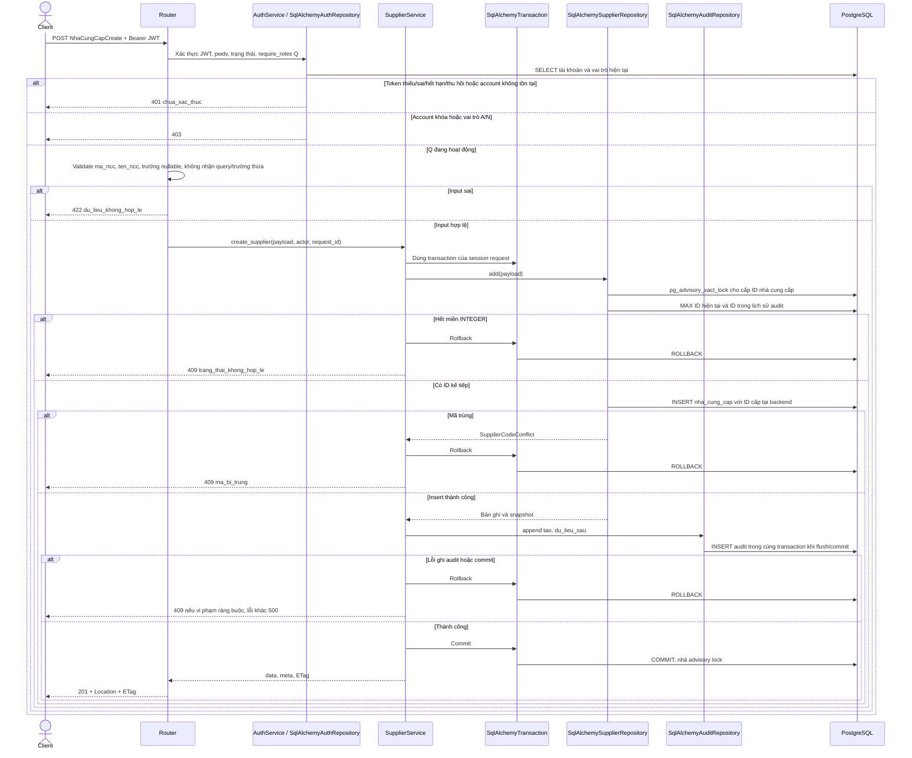
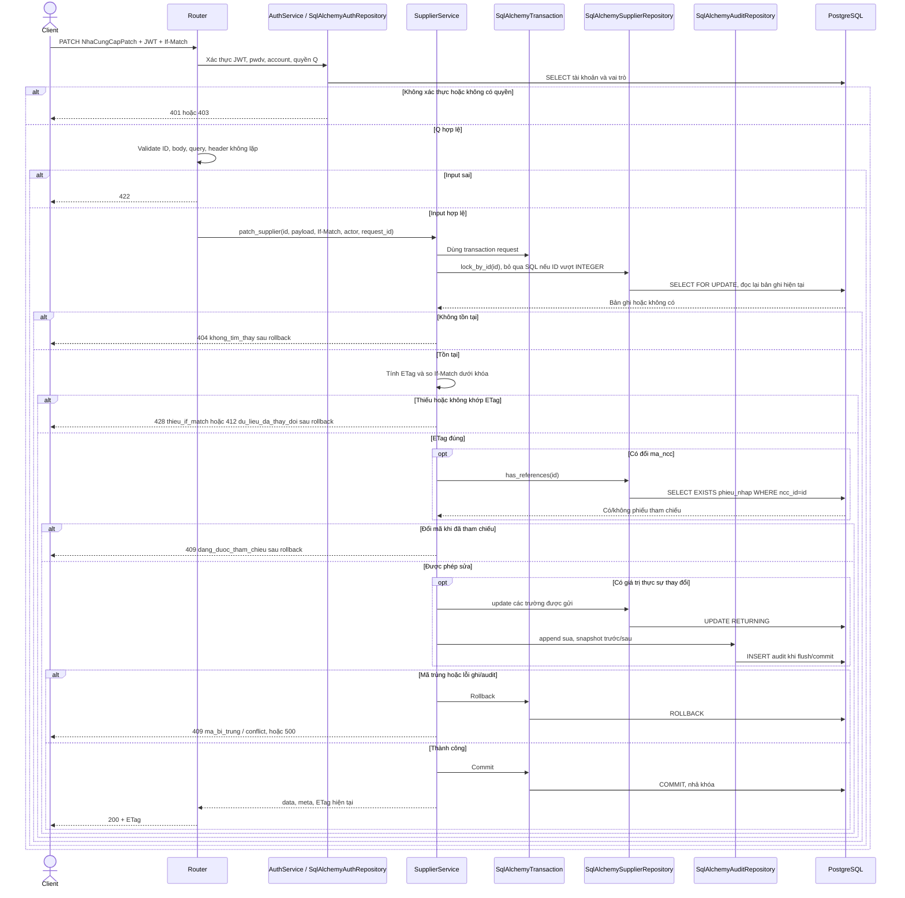
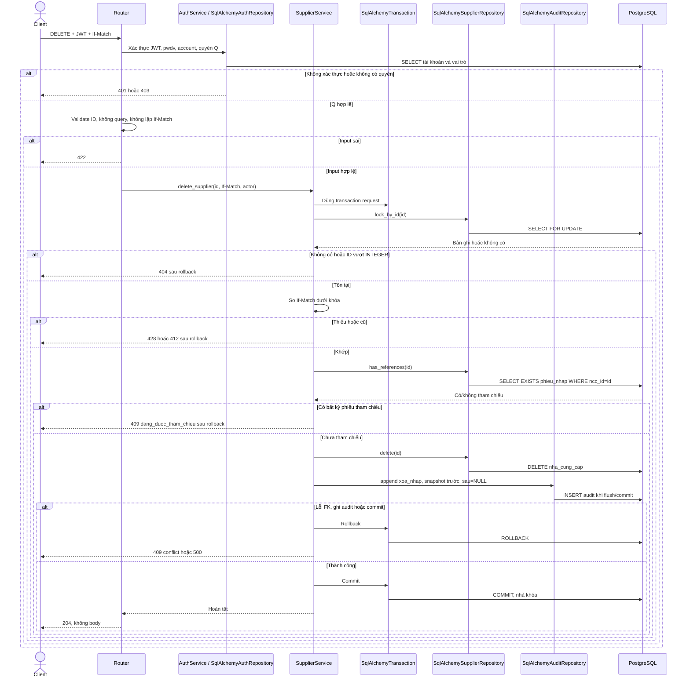

# Module nha_cung_cap

Nguồn: [API contract v2, mục 2, 3, 5 và 14](https://drive.google.com/file/d/16hj1yTLvhQ4peRENCLjbCKhNdGy_L2Xz/view).
Hai GET và POST/PATCH/DELETE tiếng Việt được triển khai theo contract v2. Dev xác nhận giữ
module `nha_cung_cap`, cho GET trả `ten_ncc=null` với dữ liệu cũ, giữ SQL hiện tại và cấp ID
tại backend dưới khóa. DELETE dùng audit `xoa_nhap` kèm snapshot trước khi xóa.

## GET /api/v1/nha_cung_cap

- `page=1`, `page_size=20`, giới hạn page_size từ 1 đến 100.
- `q` tìm chuỗi con không phân biệt hoa thường trong mã/tên. `%`, `_` được tìm như ký tự thường.
- `tinh`, `phuong` so khớp chính xác sau trim, kết hợp AND với `q`.
- Sort: `id`, `ma_ncc`, `ten_ncc`, thêm `-` để giảm dần. Mặc định `id` tăng dần;
  khi trùng giá trị, ID tăng dần làm tiêu chí phụ. NULL sắp theo mặc định PostgreSQL.
- Không hỗ trợ query khác hoặc cùng tham số xuất hiện nhiều lần: 422.
- Trang vượt phạm vi trả `data=[]` nhưng giữ total thực tế. Không có kết quả: total_pages=0.
- A và Q nhận cùng bảy trường: id, ma_ncc, ten_ncc, so_dien_thoai, dia_chi, phuong, tinh.
- GET chỉ SELECT, không ghi audit, không cập nhật nhà cung cấp, chứng từ hay tồn kho.

## GET /api/v1/nha_cung_cap/{id}

ETag có dấu ngoặc kép, không có tiền tố W/, tính trên dữ liệu nhà cung cấp và không gồm request_id.
Cùng dữ liệu có cùng ETag, đổi bất kỳ trường trả về nào làm đổi ETag. GET không yêu cầu If-Match.
Nhân viên N bị từ chối trước truy vấn nhà cung cấp. Các lỗi dùng `{error, meta.request_id}`;
401 có `WWW-Authenticate: Bearer`. Không có lỗi nghiệp vụ 409 cho hai thao tác chỉ đọc này.

## Các endpoint /suppliers có sẵn

Các đường dẫn bên dưới được giữ để tương thích; chúng vẫn dùng response/query cũ,
không phải các API v2 mới. GET cũ cho mọi tài khoản đã xác thực A/Q/N, POST cũ cho A/Q.
POST/PATCH/DELETE mới dưới `/nha_cung_cap` chỉ cho Q, được mô tả riêng bên dưới.

## GET /api/v1/suppliers

## GET /api/v1/suppliers/{supplier_id}

## POST /api/v1/suppliers

POST cũ chưa có envelope/Location/ETag theo contract v2 và vẫn cho phép ten_ncc nullable.
Quy tắc lỗi transaction theo code hiện tại: IntegrityError được chuyển thành ConflictException
(409), lỗi nội bộ khác 500. Đây là mô tả chức năng cũ, không phải mở rộng phạm vi triển khai.

## POST /api/v1/nha_cung_cap

`ma_ncc` do client cung cấp theo contract v2: NCC-000001..NCC-999999, duy nhất.
`ten_ncc` bắt buộc, trim, không rỗng/null. `so_dien_thoai`, `dia_chi`, `phuong`, `tinh`
tùy chọn nullable. Không nhận ID/audit/chi tiết từ client. Không yêu cầu If-Match khi tạo.
SQL không tự tăng `nha_cung_cap.id`: advisory lock giữ tới commit/rollback, cấp
`max(ID hiện tại, ID lịch sử audit nhà cung cấp)+1`; tránh dùng lại ID đã xóa có audit.
Không thêm sequence, migration hoặc sửa SQL hiện có. Cả POST legacy dùng cùng bộ cấp ID.

## PATCH /api/v1/nha_cung_cap/{id}

PATCH bỏ qua field nghĩa là giữ nguyên; null chỉ xóa trường nullable. Không được gửi null/rỗng
cho `ma_ncc`/`ten_ncc`. Dữ liệu legacy có tên NULL vẫn được sửa các field khác.
Nếu không có giá trị thay đổi (`{}` hoặc gửi lại giá trị hiện tại), trả 200 và ETag cũ,
không ghi audit. Nếu đã tham chiếu, vẫn cho sửa tên/liên hệ/địa chỉ và gửi lại mã cũ.
Hai PATCH thực sự thay đổi dữ liệu dùng cùng ETag: request thắng commit, request sau nhận 412.

## DELETE /api/v1/nha_cung_cap/{id}

Chặn xóa nếu có phiếu nhập ở bất kỳ trạng thái nào. Khóa FOR UPDATE trên nhà cung cấp
xung đột với khóa FK của thao tác thêm phiếu nhập: nếu phiếu đã thêm trước, mutation chờ
commit rồi kiểm tra lại tham chiếu; nếu DELETE thắng trước, FK ngăn phiếu trỏ tới ID đã xóa.
Không sửa/xóa phiếu nhập, chi tiết, tồn kho hoặc audit cũ.

PATCH/DELETE yêu cầu một ETag cụ thể từ GET, kể cả dấu ngoặc kép. `*`, weak ETag,
giá trị trống hoặc danh sách ETag không khớp trả 412; lặp header trả 422. ID không tồn tại
được xử lý 404 trước khi kiểm tra If-Match. Mọi nhánh thất bại trong transaction đều rollback.
Snapshot không tồn tại được lưu SQL NULL; DELETE giữ snapshot đầy đủ trước khi xóa.
