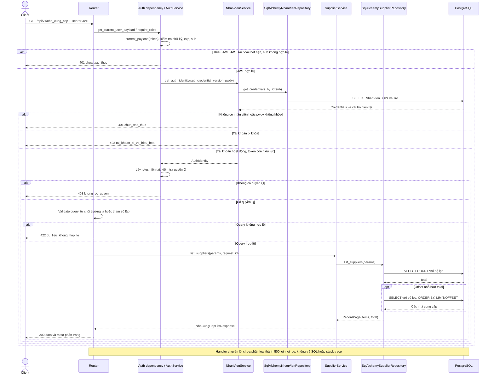
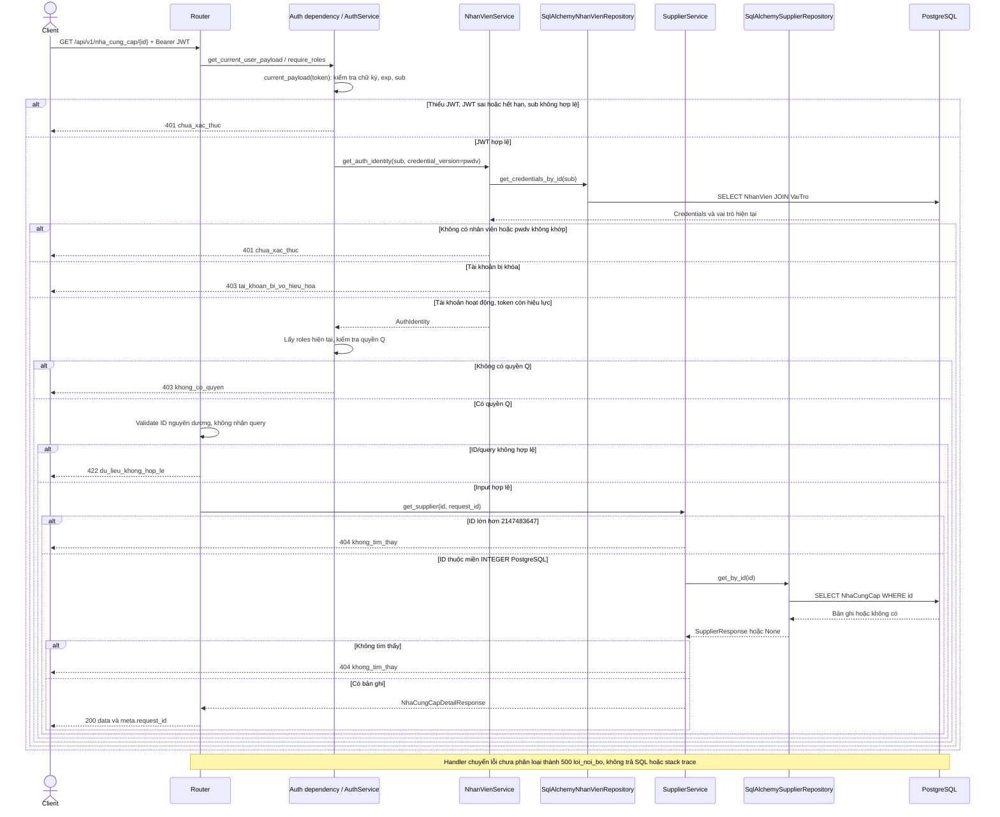
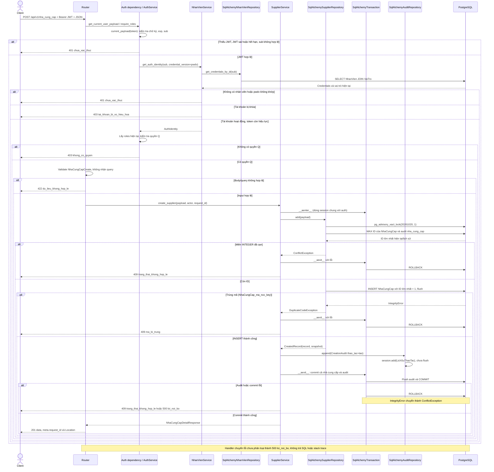

# Module nha_cung_cap

Nguồn: [API contract v2, mục 2, 3, 5 và 14](https://drive.google.com/file/d/16hj1yTLvhQ4peRENCLjbCKhNdGy_L2Xz/view),
`infra/postgres/init.sql` và quyết định trong `.handoff/plan.md` ngày 01/11/2026.
Quyết định mới thay thế phần sửa/xóa nhà cung cấp trong contract v2: nhà cung cấp
không được sửa hoặc xóa vì phiếu nhập tham chiếu trực tiếp và không lưu bản sao thông tin.
Module chỉ cung cấp ba endpoint dưới đây. Không còn `/api/v1/suppliers`; đường dẫn cũ
trả 404. PATCH/DELETE đường dẫn chi tiết trả 405 và không ghi audit.

Lỗi nghiệp vụ, xác thực, validation và lỗi nội bộ dùng
`{error: {code, message, details}, meta: {request_id}}`. Lỗi 401 có
`WWW-Authenticate: Bearer`. Q là `quan_ly`. Admin (`quan_tri_vien`) và nhân viên nhận 403 ở cả ba endpoint.

## GET /api/v1/nha_cung_cap

- `page=1`, `page_size=20`; page_size từ 1 đến 100. Trang vượt phạm vi trả
  `data=[]` và total thực tế; không có kết quả thì total_pages=0.
- `q` tìm chuỗi con không phân biệt hoa thường trong `ma_ncc`, `ten_ncc`;
  `%` và `_` là ký tự thường. `tinh`, `phuong` so khớp chính xác sau trim;
  các bộ lọc kết hợp AND.
- Sort hỗ trợ `id`, `ma_ncc`, `ten_ncc` và tiền tố `-` để giảm dần;
  mặc định `id` tăng dần. ID tăng dần là tiêu chí phụ, NULL theo PostgreSQL.
- Q nhận bảy trường: `id`, `ma_ncc`, `ten_ncc`, `so_dien_thoai`,
  `dia_chi`, `phuong`, `tinh`. Meta gồm `request_id`, `page`, `page_size`,
  `total`, `total_pages`. Dữ liệu cũ được phép có `ten_ncc=null`.
- GET chỉ SELECT, không ghi audit hoặc cập nhật dữ liệu.

## GET /api/v1/nha_cung_cap/{id}

Q nhận bảy trường như GET list, cho phép `ten_ncc=null` với dữ liệu cũ.
GET chi tiết không trả ETag, không ghi audit hoặc cập nhật dữ liệu.

## POST /api/v1/nha_cung_cap

- Chỉ Q được tạo. `ma_ncc`, `ten_ncc` bắt buộc; chuỗi được trim, tên không được
  rỗng. Mã từ `NCC-000001` đến `NCC-999999`. Trường lạ, null ở trường bắt buộc,
  mã sai định dạng và mọi query trả 422. Các trường liên hệ/địa chỉ nullable.
- `Location` là `/api/v1/nha_cung_cap/{id}`. POST không trả ETag.
- ID được cấp dưới advisory lock giữ đến commit/rollback và xét cả audit để không
  tái sử dụng ID lịch sử. Không dùng sequence để cấp ID trong repository.
- Audit `tao` chứa actor, loại `nha_cung_cap`, ID và snapshot sau tạo. Repository
  audit được inject trực tiếp qua dependency, dùng cùng session/transaction;
  không có tầng AuditService trong luồng tạo này.
- Bảng ORM là `"NhaCungCap"`; FK trực tiếp trong receiving đã cập nhật. Bảng
  receiving và các ORM nghiệp vụ còn lại chưa được chuyển đổi trong tác vụ này.
- Đây là cập nhật code cho bootstrap mới/trống; không migration, không áp dụng
  schema hay nạp seed vào database ứng dụng đang chạy.
