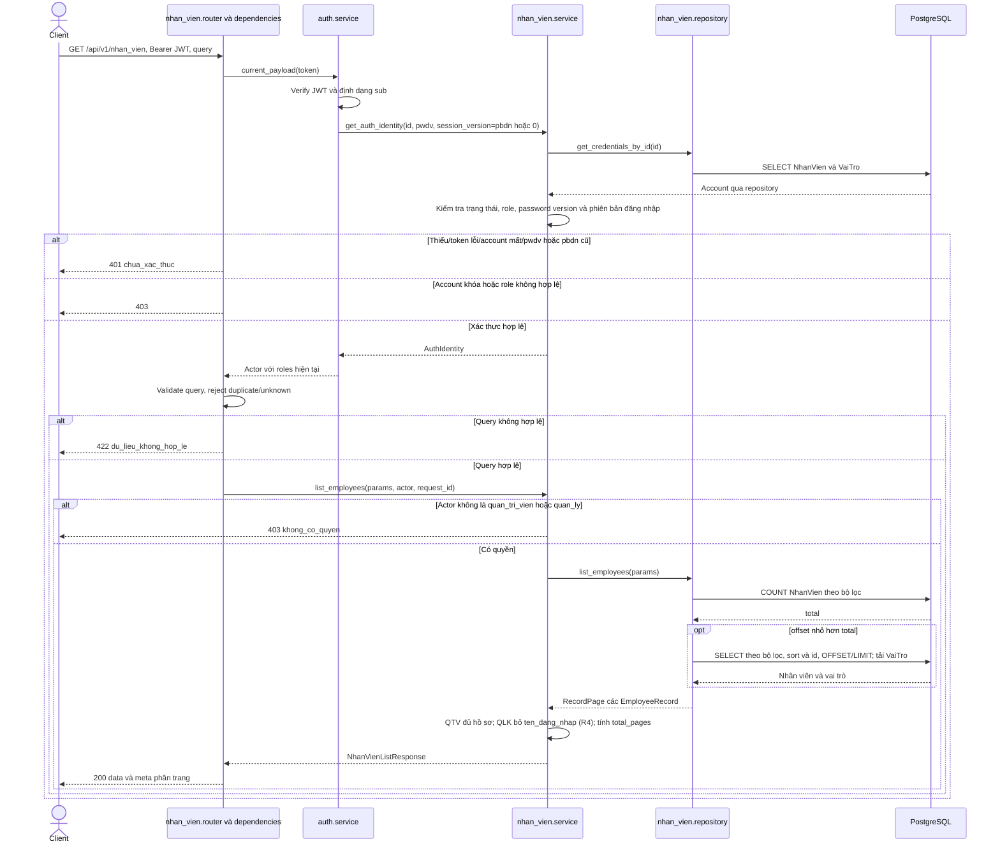
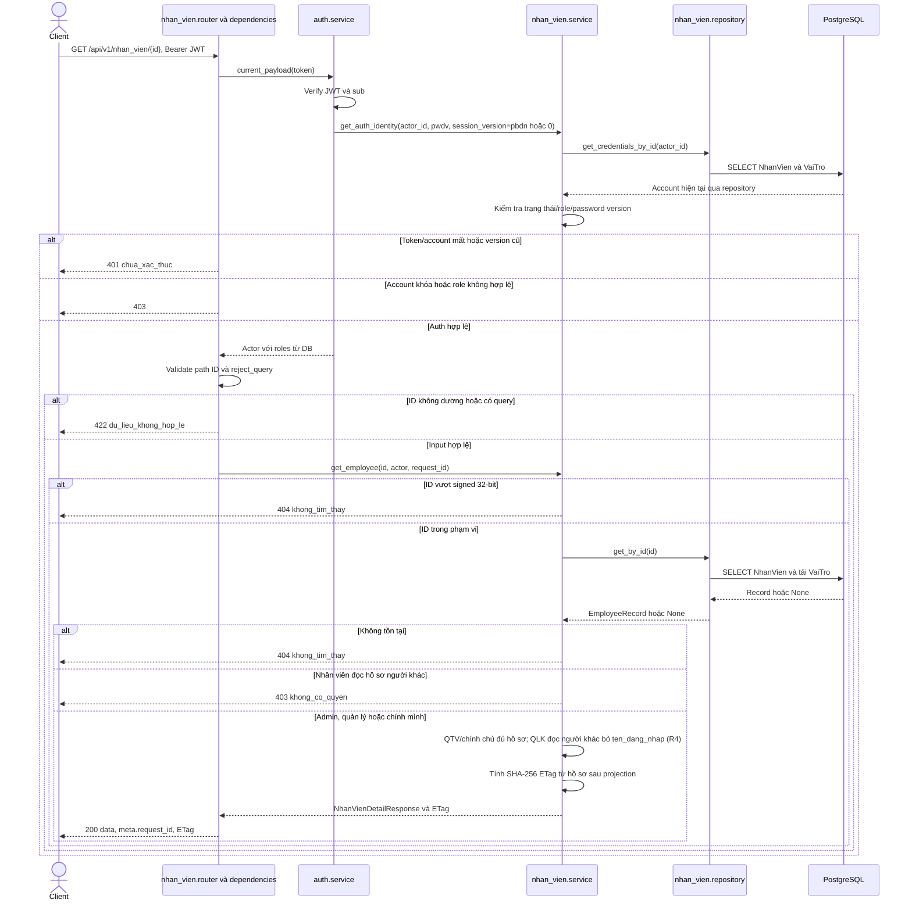
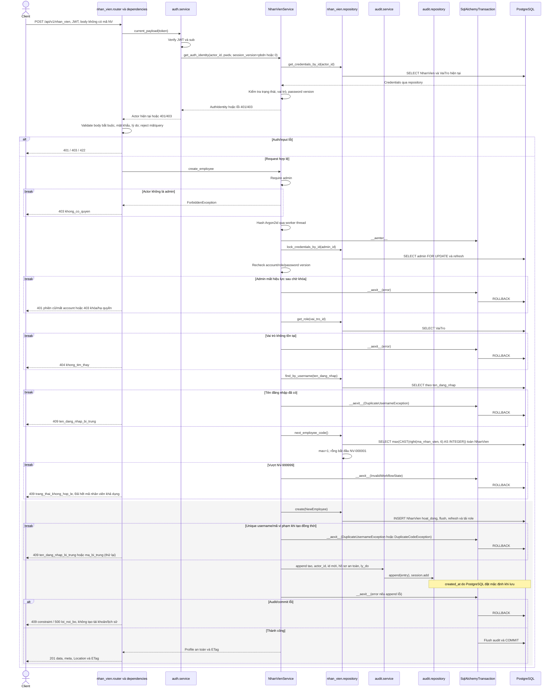
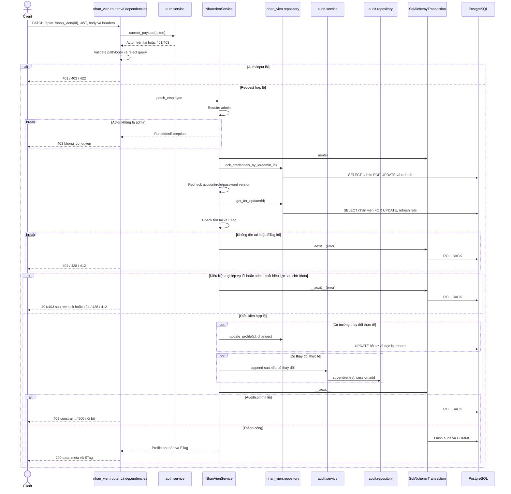
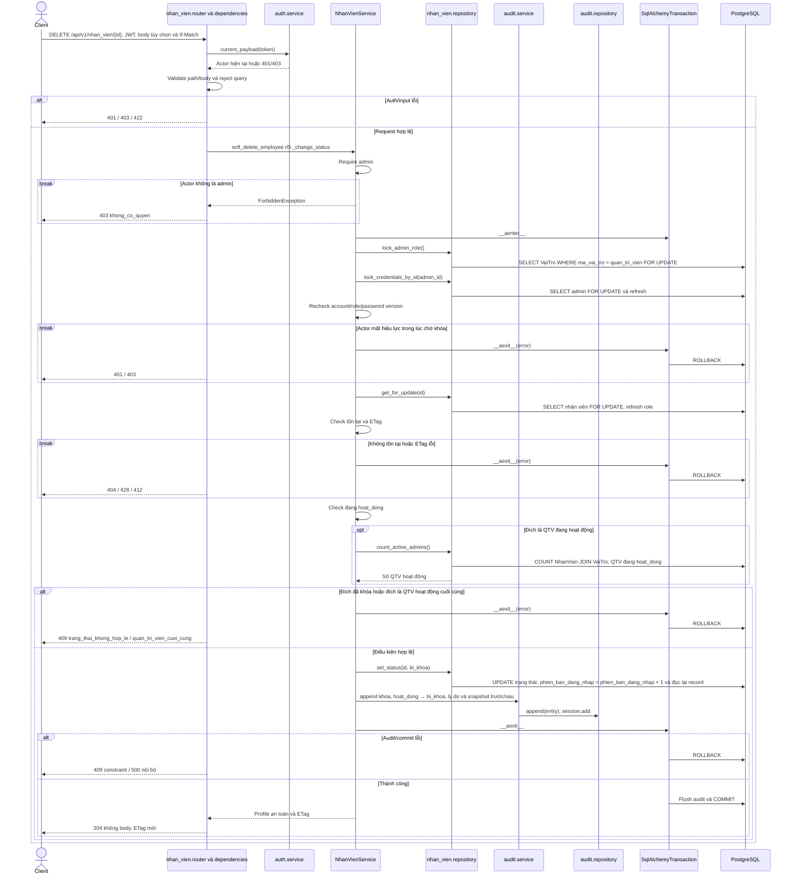
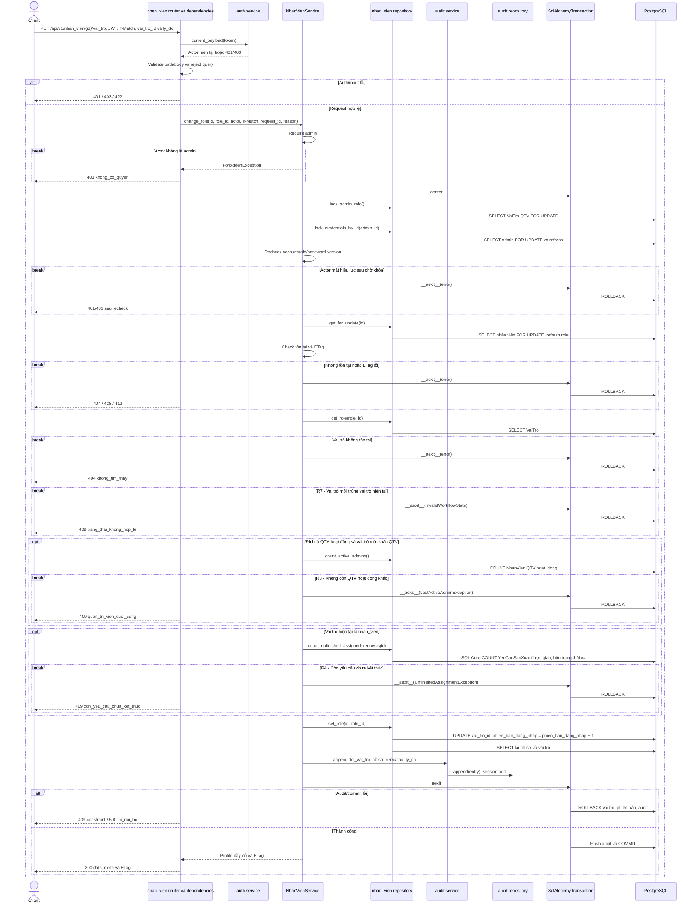
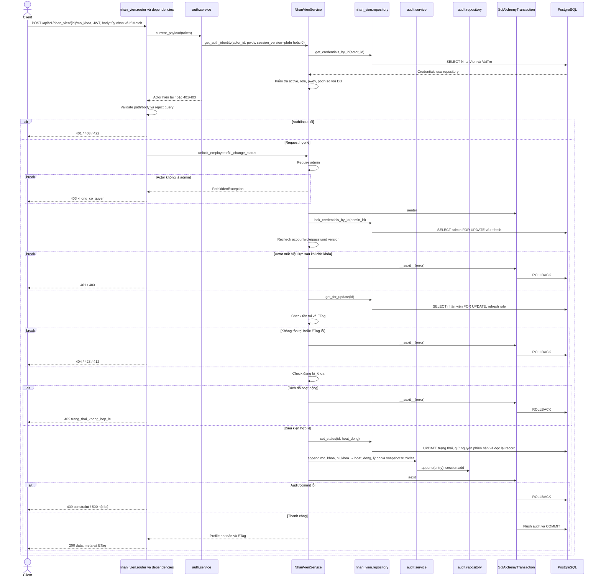
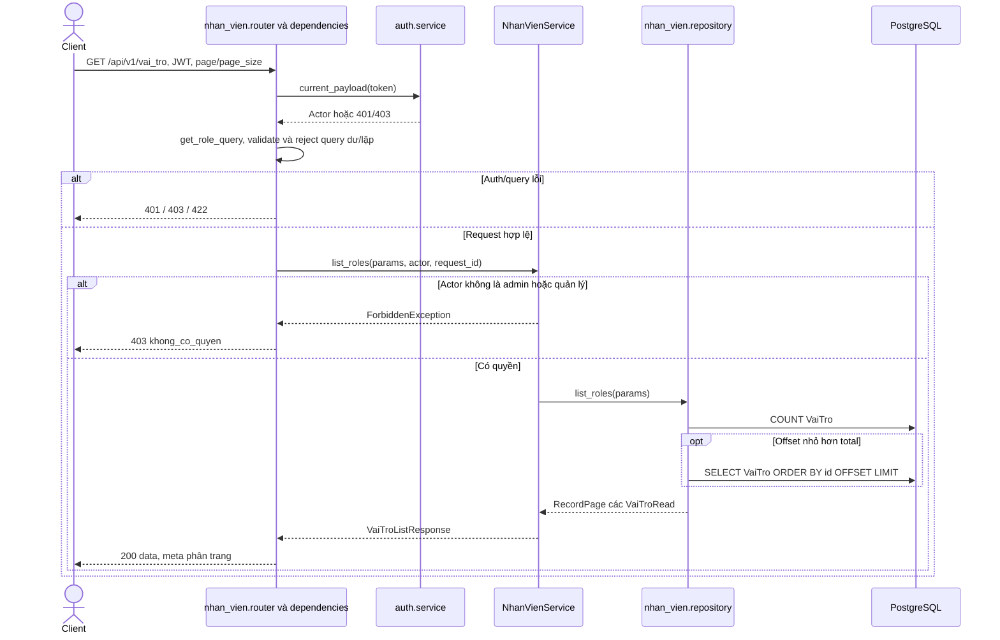
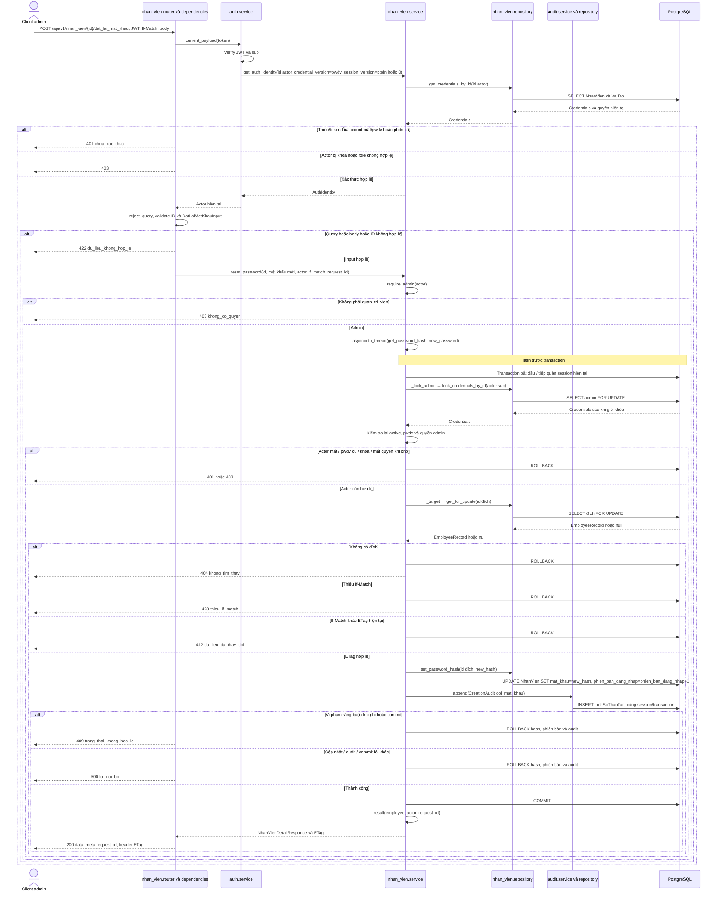

# Sequence diagram — nhan_vien

Nguồn: `nhan_vien/{router,service,repository,schemas,models}.py`, `auth/service.py`, `app/dependencies.py`, `core/{security,exceptions,request_context}.py`.
Module sở hữu ORM/bảng `NhanVien`, `VaiTro`; không có ORM trong auth. Public service cũng cung cấp xác thực/đổi mật khẩu cho auth, mô tả ở [auth.md](auth.md).
FastAPI cache dependency trong mỗi request nên kiểm tra auth dùng chung session với các truy vấn nhân viên. Nếu request đồng thời sai auth và input, sơ đồ không quy định thứ tự ưu tiên lỗi. Lỗi được chuyển thành HTTP qua exception handlers chung.

Theo [UC-06](../../specs/use_cases/identity_access/UC-06.md) A3/D1, `current_payload` truyền thêm `session_version=payload.get("pbdn", 0)` vào `get_auth_identity` cho mọi endpoint bên dưới. Service so với `NhanVien.phien_ban_dang_nhap`; lệch hoặc claim không phải số nguyên trả 401 `chua_xac_thuc` (`Please sign in again`). Tài khoản đang khóa vẫn trả 403. Chi tiết xác thực nằm trong [auth.md](auth.md).

## GET /api/v1/nhan_vien — Danh sách nhân viên

Nguồn nghiệp vụ: [UC-03 — Xem danh sách tài khoản](../../specs/use_cases/identity_access/UC-03.md), Main 2–4, R1–R4, A1–A4; D1 ngày 15/11/2026.

Query: `page` mặc định 1, tối thiểu 1; `page_size` mặc định 20, từ 1 đến 100; `q`, `vai_tro_id` dương, `trang_thai=hoat_dong|bi_khoa`; `sort` mặc định `id`, cho phép `id`, `ma_nhan_vien`, `ho_ten`, `ten_dang_nhap` và tiền tố `-` cho chiều giảm dần. Query lặp hoặc không khai báo trả 422.

- Admin nhận hồ sơ đầy đủ, có `ten_dang_nhap`. QLK nhận `id`, `ma_nhan_vien`, `ho_ten`, `vai_tro_id`, `ma_vai_tro`, `trang_thai`, `ngay_sinh`, `so_dien_thoai`, `email`, `ngay_vao_lam`, `he_so_luong`; không có `ten_dang_nhap` hoặc mật khẩu/hash (D1, R4). Nhân viên không được xem danh sách. Trang `/admin/tai-khoan` vẫn chỉ QTV vào được.
- Response QLK bổ sung các trường hồ sơ, tương thích ngược với caller hiện tại như `ProductionPage`; tham số query, phân trang và quyền NV giữ nguyên.
- `q` tìm không phân biệt hoa/thường theo mã/họ tên; escape `%` và `_`, không nội suy SQL. Sort thêm `id` để ổn định phân trang.
- Filter vai trò vượt signed 32-bit cho kết quả rỗng. Trang vượt tổng trả 200 với `data=[]`; tổng 0 có `total_pages=0`. Meta gồm request_id, page, page_size, total, total_pages.

## GET /api/v1/nhan_vien/{id} — Chi tiết nhân viên

Nguồn nghiệp vụ: [UC-03 — Xem danh sách tài khoản](../../specs/use_cases/identity_access/UC-03.md), R4; D1 ngày 15/11/2026.

Path ID nguyên dương; không nhận query. Strong ETag được tính từ profile sau projection, không từ request_id.

Admin và chính chủ đọc hồ sơ đầy đủ, có `ten_dang_nhap`; QLK đọc người khác nhận cùng tập trường như danh sách QLK ở trên, trừ `ten_dang_nhap` và mật khẩu/hash (D1, R4). Thay đổi bổ sung trường hồ sơ cho QLK tương thích ngược với caller hiện tại; ETag được tính từ projection mới. Thiếu account đích được kiểm tra trước phạm vi truy cập. Nullable profile được giữ là null; `he_so_luong` được serialize thành JSON string. Không response nào có mật khẩu/hash, `tai_khoan_id`, JWT hoặc `loai_nhan_vien`.
GET không ghi audit hoặc commit. Ngoài các nhánh trên, lỗi không dự kiến được handler chung trả 500 an toàn. Module có đủ 8 endpoint bên dưới. Quyết định ngày 01/11/2026 thay DELETE xóa thật bằng soft delete, bỏ POST /vo_hieu_hoa và giữ /mo_khoa.

## Quy ước chung cho thao tác ghi

- PATCH chỉ admin và chỉ sửa hồ sơ. POST/PUT/DELETE/mở khóa cũng chỉ admin.
- Một admin được bootstrap sẵn. API chặn tạo/cấp thêm admin, hạ quyền hoặc khóa admin hiện tại. Schema chưa có unique constraint singleton-admin; SQL trực tiếp nằm ngoài chính sách API này.
- `_lock_admin` khóa dòng admin bằng SELECT FOR UPDATE và refresh account/role/password version sau khi chờ khóa, tuần tự hóa request quản trị. `_target` khóa/refresh dòng đích trước kiểm tra ETag.
- Thiếu If-Match trả 428 `thieu_if_match`; ETag cũ, wildcard hoặc weak ETag trả 412 `du_lieu_da_thay_doi`. Không có tài khoản đích trả 404 trước kiểm tra ETag. Admin mất hiệu lực trong lúc chờ khóa trả 401/403 và rollback.
- SqlAlchemyTransaction dùng session chung với auth, repository nhân viên và audit. Auth có thể đã mở transaction bằng SELECT; __aenter__ không mở transaction lồng nhau. AuditService gọi audit repository để session.add; flush audit và COMMIT khi transaction kết thúc. Lỗi rollback toàn bộ thay đổi.
- Lỗi nhân viên/vai trò dùng `{error: {code, message, details}, meta: {request_id}}` giống auth theo contract v2; thay envelope GET cũ có success/timestamp. Validation chỉ trả tên trường/lý do, không echo input nhạy cảm.
- Thao tác ghi không nhận query. Không response/audit nào chứa mật khẩu/hash/JWT.

## POST /api/v1/nhan_vien — Tạo nhân viên

Nguồn nghiệp vụ: [UC-04 — Thêm tài khoản](../../specs/use_cases/identity_access/UC-04.md), Main 2–6, R1–R7, A1–A7; D1–D4 trong [plan UC-04](../plans/UC-04.md).

NhanVienCreate bắt buộc `ten_dang_nhap` trim 1–255 ký tự; `mat_khau` 6–1024 ký tự không trim; `vai_tro_id` integer dương signed 32-bit. Chọn được cả `quan_tri_vien`, `quan_ly`, `nhan_vien`. Hồ sơ nullable là tùy chọn: `ho_ten`, `ngay_sinh`, `so_dien_thoai`, `email`, `ngay_vao_lam`, `he_so_luong`. `he_so_luong` là decimal JSON string 0–999.99, tối đa 2 số thập phân; ngày YYYY-MM-DD. `ly_do` tùy chọn, trim, tối đa 1000 ký tự, rỗng thành null; chỉ dùng cho lịch sử. Server tự cấp `ma_nhan_vien`, đặt `hoat_dong`; gửi kèm mã hoặc field dư trả 422. Không cần If-Match, không nhận query.

Location trỏ GET chi tiết mới; ETag từ hồ sơ trả về, meta có `request_id`. Response QTV đủ hồ sơ và vai trò, không chứa mật khẩu/hash hoặc `ly_do`. Không cấp JWT khi tạo; tài khoản mới đăng nhập qua UC-01 và xuất hiện trong danh sách UC-03. Đóng phần nhập trước khi lưu không gửi POST.

- Tài khoản và audit `tao` dùng chung transaction. Audit có người thực hiện, đối tượng mới, thời điểm do DB đặt, lý do tùy chọn; không lưu mật khẩu thô/hash.
- Cấp mã đọc toàn bảng, kể cả tài khoản khóa, dưới khóa dòng của QTV thực hiện. Hai QTV khác nhau có thể lấy cùng mã; unique `ma_nhan_vien` chặn bản ghi sau, trả 409 `ma_bi_trung` với thông báo “Mã nhân viên vừa được cấp cho tài khoản khác, vui lòng thử lại”. Không có retry tự động hoặc trigger cấp mã.
- Username trùng trước cấp mã hoặc lúc INSERT đều trả 409 `ten_dang_nhap_bi_trung`, “Tên đăng nhập đã tồn tại”. Username/mã bất biến sau tạo.
- Thay đổi hợp đồng API: client bỏ `ma_nhan_vien` (gửi trường cũ sẽ nhận 422), mật khẩu từ 6 ký tự, nhận thêm `ly_do` tùy chọn. Caller `EmployeeForm` đã được cập nhật. Không sửa schema/bootstrap hoặc database đang chạy.

## PATCH /api/v1/nhan_vien/{id} — Sửa hồ sơ

NhanVienPatch chỉ nhận ho_ten, ngay_sinh, so_dien_thoai, email, ngay_vao_lam, he_so_luong. Bỏ qua giữ nguyên; null xóa giá trị nullable. Username, mã, mật khẩu, role, trạng thái và field dư trả 422. Bắt buộc If-Match.

Body rỗng hoặc giá trị không đổi là no-op, không thêm audit. Hai request cùng ETag chỉ một request thay đổi thành công; request sau nhận 412.

## DELETE /api/v1/nhan_vien/{id} — Khóa tài khoản (UC-05)

Nguồn: [UC-05](../../specs/use_cases/identity_access/UC-05.md), R1–R7, Main 1–6, A1–A9.
Body `LyDoTuyChonInput` không bắt buộc: thiếu body, `{}`, `{"ly_do":null}` hoặc lý do chỉ khoảng trắng đều được coi là không có lý do; nếu nhập thì trim, tối đa 1000 ký tự. Bắt buộc `If-Match`. Chuyển `hoat_dong` sang `bi_khoa`, giữ nguyên dòng nhân viên, vai trò, hồ sơ, yêu cầu sản xuất đang giao, chứng từ và lịch sử. Không có endpoint xóa hẳn.

Thứ tự khóa cố định trong transaction: dòng `VaiTro` QTV → actor → đích. Các thao tác khóa cùng chờ dòng vai trò, sau đó đọc lại quyền actor, trạng thái đích và số QTV hoạt động; không khóa được QTV cuối cùng kể cả khi có thao tác đồng thời. Actor mất hiệu lực sau chờ khóa trả 401/403 và rollback. QTV được khóa QTV khác hoặc tự khóa khi vẫn còn QTV khác đang hoạt động; QTV cuối nhận 409 `quan_tri_vien_cuoi_cung` (“Không khóa được Quản trị viên đang hoạt động cuối cùng”).

Gọi lại với ETag cũ trả 412 `du_lieu_da_thay_doi`; thiếu `If-Match` trả 428 `thieu_if_match`; ETag hiện tại nhưng đã khóa trả 409 `trang_thai_khong_hop_le`, không thêm audit. JWT đã cấp bị từ chối 403 `tai_khoan_bi_vo_hieu_hoa` ở request tiếp theo do xác thực đọc lại trạng thái tài khoản từ DB. FE kiểm tra lại phiên ngay sau tự khóa để kết thúc phiên và chuyển về đăng nhập; không cấp token mới.

Audit `khoa` ghi người thực hiện, đối tượng đích, `trang_thai_truoc=hoat_dong`, `trang_thai_sau=bi_khoa`, lý do đã trim hoặc null và snapshot hồ sơ trước/sau không có mật khẩu/hash. Thời điểm `created_at` do DB đặt. Theo UC-06 D1, khóa tăng `phien_ban_dang_nhap` đúng 1 bằng biểu thức SQL trong cùng transaction với trạng thái và audit; audit/commit lỗi rollback cả ba. Mở khóa không tăng và không khôi phục phiên cũ. Thành công trả 204 không body và ETag mới. Tài khoản vẫn có trong danh sách/lịch sử và hỗ trợ lọc trạng thái. Đóng hộp xác nhận trước khi lưu không gửi DELETE.

Thay đổi hợp đồng API: body/lý do DELETE trở thành tùy chọn, bổ sung lỗi QTV cuối; caller FE đã cập nhật. Không đổi đường dẫn, header, schema/bootstrap hay dữ liệu đang chạy. Test repo giả kiểm tra thứ tự gọi và SQL được biên dịch; chưa kiểm chứng khóa đồng thời trên PostgreSQL thật.

## PUT /api/v1/nhan_vien/{id}/vai_tro — Đổi vai trò (UC-07)

Nguồn: [UC-07](../../specs/use_cases/identity_access/UC-07.md), R1–R8, Main 1–6, A1–A9; D1–D5 trong plan UC-07.

Body `DoiVaiTroInput`: `vai_tro_id` integer dương signed 32-bit bắt buộc; `ly_do` tùy chọn, trim, rỗng thành null, tối đa 1000 ký tự. Field dư/không hợp lệ trả 422. Bắt buộc `If-Match`; không nhận query. Đổi được giữa cả ba vai trò, kể cả tự đổi khi còn QTV khác đang hoạt động.

Thứ tự khóa dùng chung với UC-05: dòng `VaiTro` QTV → actor → đích `FOR UPDATE`. Khóa đích chặn giao việc đồng thời vì luồng giao việc khóa nhân viên `FOR SHARE`. Đếm yêu cầu bằng SQL Core trên `"YeuCauSanXuat"`, không dùng ORM v3: `nhan_vien_duoc_giao_id=id` và `trang_thai IN ('nhap','da_gui','cho_bo_sung_linh_kien','dang_thuc_hien')`. `hoan_thanh`, `da_huy` và yêu cầu của người khác không chặn. R4 áp dụng cả NV đang khóa; R3 chỉ tính QTV `hoat_dong`.

Mỗi lần đổi thành công ghi đúng một audit `doi_vai_tro`, cùng transaction với cập nhật vai trò/phiên bản: actor, đích, thời điểm do DB tạo, hồ sơ `du_lieu_truoc/sau` có `vai_tro_id`, `ma_vai_tro`, lý do tùy chọn. `trang_thai_truoc/sau=null` vì trạng thái tài khoản không đổi. Trùng vai trò trả 409, không audit hoặc tăng phiên bản; lỗi lưu rollback cả ba. Response 200 gồm hồ sơ đầy đủ và ETag mới, không trả phiên bản đăng nhập.

Với đích đang hoạt động, mọi JWT cũ bị 401 ở request kế tiếp do claim `pbdn` lệch DB; đăng nhập lại nhận vai trò và phiên bản mới. Đích đang khóa tiếp tục bị 403 khi xác thực. FE tự đổi vai trò thì đăng xuất ngay với thông báo “Đã đổi vai trò. Vui lòng đăng nhập lại.”, dừng các bước lưu sau (kể cả mật khẩu). Đóng phần nhập trước khi lưu không gửi request. Không đổi mật khẩu, trạng thái tài khoản hoặc công việc đang giao.

## POST /api/v1/nhan_vien/{id}/mo_khoa — Mở khóa tài khoản (UC-06)

Nguồn: [UC-06](../../specs/use_cases/identity_access/UC-06.md), R1–R2, Main 1–6, A1–A6; D1–D3 trong plan UC-06.

Body `LyDoTuyChonInput | None` không bắt buộc: thiếu body, `{}`, `{"ly_do":null}`, chuỗi rỗng hoặc chỉ khoảng trắng đều lưu `ly_do=null`; lý do được trim, tối đa 1000 ký tự, field dư/không hợp lệ trả 422. Bắt buộc `If-Match`. Chỉ QTV được chuyển `bi_khoa` sang `hoat_dong`.

Audit `thao_tac=mo_khoa` thuộc enum v4; ghi actor, đích, `bi_khoa → hoat_dong`, lý do trim hoặc null và snapshot hồ sơ trước/sau an toàn. Thời điểm `created_at` do DB đặt. Trạng thái và audit commit cùng transaction; lỗi append/commit rollback, không thêm lịch sử, trạng thái và phiên bản giữ nguyên. Đích đã hoạt động trả 409 `trang_thai_khong_hop_le`, ETag cũ trả 412 `du_lieu_da_thay_doi`, thiếu If-Match trả 428 `thieu_if_match`; các nhánh này không ghi audit.

Không cấp JWT mới, không đổi password/role và không tăng `phien_ban_dang_nhap`. Token có từ trước khi khóa mang phiên bản cũ nên vẫn bị từ chối 401 sau mở khóa, kể cả còn hạn và đúng `pwdv`. Người dùng đăng nhập lại bằng mật khẩu hiện có sẽ nhận token với `pbdn` hiện tại và vai trò cũ. Response 200 là hồ sơ đầy đủ cho QTV, `meta.request_id` và ETag mới, không trả phiên bản đăng nhập.

FE giữ hộp xác nhận “Mở khóa tài khoản”, không `danger`, cho phép lý do trống và gửi POST với `{ly_do: lý do trim hoặc null}` cùng ETag đã xem. Đóng/hủy trước khi lưu không gửi request và không đổi trạng thái. QLK/NV bị chặn cả đường dẫn quản trị lẫn lời gọi API trực tiếp (403). Hợp đồng body mở khóa trở thành tùy chọn; không đổi đường dẫn/header, không cập nhật database đang chạy hoặc bootstrap.

## GET /api/v1/vai_tro — Danh sách vai trò

Thuộc module nhân viên, đăng ký vai_tro_router tại /api/v1. Chỉ admin/quản lý được đọc. Query chỉ có page mặc định 1 (>=1), page_size mặc định 20 (1–100); dư/lặp trả 422. Sắp xếp ID tăng dần; trang vượt tổng trả data rỗng. Response gồm id, ma_vai_tro, ten_vai_tro, mo_ta (string hoặc null) và meta phân trang giống danh sách nhân viên. Bộ vai trò cố định ba mã; không có API tạo/sửa/xóa vai trò (D-VT-01).

GET không ghi audit hoặc commit. Chi tiết xác thực dùng get_auth_identity như hai GET nhân viên ở trên.

## POST /api/v1/nhan_vien/{id}/dat_lai_mat_khau — Admin đặt lại mật khẩu

Nguồn: [UC-08 — Đổi mật khẩu tài khoản](../../specs/use_cases/identity_access/UC-08.md), Main 2–6, R1–R7, A1–A6; thay hành vi cũ của D-MK-01 theo D1–D4. Body duy nhất `mat_khau_moi` là SecretStr 6–1024 ký tự, không trim; không nhận mật khẩu hiện tại hoặc field dư/query. Path ID nguyên dương. Không cần lý do, cho phép đích ở mọi vai trò/trạng thái và đích là chính admin. Không có nhánh lỗi nghiệp vụ 409 riêng; vi phạm ràng buộc DB trong transaction vẫn trả 409.

- Auth và input là dependency FastAPI; khi cùng sai, sơ đồ không quy định ưu tiên lỗi. Các khóa nằm trong cùng transaction/session, kể cả khi khóa đích trùng dòng admin.
- Audit: `nhan_vien_id=admin`, `doi_tuong_id=id đích`, `loai_doi_tuong=nhan_vien`, `thao_tac=doi_mat_khau`, `du_lieu_truoc=null`, `du_lieu_sau={"da_doi_mat_khau": true}`, `ly_do=null`; không mật khẩu/hash/token; thời điểm do `LichSuThaoTac.created_at` mặc định `now()`. Append dùng service audit thực sự có trong code; transaction do service nhân viên sở hữu.
- Response là hồ sơ đầy đủ cho admin, không phân trang, không trả mật khẩu/hash. ETag có thể không đổi vì biểu diễn hồ sơ không chứa hash. Mọi token cũ của đích bị 401 qua kiểm tra `pwdv`/`pbdn` ở request sau; phiên bản tăng đúng 1 trong cùng UPDATE với hash và cùng transaction với audit; tài khoản khóa vẫn bị khóa.
- FE lưu hồ sơ → vai trò → reset; tự đổi mật khẩu thành công gọi `logout("Đã đổi mật khẩu. Vui lòng đăng nhập lại.")` rồi dừng trước cache/refetch, chuyển về `/dang-nhap`; đổi cho người khác giữ phiên QTV, cập nhật cache và báo thành công. Không tự đăng nhập lại hoặc cấp token mới. Đóng phần nhập/hủy xác nhận không gửi request (A5); lưu lỗi giữ mật khẩu, phiên bản và lịch sử cũ (A6).
