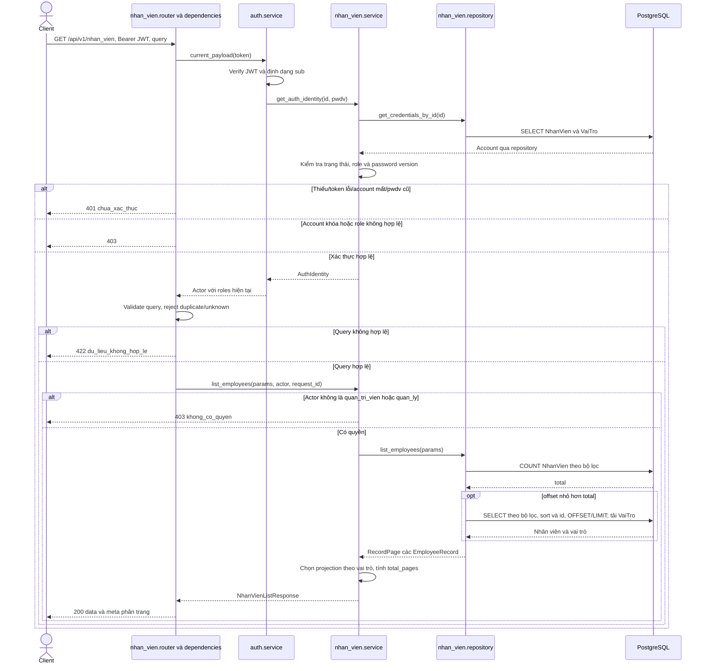
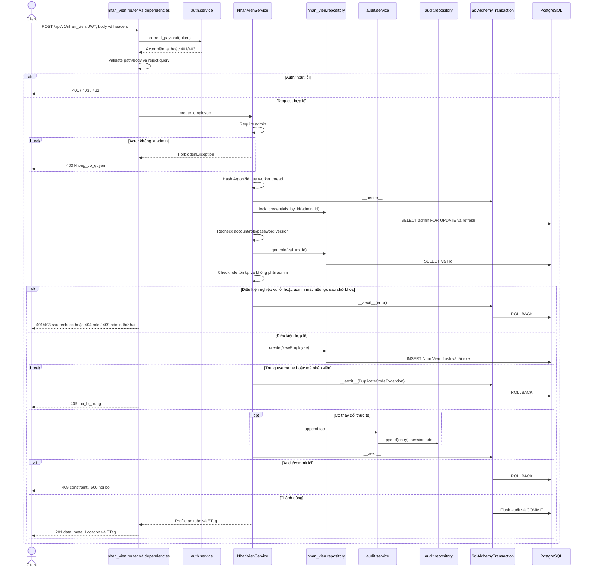
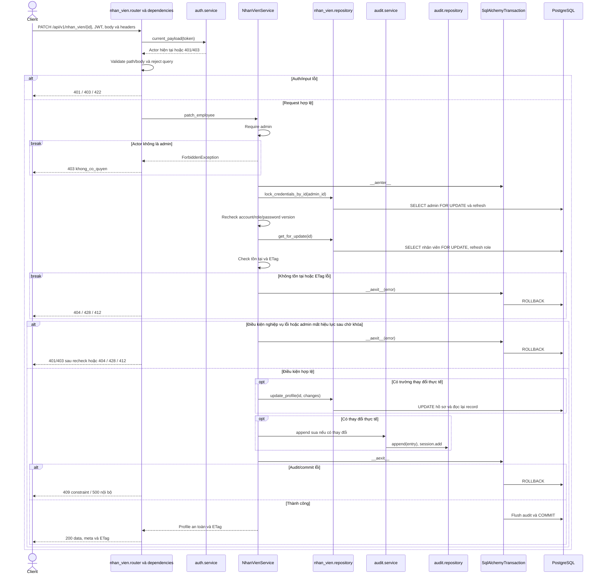
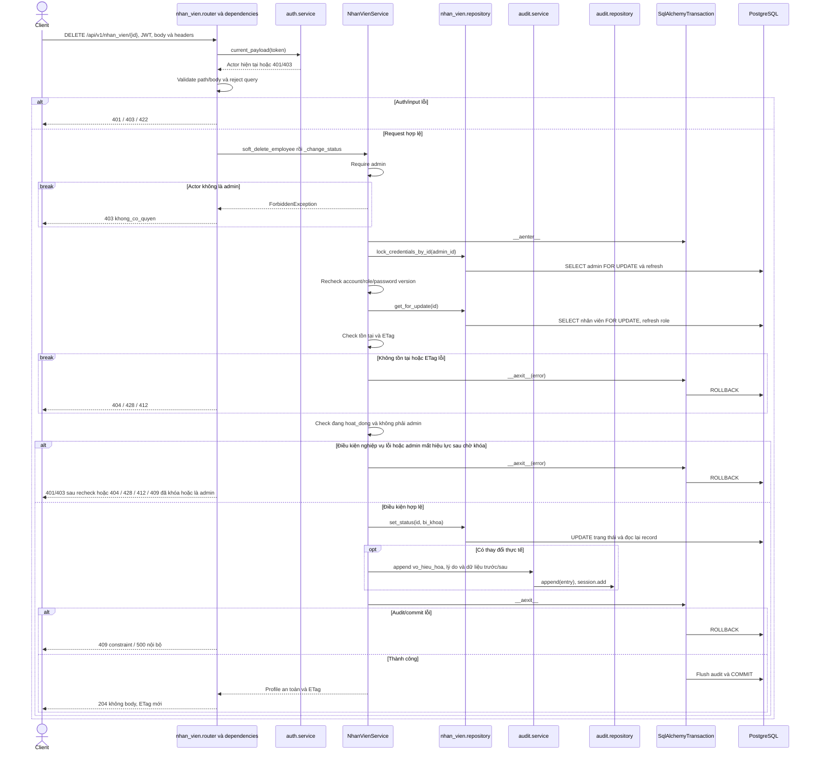
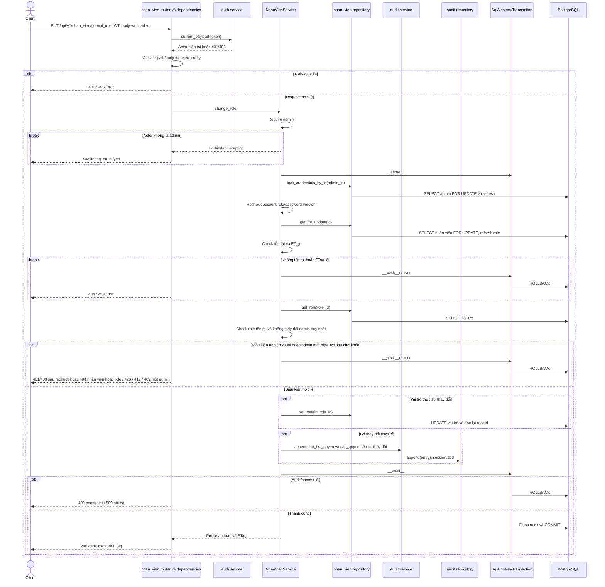
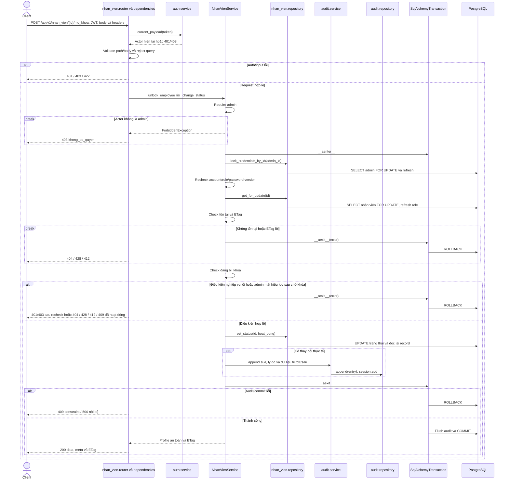
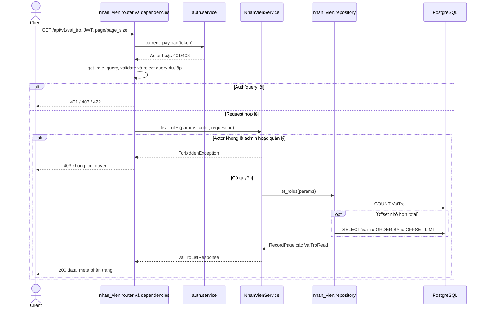

# Sequence diagram — nhan_vien

Nguồn: `nhan_vien/{router,service,repository,schemas,models}.py`, `auth/service.py`, `app/dependencies.py`, `core/{security,exceptions,request_context}.py`.
Module sở hữu ORM/bảng `NhanVien`, `VaiTro`; không có ORM trong auth. Public service cũng cung cấp xác thực/đổi mật khẩu cho auth, mô tả ở [auth.md](auth.md).
FastAPI cache dependency trong mỗi request nên kiểm tra auth dùng chung session với các truy vấn nhân viên. Nếu request đồng thời sai auth và input, sơ đồ không quy định thứ tự ưu tiên lỗi. Lỗi được chuyển thành HTTP qua exception handlers chung.

## GET /api/v1/nhan_vien — Danh sách nhân viên

Query: `page` mặc định 1, tối thiểu 1; `page_size` mặc định 20, từ 1 đến 100; `q`, `vai_tro_id` dương, `trang_thai=hoat_dong|bi_khoa`; `sort` mặc định `id`, cho phép `id`, `ma_nhan_vien`, `ho_ten`, `ten_dang_nhap` và tiền tố `-` cho chiều giảm dần. Query lặp hoặc không khai báo trả 422.

- Admin nhận hồ sơ đầy đủ. Quản lý chỉ nhận `id`, `ma_nhan_vien`, `ho_ten`, `vai_tro_id`, `ma_vai_tro`, `trang_thai` để giao việc. Nhân viên không được xem danh sách.
- `q` tìm không phân biệt hoa/thường theo mã/họ tên; escape `%` và `_`, không nội suy SQL. Sort thêm `id` để ổn định phân trang.
- Filter vai trò vượt signed 32-bit cho kết quả rỗng. Trang vượt tổng trả 200 với `data=[]`; tổng 0 có `total_pages=0`. Meta gồm request_id, page, page_size, total, total_pages.

## GET /api/v1/nhan_vien/{id} — Chi tiết nhân viên

Path ID nguyên dương; không nhận query. Strong ETag được tính từ profile sau projection, không từ request_id.

Admin và chính chủ đọc hồ sơ đầy đủ; quản lý đọc người khác chỉ có projection giao việc. Thiếu account đích được kiểm tra trước phạm vi truy cập. Nullable profile được giữ là null; `he_so_luong` được serialize thành JSON string. Không response nào có password hash, `tai_khoan_id`, JWT hoặc `loai_nhan_vien`.
GET không ghi audit hoặc commit. Ngoài các nhánh trên, lỗi không dự kiến được handler chung trả 500 an toàn. Module có đủ 8 endpoint bên dưới. Quyết định ngày 01/11/2026 thay DELETE xóa thật bằng soft delete, bỏ POST /vo_hieu_hoa và giữ /mo_khoa.

## Quy ước chung cho thao tác ghi

- PATCH chỉ admin và chỉ sửa hồ sơ. POST/PUT/DELETE/mở khóa cũng chỉ admin.
- Một admin được bootstrap sẵn. API chặn tạo/cấp thêm admin, hạ quyền hoặc khóa admin hiện tại. Schema chưa có unique constraint singleton-admin; SQL trực tiếp nằm ngoài chính sách API này.
- `_lock_admin` khóa dòng admin bằng SELECT FOR UPDATE và refresh account/role/password version sau khi chờ khóa, tuần tự hóa request quản trị. `_target` khóa/refresh dòng đích trước kiểm tra ETag.
- Thiếu If-Match trả 428 `thieu_if_match`; ETag cũ, wildcard hoặc weak ETag trả 412 `du_lieu_da_thay_doi`. Không có tài khoản đích trả 404 trước kiểm tra ETag. Admin mất hiệu lực trong lúc chờ khóa trả 401/403 và rollback.
- SqlAlchemyTransaction dùng session chung với auth, repository nhân viên và audit. Auth có thể đã mở transaction bằng SELECT; __aenter__ không mở transaction lồng nhau. AuditService gọi audit repository để session.add; flush audit và COMMIT khi transaction kết thúc. Lỗi rollback toàn bộ thay đổi.
- Lỗi nhân viên/vai trò dùng `{error: {code, message, details}, meta: {request_id}}` giống auth theo contract v2; thay envelope GET cũ có success/timestamp. Validation chỉ trả tên trường/lý do, không echo input nhạy cảm.
- Thao tác ghi không nhận query. Không response/audit nào chứa mật khẩu/hash/JWT.

## POST /api/v1/nhan_vien — Tạo nhân viên

NhanVienCreate bắt buộc ten_dang_nhap trim 1–255 ký tự; mat_khau 8–1024 ký tự không trim; ma_nhan_vien NV-NNNNNN khác NV-000000; vai_tro_id integer dương signed 32-bit. Hồ sơ nullable là tùy chọn. he_so_luong là decimal JSON string 0–999.99, tối đa 2 số thập phân; ngày YYYY-MM-DD. Server đặt hoat_dong; field dư trả 422. Không cần If-Match.

Location trỏ GET chi tiết mới; username/mã bất biến sau tạo. Không cấp JWT.

## PATCH /api/v1/nhan_vien/{id} — Sửa hồ sơ

NhanVienPatch chỉ nhận ho_ten, ngay_sinh, so_dien_thoai, email, ngay_vao_lam, he_so_luong. Bỏ qua giữ nguyên; null xóa giá trị nullable. Username, mã, mật khẩu, role, trạng thái và field dư trả 422. Bắt buộc If-Match.

Body rỗng hoặc giá trị không đổi là no-op, không thêm audit. Hai request cùng ETag chỉ một request thay đổi thành công; request sau nhận 412.

## DELETE /api/v1/nhan_vien/{id} — Soft delete bằng khóa tài khoản

Body LyDoInput bắt buộc: {"ly_do":"..."}, trim không rỗng. Bắt buộc If-Match. Thay thế POST /vo_hieu_hoa theo quyết định ngày 01/11/2026. Chuyển hoat_dong sang bi_khoa, giữ nguyên dòng nhân viên, role, chứng từ và lịch sử.

Không tự khóa admin. Gọi lại với ETag cũ trả 412; ETag hiện tại nhưng đã khóa trả 409, không thêm audit. JWT cũ bị từ chối 403 khi bị khóa. Tài khoản vẫn có trong danh sách/lịch sử và hỗ trợ lọc trạng thái.

## PUT /api/v1/nhan_vien/{id}/vai_tro — Đổi vai trò

DoiVaiTroInput chỉ nhận vai_tro_id integer dương signed 32-bit. Bắt buộc If-Match. Không cấp admin cho tài khoản khác hoặc hạ quyền admin hiện tại; chỉ đổi giữa vai trò không phải admin.

Vai trò không đổi là no-op sau kiểm tra ETag. Hai audit khi đổi role cùng transaction. Request tiếp theo dùng JWT cũ đọc quyền mới từ DB; không đổi password/trạng thái/công việc.

## POST /api/v1/nhan_vien/{id}/mo_khoa — Mở khóa

Body LyDoInput bắt buộc: {"ly_do":"..."}, trim không rỗng. Bắt buộc If-Match. Chỉ chấp nhận bi_khoa và chuyển sang hoat_dong.

Audit dùng sua vì enum chưa có mo_khoa. Không cấp JWT mới, không đổi password/role. JWT cũ còn hạn và đúng password version dùng lại được sau mở khóa.

## GET /api/v1/vai_tro — Danh sách vai trò

Thuộc module nhân viên, đăng ký vai_tro_router tại /api/v1. Chỉ admin/quản lý được đọc. Query chỉ có page mặc định 1 (>=1), page_size mặc định 20 (1–100); dư/lặp trả 422. Sắp xếp ID tăng dần; trang vượt tổng trả data rỗng. Response gồm id, ma_vai_tro, ten_vai_tro, mo_ta (string hoặc null) và meta phân trang giống danh sách nhân viên. Bộ vai trò cố định ba mã; không có API tạo/sửa/xóa vai trò (D-VT-01).

GET không ghi audit hoặc commit. Chi tiết xác thực dùng get_auth_identity như hai GET nhân viên ở trên.
