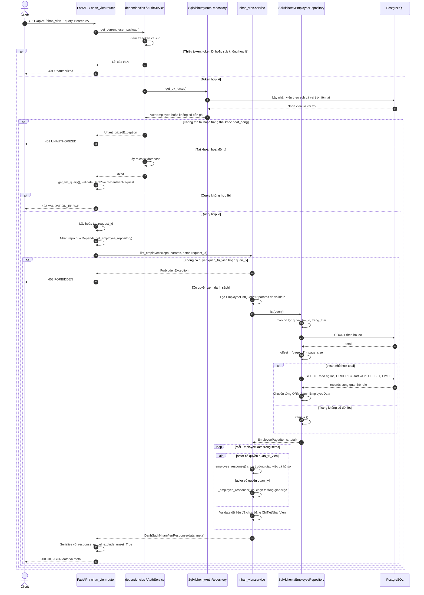
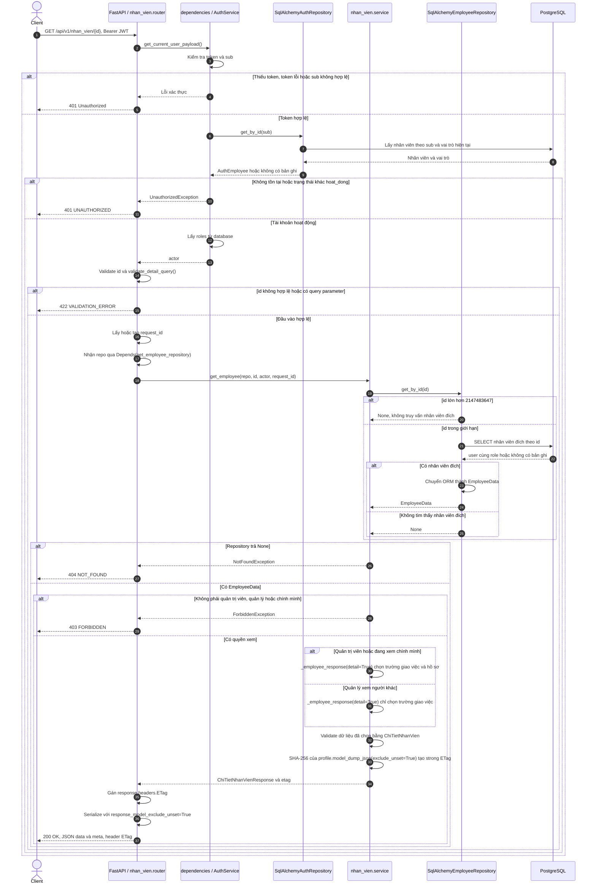

# Sequence diagram — nhan_vien

Nguồn triển khai: `backend/app/modules/nhan_vien/{router,service,schemas,dto,ports,repository,models}.py`,
`backend/app/dependencies.py`,
`backend/app/modules/auth/{service,repository}.py`, `backend/app/core/security.py`,
`backend/app/core/exceptions.py` và `backend/app/main.py`.
Đối chiếu quyền truy cập với `api-contract-v2.md` trên Google Drive của project.

`main.py` đăng ký hai endpoint từ `nhan_vien.router`. Module `nhan_vien.models`
sở hữu ORM `User` và `Role`, được dùng chung với xác thực. Việc chuyển module không đổi schema database.

`get_employee_repository` tạo `SqlAlchemyEmployeeRepository` từ session do `get_db` cung cấp.
Router truyền repository vào service theo hợp đồng `EmployeeRepository` trong `ports.py`.
Port là hợp đồng kiểu dữ liệu, không phải một tầng xử lý riêng khi chạy.
Repository tải quan hệ `User.role` (`lazy="selectin"`) rồi chuyển ORM thành `EmployeeData`
trước khi trả về. Service chỉ đọc DTO, không nhận ORM hoặc `AsyncSession`.
Các sơ đồ gom SELECT tải vai trò vào lời gọi database tương ứng.
Các nhánh validation mô tả kết quả khi xác thực thành công; không quy định thứ tự
ưu tiên lỗi nếu request đồng thời sai xác thực và đầu vào.

## GET /api/v1/nhan_vien — Lấy danh sách nhân viên

Query: `page` (mặc định 1, tối thiểu 1), `page_size` (mặc định 20, từ 1 đến 100),
`q`, `vai_tro_id` (số nguyên dương), `trang_thai` (`hoat_dong | bi_khoa`), `sort`
(mặc định `id`; hỗ trợ `id`, `ma_nhan_vien`, `ho_ten`, `ten_dang_nhap`, thêm `-` để giảm dần).
`q` tìm không phân biệt hoa thường theo mã nhân viên hoặc họ tên, escape ký tự wildcard.
Query lặp hoặc tham số không được khai báo bị từ chối.

- `meta`: `request_id`, `page`, `page_size`, `total`, `total_pages = ceil(total / page_size)`.
- Trang vượt kết quả trả `200` với `data: []`; không trả `404`. Khi `total = 0`, `total_pages = 0`.
- `vai_tro_id` lớn hơn số nguyên signed 32-bit được chuyển thành điều kiện không khớp bản ghi.
- Cả hai vai trò dùng một schema `ChiTietNhanVien`; service chọn trường theo quyền.
  Quản trị viên nhận hồ sơ đầy đủ; quản lý chỉ nhận:
  `id`, `ma_nhan_vien`, `ho_ten`, `vai_tro_id`, `ma_vai_tro`, `trang_thai`.
- Không trả `mat_khau` hoặc `tai_khoan_id`.
- Các trường hồ sơ có mặc định `None` để hỗ trợ dữ liệu giới hạn. Service không truyền
  chúng khi người gọi không có quyền; router dùng `response_model_exclude_unset=True`
  để bỏ hoàn toàn khỏi JSON. Trường được service truyền rõ ràng với giá trị `None`
  vẫn được trả về dưới dạng `null`, kể cả trường chung như `ho_ten` và `ma_vai_tro`.
- OpenAPI mô tả một `ChiTietNhanVien` với các trường hồ sơ không bắt buộc;
  tập trường thực tế phụ thuộc quyền của người gọi.

## GET /api/v1/nhan_vien/{id} — Lấy chi tiết nhân viên

`id` phải là số nguyên dương. Endpoint không nhận bất kỳ query parameter nào.
Quản trị viên và quản lý được xem nhân viên khác; nhân viên thông thường chỉ được xem chính mình.

- `meta` chỉ chứa `request_id`. ETag có dấu ngoặc kép, được tính từ hồ sơ trả về,
  không bao gồm `meta`, nên không đổi chỉ vì `request_id` thay đổi.
- Code hiện tại trả `200` kèm ETag; chưa xử lý `If-None-Match` để trả `304`.
- Kiểm tra tồn tại nhân viên đích diễn ra trước kiểm tra quyền xem: ID không tồn tại trả `404`,
  nhân viên tồn tại nhưng ngoài quyền truy cập trả `403`.
- `ChiTietNhanVien` gồm các trường giao việc và các trường hồ sơ `ten_dang_nhap`,
  `ngay_sinh`, `so_dien_thoai`, `email`, `ngay_vao_lam`, `he_so_luong`.
  Service chỉ điền các trường hồ sơ khi quản trị viên hoặc người xem chính mình;
  quản lý xem người khác nhận sáu trường giao việc giống endpoint danh sách.
  Không trả mật khẩu hoặc `tai_khoan_id`.
- ETag chỉ bao gồm các trường thực sự trả về. Thay đổi email/hệ số lương không
  làm đổi ETag của quản lý xem người khác; thay đổi trường giao việc vẫn làm đổi ETag.
- Hai endpoint chỉ đọc, không có transaction ghi dữ liệu.
