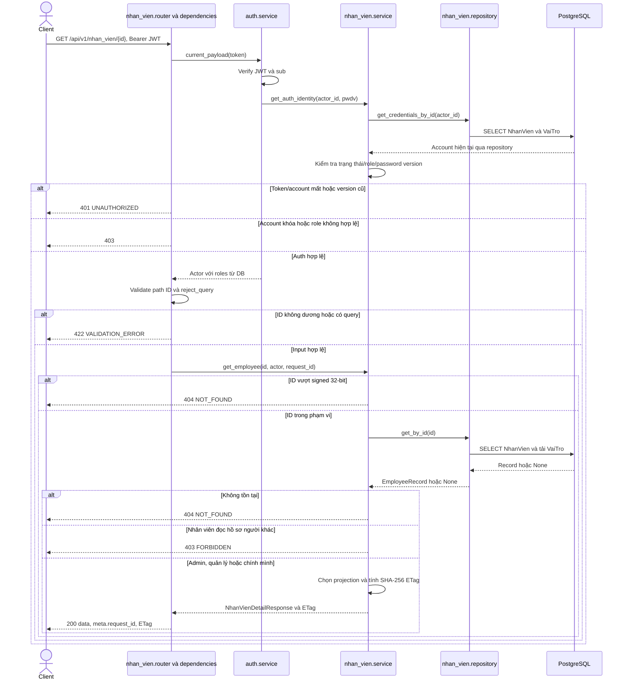

# Sequence diagram — nhan_vien

Nguồn: `nhan_vien/{router,service,repository,schemas,models}.py`, `auth/service.py`, `app/dependencies.py`, `core/{security,exceptions,request_context}.py`.
Module sở hữu ORM/bảng `NhanVien`, `VaiTro`; không có ORM trong auth. Public service cũng cung cấp xác thực/đổi mật khẩu cho auth, mô tả ở [auth.md](auth.md).
FastAPI cache dependency trong mỗi request nên kiểm tra auth dùng chung session với các truy vấn nhân viên. Nếu request đồng thời sai auth và input, sơ đồ không quy định thứ tự ưu tiên lỗi. Lỗi được chuyển thành HTTP qua exception handlers chung.

## GET /api/v1/nhan_vien — Danh sách nhân viên

Query: `page` mặc định 1, tối thiểu 1; `page_size` mặc định 20, từ 1 đến 100; `q`, `vai_tro_id` dương, `trang_thai=hoat_dong|bi_khoa`; `sort` mặc định `id`, cho phép `id`, `ma_nhan_vien`, `ho_ten`, `ten_dang_nhap` và tiền tố `-` cho chiều giảm dần. Query lặp hoặc không khai báo trả 422.

```mermaid
sequenceDiagram
    actor C as Client
    participant R as nhan_vien.router và dependencies
    participant A as auth.service
    participant N as nhan_vien.service
    participant P as nhan_vien.repository
    participant DB as PostgreSQL
    C->>R: GET /api/v1/nhan_vien, Bearer JWT, query
    R->>A: current_payload(token)
    A->>A: Verify JWT và định dạng sub
    A->>N: get_auth_identity(id, pwdv)
    N->>P: get_credentials_by_id(id)
    P->>DB: SELECT NhanVien và VaiTro
    DB-->>N: Account qua repository
    N->>N: Kiểm tra trạng thái, role và password version
    alt Thiếu/token lỗi/account mất/pwdv cũ
        R-->>C: 401 UNAUTHORIZED
    else Account khóa hoặc role không hợp lệ
        R-->>C: 403
    else Xác thực hợp lệ
        N-->>A: AuthIdentity
        A-->>R: Actor với roles hiện tại
        R->>R: Validate query, reject duplicate/unknown
        alt Query không hợp lệ
            R-->>C: 422 VALIDATION_ERROR
        else Query hợp lệ
            R->>N: list_employees(params, actor, request_id)
            alt Actor không là quan_tri_vien hoặc quan_ly
                N-->>C: 403 FORBIDDEN
            else Có quyền
                N->>P: list_employees(params)
                P->>DB: COUNT NhanVien theo bộ lọc
                DB-->>P: total
                opt offset nhỏ hơn total
                    P->>DB: SELECT theo bộ lọc, sort và id, OFFSET/LIMIT; tải VaiTro
                    DB-->>P: Nhân viên và vai trò
                end
                P-->>N: RecordPage các EmployeeRecord
                N->>N: Chọn projection theo vai trò, tính total_pages
                N-->>R: NhanVienListResponse
                R-->>C: 200 data và meta phân trang
            end
        end
    end
```

- Admin nhận hồ sơ đầy đủ. Quản lý chỉ nhận `id`, `ma_nhan_vien`, `ho_ten`, `vai_tro_id`, `ma_vai_tro`, `trang_thai` để giao việc. Nhân viên không được xem danh sách.
- `q` tìm không phân biệt hoa/thường theo mã/họ tên; escape `%` và `_`, không nội suy SQL. Sort thêm `id` để ổn định phân trang.
- Filter vai trò vượt signed 32-bit cho kết quả rỗng. Trang vượt tổng trả 200 với `data=[]`; tổng 0 có `total_pages=0`. Meta gồm request_id, page, page_size, total, total_pages.

## GET /api/v1/nhan_vien/{id} — Chi tiết nhân viên

Path ID nguyên dương; không nhận query. Strong ETag được tính từ profile sau projection, không từ request_id.



Admin và chính chủ đọc hồ sơ đầy đủ; quản lý đọc người khác chỉ có projection giao việc. Thiếu account đích được kiểm tra trước phạm vi truy cập. Nullable profile được giữ là null; `he_so_luong` được serialize thành JSON string. Không response nào có password hash, `tai_khoan_id`, JWT hoặc `loai_nhan_vien`.
GET không ghi audit hoặc commit. Ngoài các nhánh trên, lỗi không dự kiến được handler chung trả 500 an toàn. Module hiện chỉ có hai endpoint GET, chưa có CRUD nhân viên hoặc endpoint vai trò mới.
