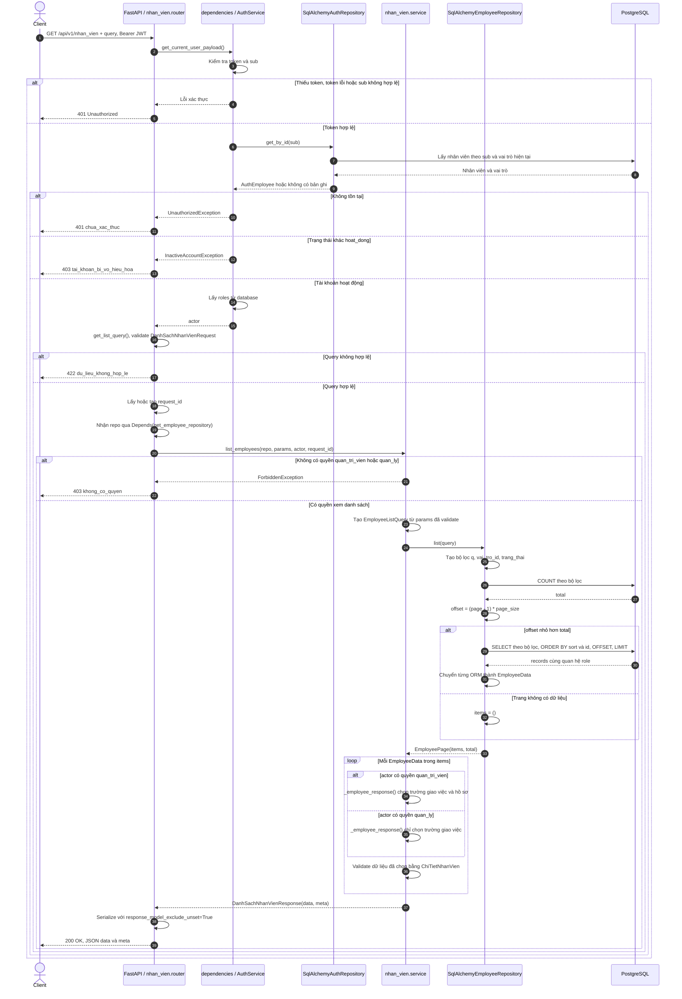
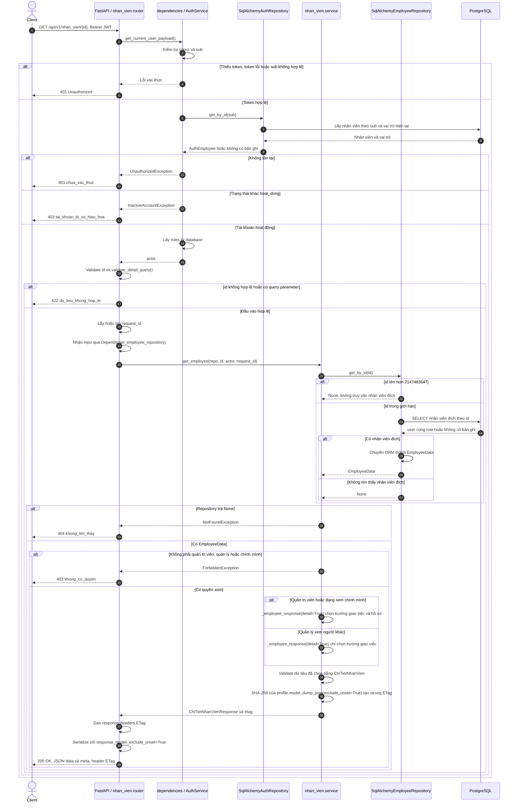
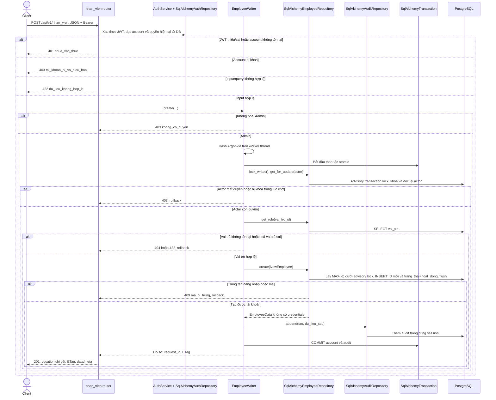
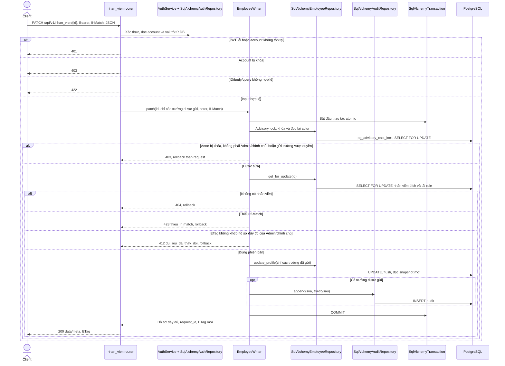
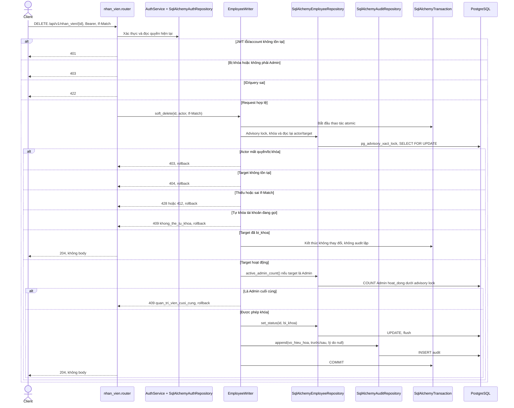
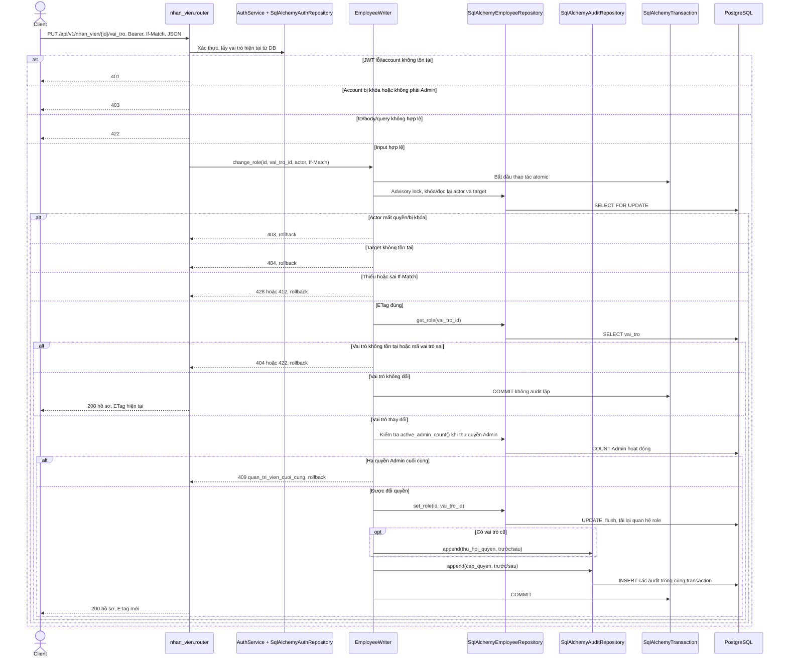
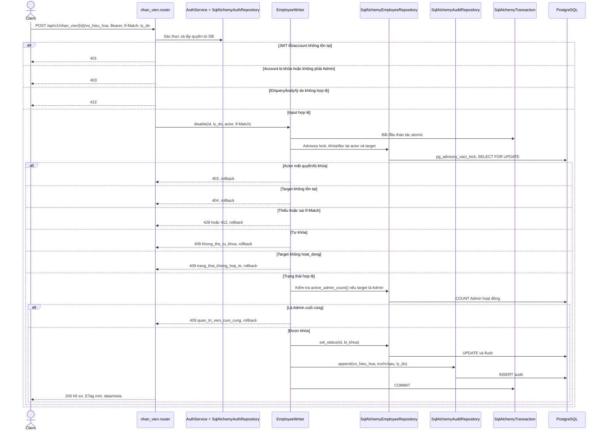
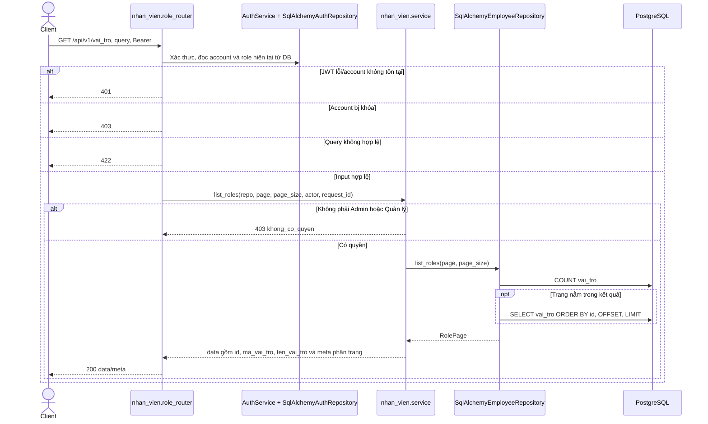

# Sequence diagram — nhan_vien

Nguồn triển khai: `backend/app/modules/nhan_vien/{router,service,write_service,schemas,dto,ports,repository,models,errors}.py`,
`backend/app/dependencies.py`,
`backend/app/modules/auth/{service,repository}.py`, `backend/app/core/security.py`,
`backend/app/core/exceptions.py` và `backend/app/main.py`.
Đối chiếu quyền truy cập với `api-contract-v2.md` trên Google Drive của project.

`main.py` đăng ký tám endpoint từ hai router trong `nhan_vien.router`. Module sở hữu
ORM `User` và `Role`, được dùng chung với xác thực. Giữ nguyên schema hiện tại;
backend cấp ID và kiểm tra trạng thái trong service/repository, không tạo migration.

Quyết định đã chốt với dev ngày 20/10/2026, bổ sung/thay thế contract v2:
- DELETE chỉ dành cho Admin và là soft delete: chuyển `bi_khoa`, giữ bản ghi, mã và toàn bộ tham chiếu;
  tài khoản khóa vẫn xuất hiện trong GET và lịch sử. Không có kiểm tra chặn theo tham chiếu để xóa vật lý.
- PATCH cho phép Admin sửa hồ sơ hoặc chính chủ sửa `ho_ten`, `ngay_sinh`, `so_dien_thoai`, `email`.
  Chỉ Admin sửa `ngay_vao_lam`, `he_so_luong`; gửi trường vượt quyền từ chối toàn request bằng 403.
- Giữ đúng sáu API mới được yêu cầu; chưa có endpoint mở khóa trong module.

Nhóm API này dùng envelope v2 `{data, meta}` / `{error, meta}`; validation chỉ trả
`{field, reason}`, không echo input. Lỗi DB trả 503, lỗi chưa phân loại trả 500 và không lộ SQL.
Thiếu/token sai hoặc account không tồn tại trả 401; account khác `hoat_dong` trả 403.

`get_employee_repository` tạo `SqlAlchemyEmployeeRepository` từ session do `get_db` cung cấp.
Router truyền repository vào service theo hợp đồng `EmployeeRepository` trong `ports.py`.
Port là hợp đồng kiểu dữ liệu, không phải một tầng xử lý riêng khi chạy.
Repository tải quan hệ `User.role` (`lazy="selectin"`) rồi chuyển ORM thành `EmployeeData`
trước khi trả về. Service chỉ đọc DTO, không nhận ORM hoặc `AsyncSession`.
Các sơ đồ gom SELECT tải vai trò vào lời gọi database tương ứng.
Các nhánh validation mô tả kết quả khi xác thực thành công; không quy định thứ tự
ưu tiên lỗi nếu request đồng thời sai xác thực và đầu vào.

## GET /api/v1/nhan_vien — Lấy danh sách nhân viên

Query: `page` (mặc định 1, tối thiểu 1), `page_size` (mặc định 20, từ 1 đến 100),
`q`, `vai_tro_id` (số nguyên dương), `trang_thai` (`hoat_dong | bi_khoa`), `sort`
(mặc định `id`; hỗ trợ `id`, `ma_nhan_vien`, `ho_ten`, `ten_dang_nhap`, thêm `-` để giảm dần).
`q` tìm không phân biệt hoa thường theo mã nhân viên hoặc họ tên, escape ký tự wildcard.
Query lặp hoặc tham số không được khai báo bị từ chối.

- `meta`: `request_id`, `page`, `page_size`, `total`, `total_pages = ceil(total / page_size)`.
- Trang vượt kết quả trả `200` với `data: []`; không trả `404`. Khi `total = 0`, `total_pages = 0`.
- `vai_tro_id` lớn hơn số nguyên signed 32-bit được chuyển thành điều kiện không khớp bản ghi.
- Cả hai vai trò dùng một schema `ChiTietNhanVien`; service chọn trường theo quyền.
  Quản trị viên nhận hồ sơ đầy đủ; quản lý chỉ nhận:
  `id`, `ma_nhan_vien`, `ho_ten`, `vai_tro_id`, `ma_vai_tro`, `trang_thai`.
- Không trả `mat_khau` hoặc `tai_khoan_id`.
- Các trường hồ sơ có mặc định `None` để hỗ trợ dữ liệu giới hạn. Service không truyền
  chúng khi người gọi không có quyền; router dùng `response_model_exclude_unset=True`
  để bỏ hoàn toàn khỏi JSON. Trường được service truyền rõ ràng với giá trị `None`
  vẫn được trả về dưới dạng `null`, kể cả trường chung như `ho_ten` và `ma_vai_tro`.
- OpenAPI mô tả một `ChiTietNhanVien` với các trường hồ sơ không bắt buộc;
  tập trường thực tế phụ thuộc quyền của người gọi.

## GET /api/v1/nhan_vien/{id} — Lấy chi tiết nhân viên

`id` phải là số nguyên dương. Endpoint không nhận bất kỳ query parameter nào.
Quản trị viên và quản lý được xem nhân viên khác; nhân viên thông thường chỉ được xem chính mình.

- `meta` chỉ chứa `request_id`. ETag có dấu ngoặc kép, được tính từ hồ sơ trả về,
  không bao gồm `meta`, nên không đổi chỉ vì `request_id` thay đổi.
- Code hiện tại trả `200` kèm ETag; chưa xử lý `If-None-Match` để trả `304`.
- Kiểm tra tồn tại nhân viên đích diễn ra trước kiểm tra quyền xem: ID không tồn tại trả `404`,
  nhân viên tồn tại nhưng ngoài quyền truy cập trả `403`.
- `ChiTietNhanVien` gồm các trường giao việc và các trường hồ sơ `ten_dang_nhap`,
  `ngay_sinh`, `so_dien_thoai`, `email`, `ngay_vao_lam`, `he_so_luong`.
  Service chỉ điền các trường hồ sơ khi quản trị viên hoặc người xem chính mình;
  quản lý xem người khác nhận sáu trường giao việc giống endpoint danh sách.
  Không trả mật khẩu hoặc `tai_khoan_id`.
- ETag chỉ bao gồm các trường thực sự trả về. Thay đổi email/hệ số lương không
  làm đổi ETag của quản lý xem người khác; thay đổi trường giao việc vẫn làm đổi ETag.
- Hai endpoint chỉ đọc, không có transaction ghi dữ liệu.

## POST /api/v1/nhan_vien — Tạo tài khoản

Bắt buộc `ten_dang_nhap`, `mat_khau` tối thiểu 8 ký tự, `ma_nhan_vien`, `vai_tro_id`.
Hồ sơ nullable: `ho_ten`, `ngay_sinh`, `so_dien_thoai`, `email`, `ngay_vao_lam`, `he_so_luong`.
Hệ số lương là JSON string decimal không âm, tối đa 5 chữ số và 2 chữ số thập phân.
Không nhận ID, trạng thái, `tai_khoan_id` hay trường lạ. Mã/tên đăng nhập do client gửi, duy nhất và bất biến.

Không có If-Match khi tạo. Audit/commit thất bại rollback cả tài khoản.
Mật khẩu, hash và token không xuất hiện trong response, audit hoặc SQL parameter logs.

## PATCH /api/v1/nhan_vien/{id} — Sửa hồ sơ

Chỉ nhận các trường hồ sơ nullable của Create. Trường bỏ qua giữ nguyên, `null` xóa giá trị nullable.
Không nhận mật khẩu, tên đăng nhập, mã nhân viên, vai trò hoặc trạng thái.

Request `{}` vẫn kiểm tra quyền/ETag, trả hồ sơ hiện tại và không ghi audit.
Admin được sửa cả ngày vào làm/hệ số lương; mọi vai trò được tự sửa bốn trường đã chốt.

## DELETE /api/v1/nhan_vien/{id} — Xóa mềm bằng trạng thái bi_khoa

Không xóa bản ghi, không giải phóng mã/tên đăng nhập và không tác động chứng từ hoặc kho.
Không yêu cầu body/lý do. If-Match phải là ETag mới nhất từ GET của Admin.

Gọi lại vẫn phải gửi If-Match hiện tại: dùng ETag trước lần khóa vẫn trả 412.
JWT đã cấp cho tài khoản khóa bị chặn ở request sau; không cần thu hồi token để có hiệu lực.

## PUT /api/v1/nhan_vien/{id}/vai_tro — Đổi vai trò

Body duy nhất `{vai_tro_id: integer dương}`. Quyền chỉ từ vai trò hiện tại trong database.

## POST /api/v1/nhan_vien/{id}/vo_hieu_hoa — Khóa có lý do

Body `{ly_do: string}` bắt buộc, trim và không được rỗng. Chỉ chuyển `hoat_dong → bi_khoa`.

## GET /api/v1/vai_tro — Danh sách vai trò

Query chỉ gồm `page` (>=1, mặc định 1), `page_size` (1..100, mặc định 20).
Không nhận query lặp/thừa. Sắp xếp ID tăng dần, trang vượt phạm vi trả danh sách rỗng.

## Schema và kiểm chứng

- Source v3 đã đối chiếu: DBML được liên kết trong `api-contract-v2.md`, schema PostgreSQL hiện tại.
  `infra/postgres/init.sql` còn model cũ (`loai_nhan_vien`), không phải nguồn bootstrap v3 hợp lệ.
- Theo yêu cầu dev: không tạo migration hoặc thay đổi schema. ID nhân viên không có identity/sequence;
  repository lấy MAX(id)+1 dưới cùng advisory transaction lock với mọi API ghi nhân viên, giữ khóa
  đến commit và kiểm tra giới hạn signed 32-bit. Các lần tạo đồng thời qua API không trùng ID.
  Tiến trình ghi trực tiếp bằng SQL ngoài API phải phối hợp cùng khóa/cơ chế cấp ID; khóa advisory
  không tự ép các client SQL khác tuân thủ. PK/UNIQUE của database vẫn chặn dữ liệu trùng.
- Backend đặt `hoat_dong` khi tạo và kiểm tra trạng thái trên mỗi request; không tự sửa dữ liệu cũ.
  Dữ liệu NULL/trạng thái lạ vẫn bị từ chối xác thực. Giữ bộ xác minh Argon2id/bcrypt khi rollback code
  để các tài khoản đã tạo tiếp tục đăng nhập được; không có bước downgrade schema trong tác vụ này.
- Unit/API dùng SQLite riêng; concurrency dùng database có tên bắt đầu `xbike_employee_test_` và
  tạo schema riêng mỗi lượt để các kết nối thấy fixture, không reset/xóa dữ liệu hoặc database có sẵn.
- Chạy trong `backend`: `poetry run pytest -q`, `poetry run ruff check .`, `poetry run ruff format --check .`.
  Đặt `EMPLOYEE_TEST_DATABASE_URL` tới DB test chuyên biệt để chạy thêm `test_nhan_vien_postgres.py`.
- Các nhánh lỗi audit/commit rollback mọi cập nhật; lỗi SQL trả 503, lỗi khác trả 500 theo envelope v2.
  Thứ tự validation và auth không cam kết khi request đồng thời sai nhiều điều kiện.
