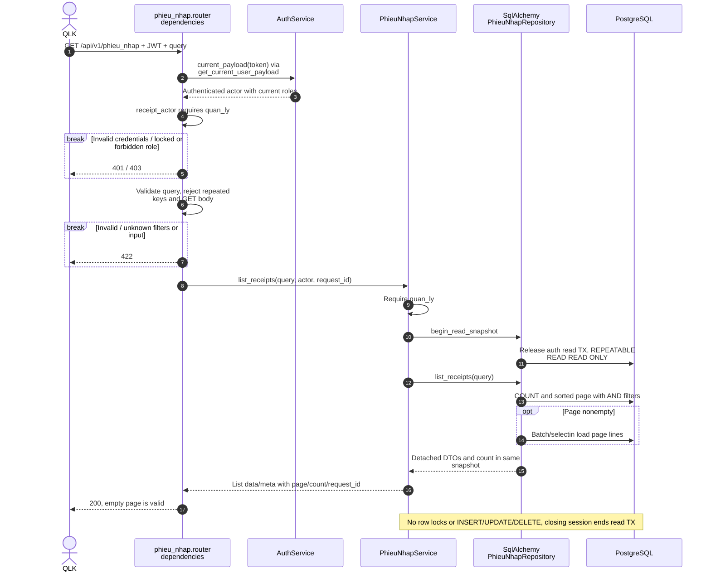
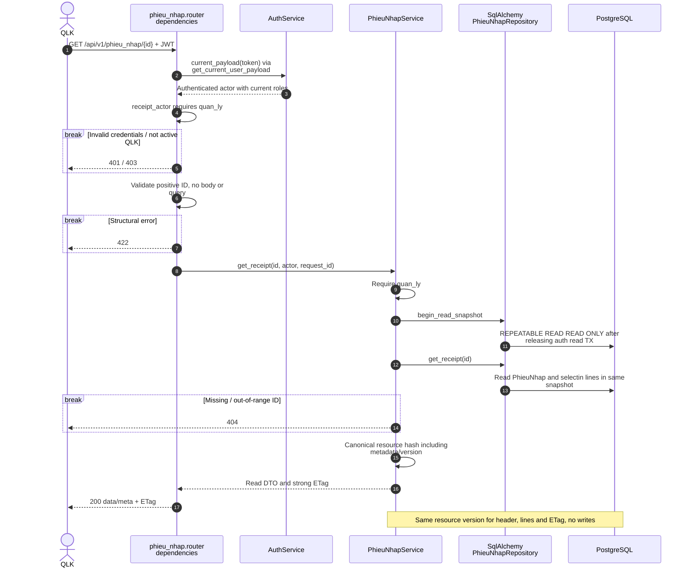
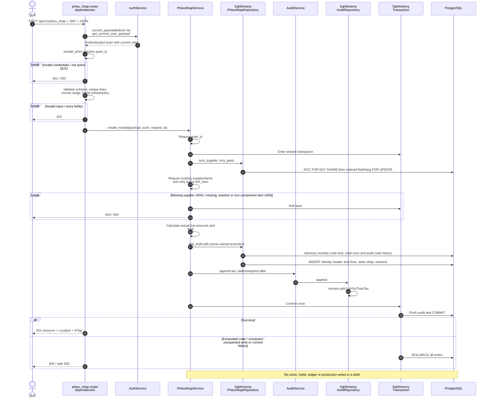
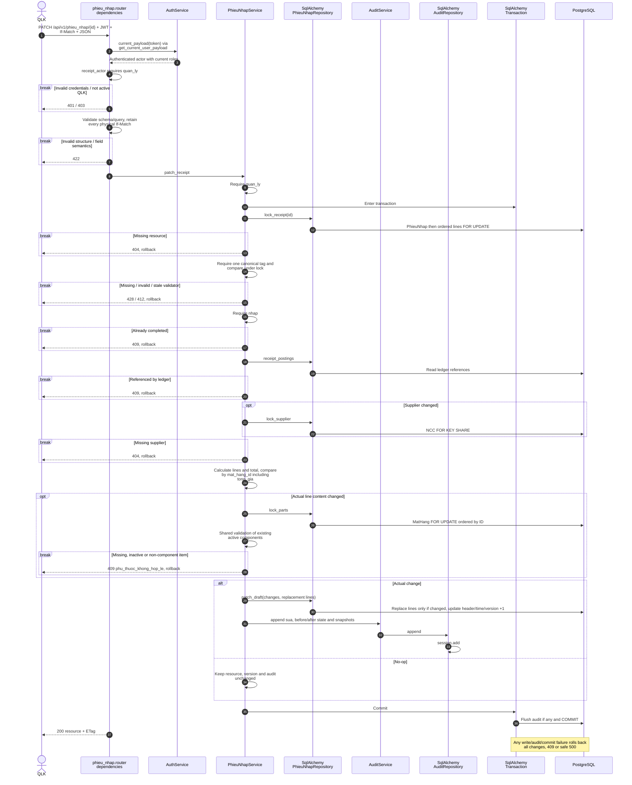
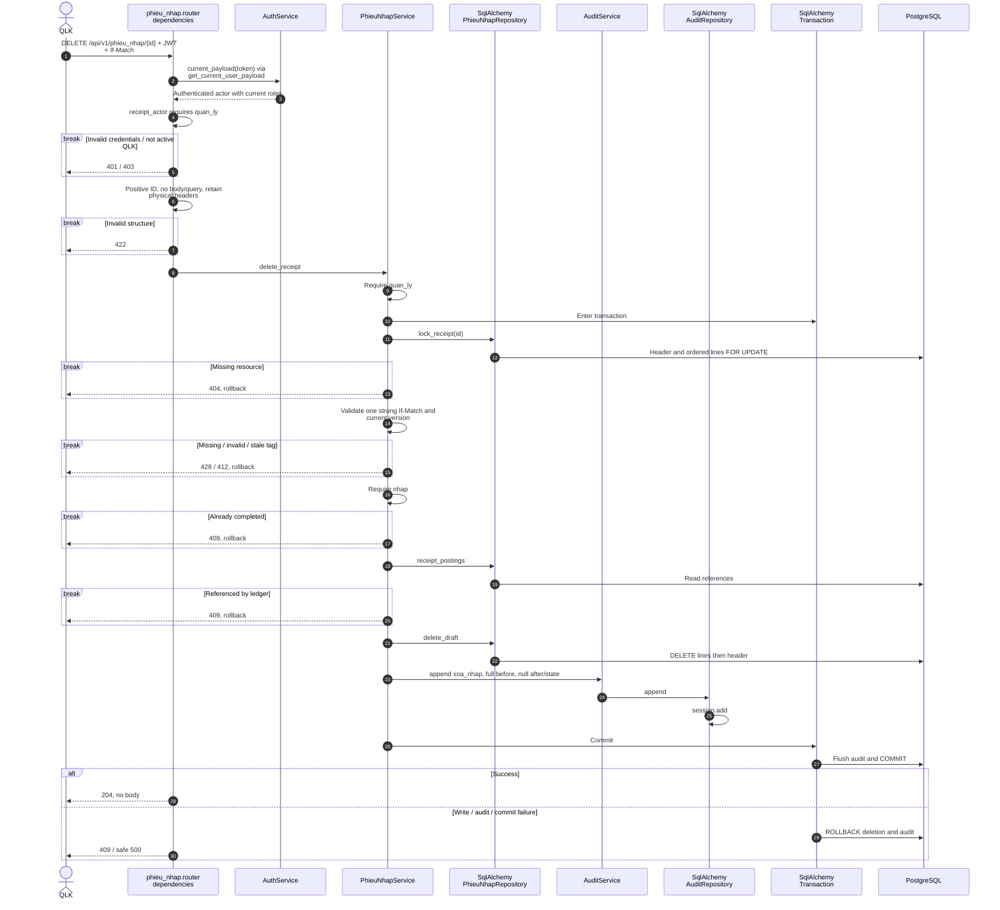
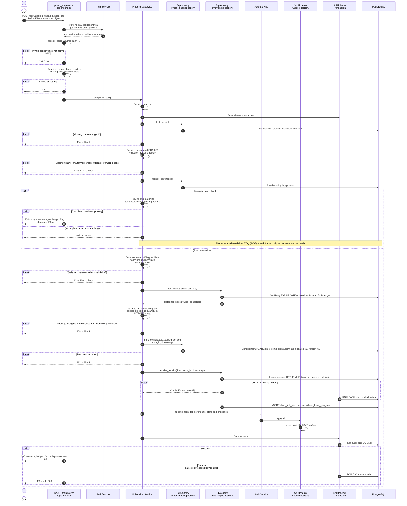

# Sequence phiếu nhập v4 — UC-20 đến UC-22

Nguồn: [UC-20](../../specs/use_cases/goods_receipt/UC-20.md),
[UC-21](../../specs/use_cases/goods_receipt/UC-21.md),
[UC-22](../../specs/use_cases/goods_receipt/UC-22.md),
[plan đã duyệt](../plans/PR-08-phieu-nhap.md),
`phieu_nhap/{router,service,repository,schemas,models,ports}.py`, `inventory/{ports,repository}.py`,
`audit/{service,repository,schemas,models}.py`, dependencies/core transaction và init.sql v4.

| Endpoint thực tế | UC | PNG |
|---|---|---|
| GET `/api/v1/phieu_nhap` | UC-22 | [Danh sách](assets/phieu_nhap/01-danh-sach.png) |
| GET `/api/v1/phieu_nhap/{id}` | UC-22 | [Chi tiết](assets/phieu_nhap/02-chi-tiet.png) |
| POST `/api/v1/phieu_nhap` | UC-20 | [Tạo nháp](assets/phieu_nhap/03-tao-nhap.png) |
| PATCH `/api/v1/phieu_nhap/{id}` | UC-20 | [Sửa nháp](assets/phieu_nhap/04-sua-nhap.png) |
| DELETE `/api/v1/phieu_nhap/{id}` | UC-20 | [Xóa nháp](assets/phieu_nhap/05-xoa-nhap.png) |
| POST `/api/v1/phieu_nhap/{id}/hoan_tat` | UC-21 | [Hoàn tất](assets/phieu_nhap/06-hoan-tat.png) |

Chỉ `quan_ly` (QLK) dùng cả sáu endpoint; QTV/NV bị chặn, QLK không bị giới hạn
chỉ phiếu mình lập. Mỗi endpoint nhận `actor` qua `Depends(receipt_actor)`;
APIRouter không khai báo thêm dependency quyền trùng. Dependency dùng
`get_current_user_payload` / `AuthService.current_payload` để xác thực người dùng
và kiểm vai trò hiện tại. Service giữ `_require_manager` để bảo vệ lời gọi trực tiếp.
Không phục hồi /receiving hoặc thêm route duyệt.

Response success `{data,meta}`; lỗi `{error:{code,message,details},meta:{request_id}}`.
Tiền integer VND/BIGINT, không Decimal/chuỗi. Timestamp UTC/Z; ngay_nhap là DATE.
Chi tiết có updated_at, hoan_thanh_at, nguoi_hoan_thanh_id, phien_ban. ETag strong
SHA-256 JSON canonical của toàn resource/dòng theo ID/metadata, không gồm request_id.
Phien_ban đổi khi patch thực tế hoặc hoàn tất, không đổi khi no-op/replay.

PATCH/DELETE/hoan_tat yêu cầu một If-Match dạng quoted 64 hex thường. Thiếu/trắng
428; weak/wildcard/nhiều physical header/compound/sai định dạng 412. Tag cũ 412,
ngoại lệ replay hoàn tất bên dưới. GET không body; DELETE không body; mọi endpoint
trừ GET list không nhận query. Khi cùng sai auth và cấu trúc không cam kết ưu tiên lỗi.

## GET /api/v1/phieu_nhap

Query AND: q tìm mã không phân biệt hoa/thường (`%`/`_` literal), trang_thai,
ncc_id, nhan_vien_id, tu_ngay/den_ngay theo **created_at** giờ Asia/Ho_Chi_Minh,
bao gồm cả ngày. Không thêm lọc ngay_nhap. Page1/size20/max100, sort id/created_at/
ma_phieu_nhap hoặc `-`, mặc định id tăng, ID tăng làm tiêu chí phụ. Không ETag list.

## GET /api/v1/phieu_nhap/{id}

ID positive, quá PostgreSQL INTEGER hoặc không tồn tại trả 404. ncc_id tham chiếu
NCC hiện tại, không có snapshot NCC trong resource; UI lookup NCC để hiển thị sau này.

## POST /api/v1/phieu_nhap

Input ncc_id, ngay_nhap, ghi_chu optional/null, chi_tiet gồm LK/quantity/đơn giá nhập.
ID/lượng strict positive INTEGER, tiền strict nonnegative BIGINT, không float/bool/
chuỗi. Server tính tổng; mã/actor/state/metadata không do client đặt. Giá danh mục
không bị sửa và không thay giá nhập. NCC key-share và LK theo ID tăng FOR UPDATE
trước cấp mã; advisory (20261022,1) chỉ bảo vệ PN-YYYYMM-NNNNNN theo tháng created_at
giờ VN, gồm cả history audit để không reuse mã xóa. ID do Identity, có thể khuyết khi rollback.

## PATCH /api/v1/phieu_nhap/{id}

Field bỏ qua giữ nguyên; ghi_chu=null xóa ghi chú. ncc_id/ngay_nhap/chi_tiet null
bị 422; gửi chi_tiet là thay cả danh sách không rỗng, không endpoint sửa dòng riêng.
So sánh dòng theo `mat_hang_id`, gồm số lượng, đơn giá và `tong_gia`, cùng tổng tiền
phiếu; thứ tự gửi không làm thay đổi phiếu. No-op giữ nguyên dòng/ID, metadata,
phien_ban, ETag và audit, không gọi `patch_draft`. Chỉ gọi `_validate_parts` khi
nội dung dòng thực sự thay đổi; nếu chỉ tổng tiền phiếu sai, cập nhật tổng tiền
không thay dòng hoặc kiểm lại linh kiện. Vì vậy sửa ghi chú kèm dòng cũ vẫn
được phép nếu linh kiện đã ngừng hoạt động. Thay đổi thực tế tăng version/updated_at,
audit before/after. Hoàn tất không được sửa.

## DELETE /api/v1/phieu_nhap/{id}

Chỉ nháp chưa có ledger. Audit giữ full snapshot trước/mã; snapshot và state sau null.
Xóa/audit cùng transaction, không cascade xóa ledger/audit. Thành công 204 không body.

## POST /api/v1/phieu_nhap/{id}/hoan_tat

Body `{}` bắt buộc. Thứ tự khóa: phiếu → chi tiết tăng ID → MatHang tăng ID.
Service kiểm nội dung persisted, số dư khớp SUM ledger và không tràn INTEGER.
mark_completed UPDATE có điều kiện id/nhap/phien_ban, ghi metadata cùng state trước
INSERT ledger để đáp ứng trigger. Tiền nhập giữ nguyên; không sửa giá danh mục,
so_luong_dang_giu hoặc GiuHang, không tự kiểm tra/đổi yêu cầu sản xuất.

Replay giữ quyền/header đúng policy; không quyết định lại theo giá hoặc tồn hiện tại.
Nhập không có ticket/phiếu điều chỉnh hoặc bước duyệt. Trigger MatHang thông báo sau
commit, cache khác cập nhật theo listener/reconciliation, không bảo đảm tức thì.
Test ASGI với repository/session giả kiểm tra các AC backend, SQL ghi sổ thật và
rollback khi UPDATE không có dòng. Test FE `uc21-hoan-tat-phieu-nhap.test.js` dùng
ReceiptEditor và Confirmation hiện tại, xác nhận Hủy/X/Escape không gọi API.
Chưa kiểm chứng DB PostgreSQL thật, tranh chấp đồng thời hoặc E2E trình duyệt.
