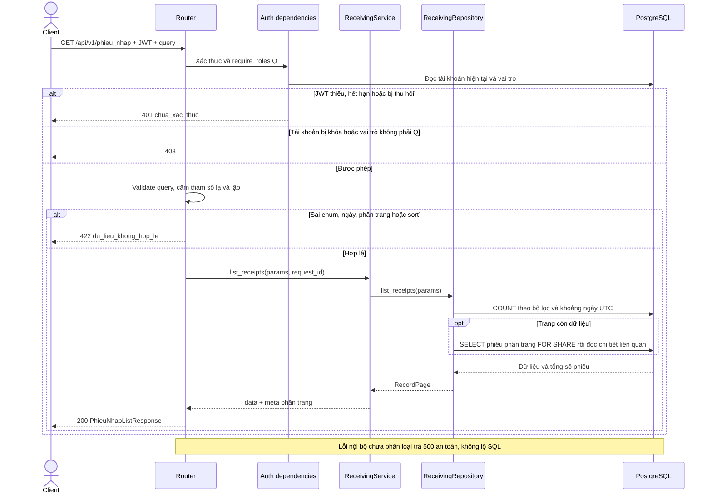
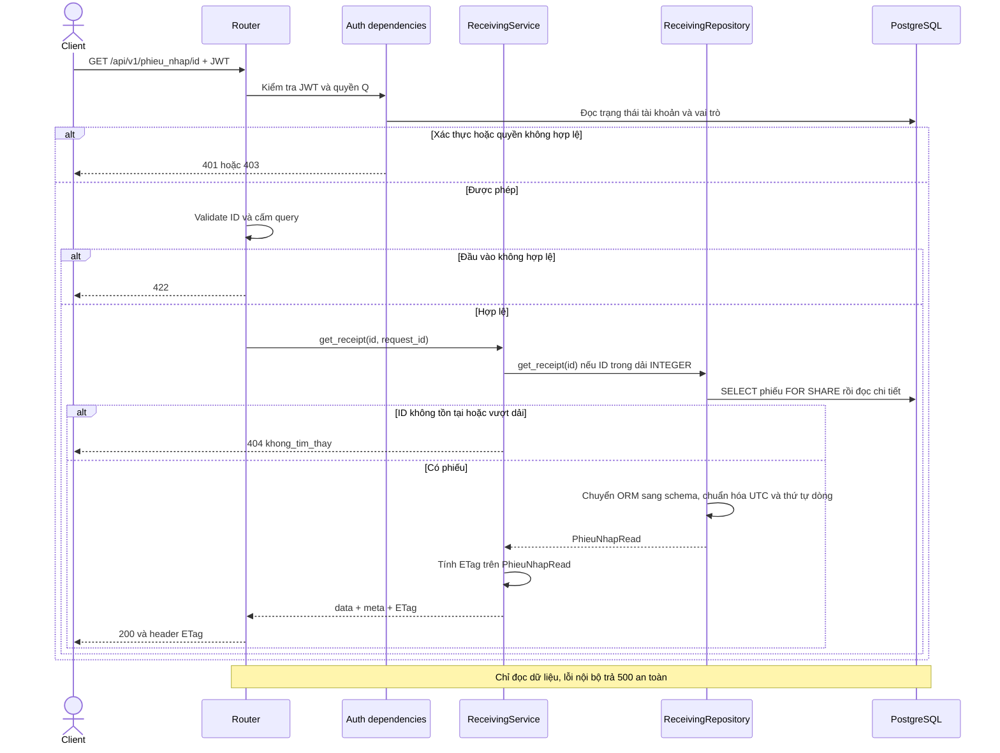
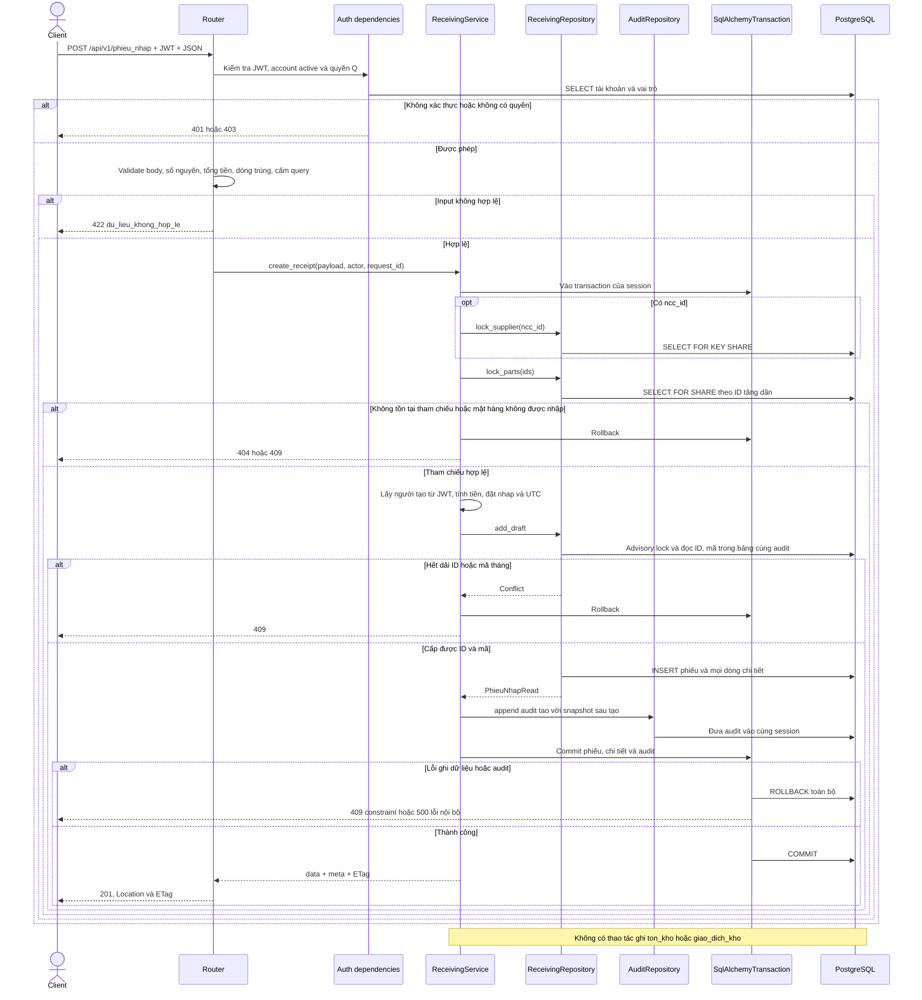
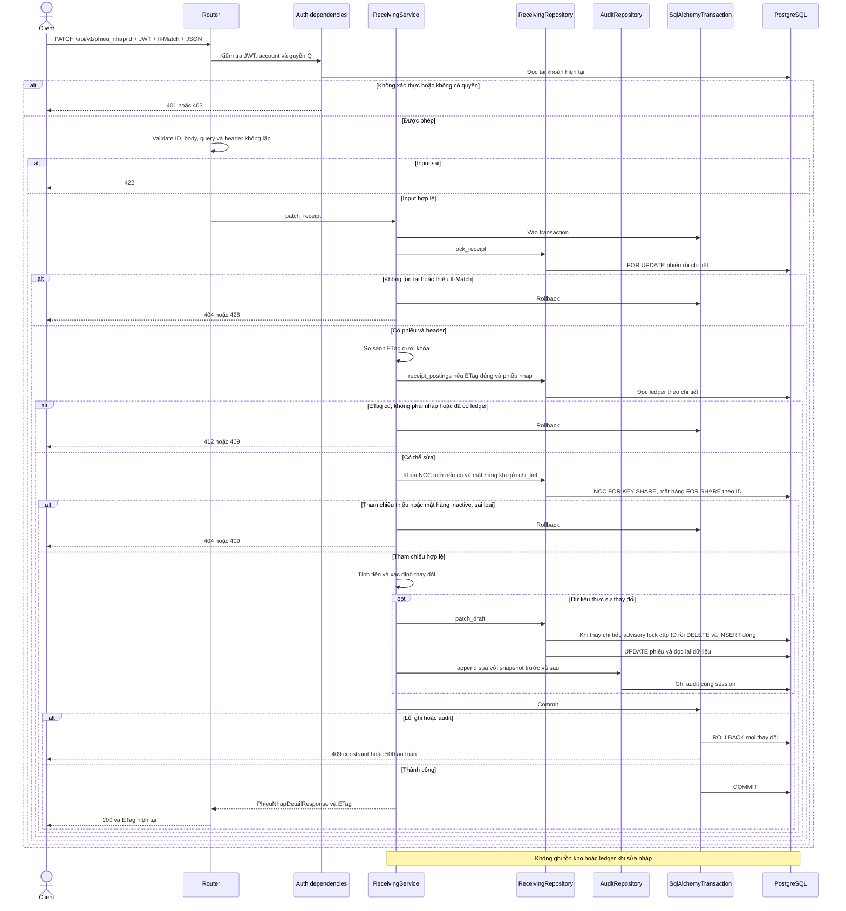
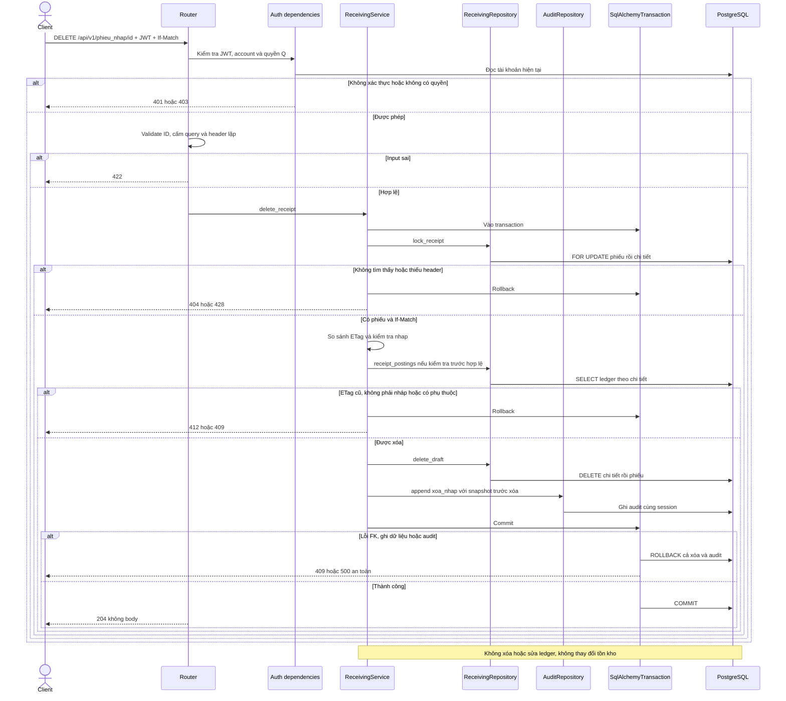
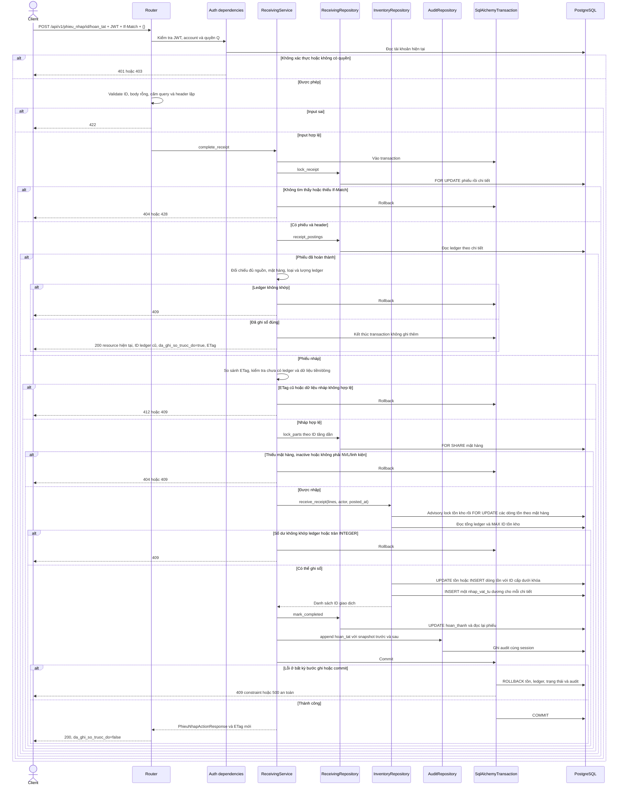
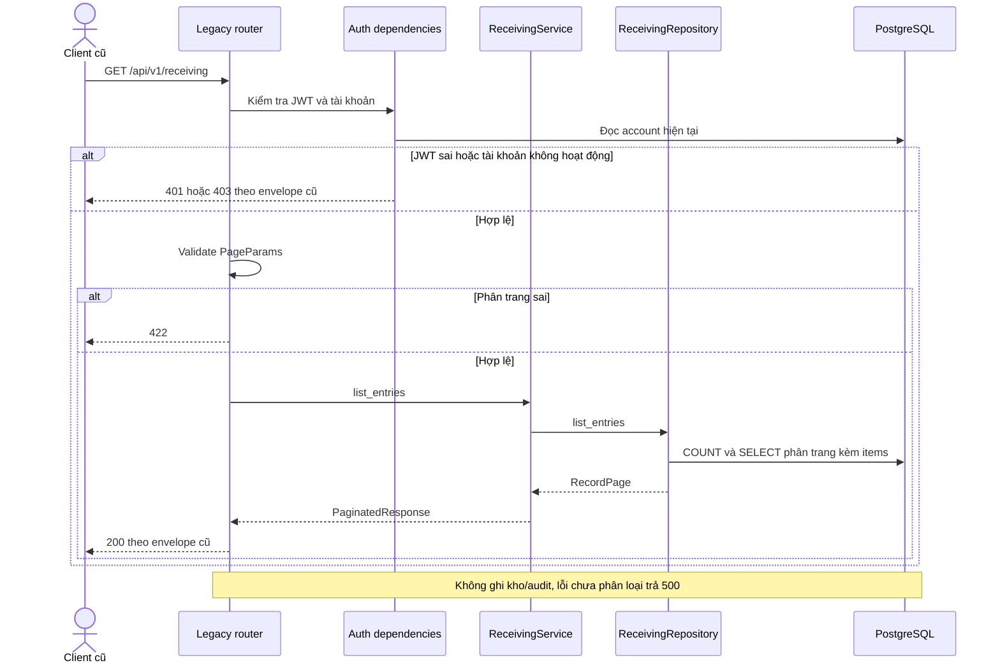
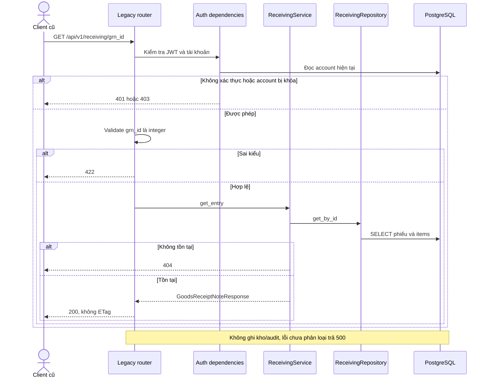
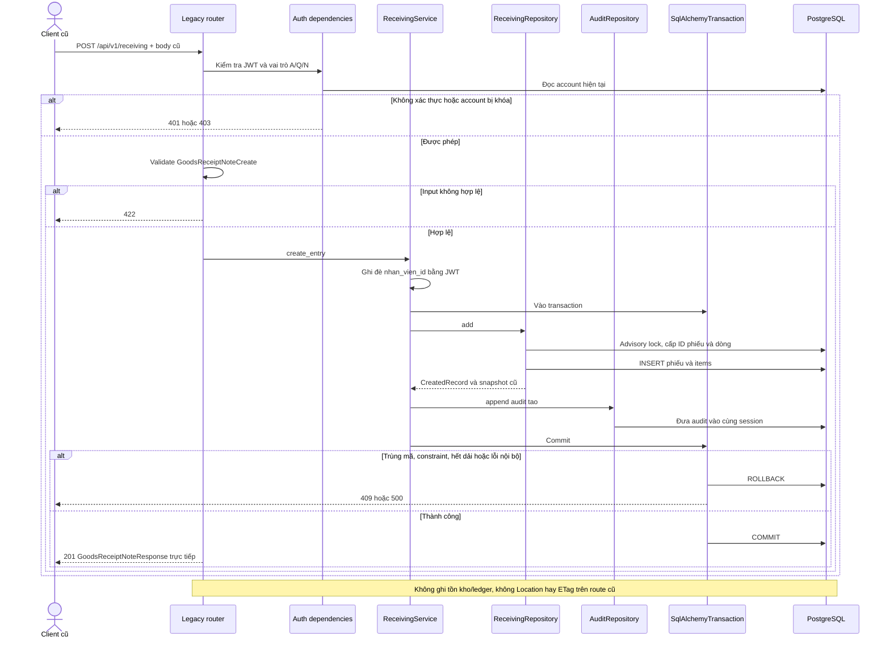

# Luồng API phiếu nhập

Đối chiếu ngày 22/10/2026 với router, service, repository, schema, ORM và dependency hiện tại trong `backend/app/modules/phieu_nhap/`.
Nguồn nghiệp vụ: [API contract v2](https://drive.google.com/file/d/16hj1yTLvhQ4peRENCLjbCKhNdGy_L2Xz/view), mục 2, 3, 5, 7, 13, 14 và quy ước mã trong `infra/postgres/init.sql`.

## Quy ước đang triển khai

- Sáu endpoint `/phieu_nhap` chỉ dành cho Q (`quan_ly`). JWT, phiên bản mật khẩu và trạng thái tài khoản được kiểm tra ở mỗi request. A không mặc định có quyền Q.
- Response thành công: `{data, meta}`; danh sách có page/page_size/total/total_pages/request_id. Lỗi: `{error: {code, message, details}, meta: {request_id}}`.
- GET chi tiết và POST trả strong ETag tính trên toàn bộ PhieuNhapRead, bao gồm các dòng chi tiết được sắp theo ID. `request_id` không tham gia ETag.
- POST tạo mới chỉ tạo trạng thái `nhap`, không ghi `ton_kho` hoặc `giao_dich_kho`. PATCH/DELETE chỉ tác động nháp chưa có giao dịch kho. Chỉ action `hoan_tat` cộng tồn, ghi ledger và chuyển trạng thái.
- PATCH, DELETE và hoàn tất yêu cầu If-Match. Sau khi khóa phiếu, không tìm thấy trả 404, thiếu header trả 428. ETag cũ trả 412; riêng hoàn tất đã thành công cho phép retry với ETag cũ nhưng vẫn cần header. Header lặp trả 422.
- GET mới giữ khóa FOR SHARE trên phiếu đến khi đọc xong chi tiết để response và ETag cùng một phiên bản. GET không ghi dữ liệu. COUNT và trang danh sách là hai truy vấn, tổng số có thể thay đổi khi có request tạo/xóa đồng thời.
- Hoàn tất khóa phiếu và chi tiết FOR UPDATE, khóa mặt hàng FOR SHARE theo ID tăng dần, rồi lấy advisory transaction lock tồn kho `(20261022, 2)`. Khóa các dòng tồn theo mã mặt hàng, cấp ID cho dòng tồn chưa có bằng MAX(id)+1 dưới khóa, đúng SQL không Identity. Các lần ghi sổ phiếu nhập được tuần tự hóa tại khóa này.
- Trước cộng tồn, số dư phải khớp tổng ledger và số lượng mới không vượt INTEGER. Sai lệch trả 409, không tự sửa số dư. Mỗi chi tiết sinh đúng một `nhap_vat_tu` dương với duy nhất FK nguồn `chi_tiet_phieu_nhap_id`. Tồn, ledger, trạng thái và audit cùng commit hoặc cùng rollback.
- Theo quyết định của dev: giữ SQL, backend cấp ID phiếu và dòng dưới advisory transaction lock `(20261022, 1)`. Xét ID/mã lớn nhất trong bảng và snapshot audit để không tái sử dụng những giá trị đã lưu lịch sử.
- Mã `PN-YYYYMM-NNNNNN` do server sinh theo tháng Asia/Ho_Chi_Minh, từ 000001 đến 999999. PostgreSQL chuyển múi giờ, không phụ thuộc tzdata trên máy Windows. Hết dải trả 409, không quay vòng.
- `created_at` lưu UTC vào cột TIMESTAMP WITHOUT TIME ZONE, API mới trả UTC có Z. Dữ liệu cũ giữ NULL ở người tạo, tiền, thời gian và đơn giá; không tự sửa dữ liệu cũ.
- Tiền và số lượng đầu vào là JSON integer nghiêm ngặt. Số lượng > 0, giá >= 0; tổng tiền không vượt INTEGER PostgreSQL (2,147,483,647). ID dòng/mã phiếu/tổng/trạng thái/người tạo/thời gian do server quản lý.
- POST khóa nhà cung cấp bằng FOR KEY SHARE và mặt hàng bằng FOR SHARE theo ID tăng dần trước khi kiểm tra; giữ khóa đến commit/rollback. Chỉ nhận mặt hàng active là NVL hoặc linh kiện.
- Tạo phiếu, mọi dòng và audit `tao` cùng transaction. Audit lỗi thì rollback tất cả. Audit lưu snapshot PhieuNhapRead và người thực hiện từ JWT.
- `/receiving` là các route cũ vẫn được giữ để tương thích, có quyền/payload/envelope khác; không xem chúng là contract v2.

## GET /api/v1/phieu_nhap

Query: page (1), page_size (20, tối đa 100), q tìm mã không phân biệt hoa/thường, trang_thai, ncc_id, nhan_vien_id, tu_ngay, den_ngay, sort. Sort cho phép id/created_at/ma_phieu_nhap và dạng `-` giảm dần, ID là tiêu chí phụ. Ký tự `%`/`_` trong q được hiểu theo nghĩa đen. Filter kết hợp AND.

Ngày lọc theo Asia/Ho_Chi_Minh, lấy cả hai ngày bằng khoảng UTC nửa mở. Không tìm thấy trả 200 với danh sách rỗng. Không ghi audit hay thay đổi trạng thái/tồn kho.

## GET /api/v1/phieu_nhap/{id}

ID nguyên dương; không nhận query. ID vượt INTEGER PostgreSQL trả 404, không đưa giá trị tràn vào truy vấn. GET được đọc cả phiếu nháp và hoàn thành, kể cả dữ liệu lịch sử có mặt hàng ngừng hoạt động.

## POST /api/v1/phieu_nhap

Body: `ncc_id` tùy chọn nullable, `chi_tiet` bắt buộc có ít nhất một dòng `{mat_hang_id, so_luong, don_gia_thuc}`. Không trùng mặt hàng. Không cần If-Match khi tạo mới. Nếu nhà cung cấp/mặt hàng không tồn tại trả 404; mặt hàng không active hoặc sai loại trả 409 `phu_thuoc_khong_hop_le`.

## PATCH /api/v1/phieu_nhap/{id}

Body nhận `ncc_id` và `chi_tiet` tùy chọn. Bỏ trường nghĩa là giữ nguyên; `ncc_id: null` bỏ liên kết NCC. `chi_tiet` nếu gửi phải là mảng có ít nhất một dòng, thay toàn bộ chi tiết, không nhận null hoặc mặt hàng trùng. Server tính lại tiền và cấp ID mới cho bộ chi tiết thay thế. Payload không làm thay đổi dữ liệu trả 200 với ETag cũ, không ghi audit. Không sửa phiếu hoàn thành hoặc phiếu có ledger.

## DELETE /api/v1/phieu_nhap/{id}

Không nhận query. Xóa chi tiết rồi phiếu nháp trong cùng transaction với audit `xoa_nhap`, snapshot trước xóa và snapshot sau là NULL. Giữ lịch sử ID/mã trong audit để allocator không tái sử dụng. Thành công 204 không body. Phiếu hoàn thành hoặc đã có giao dịch phụ thuộc không được xóa.

## POST /api/v1/phieu_nhap/{id}/hoan_tat

Body bắt buộc là `{}`, không nhận query hay trường thêm. Kết quả gồm PhieuNhapRead, `giao_dich_kho_ids` và `da_ghi_so_truoc_do`. ETag tính từ PhieuNhapRead, giống GET chi tiết, không tính hai trường action. Người ghi ledger/audit là người đang thực hiện action, không đổi người tạo phiếu. Thời điểm ghi sổ là UTC, dùng chung cho mọi dòng của một lần hoàn tất.

Retry phải còn quyền Q và có If-Match. Nếu phiếu hoàn thành, đối chiếu chính xác ledger với từng dòng trước khi trả `da_ghi_so_truoc_do=true`; không tạo thêm audit/ledger hoặc cộng lại tồn. Trạng thái hoàn thành nhưng thiếu/sai ledger trả 409. Nháp cũ thiếu giá, sai tổng hoặc rỗng trả 409 để sửa trước khi hoàn tất.

## GET /api/v1/receiving

Route cũ: mọi tài khoản A/Q/N hợp lệ được đọc, dùng PageParams (`page`, `page_size`, `search`, `sort_by`, `sort_order`) và PaginatedResponse cũ, trường dòng là `items`. Không có ETag.

## GET /api/v1/receiving/{grn_id}

Route cũ trả GoodsReceiptNoteResponse trực tiếp, không có meta/ETag. Giữ validation path integer cũ.

## POST /api/v1/receiving

Route cũ vẫn cho A/Q/N, nhận ma_phieu_nhap, items, tổng tiền và giá dòng theo schema cũ, cho phép nháp rỗng. Người tạo luôn được ghi đè bằng JWT. Đây không phải validation của contract v2. Cùng allocator dưới khóa với API mới để không cấp trùng ID; route cũ vẫn giữ mã do client cung cấp.

