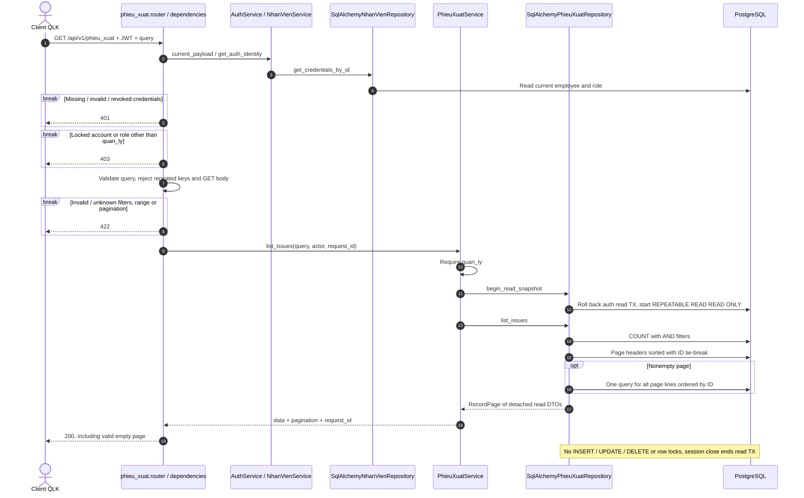
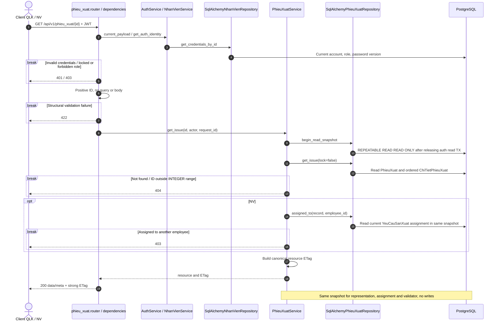
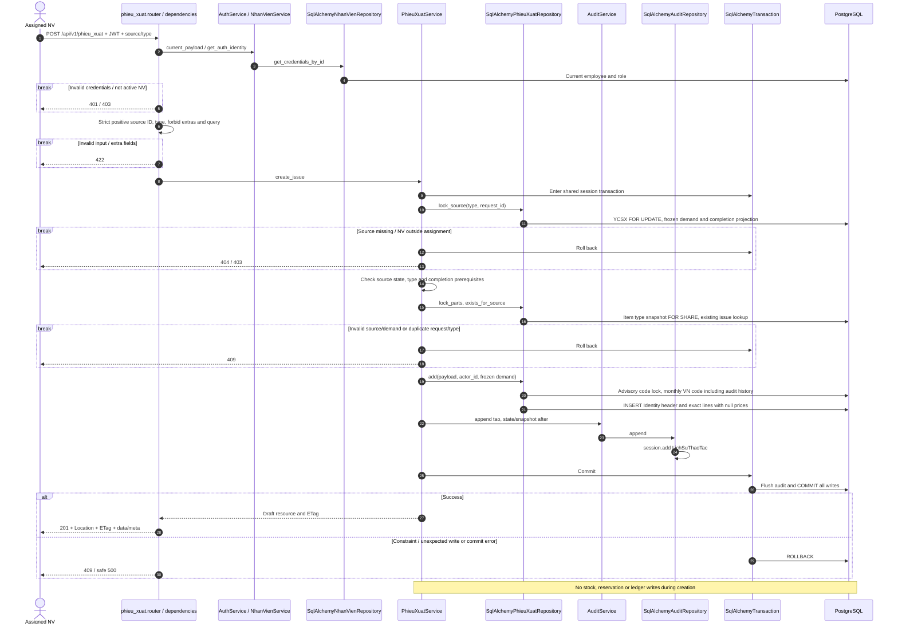
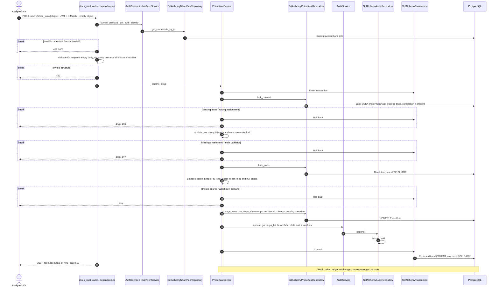
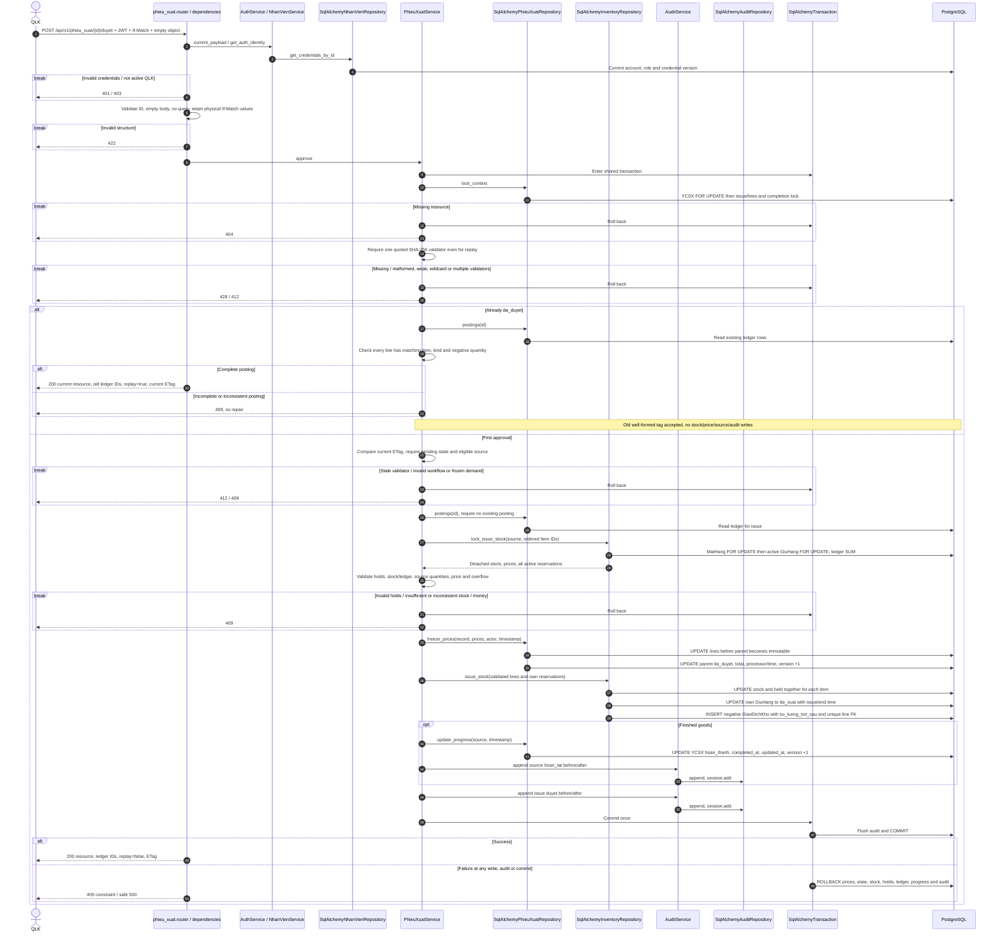
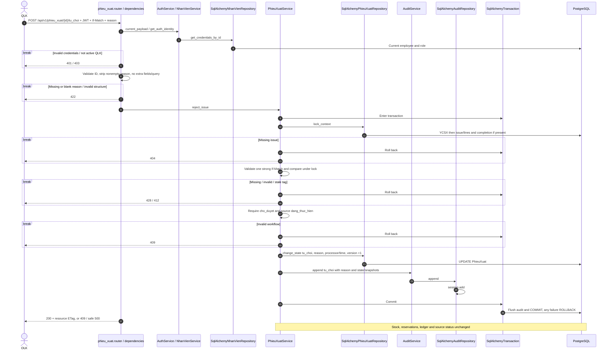

# Sequence phiếu xuất v4 — UC-34 đến UC-40

Nguồn: [spec](../../specs/use_cases/goods_issue/README.md),
[plan và kết quả](../../specs/use_cases/goods_issue/PLAN.md),
`phieu_xuat/{router,schemas,service,ports,repository,models}.py`,
`inventory/{ports,repository}.py`, `audit/{service,repository,schemas,models}.py`,
`dependencies.py`, `core/{request_context,sqlalchemy_transaction}.py` và `init.sql` v4.

| Endpoint hiện có | UC | PNG |
|---|---|---|
| GET `/api/v1/phieu_xuat` | UC-40 | [Danh sách](assets/phieu_xuat/01-danh-sach.png) |
| GET `/api/v1/phieu_xuat/{id}` | UC-40 | [Chi tiết](assets/phieu_xuat/02-chi-tiet.png) |
| POST `/api/v1/phieu_xuat` | UC-34/37 | [Tạo nháp](assets/phieu_xuat/03-tao-nhap.png) |
| POST `/api/v1/phieu_xuat/{id}/gui` | UC-34/37 | [Gửi hoặc gửi lại](assets/phieu_xuat/06-gui.png) |
| POST `/api/v1/phieu_xuat/{id}/duyet` | UC-35/38 | [Duyệt](assets/phieu_xuat/07-duyet.png) |
| POST `/api/v1/phieu_xuat/{id}/tu_choi` | UC-36/39 | [Từ chối](assets/phieu_xuat/08-tu-choi.png) |

Chỉ sáu endpoint trên được đăng ký. PATCH/DELETE `/{id}` trả 405; `/{id}/ve_nhap`
và các alias xuất cũ không có route. Không tạo route `gui_lai`: gửi lại dùng `/gui`.
QLK (`quan_ly`) đọc danh sách/chi tiết, duyệt, từ chối. NV (`nhan_vien`) đọc/lập/gửi
phiếu thuộc yêu cầu hiện được giao. QTV không được vào các endpoint này. JWT được
kiểm tra chữ ký/hạn, tài khoản, hash phiên mật khẩu và vai trò hiện tại từ DB.
Phần auth hiện hữu chưa được nâng sang `phien_ban_dang_nhap` v4 trong tác vụ này.

Thành công dùng `{data,meta}`; lỗi nghiệp vụ `{error,meta}` có `request_id`. POST tạo
201 + Location + ETag; các thao tác và GET chi tiết 200 + ETag. Tiền là integer VND
trong BIGINT, giá/tổng null trước duyệt. Thời gian UTC với Z. ETag là SHA-256 JSON
canonical của header và chi tiết sắp theo ID, gồm metadata/phien_ban, không có request_id.
If-Match bắt buộc với gửi/duyệt/từ chối: thiếu/trắng 428; weak/wildcard/nhiều header/
nhiều tag/sai định dạng 412; tag cũ 412, ngoại lệ replay duyệt bên dưới.
Sơ đồ biểu diễn nhóm lỗi, không cam kết ưu tiên giữa auth và validation khi cùng sai.

## GET /api/v1/phieu_xuat

QLK-only. Bộ lọc AND: `q` chứa mã (không phân biệt hoa thường, `%`/`_` là ký tự thường),
`loai_phieu`, `trang_thai`, `nhan_vien_id`, `yeu_cau_san_xuat_id`, `tu_ngay`, `den_ngay`.
Ngày theo Asia/Ho_Chi_Minh, hai đầu bao gồm cả ngày. Page 1, size 20, tối đa 100.
Sort whitelist `id`, `created_at`, `ma_phieu_xuat`, có tiền tố `-`; mặc định
`-created_at`, ID tăng dần khi trùng. Không có lọc theo lệnh, không ETag danh sách.

## GET /api/v1/phieu_xuat/{id}

Missing ID hoặc lớn hơn PostgreSQL INTEGER trả 404; không đưa ID quá dải vào asyncpg.
NV ngoài phạm vi nhận 403. Không nhận query hoặc GET body.

## POST /api/v1/phieu_xuat

Input chỉ `{loai_phieu, yeu_cau_san_xuat_id}`. Loại `xuat_linh_kien` hoặc
`xuat_thanh_pham`. Source phải `dang_thuc_hien`, giao đúng NV. LK lấy đúng đủ
NhuCauLinhKien đã chốt, cần lượng sản xuất > 0. TP chỉ `xuat_giao`, lượng toàn bộ yêu
cầu; nếu cần sản xuất thì chứng từ hoàn thành của nguồn phải `da_duyet`. Không tính
lại BOM; TP đã ngừng vẫn được hoàn tất yêu cầu đã gửi hợp lệ (UC-12 R7).

## POST /api/v1/phieu_xuat/{id}/gui

Body bắt buộc `{}`. NV đúng nguồn gửi nháp hoặc gửi lại từ chối trực tiếp sang
`cho_duyet`; giữ nguyên ID/chi tiết. Tăng phiên bản, cập nhật gui_at/updated_at,
xóa metadata xử lý/lý do trên resource khi gửi lại; lý do cũ vẫn trong audit.

## POST /api/v1/phieu_xuat/{id}/duyet

Body bắt buộc `{}`, QLK-only. Thứ tự khóa: nguồn YCSX → phiếu/chi tiết → chứng từ
hoàn thành nếu có → MatHang tăng dần ID → GiuHang tăng dần item/ID. Nhu cầu đã chốt
bất biến; chứng từ hoàn thành đã duyệt bất biến. Service kiểm tra lượng đúng đủ,
giữ nguồn/loại/lượng/chứng từ đúng, tổng giữ khớp các khoản đang giữ, tồn khớp tổng
ledger, giá integer và không tràn BIGINT. Không dùng cache để quyết định giá/tồn.

LK không tự bắt đầu sản xuất. TP đóng yêu cầu chỉ khi duyệt thành công, thêm audit
`yeu_cau_san_xuat/hoan_tat`. Replay không kiểm tra lại giá/tồn hiện tại hay ghi audit.
NOTIFY mặt hàng do trigger gửi sau commit; không bảo đảm cache module khác cập nhật
đồng bộ tức thì. Hai session thật, rollback từng bước và replay có test PostgreSQL.

## POST /api/v1/phieu_xuat/{id}/tu_choi

QLK, body `{ly_do: string}` không trắng. Chỉ `cho_duyet` → `tu_choi` khi nguồn đang
thực hiện; lưu processor/time/reason, updated_at, phien_ban +1. Không đóng nguồn TP.

## Port nội bộ hủy yêu cầu — không phải endpoint

`YeuCauSanXuatService → PhieuXuatService → SqlAlchemyPhieuXuatRepository`:

- `co_phieu_da_ghi_so(yeu_cau_id)` gọi `lock_by_sources(yeu_cau_id)`; khóa mọi phiếu
  của yêu cầu theo id bằng `FOR UPDATE`, có `da_duyet` thì chặn hủy.
- `huy_phieu_chua_ghi_so(yeu_cau_id, ly_do, actor_id)` kiểm lại R2 trên các phiếu đã
  khóa; Nháp xóa chi tiết rồi header và audit `xoa_nhap`; Chờ duyệt chuyển
  `tu_choi`, ghi người/thời điểm/phiên bản, `ly_do_tu_choi = "Yêu cầu đã hủy"`,
  audit `tu_choi`. Audit lưu lý do truyền vào và snapshot trước/sau. UC-28 truyền
  lý do `Yêu cầu đã hủy`; lý do QLK nhập thuộc lịch sử yêu cầu. Giữ phiếu `tu_choi`.
- `phieu_cua_yeu_cau(yeu_cau_id)` chỉ SELECT id, mã, loại, trạng thái theo id,
  không khóa, không ghi; phục vụ GET xem trước và snapshot tác động khi hủy.
- `tong_da_xuat_thanh_pham(yeu_cau_ids)` giữ nguyên.

Đã bỏ `lenh_ids` khỏi hai hàm hủy/kiểm tra và `lock_by_sources`; không truy vấn
bảng lệnh. Caller khóa yêu cầu trước, sở hữu transaction và trả giữ hàng; thứ tự
khóa yêu cầu → phiếu → MatHang → GiuHang. Cổng dùng chung session, không commit
riêng; lỗi lịch sử/ghi dữ liệu rollback cả phiếu, giữ hàng, yêu cầu và audit.
Luồng endpoint hủy v4 được mô tả trong `san_xuat.md`. Kiểm thử ASGI/service và SQL
không thay thế nghiệm thu E2E hay kiểm tranh chấp PostgreSQL thật.
