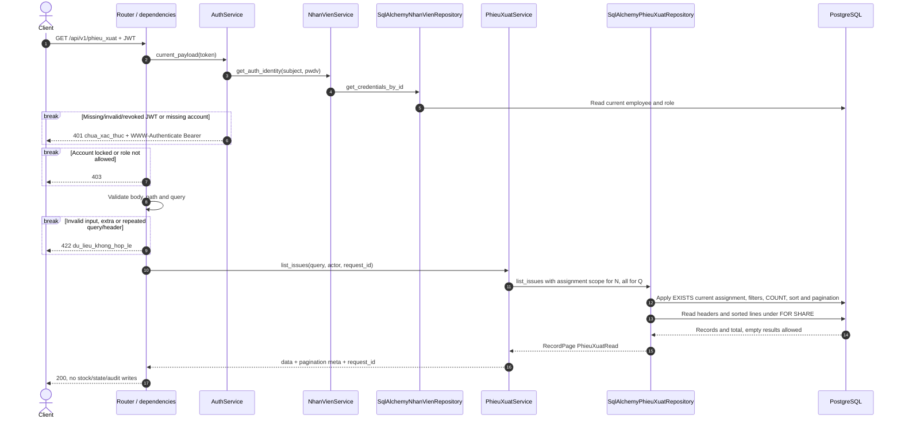
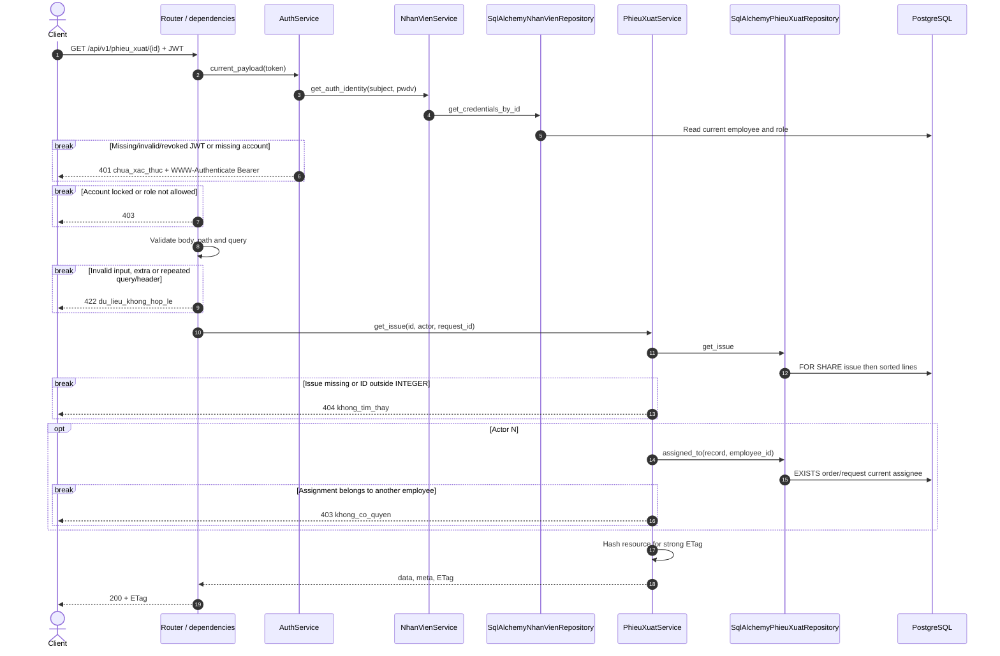
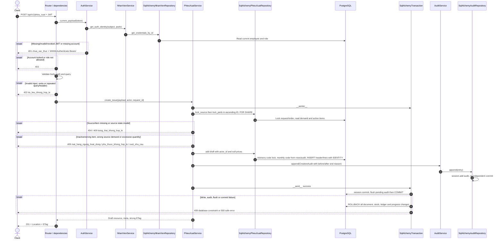
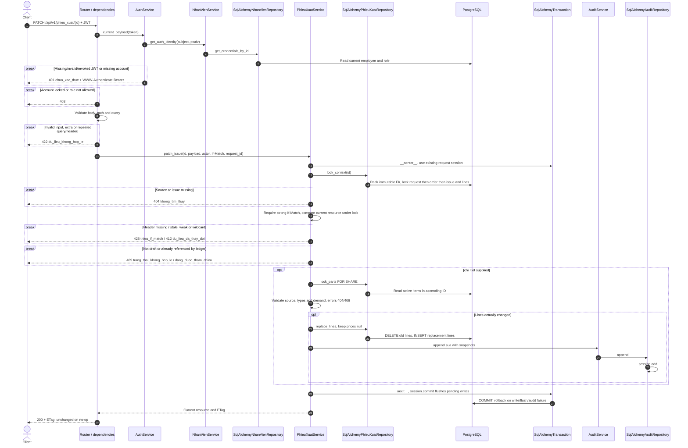
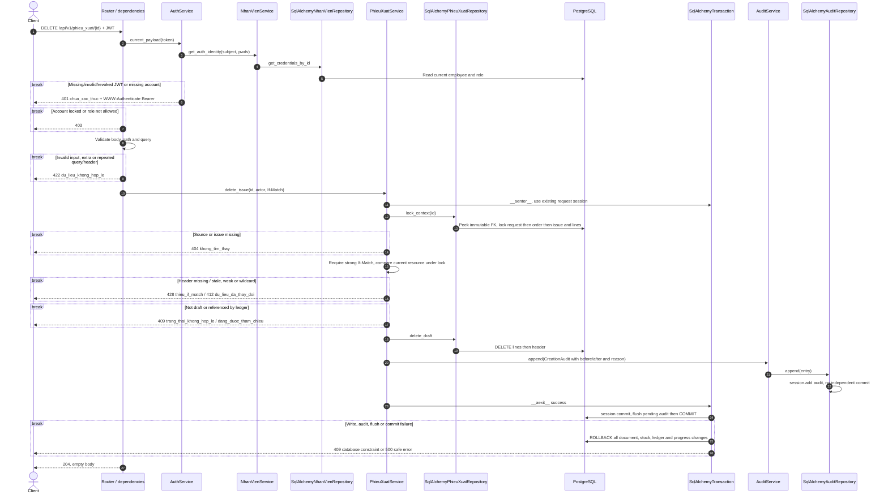
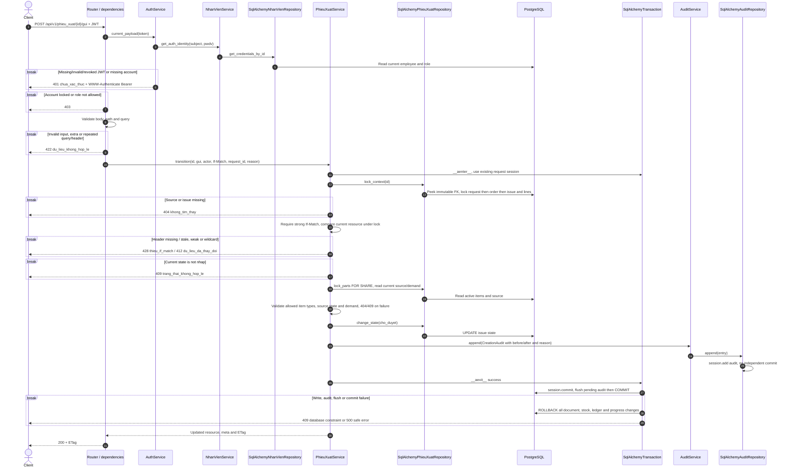
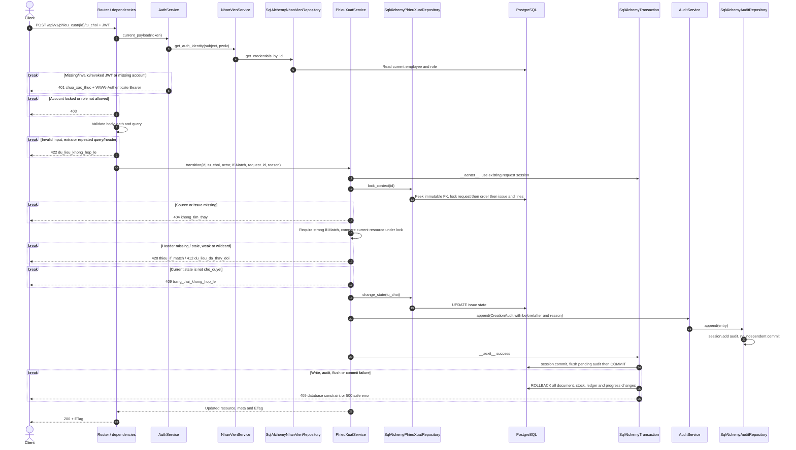
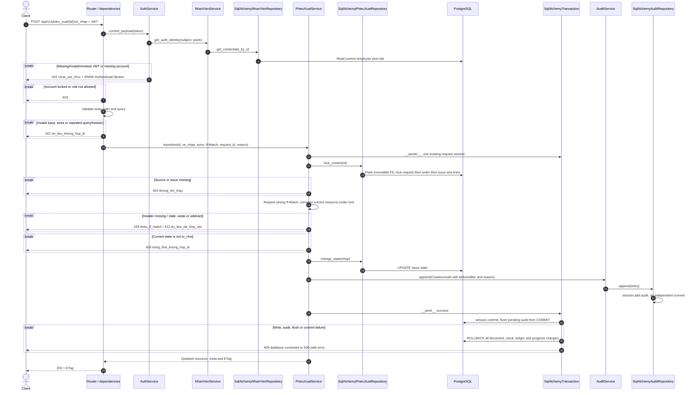
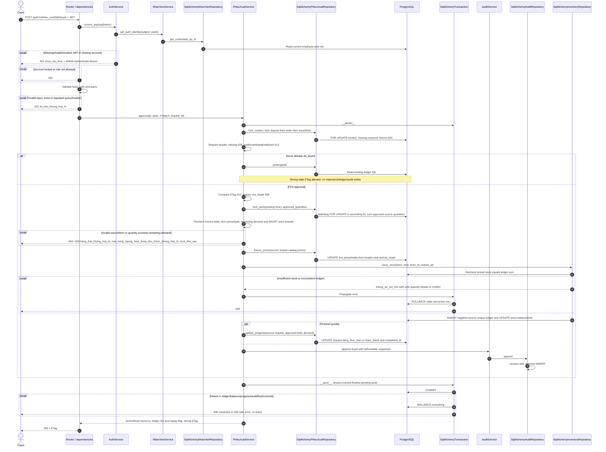

# Luồng API phiếu xuất — contract v3

## Ảnh PNG cho từng endpoint

| Endpoint | Ảnh sequence |
|---|---|
| GET `/api/v1/phieu_xuat` | [01 — Danh sách](assets/phieu_xuat/01-danh-sach.png) |
| GET `/api/v1/phieu_xuat/{id}` | [02 — Chi tiết](assets/phieu_xuat/02-chi-tiet.png) |
| POST `/api/v1/phieu_xuat` | [03 — Tạo nháp](assets/phieu_xuat/03-tao-nhap.png) |
| PATCH `/api/v1/phieu_xuat/{id}` | [04 — Sửa nháp](assets/phieu_xuat/04-sua-nhap.png) |
| DELETE `/api/v1/phieu_xuat/{id}` | [05 — Xóa nháp](assets/phieu_xuat/05-xoa-nhap.png) |
| POST `/api/v1/phieu_xuat/{id}/gui` | [06 — Gửi](assets/phieu_xuat/06-gui.png) |
| POST `/api/v1/phieu_xuat/{id}/duyet` | [07 — Duyệt](assets/phieu_xuat/07-duyet.png) |
| POST `/api/v1/phieu_xuat/{id}/tu_choi` | [08 — Từ chối](assets/phieu_xuat/08-tu-choi.png) |
| POST `/api/v1/phieu_xuat/{id}/ve_nhap` | [09 — Về nháp](assets/phieu_xuat/09-ve-nhap.png) |

Đối chiếu `docs/api_contract_v3.md` §2, §3, §10, §14 và code hiện tại. Nguồn schema là `infra/postgres/init.sql`, bảng PascalCase. Đơn giá mặt hàng và ba cột tiền phiếu xuất dùng BIGINT theo quyết định của dev; API trả JSON integer VND, không trả chuỗi Decimal. Không chạy migration hoặc cập nhật database đang có dữ liệu.

Q được đọc và ghi mọi phiếu, kể cả tự duyệt phiếu mình lập. N chỉ đọc phiếu thuộc lệnh/yêu cầu hiện được giao, không kiểm tra N là người lập. A bị từ chối. Vai trò, tài khoản và phiên bản mật khẩu được kiểm tra từ DB mỗi request. Người lập và người ghi audit/ledger lấy từ JWT đã xác minh.

Chỉ đăng ký chín endpoint dưới đây. `/material-issuing` và `/finished-goods-issuing` đã được gỡ khỏi app.main, không còn đường ghi cũ để vượt quyền/giá v3. Phần tương tác nội bộ với module sản xuất vẫn dùng `PhieuXuatService` và `SqlAlchemyPhieuXuatRepository`.

Response thành công `{data,meta}`, lỗi `{error:{code,message,details},meta:{request_id}}`. GET chi tiết và các response ghi trả strong ETag trên resource gồm trạng thái và chi tiết sắp theo ID. POST trả 201 + Location, DELETE 204 không body, còn lại 200. Validation 422 không echo input nhạy cảm. 405 theo FastAPI mặc định.

POST chỉ nhận loại, đúng một FK nguồn và chi_tiet gồm mặt hàng/số lượng. Không nhận đơn giá, tổng, người lập, mã phiếu hoặc trạng thái. Nháp/chờ duyệt/từ chối giữ giá và tổng null. PATCH chỉ nhận chi_tiet, bỏ qua giữ nguyên, null/array rỗng bị từ chối, gửi array thì thay toàn bộ dòng. PATCH không đổi dữ liệu không ghi thêm audit.

Giao dịch ghi dùng chung AsyncSession với auth, audit và inventory. Để đồng bộ với hủy yêu cầu sản xuất, thứ tự khóa là yêu cầu → lệnh (nếu có) → phiếu → chi tiết → mặt hàng tăng dần ID. lock_context đọc FK bất biến trước, khóa nguồn, rồi đọc lại phiếu FOR UPDATE và kiểm tra ETag dưới khóa. GET giữ FOR SHARE trên phiếu/chi tiết đến khi đọc xong, không ghi dữ liệu. COUNT và trang là hai truy vấn nên tổng có thể đổi giữa hai truy vấn khi có tạo/xóa đồng thời.

Thay đổi phiếu cần If-Match: thiếu/rỗng 428, weak/wildcard/sai định dạng/cũ 412. Riêng duyệt đã thành công nhận strong ETag cũ, trả resource hiện tại với da_ghi_so_truoc_do=true và các ID ledger đã có; vẫn phải còn quyền, có header hợp lệ. Không ghi kho/audit lần hai. Phiếu da_duyet bất biến.

Mã PX-YYYYMM-NNNNNN do PostgreSQL xác định tháng Asia/Ho_Chi_Minh; advisory transaction lock (20261022,3) bảo vệ cấp mã. Xét cả mã hiện có và snapshot audit để không tái sử dụng mã đã xóa. ID do IDENTITY cấp, có thể khuyết khi rollback.

AuditService.append → SqlAlchemyAuditRepository.append chỉ session.add, chưa INSERT. SqlAlchemyTransaction.commit flush cả audit rồi COMMIT. Lỗi bất kỳ ở giá/trạng thái/ledger/tồn/tiến độ/audit hoặc commit đều rollback toàn bộ. Không có ticket khi duyệt xuất thất bại.

## GET /api/v1/phieu_xuat

Q/N. Query: page/page_size, q, sort, loai_phieu, trang_thai, nhan_vien_id, lenh_san_xuat_id, yeu_cau_san_xuat_id, tu_ngay/den_ngay. Ngày lọc theo Asia/Ho_Chi_Minh, sort whitelist thêm ID. Không ETag danh sách.

## GET /api/v1/phieu_xuat/{id}

Q/N. N ngoài công việc hiện được giao nhận 403; phiếu không tồn tại 404. Không cần N là người lập.

## POST /api/v1/phieu_xuat

Chỉ Q, không If-Match. Kiểm tra đúng nguồn, trạng thái và mặt hàng active thuộc nhu cầu trực tiếp. Không kiểm tồn hoặc ghi kho ở bước tạo nháp.

## PATCH /api/v1/phieu_xuat/{id}

Chỉ Q, chỉ nháp. Chi tiết được thay nguyên danh sách khi gửi, ID dòng do server cấp. Không ghi kho.

## DELETE /api/v1/phieu_xuat/{id}

Chỉ Q, chỉ nháp chưa có ledger. Audit giữ snapshot trước khi xóa.

## POST /api/v1/phieu_xuat/{id}/gui

Chỉ Q. nhap → cho_duyet. Body JSON object rỗng bắt buộc. Không thay đổi tồn kho.

## POST /api/v1/phieu_xuat/{id}/tu_choi

Chỉ Q. cho_duyet → tu_choi. LyDoInput bắt buộc, trim lý do không rỗng và lưu audit. Không thay đổi tồn kho.

## POST /api/v1/phieu_xuat/{id}/ve_nhap

Chỉ Q. tu_choi → nhap. LyDoInput bắt buộc, trim lý do không rỗng và lưu audit. Không thay đổi tồn kho.

## POST /api/v1/phieu_xuat/{id}/duyet

Chỉ Q, body {}. Được duyệt phiếu mình lập. Duyệt mới chỉ từ cho_duyet. Tồn/giá/ledger/tiến độ/audit cùng transaction. Hai yêu cầu khác nhau dùng chung mặt hàng vẫn được tuần tự hóa bằng khóa dòng MatHang.

