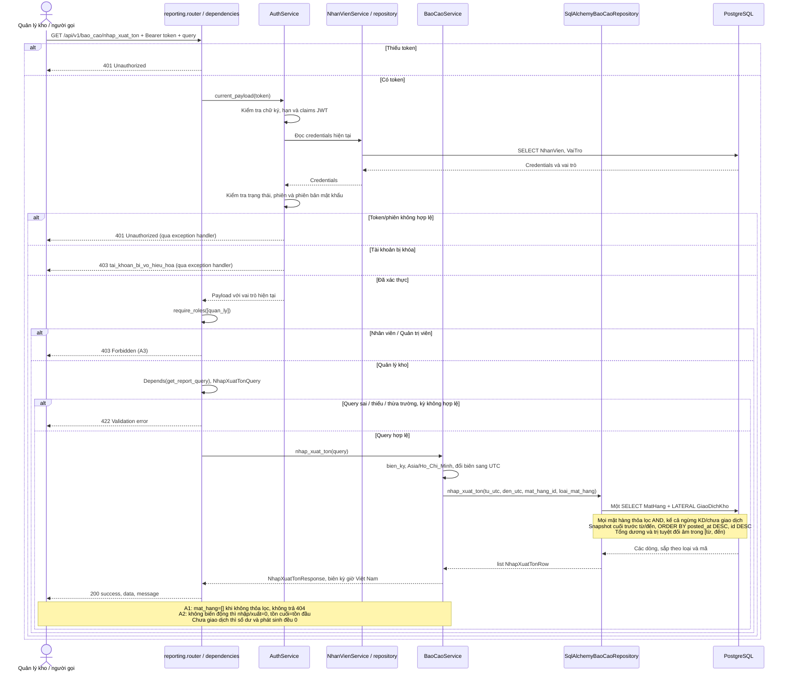

# Module reporting — UC-41 Xem báo cáo nhập-xuất-tồn

## GET /api/v1/bao_cao/nhap_xuat_ton

Nguồn: [UC-41](../../specs/use_cases/reporting/UC-41.md), [plan đã duyệt](../plans/UC-41.md),
`reporting/{router,schemas,service,ports,repository}.py`, `app/dependencies.py`,
`auth/service.py`, `nhan_vien/service.py` và `infra/postgres/init.sql`.

- Query: `ky` (`thang`/`quy`/`nam`), `nam` (2–9998); `thang` (1–12) chỉ bắt buộc
  khi kỳ tháng, `quy` (1–4) chỉ bắt buộc khi kỳ quý. Hai trường bị cấm ở kỳ khác.
  `mat_hang_id > 0`, `loai_mat_hang` (`linh_kien`/`thanh_pham`) tùy chọn; cấm trường lạ.
- Biên kỳ là nửa mở `[tu_thoi_diem, den_thoi_diem)`, ISO với `+07:00` cho các kỳ
  hiện đại. `ZoneInfo` dùng dữ liệu múi giờ lịch sử cho năm rất sớm trong khoảng hợp lệ.
  Cho phép kỳ tương lai. Không phân trang và không phân biệt trường trả về theo vai trò;
  chỉ `quan_ly` được đọc.
- Không đọc trạng thái chứng từ trong truy vấn báo cáo: trigger `kiem_tra_nguon_giao_dich`
  bảo đảm sổ chỉ có nguồn đã ghi nhận. Tồn đầu/cuối lấy `so_luong_ton_sau`, không lấy
  tổng lịch sử hay số tồn hiện tại để thay cho snapshot. Chứng từ và tồn kho được cập nhật
  ở các nghiệp vụ nguồn; endpoint này không cập nhật dữ liệu, không audit, không commit,
  không có transaction ghi, không yêu cầu `If-Match` và không trả `ETag`.
