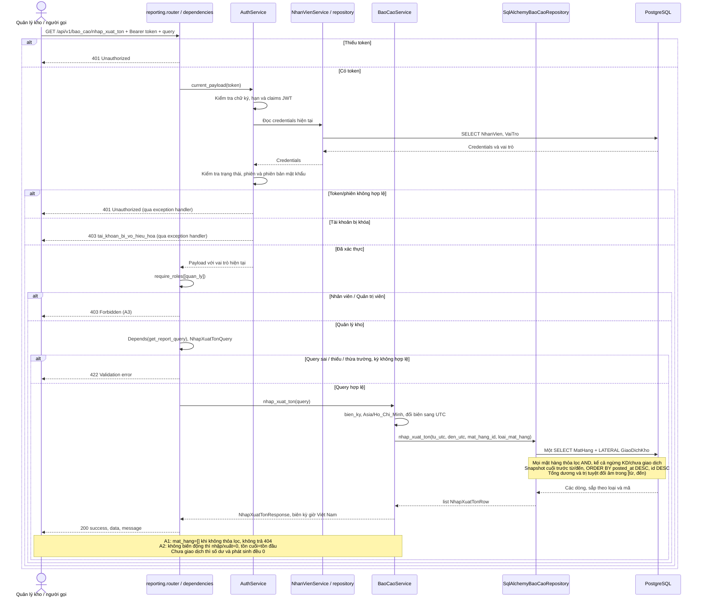
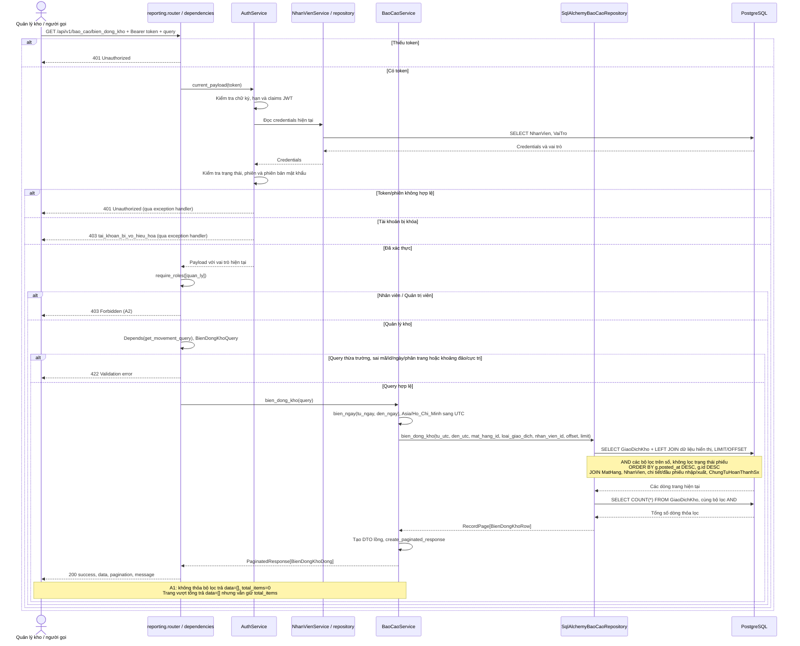

# Module reporting — UC-41 Xem báo cáo nhập-xuất-tồn; UC-42 Tra cứu lịch sử biến động kho

## GET /api/v1/bao_cao/nhap_xuat_ton

Nguồn: [UC-41](../../specs/use_cases/reporting/UC-41.md), [plan đã duyệt](../plans/UC-41.md),
`reporting/{router,schemas,service,ports,repository}.py`, `app/dependencies.py`,
`auth/service.py`, `nhan_vien/service.py` và `infra/postgres/init.sql`.

- Query: `ky` (`thang`/`quy`/`nam`), `nam` (2–9998); `thang` (1–12) chỉ bắt buộc
  khi kỳ tháng, `quy` (1–4) chỉ bắt buộc khi kỳ quý. Hai trường bị cấm ở kỳ khác.
  `mat_hang_id > 0`, `loai_mat_hang` (`linh_kien`/`thanh_pham`) tùy chọn; cấm trường lạ.
- Biên kỳ là nửa mở `[tu_thoi_diem, den_thoi_diem)`, ISO với `+07:00` cho các kỳ
  hiện đại. `ZoneInfo` dùng dữ liệu múi giờ lịch sử cho năm rất sớm trong khoảng hợp lệ.
  Cho phép kỳ tương lai. Không phân trang và không phân biệt trường trả về theo vai trò;
  chỉ `quan_ly` được đọc.
- Không đọc trạng thái chứng từ trong truy vấn báo cáo: trigger `kiem_tra_nguon_giao_dich`
  bảo đảm sổ chỉ có nguồn đã ghi nhận. Tồn đầu/cuối lấy `so_luong_ton_sau`, không lấy
  tổng lịch sử hay số tồn hiện tại để thay cho snapshot. Chứng từ và tồn kho được cập nhật
  ở các nghiệp vụ nguồn; endpoint này không cập nhật dữ liệu, không audit, không commit,
  không có transaction ghi, không yêu cầu `If-Match` và không trả `ETag`.

## GET /api/v1/bao_cao/bien_dong_kho

Nguồn: [UC-42](../../specs/use_cases/reporting/UC-42.md), [plan đã duyệt](../plans/UC-42.md),
`reporting/{router,schemas,service,ports,repository}.py`, `app/dependencies.py`,
`auth/service.py`, `nhan_vien/service.py`, `shared/{pagination,records}.py` và `infra/postgres/init.sql`.

- Query tùy chọn: `mat_hang_id > 0`, `nhan_vien_id > 0`, `loai_giao_dich` thuộc
  `nhap_linh_kien`, `xuat_linh_kien`, `nhap_san_pham_san_xuat`, `xuat_thanh_pham`;
  `tu_ngay`, `den_ngay` đúng `YYYY-MM-DD`. `page >= 1` mặc định 1, `page_size` 1–100
  mặc định 20. Cấm trường lạ, tìm kiếm và tùy chỉnh sắp xếp.
- Ngày bao gồm cả hai đầu theo `Asia/Ho_Chi_Minh`: từ đầu `tu_ngay` đến trước đầu
  ngày sau `den_ngay`, đổi UTC. Bỏ một biên thì không lọc biên đó; bỏ cả hai thì đọc
  toàn bộ lịch sử có phân trang. Chặn `tu_ngay = date.min`, `den_ngay = date.max`,
  khoảng đảo và ngày sai bằng 422. Mặt hàng/nhân viên không tồn tại trả 200 rỗng.
- Chỉ `GiaoDichKho` quyết định tập dòng và COUNT. Trigger `kiem_tra_nguon_giao_dich`
  đã chặn nguồn chưa hoàn tất/chưa duyệt/từ chối khi ghi sổ; JOIN chỉ lấy dữ liệu hiển thị.
  `chung_tu.id` là ID đầu phiếu nhập/xuất hoặc chứng từ hoàn thành, không phải ID chi tiết.
  `nhan_vien` là người ghi nhận trên sổ, không phải người lập chứng từ; `ho_ten` có thể null.
- Không có dữ liệu khác nhau theo vai trò: chỉ `quan_ly` được đọc. Trả số lượng có dấu,
  snapshot `so_luong_ton_sau`, thời điểm ghi sổ và thông tin mặt hàng, chứng từ, nhân viên.
  Không ghi dữ liệu, không audit/commit/transaction ghi, không yêu cầu `If-Match`, không trả `ETag`.
- UC-42 gỡ `GET /api/v1/inventory/movements` cùng ba method `list_movements` cũ;
  gọi GET đường dẫn cũ trả 405/404. Sau đó router inventory v3 (`GET /inventory/stock`,
  `POST /inventory/movements`) và ORM legacy cũng đã gỡ; module inventory chỉ còn writer. Trang `/kho/giao-dich` gọi endpoint reporting mới;
  không liên kết chứng từ sang các trang phiếu hiện tại.
