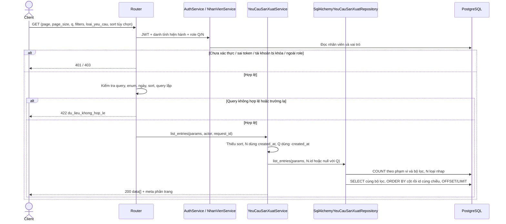
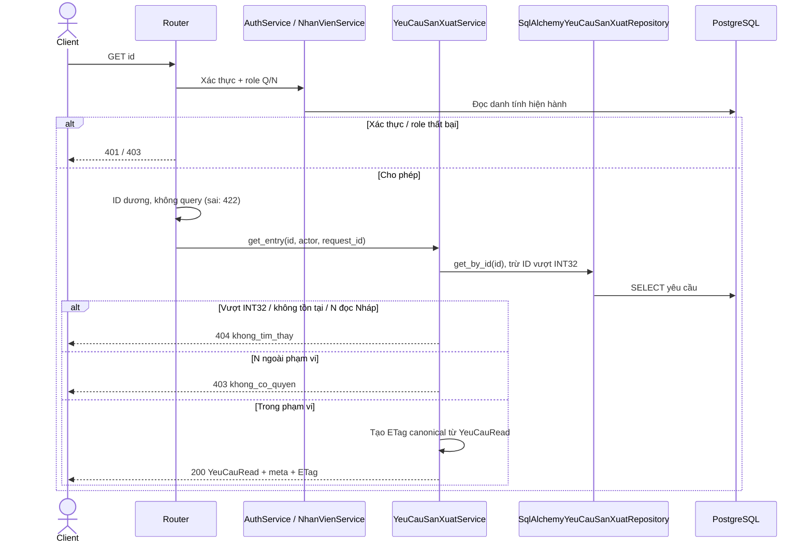
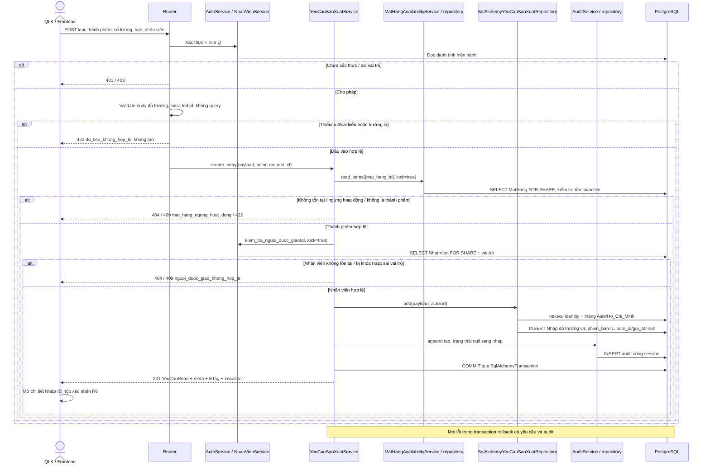
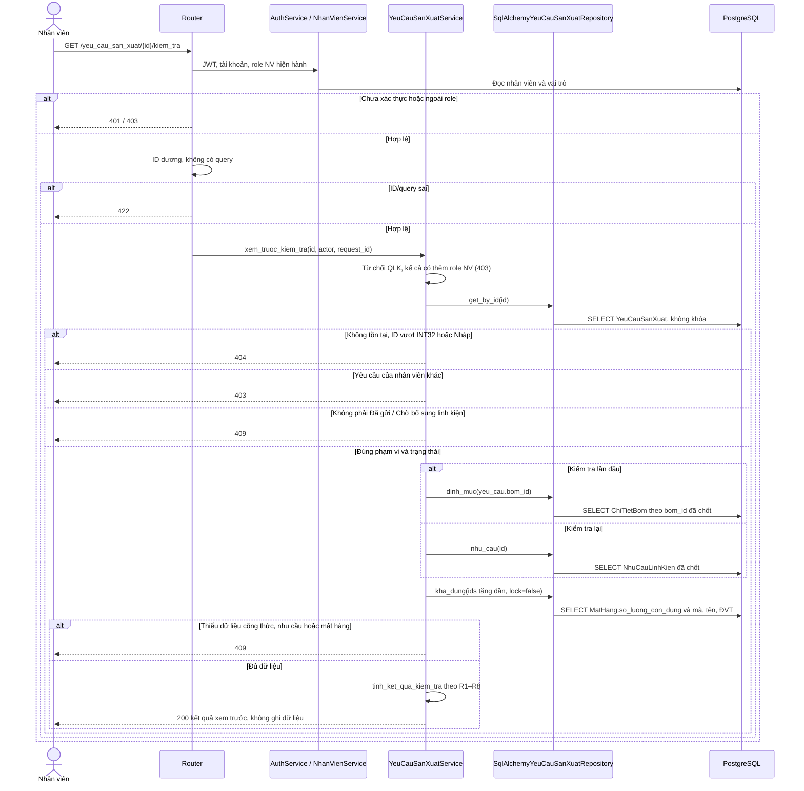
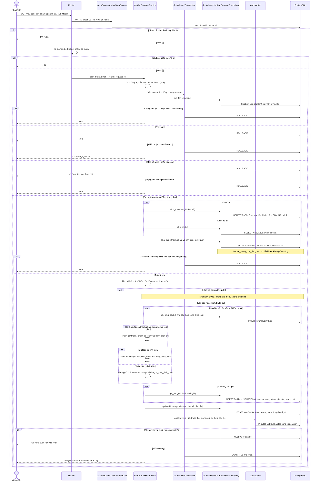
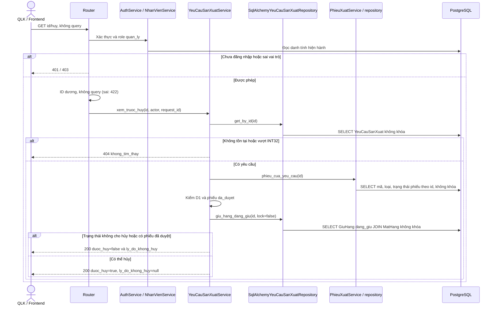
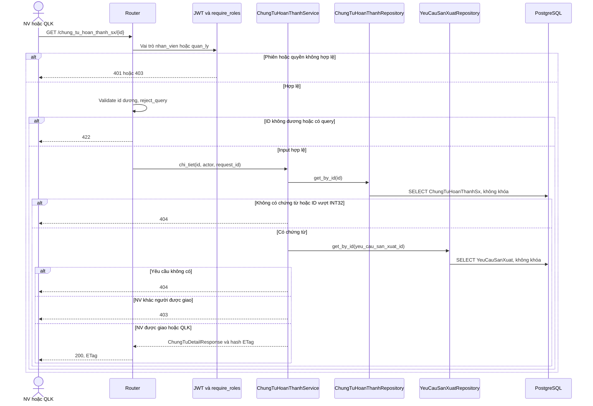
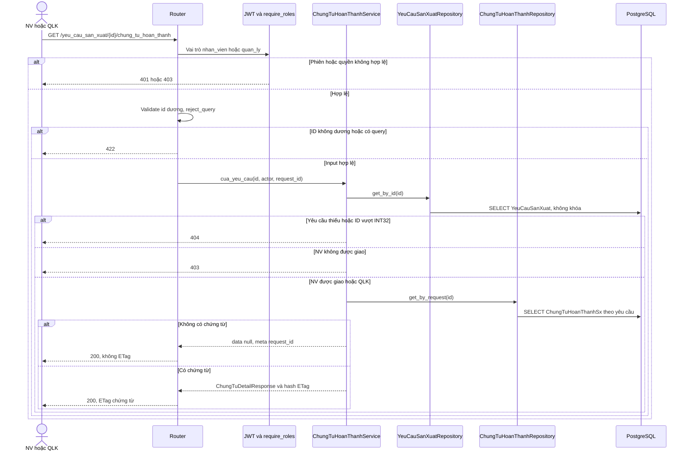
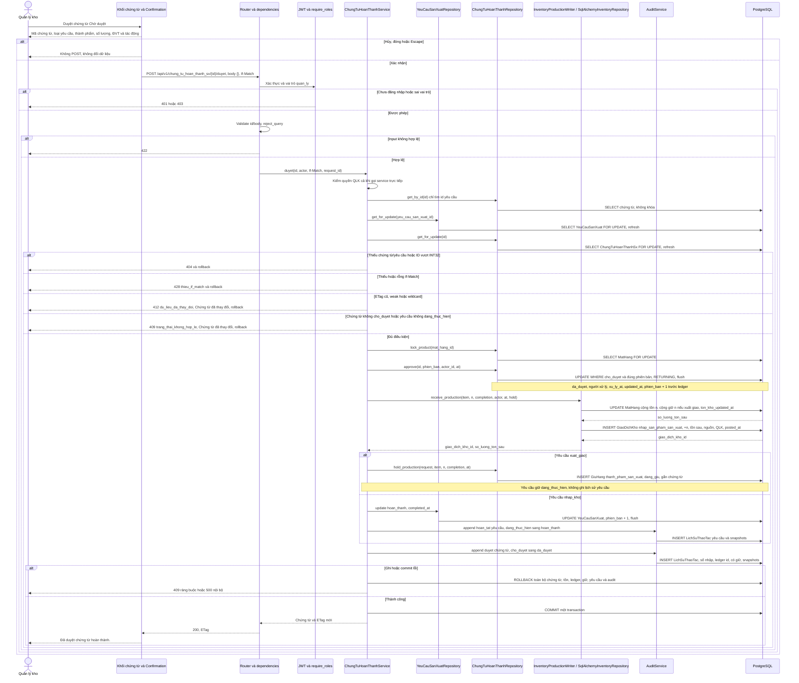

# Sequence — san_xuat

Phần tạo/gửi yêu cầu theo [UC-23](../../specs/use_cases/production/UC-23.md),
plan `docs/plans/UC-23.md` và quyết định D1–D7 ngày 16/11/2026; bảng
`"YeuCauSanXuat"` theo `infra/postgres/init.sql` v4. Sửa/xóa Nháp theo
[UC-24](../../specs/use_cases/production/UC-24.md), plan `docs/plans/UC-24.md`
và quyết định D1–D4 ngày 16/11/2026; gửi lại dùng chung luồng gửi UC-23.
Danh sách theo [UC-25](../../specs/use_cases/production/UC-25.md),
plan `docs/plans/UC-25.md` và quyết định D1–D6 ngày 16/11/2026.
Kiểm tra và giữ hàng theo [UC-26](../../specs/use_cases/production/UC-26.md),
plan `docs/plans/UC-26.md`, D1–D6 ngày 16/11/2026 và data model v4 §3.5.
Nhu cầu bổ sung theo [UC-27](../../specs/use_cases/production/UC-27.md),
plan `docs/plans/UC-27.md` và D1–D6 dev duyệt ngày 16/11/2026.
Hủy theo [UC-28](../../specs/use_cases/production/UC-28.md).
Bắt đầu theo [UC-29](../../specs/use_cases/production/UC-29.md), D1–D6d dev duyệt ngày 16/11/2026.
Lệnh sản xuất v3 và các endpoint chứng từ hoàn thành v3 đã gỡ. Lập/xem/gửi chứng từ v4
theo [UC-30](../../specs/use_cases/production/UC-30.md), plan `docs/plans/UC-30.md`,
D1–D5 dev duyệt ngày 16/11/2026 và data model v4 §3.5. Duyệt chứng từ theo
[UC-31](../../specs/use_cases/production/UC-31.md), plan `docs/plans/UC-31.md`,
D1–D4 dev duyệt ngày 16/11/2026. Từ chối/danh sách (UC-32 – UC-33) chưa triển khai.
`Q = quan_ly`, `N = nhan_vien`. Admin bị chặn ở các endpoint nghiệp vụ này.
JWT được kiểm tra bằng tài khoản, vai trò và phiên bản đăng nhập/mật khẩu hiện hành.
N chỉ đọc yêu cầu được giao đã gửi: danh sách loại `nhap` trước COUNT/phân trang;
chi tiết Nháp trả 404, yêu cầu đã gửi ngoài phạm vi trả 403.

Các endpoint yêu cầu dùng lỗi `{error: {code, message, details}, meta: {request_id}}`.
Ngoại lệ hiện tại của endpoint nhu cầu bổ sung UC-27 được ghi rõ bên dưới.
Body không hỗ trợ trường lạ; ID path phải dương (422), ID vượt INT32 trả 404.
GET chi tiết, POST tạo, PATCH, gửi, hủy và bắt đầu trả strong ETag hash toàn bộ `YeuCauRead`,
gồm cột v4/`phien_ban`; không còn `lenh_san_xuat_ids` hoặc hai trường tiến độ xuất (D6).
PATCH/DELETE/gửi/hủy/bắt đầu so `If-Match` dưới khóa yêu cầu: thiếu/blank 428
`thieu_if_match`; cũ/weak/`*` 412 `du_lieu_da_thay_doi`.
Mỗi `update` tăng `phien_ban` một và ghi `updated_at`, kể cả gửi.
Mọi ghi nghiệp vụ và audit dùng cùng session/transaction; lỗi rollback toàn bộ.
Tạo/gửi không tính nhu cầu, không sinh lệnh, không giữ hàng hoặc thay đổi tồn/ledger.
Yêu cầu không đọc tổng xuất thành phẩm để tạo response/ETag hoặc audit (UC-25 D6).
Cổng `ProductionIssues` cung cấp `co_phieu_da_ghi_so`, `huy_phieu_chua_ghi_so` cho luồng hủy
và `phieu_cua_yeu_cau` để đọc phiếu trong luồng hủy/bắt đầu.

## GET /api/v1/nhu_cau_bo_sung_linh_kien

Nguồn: UC-27 Main 1–4, R1–R3, AC-1–AC-3, A1; D1–D5.
Chỉ QLK; N và Admin trả 403. Không tham số, không phân trang; query bất kỳ trả 422.
Response `{data: {yeu_cau: [...], tong_hop: [...]}, meta: {request_id}}`.
Không ETag/If-Match, không transaction ghi, khóa dòng, audit, giữ hàng hay cập nhật trạng thái.
Lỗi dùng envelope hợp đồng như các endpoint sản xuất khác (`nhu_cau_bo_sung_linh_kien` có trong danh sách resource của `app/core/exceptions.py`).

```mermaid
sequenceDiagram
    actor C as Quản lý kho
    participant R as nhu_cau_bo_sung_router
    participant A as AuthService / NhanVienService
    participant S as YeuCauSanXuatService
    participant P as SqlAlchemyYeuCauSanXuatRepository
    participant DB as PostgreSQL
    C->>R: GET /api/v1/nhu_cau_bo_sung_linh_kien + Bearer
    R->>A: get_current_user_payload, require_roles(quan_ly)
    alt Thiếu/sai JWT hoặc phiên đăng nhập không hợp lệ
        A-->>C: 401
    else Tài khoản bị khóa hoặc thiếu quyền QLK
        A-->>C: 403
    else QLK hợp lệ
        R->>R: reject_query
        alt Có query parameter
            R-->>C: 422 extra_forbidden
        else Không query
            R->>S: xem_nhu_cau_bo_sung(actor, request_id)
            S->>S: _require_manager(actor)
            S->>P: yeu_cau_cho_bo_sung()
            P->>DB: SELECT YeuCauSanXuat WHERE trang_thai = cho_bo_sung_linh_kien<br/>ORDER BY kiem_tra_lan_dau_at ASC, id ASC
            DB-->>P: Yêu cầu chờ
            P-->>S: list YeuCauRead
            alt A1 - Không có yêu cầu chờ
                S->>S: tong_hop_nhu_cau_bo_sung([], {}, {})
                S-->>R: yeu_cau = [], tong_hop = [], meta
            else Có yêu cầu chờ
                S->>P: nhu_cau_cua_cac_yeu_cau(ids)
                P->>DB: SELECT NhuCauLinhKien WHERE yeu_cau_san_xuat_id IN ids
                DB-->>P: Nhu cầu đã chốt tại lần kiểm tra đầu UC-26
                P-->>S: Nhu cầu theo yêu cầu và linh kiện
                opt Có linh kiện trong nhu cầu
                    S->>P: kha_dung(ids linh kiện, lock=False)
                    P->>DB: SELECT MatHang id, mã, tên, ĐVT, so_luong_con_dung<br/>Không FOR UPDATE / FOR SHARE
                    DB-->>P: Còn dùng được hiện tại
                    P-->>S: dict HangKhaDung
                end
                S->>S: tong_hop_nhu_cau_bo_sung(yeu_cau, nhu_cau, kha_dung)
                Note over S: Mỗi yêu cầu so riêng với còn dùng được;<br/>chỉ đưa dòng cần lớn hơn còn dùng được vào linh_kien_thieu.<br/>Vẫn giữ yêu cầu đã đủ với da_du = true.
                Note over S: Tổng hợp mọi linh kiện trong nhu cầu các yêu cầu chờ:<br/>tong_can = tổng cần; thiếu = max(0, tong_can - còn dùng được).<br/>Đếm so_yeu_cau; giữ thiếu 0; sắp thiếu DESC rồi mã ASC.
                S-->>R: yeu_cau, tong_hop, meta
            end
            R-->>C: 200 NhuCauBoSungResponse
        end
    end
```

`yeu_cau` giữ thứ tự D1; mỗi dòng gồm id, mã yêu cầu, `mat_hang_id` thành phẩm,
loại yêu cầu, số cần sản xuất đã chốt, hạn hoàn thành, `nhan_vien_duoc_giao_id`,
`kiem_tra_lan_dau_at`, `linh_kien_thieu`, `da_du`. Mỗi dòng thiếu gồm id linh kiện,
mã, tên, đơn vị tính, cần, còn dùng được, thiếu. Tổng hợp trừ còn dùng được đúng
một lần cho mỗi linh kiện; không cộng các lượng thiếu riêng của từng yêu cầu.
Chỉ đọc ba truy vấn theo lô khi có nhu cầu; A1 chỉ đọc danh sách yêu cầu.
Đây là dữ liệu tại lúc đọc, không bảo đảm snapshot chung giữa các truy vấn.
Lỗi hạ tầng không xử lý riêng trong service, đi qua exception handler chung (500).

FE `/kho/nhu-cau-bo-sung` tải API một lần, dùng catalog và danh sách nhân viên chung
để hiện tên, không gọi theo từng yêu cầu. Tổng hợp hiển thị trước danh sách yêu cầu;
mã liên kết tới `/kho/yeu-cau/{id}`. `da_du=true` hiển thị
"Đã đủ linh kiện, chờ nhân viên kiểm tra lại."; A1 hiển thị hai khối trống.
Không thao tác tạo phiếu nhập, lọc hoặc sắp xếp trên trang; QLK tự lập phiếu nhập ở UC-20.

## GET /api/v1/yeu_cau_san_xuat

Nguồn: UC-25 Main 1–3; AC-1–AC-5, A1, A3, R5; D1–D3, D5–D6.



Filter `q` tìm mã yêu cầu bằng ILIKE tham số hóa, escape ký tự wildcard. Bộ lọc
`mat_hang_id`, `trang_thai`, `nhan_vien_duoc_giao_id`, `loai_yeu_cau` (`xuat_giao`/`nhap_kho`),
`tu_ngay`, `den_ngay` kết hợp
với phạm vi N. Ngày địa phương Asia/Ho_Chi_Minh chuyển sang khoảng UTC nửa mở.
Không gửi `sort`: cả N và Q dùng `-created_at` (mới nhất trước; dev chốt 16/11/2026).
Whitelist `id`, `created_at`, `ma_yeu_cau_san_xuat`, `han_hoan_thanh`, mỗi cột có chiều
tăng hoặc dấu `-` cho giảm; luôn thêm `id` cùng chiều làm khóa phụ.
Sai loại/sort trả 422. Bộ lọc người được giao không thay thế phạm vi N: lọc người khác
trả danh sách rỗng. Q vẫn thấy yêu cầu giao cho nhân viên bị khóa, không JOIN/lọc trạng thái NV.
Meta có `request_id`, `page`, `page_size`, `total`, `total_pages`.
Projection Q/N cùng các field, khác phạm vi dòng. Không audit, không ETag danh sách.

## GET /api/v1/yeu_cau_san_xuat/{id}



Không audit. Response và ETag dùng trực tiếp bản ghi yêu cầu, không truy vấn tiến độ xuất (D6).

## POST /api/v1/yeu_cau_san_xuat

Nguồn: UC-23 Main 4–6; A1. Loại mặc định `xuat_giao` hoặc `nhap_kho`; bắt buộc thành
phẩm, số lượng nguyên dương INT32, hạn kiểu date và nhân viên được giao.
Không chặn ngày quá khứ. Body không nhận mã, trạng thái, BOM hoặc token do client đặt.



Không cần If-Match. Mã có phần số bằng ID 6 chữ số, không reset theo tháng;
giới hạn PoC 999999. `Location` trỏ GET chi tiết vừa tạo. Audit `tao` có người,
đối tượng, dữ liệu sau và `trang_thai_truoc=null`, `trang_thai_sau=nhap`.
Đóng hộp xác nhận không gọi gửi: yêu cầu giữ Nháp, N không thấy (A2).

## PATCH /api/v1/yeu_cau_san_xuat/{id}

Nguồn: UC-24 A1; R1–R3, R8–R10; D4. Body bắt buộc đủ 5 trường
`loai_yeu_cau`, `mat_hang_id`, `so_luong`, `han_hoan_thanh`,
`nhan_vien_duoc_giao_id`, không có mặc định, không nhận null hoặc trường lạ.
Thiếu/null → 422 trước khi gọi service, bản ghi và lịch sử giữ nguyên.
FE điền sẵn form khi bấm Sửa; Lưu nháp gọi PATCH ngay, không mở xác nhận.

```mermaid
sequenceDiagram
    actor C as Client
    participant R as Router
    participant A as AuthService / NhanVienService
    participant S as YeuCauSanXuatService
    participant P as SqlAlchemyYeuCauSanXuatRepository
    participant M as MatHangAvailabilityService / repository
    participant L as AuditService / repository
    participant D as PostgreSQL
    C->>R: PATCH đủ 5 trường + If-Match
    R->>A: Xác thực + role Q (sai: 401/403)
    A->>D: Đọc danh tính hiện hành
    R->>R: ID dương, không query; đủ 5 trường, không null/extra (sai: 422)
    R->>S: patch_entry
    S->>P: get_for_update(id)
    P->>D: SELECT yêu cầu FOR UPDATE
    Note over S,P: ID vượt INT32/không tồn tại: 404
    S->>S: So If-Match (thiếu: 428, không khớp: 412)
    alt Không còn nhap
        S-->>C: 409 trang_thai_khong_hop_le, rollback
    else Nháp
        S->>M: Kiểm tra thành phẩm hiện hành, lock=true
        M->>D: FOR SHARE, tồn tại/active/loại (404/409/422)
        S->>A: kiem_tra_nguoi_duoc_giao(lock=true)
        A->>D: FOR SHARE, tồn tại/trạng thái/vai trò (404/409)
        S->>P: update(đủ 5 trường)
        P->>D: UPDATE yêu cầu, phien_ban tăng 1, updated_at
        S->>L: append sua, dữ liệu trước/sau, trạng thái nhap sang nhap
        L->>D: INSERT audit
        S->>D: COMMIT; mọi lỗi rollback toàn bộ
        S-->>C: 200 YeuCauRead + meta + ETag mới
    end
```

Số lượng phải là số nguyên dương INT32; ID phải là số nguyên dương; loại chỉ
`xuat_giao`/`nhap_kho`; hạn kiểu date, không giới hạn ngày quá khứ. Thành phẩm ngừng
→ 409 `mat_hang_ngung_hoat_dong`, linh kiện → 422 `du_lieu_khong_hop_le`,
nhân viên khóa/sai vai trò → 409 `nguoi_duoc_giao_khong_hop_le`; không tồn tại → 404.
Chỉ sửa Nháp, đổi được loại và cả 5 trường; sau gửi trả 409 `trang_thai_khong_hop_le`.
Audit `sua` có người, đối tượng, snapshot trước/sau, trạng thái `nhap → nhap`.
Lưu vẫn Nháp, không chốt BOM, không gửi, không đổi tồn hoặc phần đang giữ.
Audit lỗi rollback cả cập nhật và lịch sử. Thành công trả ETag mới; FE về chế độ xem.

## DELETE /api/v1/yeu_cau_san_xuat/{id}

Nguồn: UC-24 A2; R1, R4, R8–R10; D1. FE xác nhận Xóa nháp với `danger`,
gửi DELETE bằng ETag đang xem; thành công điều hướng về danh sách.

```mermaid
sequenceDiagram
    actor C as Client
    participant R as Router
    participant A as AuthService / NhanVienService
    participant S as YeuCauSanXuatService
    participant P as SqlAlchemyYeuCauSanXuatRepository
    participant L as AuditService / repository
    participant D as PostgreSQL
    C->>R: DELETE id + If-Match
    R->>A: Xác thực + role Q (sai: 401/403)
    A->>D: Đọc danh tính hiện hành
    R->>R: ID dương, không query (sai: 422)
    R->>S: delete_entry
    S->>P: get_for_update(id)
    P->>D: FOR UPDATE yêu cầu (không có: 404)
    S->>S: If-Match (thiếu: 428, cũ/weak/*: 412)
    alt Không nhap
        S-->>C: 409 trang_thai_khong_hop_le
    else Nháp
        S->>P: delete(id), không kiểm phụ thuộc
        P->>D: DELETE YeuCauSanXuat, trigger chỉ cho xóa nhap
        S->>L: append xoa_nhap, dữ liệu trước, trạng thái nhap sang null
        L->>D: INSERT audit cùng session
        S->>D: COMMIT; lỗi rollback toàn bộ
        R-->>C: 204, không body
    end
```

Xóa cứng yêu cầu Nháp, không cần hủy; không kiểm phụ thuộc vì theo bất biến v4,
chứng từ/nhu cầu/giữ hàng chỉ phát sinh sau gửi. Trigger DB vẫn bảo vệ trạng thái;
nếu dữ liệu sai bất biến gây lỗi FK thì lỗi hệ thống và rollback. Audit `xoa_nhap`
có người, đối tượng, snapshot trước, `du_lieu_sau={}`, trạng thái `nhap → null`.
Audit lỗi rollback: bản ghi Nháp và lịch sử cũ vẫn còn. Không đổi tồn/giữ,
không xóa nhân viên/mặt hàng, không cascade sang chứng từ khác.
FE ẩn Hủy với Nháp; BE từ chối hủy Nháp theo UC-28, chỉ xóa theo UC-24.

## POST /api/v1/yeu_cau_san_xuat/{id}/gui

Nguồn: UC-23 Main 7–9; A3. Body `{}`, `If-Match` là ETag của Nháp đã tạo.

```mermaid
sequenceDiagram
    actor C as QLK / Frontend
    participant R as Router
    participant A as AuthService / NhanVienService
    participant S as YeuCauSanXuatService
    participant P as SqlAlchemyYeuCauSanXuatRepository
    participant M as MatHangAvailabilityService / repository
    participant L as AuditService / repository
    participant D as PostgreSQL
    C->>R: POST body {} + If-Match sau khi xác nhận
    R->>A: Xác thực + role Q
    A->>D: Đọc danh tính hiện hành
    alt Chưa xác thực / sai vai trò
        R-->>C: 401 / 403
    else Cho phép
        R->>R: Validate ID, body rỗng, không query/extra
        alt Body/query/ID sai
            R-->>C: 422 du_lieu_khong_hop_le
        else Đầu vào hợp lệ
            R->>S: gui(id, actor, If-Match, request_id)
            S->>P: get_for_update(id)
            P->>D: SELECT YeuCauSanXuat FOR UPDATE
            alt Không có / ID vượt INT32
                S-->>C: 404 khong_tim_thay
            else Có yêu cầu
                S->>S: So If-Match, kiểm tra phải Nháp
                alt Thiếu/cũ ETag hoặc không còn Nháp
                    S-->>C: 428 / 412 / 409 trang_thai_khong_hop_le
                else Nháp và ETag khớp
                    S->>M: read_items([thành phẩm], lock=true)
                    M->>D: SELECT MatHang FOR SHARE, kiểm tra lại tồn tại/active/loại
                    alt Thành phẩm đã ngừng (A3)
                        S-->>C: 409 trang_thai_khong_hop_le, nêu lý do
                    else Thành phẩm hợp lệ
                        Note over S,M: Không tồn tại trả 404, sai loại trả 422
                        S->>A: kiem_tra_nguoi_duoc_giao(lock=true)
                        A->>D: SELECT NhanVien FOR SHARE, kiểm tra hoạt động/vai trò
                        alt Nhân viên bị khóa / không còn hợp lệ (A3)
                            S-->>C: 409 nguoi_duoc_giao_khong_hop_le, nêu lý do
                        else Nhân viên hợp lệ
                            S->>P: bom_dang_dung(mat_hang_id)
                            P->>D: SELECT Bom.id WHERE đúng thành phẩm AND is_active FOR SHARE
                            P->>P: scalar_one()
                            S->>P: update da_gui, bom_id, gui_at=now
                            P->>D: UPDATE yêu cầu, phien_ban + 1, updated_at=now
                            Note over P,D: Trigger kiểm BOM thuộc thành phẩm, ràng buộc v4
                            S->>L: append gui, trạng thái nhap sang da_gui
                            L->>D: INSERT audit cùng session
                            S->>D: COMMIT
                            S-->>C: 200 YeuCauRead + meta + ETag mới
                            C->>C: Báo đã gửi yêu cầu cho nhân viên
                        end
                    end
                end
            end
        end
    end
    Note over S,D: Lỗi ghi/audit rollback; A3 giữ Nháp, bom_id/gui_at null, không audit gui
```

Chốt đúng `Bom.id` đang dùng tại lúc gửi; mỗi thành phẩm luôn có đúng một BOM active
(D3). Không có nhánh nghiệp vụ thiếu BOM; sai bất biến gây lỗi hệ thống 500 và rollback.
Không tính nhu cầu, sinh lệnh, đọc số dư tồn, ghi giữ hàng hoặc ledger. Loại `nhap_kho`
cũng gửi theo cùng luồng; các số lượng kiểm tra lần đầu còn null. Response gửi có cùng
cấu trúc với chi tiết yêu cầu. Audit `gui` lưu trước/sau, người, thời điểm và đối tượng.
Hộp xác nhận hiển thị đủ loại, thành phẩm, số lượng, đơn vị, hạn, nhân viên và tác động
chưa đổi tồn; lỗi BE truyền ra `ErrorNotice`, đóng hộp ở lại chi tiết Nháp (A3).

## GET /api/v1/yeu_cau_san_xuat/{id}/kiem_tra

Nguồn: UC-26 Main 2–4; A1–A5, A7; D1, D2. Chỉ nhân viên được giao;
QLK trả 403, kể cả có thêm role NV. Không dùng token xem trước.
Response `{data: KiemTraKetQua, meta: {request_id}}` gồm `lan_dau`, `so_luong`,
`so_luong_dung_thanh_pham`, `so_luong_can_san_xuat`, `du_linh_kien`,
`trang_thai_du_kien`, `giu_thanh_pham` (lượng thành phẩm sẽ giữ thêm), `linh_kien[]`.
Mỗi dòng có `mat_hang_id`, mã, tên, ĐVT, cần, còn dùng được, thiếu.
Không khóa, không ghi, không tăng phiên bản, không audit; không cam kết tồn khi xác nhận.



Lần đầu xuất giao: dùng `min(còn dùng được, số yêu cầu)`, nhu cầu theo số còn cần sản xuất.
Nhập kho luôn dùng 0 thành phẩm, sản xuất toàn bộ số yêu cầu. Kiểm tra lại dùng số chốt,
không tính lại định mức hoặc số thành phẩm dùng; `giu_thanh_pham = 0` vì đã giữ ở lần đầu.
Đóng hộp xác nhận không gọi POST; không có gì thay đổi (AC-8).

## POST /api/v1/yeu_cau_san_xuat/{id}/kiem_tra

Nguồn: UC-26 Main 5–8; R1–R12; AC-1–AC-9, A1–A7; D1–D6.
Body bắt buộc `{}`, trường lạ bị 422. Chỉ NV được giao, QLK bị 403.
`If-Match` lấy từ chi tiết đã xem; kiểm dưới khóa yêu cầu trước khi tính lại.
Response `{data: {yeu_cau, ket_qua}, meta: {request_id}}` kèm ETag của `yeu_cau`.
GET xem trước không phải điều kiện bắt buộc để gọi POST. Kết quả POST là kết quả thực tế.



Đủ thành phẩm: số cần sản xuất = 0, không có `NhuCauLinhKien`, chỉ giữ thành phẩm.
Thiếu linh kiện: vẫn chốt nhu cầu và giữ phần thành phẩm dùng từ kho ở lần đầu;
không giữ bất kỳ linh kiện nào, kể cả loại đủ. Nhập kho không giữ thành phẩm.
Audit D4 gồm `lan_dau`, hai số lượng chốt, `giu_hang` (mặt hàng, loại, lượng giữ thêm),
`thieu` (mã, tên, ĐVT, cần, còn dùng được, thiếu); lần đầu thiếu lưu đúng ảnh chụp đó.
Kiểm tra lại vẫn thiếu trả cùng yêu cầu/ETag, không lịch sử mới.
Tồn thực tế và ledger không đổi; `so_luong_dang_giu` tăng cùng transaction với `GiuHang`.
Kết quả thiếu chỉ ở state FE sau xác nhận đến khi rời yêu cầu; ba dòng chi tiết D5 đọc từ yêu cầu.
Kiểm thử AC-4 dùng repository giả tuần tự hóa và SQL biên dịch; chưa chạy tranh chấp PostgreSQL thật.

## GET /api/v1/yeu_cau_san_xuat/{id}/huy

Nguồn: UC-28 Main 4, D4. Chỉ QLK; chỉ đọc, không khóa, không ghi hoặc lịch sử.



Response `data` gồm `duoc_huy`, `ly_do_khong_huy`, `hang_tra[]` và `phieu_xuat[]`;
`meta.request_id` theo quy ước chung. Mỗi dòng có `id`; hàng trả có `mat_hang_id`,
mã, tên, đơn vị tính, loại giữ và lượng. Danh sách phiếu bị ảnh hưởng chỉ gồm
`nhap` (xử lý `bo`) và `cho_duyet` (xử lý `tu_choi`), có mã, loại, trạng thái.
GET không cần `If-Match`, không cấp ETag mới, không phân trang. FE dùng ETag
của chi tiết đang xem khi xác nhận. POST kiểm lại điều kiện dưới khóa.

## POST /api/v1/yeu_cau_san_xuat/{id}/huy

Nguồn: UC-28 R1–R7, A1–A5, D1–D3. Body `{ly_do}` trim không rỗng, `If-Match`
của chi tiết đã xem. Chỉ `da_gui`, `cho_bo_sung_linh_kien`, `dang_thuc_hien` được
hủy và phải chưa có bất kỳ phiếu xuất nào `da_duyet` của yêu cầu.

```mermaid
sequenceDiagram
    actor C as Client
    participant R as Router
    participant A as AuthService / NhanVienService
    participant S as YeuCauSanXuatService
    participant T as SqlAlchemyTransaction
    participant P as SqlAlchemyYeuCauSanXuatRepository
    participant X as PhieuXuatService / repository
    participant L as AuditService / repository
    participant D as PostgreSQL
    C->>R: POST ly_do + If-Match
    R->>A: Xác thực + role Q (401/403)
    A->>D: Đọc danh tính hiện hành
    R->>R: Validate ID, lý do trim không rỗng, không extra/query (422)
    R->>S: huy
    S->>P: get_for_update(id)
    P->>D: FOR UPDATE yêu cầu (không có/vượt INT32: 404)
    S->>S: If-Match (thiếu: 428, cũ/weak/*: 412)
    alt Yêu cầu nhap / hoan_thanh / da_huy
        S-->>C: 409 trang_thai_khong_hop_le
    else Trạng thái cho phép
        S->>X: co_phieu_da_ghi_so(yeu_cau_id)
        X->>D: FOR UPDATE phiếu xuất theo ID, lấy snapshot chi tiết
        alt Có phiếu xuất da_duyet
            S-->>C: 409 phu_thuoc_khong_hop_le; rollback
        else Chưa ghi sổ
            S->>X: phieu_cua_yeu_cau(id), lấy mã/trạng thái để audit
            X->>D: SELECT phiếu của yêu cầu đã khóa
            S->>P: tra_giu_hang(id)
            P->>D: SELECT MatHang liên quan ORDER BY id FOR UPDATE
            P->>D: SELECT GiuHang dang_giu JOIN MatHang, FOR UPDATE OF GiuHang
            P->>D: Trừ tổng so_luong_dang_giu; GiuHang thành da_tra và ket_thuc_at
            Note over P,D: Không đổi so_luong_ton hoặc ledger; bỏ qua giữ của yêu cầu khác/đã kết thúc
            S->>X: huy_phieu_chua_ghi_so(id, Yêu cầu đã hủy, actor_id)
            X->>D: Đọc lại bằng khóa phiếu đang giữ, kiểm lại R2
            loop Phiếu nhap hoặc cho_duyet
                alt Phiếu nhap
                    X->>D: DELETE ChiTietPhieuXuat rồi PhieuXuat
                    X->>L: append xoa_nhap, snapshot trước, lý do Yêu cầu đã hủy
                else Phiếu cho_duyet
                    X->>D: UPDATE tu_choi, lý do Yêu cầu đã hủy, người/thời điểm, phiên bản
                    X->>L: append tu_choi, cho_duyet sang tu_choi, lý do Yêu cầu đã hủy
                end
                L->>D: INSERT lịch sử phiếu cùng session
            end
            S->>P: update da_huy, huy_at, nguoi_huy_id, ly_do_huy
            P->>D: UPDATE YeuCauSanXuat, phien_ban + 1, updated_at
            S->>L: append huy, trạng thái trước/sau, lý do QLK, hang_tra và phieu_xuat
            L->>D: INSERT audit cùng session
            alt Ghi dữ liệu, audit hoặc commit lỗi
                T->>D: ROLLBACK giữ hàng, phiếu, yêu cầu và lịch sử
                R-->>C: 409 ràng buộc / 500 lỗi khác
            else Thành công
                T->>D: COMMIT, nhả khóa
                R-->>C: 200 YeuCauRead + meta + ETag mới
            end
        end
    end
```

Khóa theo thứ tự yêu cầu → phiếu xuất → `MatHang` theo id tăng dần → `GiuHang`.
Cổng phiếu xuất đọc/khóa lại các phiếu đã giữ khóa trong cùng transaction;
không mở transaction hoặc commit riêng. Phiếu `tu_choi` và lịch sử cũ giữ nguyên.
Không đọc cây lệnh hay chứng từ theo lệnh v3 trong luồng hủy.
`du_lieu_sau` lịch sử yêu cầu gồm snapshot yêu cầu đã hủy, `hang_tra` (id giữ,
id/mã/tên/ĐVT mặt hàng, loại, số lượng), `phieu_xuat` (mã, xử lý `bo`/`tu_choi`).
`ly_do` lịch sử yêu cầu là lý do QLK nhập; lịch sử phiếu dùng `Yêu cầu đã hủy`.

FE tải GET trước; lỗi hoặc không được hủy hiện `ErrorNotice` riêng, không mở hộp.
Hộp có hai bảng hàng trả/phiếu bị ảnh hưởng, lý do bắt buộc, câu tác động
“Tồn thực tế không đổi.”; đóng hộp không POST. Xác nhận dùng mutation riêng,
lỗi POST chỉ ở hộp; thành công “Đã hủy yêu cầu.”. Chi tiết `da_huy` thêm Hủy lúc,
Người hủy, Lý do hủy; không còn thao tác trên yêu cầu. Nháp vẫn xóa theo UC-24.

## POST /api/v1/yeu_cau_san_xuat/{id}/bat_dau

Nguồn: UC-29 Main 1–5, A1–A2 và D1–D4. Body bắt buộc `{}`, trường lạ/query bị từ chối.
Chỉ NV được giao; QLK/Admin 403, NV mở Nháp 404, NV khác 403. Giữ trạng thái
`dang_thuc_hien`; không đọc/ghi tồn, giữ hàng hoặc ledger.

```mermaid
sequenceDiagram
    actor C as Nhân viên
    participant R as Router và dependency
    participant S as YeuCauSanXuatService
    participant P as SqlAlchemyYeuCauSanXuatRepository
    participant I as PhieuXuatService
    participant IP as SqlAlchemyPhieuXuatRepository
    participant A as AuditService
    participant AP as SqlAlchemyAuditRepository
    participant T as SqlAlchemyTransaction
    participant D as PostgreSQL
    C->>R: POST /api/v1/yeu_cau_san_xuat/{id}/bat_dau, {}, If-Match
    R->>R: Xác thực tài khoản, vai trò NV, ID dương, body rỗng, không query
    alt Chưa xác thực hoặc bị khóa/sai vai trò
        R-->>C: 401 hoặc 403
    else Input không hợp lệ
        R-->>C: 422
    else Input hợp lệ
        R->>S: bat_dau(id, actor, If-Match, request_id)
        S->>S: Chỉ NV, QLK bị chặn cả khi gọi service trực tiếp
        S->>T: Mở phạm vi transaction dùng chung session
        S->>P: get_for_update(id)
        P->>D: SELECT YeuCauSanXuat FOR UPDATE
        D-->>P: Bản ghi hiện tại
        P-->>S: YeuCauRead hoặc không có
        alt Không có/ID vượt INT32/NV mở Nháp
            S-->>C: 404
        else NV không được giao
            S-->>C: 403
        else Thiếu/blank If-Match hoặc ETag cũ/weak/wildcard
            S-->>C: 428 hoặc 412
        else started_at đã có
            S->>T: Kết thúc không UPDATE hoặc thêm audit
            T->>D: COMMIT và giải phóng khóa
            S-->>C: 200 bản ghi nguyên trạng và cùng ETag
        else Không Đang thực hiện hoặc số cần sản xuất không dương
            S-->>C: 409 trạng thái không hợp lệ
        else Được phép bắt đầu
            S->>I: phieu_cua_yeu_cau(id)
            I->>IP: phieu_cua_yeu_cau(id)
            IP->>D: SELECT id, mã, loại, trạng thái PhieuXuat theo yêu cầu
            D-->>IP: Các phiếu của yêu cầu
            IP-->>I: Các phiếu
            I-->>S: Các phiếu
            alt Không có phiếu xuat_linh_kien da_duyet
                S-->>C: 409 Phiếu xuất linh kiện chưa được duyệt
            else Có phiếu linh kiện đã duyệt
                S->>P: update(id, started_at=now UTC)
                P->>D: UPDATE thời điểm, phien_ban + 1, updated_at; flush
                P-->>S: YeuCauRead mới
                S->>A: append bat_dau, người thực hiện, bản ghi trước/sau
                A->>AP: append CreationAudit
                AP->>D: INSERT LichSuThaoTac, dang_thuc_hien sang dang_thuc_hien
                S->>T: Hoàn tất transaction
                T->>D: COMMIT
                S-->>C: 200 YeuCauDetailResponse và ETag mới
            end
        end
        opt Lỗi nghiệp vụ hoặc lỗi ghi/audit/commit
            T->>D: ROLLBACK mọi thay đổi và giải phóng khóa
            S-->>C: Mã lỗi nghiệp vụ tương ứng hoặc 500 lỗi nội bộ
        end
    end
```

Nhánh đã bắt đầu vẫn kiểm quyền và `If-Match` trước khi trả nguyên; không kiểm lại phiếu,
không tăng `phien_ban`, không đổi `updated_at` hoặc ghi lịch sử thứ hai. Lần đầu audit
ghi toàn bộ bản ghi trước/sau, trong đó `du_lieu_sau.started_at` là thời điểm vừa ghi.
Không có hộp xác nhận trên FE. Lỗi bắt đầu hiển thị qua `startError`/`ErrorNotice` riêng;
thành công thông báo “Đã ghi nhận bắt đầu sản xuất.” và tải lại dữ liệu qua `useWrite`.

## POST /api/v1/chung_tu_hoan_thanh_sx

Nguồn: UC-30 Main 2–5, R1–R2, R6, AC-1, AC-4, A1; D1–D2, D5.
Body bắt buộc `{yeu_cau_san_xuat_id: int > 0}`, `extra="forbid"`; không nhận số lượng,
thời điểm, trạng thái, người lập; query bất kỳ → 422. Chỉ N được giao được lập;
QLK/Admin hoặc N khác → 403. Không cần `If-Match` khi tạo.
Mã `HTSX-YYYYMM-NNNNNN` dùng `nextval` sequence `id` của `"ChungTuHoanThanhSx"`,
tháng theo `Asia/Ho_Chi_Minh`. Ràng buộc UNIQUE trên yêu cầu cùng khóa yêu cầu
ngăn tạo trùng; 409 có id chứng từ hiện có trong thông điệp.

```mermaid
sequenceDiagram
    actor N as Nhân viên
    participant API as Router
    participant Auth as JWT và require_roles
    participant S as ChungTuHoanThanhService
    participant R as YeuCauSanXuatRepository
    participant C as ChungTuHoanThanhRepository
    participant A as AuditService
    participant DB as PostgreSQL
    N->>API: POST /chung_tu_hoan_thanh_sx
    API->>Auth: Xác thực và vai trò nhan_vien
    alt Chưa đăng nhập hoặc sai vai trò
        Auth-->>N: 401 hoặc 403
    else Được phép gọi
        API->>API: Validate body, reject_query
        alt ID không dương, thiếu body hoặc trường lạ
            API-->>N: 422
        else Input hợp lệ
            API->>S: tao(payload, actor, request_id)
            S->>R: get_for_update(yeu_cau_id)
            R->>DB: SELECT YeuCauSanXuat FOR UPDATE
            alt Yêu cầu thiếu hoặc ID vượt INT32
                S-->>N: 404, rollback
            else Không phải NV được giao
                S-->>N: 403, rollback
            else Trong phạm vi
                S->>C: get_by_request(yeu_cau_id)
                C->>DB: SELECT ChungTuHoanThanhSx theo yêu cầu
                alt Đã có chứng từ
                    S-->>N: 409 kèm id hiện có, rollback
                else Sai trạng thái, chưa started_at hoặc số cần sản xuất không dương
                    S-->>N: 409, rollback
                else Đủ điều kiện
                    S->>C: add(request.id, so_luong_can_san_xuat, actor.id)
                    C->>DB: nextval và tháng giờ Việt Nam; INSERT Nháp, finish_time NULL
                    S->>A: append tao, None sang nhap, người thực hiện và snapshot
                    A->>DB: INSERT LichSuThaoTac cùng transaction
                    alt Ghi chứng từ, audit hoặc commit lỗi
                        S->>DB: ROLLBACK
                        S-->>N: 409 nếu vi phạm ràng buộc, lỗi nội bộ 500
                    else Thành công
                        S->>DB: COMMIT
                        S-->>API: ChungTuDetailResponse và hash ETag
                        API-->>N: 201, ETag, Location /api/v1/chung_tu_hoan_thanh_sx/{id}
                    end
                end
            end
        end
    end
```

Response `{data: ChungTuRead, meta: {request_id}}`; số lượng bằng đúng số cần sản xuất,
`trang_thai = nhap`, `finish_time = null`, `phien_ban = 1`. Không truy cập tồn,
giữ hàng hoặc giao dịch kho. Audit và chứng từ cùng session/transaction.

## GET /api/v1/chung_tu_hoan_thanh_sx/{id}

Nguồn: UC-30 Main 6, A1, A3; D1, D3. QLK hoặc NV được giao xem cùng dữ liệu,
không phân trang, không query. QLK không có quyền lập/gửi.



Response có toàn bộ trường `ChungTuRead`, gồm `finish_time`, thông tin/lý do từ chối,
`phien_ban`. ETag hash toàn bản ghi, giống ETag của endpoint tra theo yêu cầu.
Đọc không ghi audit, không khóa, không commit dữ liệu nghiệp vụ. Lỗi nội bộ → 500.

## GET /api/v1/yeu_cau_san_xuat/{id}/chung_tu_hoan_thanh

Nguồn: UC-30 Main 1–2, A1; D1, D3–D4. Cùng quyền xem như GET chứng từ;
response `{data: ChungTuRead | null, meta: {request_id}}`.



Không ghi, không khóa, không audit, không phân trang. Lỗi nội bộ → 500.
FE dùng `useResource` bọc `QueryState`; chỉ hiện khối khi yêu cầu có `started_at`
hoặc đã có chứng từ. Chưa có chứng từ thì NV đủ điều kiện mở form chỉ đọc,
Lưu chỉ POST id yêu cầu. QLK có thể duyệt chứng từ Chờ duyệt theo UC-31 bên dưới.

## POST /api/v1/chung_tu_hoan_thanh_sx/{id}/gui

Nguồn: UC-30 Main 6–9, R3–R6, AC-2–AC-3, AC-5, A2–A3; D1–D4.
Body bắt buộc `{}`, không nhận thời điểm/số lượng hoặc query. Chỉ NV được giao;
QLK/Admin/NV khác → 403. Bắt buộc `If-Match` strong ETag của chứng từ đã xem.
Khóa yêu cầu trước rồi khóa chứng từ; lượt đọc chứng từ đầu chỉ tìm id yêu cầu,
không khóa. Sau khi khóa chứng từ, đọc lại bằng `populate_existing=True`.

```mermaid
sequenceDiagram
    actor N as Nhân viên
    participant FE as Khối chứng từ và hộp xác nhận
    participant API as Router
    participant Auth as JWT và require_roles
    participant S as ChungTuHoanThanhService
    participant C as ChungTuHoanThanhRepository
    participant R as YeuCauSanXuatRepository
    participant A as AuditService
    participant DB as PostgreSQL
    N->>FE: Gửi hoặc Gửi lại
    FE-->>N: Chứng từ, Thành phẩm, Số lượng hoàn thành, Đơn vị tính; Chưa cộng tồn thành phẩm
    alt Đóng hộp xác nhận
        FE-->>N: Không POST, giữ nguyên trạng thái và finish_time
    else Xác nhận
        FE->>API: POST /chung_tu_hoan_thanh_sx/{id}/gui, body {}, If-Match
        API->>Auth: Vai trò nhan_vien
        alt Chưa đăng nhập hoặc sai vai trò
            Auth-->>N: 401 hoặc 403
        else Hợp lệ
            API->>API: Validate id/body rỗng, reject_query
            alt Input không hợp lệ
                API-->>N: 422
            else Input hợp lệ
                API->>S: gui(id, actor, If-Match, request_id)
                S->>C: get_by_id(id), chỉ tìm yêu cầu
                C->>DB: SELECT ChungTuHoanThanhSx, không khóa
                alt Thiếu chứng từ hoặc ID vượt INT32
                    S-->>N: 404, rollback
                else Có chứng từ
                    S->>R: get_for_update(yeu_cau_san_xuat_id)
                    R->>DB: SELECT YeuCauSanXuat FOR UPDATE
                    alt Yêu cầu thiếu hoặc NV không được giao
                        S-->>N: 404 hoặc 403, rollback
                    else Trong phạm vi
                        S->>C: get_for_update(id)
                        C->>DB: SELECT ChungTuHoanThanhSx FOR UPDATE và refresh
                        alt Chứng từ không còn
                            S-->>N: 404, rollback
                        else If-Match thiếu hoặc blank
                            S-->>N: 428 thieu_if_match, rollback
                        else ETag cũ, weak hoặc wildcard
                            S-->>N: 412 du_lieu_da_thay_doi, rollback
                        else Chứng từ không phải nhap/tu_choi hoặc yêu cầu không dang_thuc_hien
                            S-->>N: 409, rollback
                        else Đủ điều kiện
                            S->>C: update cho_duyet, finish_time giờ máy chủ, xóa thông tin xử lý/từ chối
                            C->>DB: UPDATE, phien_ban + 1, updated_at mới
                            S->>A: append gui hoặc gui_lai, trạng thái và snapshot trước/sau
                            A->>DB: INSERT LichSuThaoTac cùng transaction
                            alt Ghi hoặc commit lỗi
                                S->>DB: ROLLBACK
                                S-->>N: 409 nếu vi phạm ràng buộc, lỗi nội bộ 500
                            else Thành công
                                S->>DB: COMMIT
                                S-->>API: ChungTuDetailResponse và hash ETag mới
                                API-->>FE: 200, ETag
                                FE-->>N: Đã gửi chứng từ hoàn thành.
                            end
                        end
                    end
                end
            end
        end
    end
```

`nhap → cho_duyet` ghi `gui`; `tu_choi → cho_duyet` trực tiếp ghi `gui_lai`.
Mỗi lần xác nhận đều ghi mới `finish_time`; xóa `nguoi_xu_ly_id`, `xu_ly_at`,
`ly_do_tu_choi`, giữ lý do cũ trong snapshot audit và lịch sử từ chối trước.
Audit có `nhan_vien_id`, loại `chung_tu_hoan_thanh_san_xuat`, trạng thái trước/sau
và toàn bộ snapshot trước/sau. Không đổi yêu cầu, tồn, giữ hàng hoặc giao dịch kho.
Lỗi POST hiển thị trong hộp xác nhận, lỗi lập có `ErrorNotice` riêng; `useWrite`
tải lại dữ liệu sau thành công. UC-30 không thêm endpoint sửa Nháp, về Nháp
hoặc danh sách chứng từ; duyệt/từ chối được triển khai ở UC-31/UC-32 bên dưới.
Tất cả bốn endpoint UC-30 dùng envelope lỗi hợp đồng.

## POST /api/v1/chung_tu_hoan_thanh_sx/{id}/duyet

Nguồn: UC-31 Main 2–6, R1–R5, AC-1–AC-4, A1–A2; D1–D4 (16/11/2026).
Chỉ QLK; NV/Admin → 403, chưa xác thực → 401. Body bắt buộc `{}`, không nhận
trường ghi đè hoặc query. `If-Match` là strong ETag của **chứng từ** đã xem.
Response `200 {data, meta.request_id}` chứa chứng từ mới và header `ETag` mới.
Không phân trang, không thay đổi dữ liệu trả về theo vai trò vì chỉ QLK được gọi.



Thứ tự khóa yêu cầu → chứng từ → MatHang thành phẩm; không khóa/ghi linh kiện.
Không tìm thấy thành phẩm → 409; `approve` không cập nhật được dòng đúng trạng thái/
phiên bản → 409 “Chứng từ đã thay đổi”. Chứng từ phải được flush ở `da_duyet`
trước INSERT ledger để thỏa `kiem_tra_nguon_giao_dich`. UNIQUE nguồn chứng từ trên
`GiaoDichKho` là chốt cuối chống ghi sổ hai lần; mọi vi phạm ràng buộc đều rollback.
Xuất giao: tồn và giữ cùng tăng n, còn dùng được không đổi. Nhập kho: không tạo
`GiuHang`, còn dùng được tăng n, yêu cầu có `completed_at` cùng lúc chuyển Hoàn thành.
`ck_htsx_xu_ly`, `ck_ycsx_hoan_thanh`, `ck_giu_hang_nguon_sx` và trigger giới hạn
giữ thành phẩm cho xuất giao được đáp ứng, không sửa bootstrap/schema.

FE dùng `actions actions-end`, nút chính Duyệt sau thông tin chứng từ chỉ khi
QLK + `cho_duyet` + yêu cầu `dang_thuc_hien`; nút secondary Từ chối (UC-32) đứng
phía trước. Hộp xác nhận Duyệt dùng đúng năm dòng, `REQUEST_TYPE_LABELS`, `number` và câu:
“Tồn thành phẩm tăng N; N xe được giữ cho yêu cầu này.” / “Tồn thành phẩm tăng N;
N xe còn dùng được; yêu cầu chuyển Hoàn thành.” `completionMutation` POST với ETag
chứng từ chụp khi mở hộp; lỗi ở trong hộp, không lặp ở khối. `useWrite` tải lại
các resource sau thành công, gồm chứng từ, chi tiết và danh sách yêu cầu.

## POST /api/v1/chung_tu_hoan_thanh_sx/{id}/tu_choi

Nguồn: UC-32 Main 2–5, R1–R3, AC-1–AC-3, A1–A2; D1–D2 đã duyệt.
Chỉ QLK; NV/Admin → 403, chưa xác thực → 401. Body `{ly_do}` dùng `LyDoInput`:
strip khoảng trắng, bắt buộc không rỗng, không nhận trường dư hoặc query.
`If-Match` bắt buộc là strong ETag của chứng từ. Response `200 {data, meta.request_id}`
và header `ETag` mới; không phân trang hoặc khác biệt dữ liệu theo vai trò.

```mermaid
sequenceDiagram
    actor Q as Quản lý kho
    participant FE as Khối chứng từ và Confirmation
    participant API as Router và dependencies
    participant Auth as JWT và require_roles
    participant S as ChungTuHoanThanhService
    participant R as YeuCauSanXuatRepository
    participant C as ChungTuHoanThanhRepository
    participant A as AuditService
    participant DB as PostgreSQL
    Q->>FE: Bấm Từ chối
    FE-->>Q: Mã chứng từ, lý do bắt buộc và cảnh báo tồn không đổi
    alt Hủy, đóng hoặc Escape
        FE-->>Q: Không POST, không đổi dữ liệu
    else Xác nhận với lý do không rỗng sau trim
        FE->>API: POST /api/v1/chung_tu_hoan_thanh_sx/{id}/tu_choi, ly_do, If-Match
        API->>Auth: Xác thực và vai trò quan_ly
        alt Chưa đăng nhập hoặc sai vai trò
            Auth-->>Q: 401 hoặc 403
        else Được phép
            API->>API: Validate id, LyDoInput, reject_query
            alt Thiếu/rỗng lý do hoặc input không hợp lệ
                API-->>Q: 422, không ghi dữ liệu (A1)
            else Hợp lệ
                API->>S: tu_choi(id, ly_do, actor, If-Match, request_id)
                S->>S: Kiểm quyền QLK cả khi gọi service trực tiếp
                Note over S,DB: Một transaction dùng chung cập nhật chứng từ và audit
                S->>C: get_by_id(id) tìm id yêu cầu, không khóa
                C->>DB: SELECT ChungTuHoanThanhSx
                S->>R: get_for_update(yeu_cau_san_xuat_id)
                R->>DB: SELECT YeuCauSanXuat FOR UPDATE, refresh
                S->>C: get_for_update(id)
                C->>DB: SELECT ChungTuHoanThanhSx FOR UPDATE, refresh
                alt Thiếu chứng từ/yêu cầu hoặc ID vượt INT32
                    S-->>Q: 404 và rollback
                else Thiếu hoặc rỗng If-Match
                    S-->>Q: 428 thieu_if_match và rollback
                else ETag cũ, weak hoặc wildcard
                    S-->>Q: 412 du_lieu_da_thay_doi, Chứng từ đã thay đổi, rollback
                else Chứng từ không cho_duyet
                    S-->>Q: 409 trang_thai_khong_hop_le, Chứng từ đã thay đổi, rollback (A2)
                else Chờ duyệt và đúng ETag
                    S->>C: update tu_choi, ly_do_tu_choi, nguoi_xu_ly_id, xu_ly_at
                    C->>DB: UPDATE chứng từ, updated_at, phien_ban + 1, flush
                    Note over S,DB: Giữ nguyên finish_time và yêu cầu; không gọi inventory, không ghi tồn/giữ/sổ kho
                    S->>A: append tu_choi, cho_duyet sang tu_choi, ly_do, QLK, snapshots
                    A->>DB: INSERT LichSuThaoTac
                    alt Ghi hoặc commit lỗi
                        S->>DB: ROLLBACK cả chứng từ và audit
                        S-->>Q: 409 ràng buộc hoặc 500 nội bộ; chứng từ vẫn cho_duyet
                    else Thành công
                        S->>DB: COMMIT
                        S-->>API: Chứng từ và ETag mới
                        API-->>FE: 200, ETag
                        FE-->>Q: Đã từ chối chứng từ hoàn thành.
                    end
                end
            end
        end
    end
```

Thứ tự khóa yêu cầu → chứng từ giống UC-31. Service không đòi yêu cầu còn
`dang_thuc_hien`; chỉ trạng thái chứng từ quyết định được từ chối sau kiểm ETag.
`update` hiện có tăng phiên bản, giữ `finish_time`; không cần hàm repository mới.
Audit có đúng một bản ghi `tu_choi`, lý do đã strip, người xử lý và snapshots trước/sau.
Lỗi audit rollback để chứng từ giữ `cho_duyet`.

FE hiện nút `Button variant="secondary"` Từ chối trước Duyệt trong cùng
`actions actions-end` và cùng điều kiện hiển thị của Duyệt (QLK, chứng từ Chờ duyệt,
yêu cầu Đang thực hiện). Hộp có `reason: true`, `danger: true`, title
“Từ chối chứng từ hoàn thành”, description là `ma_phieu`, impact
“Tồn không đổi; nhân viên sẽ gửi lại chứng từ.”. ETag được chụp khi mở hộp;
chỉ xác nhận mới POST `{ly_do}`. Lỗi ở trong hộp, không báo thành công; `useWrite`
tải lại resource sau thành công. Nhân viên đọc thấy lý do, chỉ có Gửi lại theo UC-30:
`tu_choi → cho_duyet`, xóa thông tin xử lý/lý do, ghi mới `finish_time` và audit `gui_lai`.
Không có endpoint hoặc nút đưa về Nháp.

## Phạm vi và kiểm chứng

- Không còn endpoint `/api/v1/lenh_san_xuat*`; trả 404. Chứng từ có bốn endpoint UC-30, POST duyệt UC-31 và POST từ chối UC-32.
- UC-33 chưa triển khai, không mô tả như chức năng đang có.
- UC-29 dùng service/ASGI với port giả có trạng thái, transaction commit/rollback thật qua
  session giả, và biên dịch SQL PostgreSQL. Không chạy DB/Docker hoặc Playwright.
- ORM chứng từ được đối chiếu cột, kiểu, nullable/default, FK, UNIQUE, check và index với `init.sql`.
- UC-30 dùng service/ASGI với repository giả có trạng thái; cố định thời gian gửi, kiểm rollback,
  thứ tự khóa, hash ETag, mã từ sequence và không đổi tồn/giữ/ledger. Không chạy DB/Docker/seed.
- Test FE UC-30 chạy các handler và render khối bằng React, kiểm nội dung xác nhận,
  đóng hộp không POST, quyền, thông tin chỉ đọc, trạng thái tải/lỗi/đang ghi; không Playwright.
- UC-31 dùng ASGI/service với repository có trạng thái và inventory SQL trên session giả;
  kiểm số dư, giữ, ledger, audit, thứ tự khóa và rollback. FE chạy khối và Confirmation
  thật với hook giả, kiểm đóng/hủy/Escape, pending, lỗi và POST/If-Match qua axios adapter.
  Không chạy PostgreSQL thật, DB/Docker/seed hoặc Playwright; không chứng minh tranh chấp thật.
- UC-32 dùng service/ASGI với repository giả và transaction commit/rollback trên session giả;
  kiểm lý do, quyền, ETag, lịch sử, rollback, tồn/giữ/sổ kho không đổi và gửi lại UC-30.
  FE chạy khối và Confirmation thật với hook giả, kiểm lý do bắt buộc, đóng hộp,
  thứ tự/quyền nút, lỗi và POST/If-Match qua axios adapter. Không chứng minh tranh chấp DB thật.
- Mermaid được đối chiếu source; kết quả kiểm tra cú pháp/render được báo khi bàn giao.
