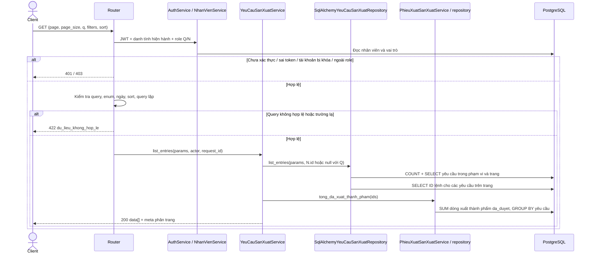
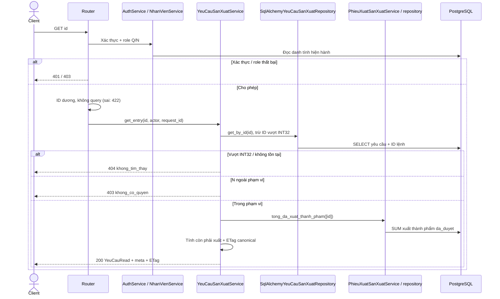
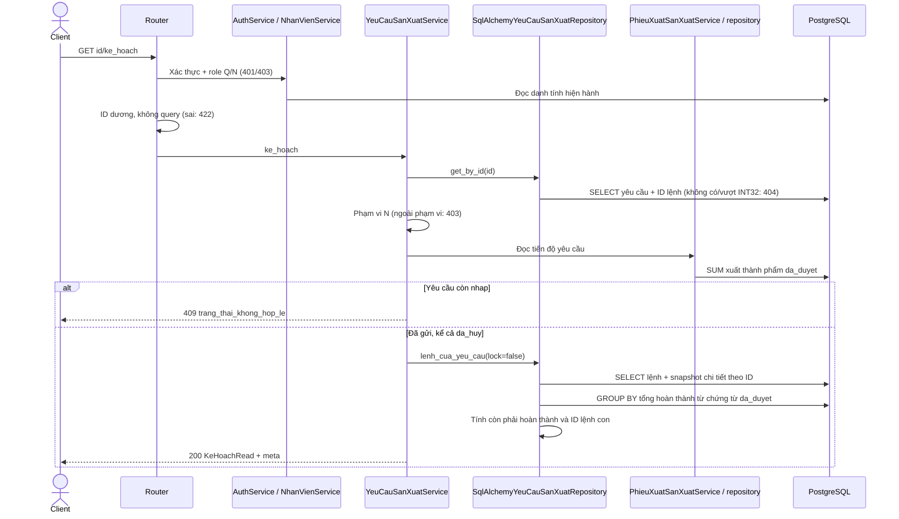

# Sequence — san_xuat

Triển khai contract v3 §8 (API-036–044); quyết định D-SX-01–19 tại `docs/DECISION.md`.
`Q = quan_ly`, `N = nhan_vien`. Admin bị chặn ở cả 9 endpoint. JWT được kiểm tra
bằng trạng thái tài khoản, vai trò và phiên bản mật khẩu hiện hành trong DB.
N chỉ đọc/tính thử yêu cầu có `nhan_vien_duoc_giao_id = sub`; ID không tồn tại trả
404 trước khi kiểm tra phạm vi, ngoài phạm vi trả 403.

Mọi lỗi dùng `{error: {code, message, details}, meta: {request_id}}`.
Body không hỗ trợ trường lạ; ID path phải dương (422), ID vượt INT32 trả 404.
GET chi tiết, POST tạo, PATCH, gửi và hủy trả strong ETag từ toàn bộ `YeuCauRead`,
gồm tổng lượng xuất và ID lệnh. PATCH/DELETE/gửi/hủy so `If-Match` dưới khóa yêu cầu:
thiếu/blank 428 `thieu_if_match`; cũ/weak/`*` 412 `du_lieu_da_thay_doi`.
Mọi ghi nghiệp vụ và audit dùng cùng session/transaction; lỗi rollback toàn bộ.
Không endpoint nào ở đây ghi kho, giữ chỗ hoặc tạo ledger.

## GET /api/v1/yeu_cau_san_xuat



Filter `q` tìm mã yêu cầu bằng ILIKE tham số hóa, escape ký tự wildcard. Bộ lọc
`mat_hang_id`, `trang_thai`, `nhan_vien_duoc_giao_id`, `tu_ngay`, `den_ngay` kết hợp
với phạm vi N. Ngày địa phương Asia/Ho_Chi_Minh chuyển sang khoảng UTC nửa mở.
Sort mặc định `-created_at`, whitelist `id`, `created_at`, `ma_yeu_cau_san_xuat`,
luôn thêm ID tăng dần. Meta có `request_id`, `page`, `page_size`, `total`, `total_pages`.
Projection Q/N cùng các field, khác phạm vi dòng. Không audit, không ETag danh sách.

## GET /api/v1/yeu_cau_san_xuat/{id}



Không audit. `so_luong_con_phai_xuat = max(so_luong - so_luong_da_xuat, 0)`.

## POST /api/v1/yeu_cau_san_xuat

```mermaid
sequenceDiagram
    actor C as Client
    participant R as Router
    participant A as AuthService / NhanVienService
    participant S as YeuCauSanXuatService
    participant M as MatHangAvailabilityService / repository
    participant P as SqlAlchemyYeuCauSanXuatRepository
    participant L as AuditService / repository
    participant D as PostgreSQL
    C->>R: POST YeuCauCreate
    R->>A: Xác thực + role Q (sai: 401/403)
    A->>D: Đọc danh tính hiện hành
    R->>R: Validate body, extra forbid, không query (sai: 422)
    R->>S: create_entry(payload, actor, request_id)
    S->>M: read_items([mat_hang_id], lock=true)
    M->>D: SELECT MatHang FOR SHARE, kiểm tra tồn tại/active
    alt Mặt hàng không tồn tại / ngừng hoạt động / không là thành phẩm
        S-->>C: 404 / 409 mat_hang_ngung_hoat_dong / 422
    else Thành phẩm hợp lệ
        opt Có người phụ trách
            S->>A: kiem_tra_nguoi_duoc_giao(id, lock=true)
            A->>D: SELECT NhanVien FOR SHARE + vai trò
            Note over A,D: Không tồn tại: 404; bị khóa/sai vai trò: 409 nguoi_duoc_giao_khong_hop_le
        end
        S->>P: add(payload, actor.id)
        P->>D: nextval identity + tháng Asia/Ho_Chi_Minh
        P->>D: INSERT YeuCauSanXuat nhap, mã YCSX, người tạo từ JWT
        S->>L: append tao (dữ liệu sau)
        L->>D: Thêm audit trong cùng session
        S->>D: COMMIT qua SqlAlchemyTransaction
        S-->>C: 201 YeuCauRead + meta + ETag + Location
    end
    Note over S,D: Mọi lỗi ghi/audit: rollback cả yêu cầu và audit
```

Người phụ trách tùy chọn, nullable. Không cần If-Match. Mã có phần số bằng ID 6 chữ số,
không reset theo tháng; giới hạn PoC 999999. `Location` trỏ GET chi tiết vừa tạo.

## PATCH /api/v1/yeu_cau_san_xuat/{id}

```mermaid
sequenceDiagram
    actor C as Client
    participant R as Router
    participant A as AuthService / NhanVienService
    participant S as YeuCauSanXuatService
    participant P as SqlAlchemyYeuCauSanXuatRepository
    participant X as PhieuXuatSanXuatService / repository
    participant M as MatHangAvailabilityService / repository
    participant L as AuditService / repository
    participant D as PostgreSQL
    C->>R: PATCH YeuCauPatch + If-Match
    R->>A: Xác thực + role Q (sai: 401/403)
    A->>D: Đọc danh tính hiện hành
    R->>R: Không query; body không rỗng, null/extra hợp lệ (sai: 422)
    R->>S: patch_entry
    S->>P: get_for_update(id)
    P->>D: SELECT yêu cầu FOR UPDATE + ID lệnh
    Note over S,P: ID vượt INT32/không tồn tại: 404
    S->>X: Đọc tổng xuất thành phẩm da_duyet cho ETag
    X->>D: SELECT SUM dòng xuất
    S->>S: So If-Match (thiếu: 428, không khớp: 412)
    alt Không còn nhap
        S-->>C: 409 trang_thai_khong_hop_le, rollback
    else Nháp
        S->>M: Kiểm tra thành phẩm hiện hành, lock=true
        M->>D: FOR SHARE, tồn tại/active/loại (404/409/422)
        opt Người phụ trách sau PATCH khác null
            S->>A: kiem_tra_nguoi_duoc_giao(lock=true)
            A->>D: FOR SHARE, trạng thái/vai trò (404/409)
        end
        S->>P: update(chỉ field được gửi)
        P->>D: UPDATE yêu cầu
        S->>L: append sua (trước/sau)
        L->>D: INSERT audit
        S->>D: COMMIT; mọi lỗi rollback toàn bộ
        S-->>C: 200 YeuCauRead + meta + ETag mới
    end
```

Chỉ nhận `mat_hang_id`, `so_luong`, `nhan_vien_duoc_giao_id`. Hai trường đầu không nhận
null; trường phụ trách nhận null. Bỏ qua field giữ nguyên giá trị.

## DELETE /api/v1/yeu_cau_san_xuat/{id}

```mermaid
sequenceDiagram
    actor C as Client
    participant R as Router
    participant A as AuthService / NhanVienService
    participant S as YeuCauSanXuatService
    participant P as SqlAlchemyYeuCauSanXuatRepository
    participant X as PhieuXuatSanXuatService / repository
    participant L as AuditService / repository
    participant D as PostgreSQL
    C->>R: DELETE id + If-Match
    R->>A: Xác thực + role Q (sai: 401/403)
    A->>D: Đọc danh tính hiện hành
    R->>R: ID dương, không query (sai: 422)
    R->>S: delete_entry
    S->>P: get_for_update(id)
    P->>D: FOR UPDATE yêu cầu + ID lệnh (không có: 404)
    S->>X: Tổng xuất thành phẩm để tạo ETag
    X->>D: SUM các dòng da_duyet
    S->>S: If-Match (thiếu: 428, cũ/weak/*: 412)
    alt Không nhap
        S-->>C: 409 trang_thai_khong_hop_le
    else Nháp
        S->>P: has_dependencies(id)
        P->>D: EXISTS LenhSanXuat hoặc PhieuXuat
        alt Có phụ thuộc
            S-->>C: 409 dang_duoc_tham_chieu
        else Không phụ thuộc
            S->>P: delete(id)
            P->>D: DELETE YeuCauSanXuat
            S->>L: append xoa_nhap (dữ liệu trước)
            L->>D: INSERT audit
            S->>D: COMMIT; lỗi rollback toàn bộ
            R-->>C: 204, không body
        end
    end
```

Xóa cứng yêu cầu nháp; không xóa nhân viên/mặt hàng, không cascade sang chứng từ khác.

## POST /api/v1/yeu_cau_san_xuat/{id}/tinh_ke_hoach

```mermaid
sequenceDiagram
    actor C as Client
    participant R as Router
    participant A as AuthService / NhanVienService
    participant S as YeuCauSanXuatService
    participant P as SqlAlchemyYeuCauSanXuatRepository
    participant B as BomPlanningReader / repository
    participant M as MatHangAvailabilityService / repository
    participant X as PhieuXuatSanXuatService / repository
    participant D as PostgreSQL
    C->>R: POST body rỗng JSON
    R->>A: Xác thực + role Q/N (sai: 401/403)
    A->>D: Đọc danh tính hiện hành
    R->>R: ID/body/query validation (sai: 422)
    R->>S: tinh_ke_hoach
    S->>P: get_by_id + ID lệnh (không có/vượt INT32: 404)
    P->>D: SELECT yêu cầu
    S->>S: Phạm vi N (ngoài phạm vi: 403)
    S->>X: Đọc tiến độ yêu cầu
    X->>D: SUM xuất thành phẩm da_duyet
    alt Không ở nhap
        S-->>C: 409 trang_thai_khong_hop_le
    else Nháp
        S->>B: active_graph()
        B->>D: SELECT BOM active + chi tiết theo ID
        S->>M: read_items(mọi ID đi tới được, lock=false)
        M->>D: SELECT trực tiếp DB, không cache (thiếu ID: 404, inactive: 409)
        S->>S: calculate_plan BFS, tồn dùng chung; chu trình: 409 bom_co_chu_trinh
        S->>A: Kiểm tra người phụ trách, lock=false
        A->>D: SELECT nhân viên/vai trò
        S->>S: Tính du_dieu_kien_gui; ký JWT aud kế hoạch, TTL 10 phút
        S-->>C: 200 KeHoachPreview + meta
    end
```

Không If-Match, không khóa, không ghi/audit. Người phụ trách null/không còn hợp lệ hoặc
thiếu BOM làm `du_dieu_kien_gui=false`; thiếu NVL chỉ bật `thieu_vat_tu`.
Đủ thành phẩm trả hai mảng `lenh_du_kien`, `vat_tu` rỗng. BTP có sẵn dùng một lần giữa
các nhánh; chỉ phần thiếu sinh lệnh con. Nhu cầu cha vẫn là toàn bộ nhu cầu trực tiếp.
`vat_tu` gồm NVL/linh kiện cần lấy và phần BTP lấy từ tồn. Nhu cầu trực tiếp vượt INT32
trả 422 thay vì ghi một kế hoạch không thể lưu. Token không dùng làm access token.

## POST /api/v1/yeu_cau_san_xuat/{id}/gui

```mermaid
sequenceDiagram
    actor C as Client
    participant R as Router
    participant A as AuthService / NhanVienService
    participant S as YeuCauSanXuatService
    participant P as SqlAlchemyYeuCauSanXuatRepository
    participant X as PhieuXuatSanXuatService / repository
    participant B as BomPlanningReader / repository
    participant M as MatHangAvailabilityService / repository
    participant L as AuditService / repository
    participant D as PostgreSQL
    C->>R: POST ke_hoach_token + If-Match
    R->>A: Xác thực + role Q (sai: 401/403)
    A->>D: Đọc danh tính hiện hành
    R->>R: Validate ID, token không rỗng, không query/extra (422)
    R->>S: gui
    S->>P: get_for_update(id)
    P->>D: FOR UPDATE yêu cầu, ID lệnh (không có/vượt INT32: 404)
    S->>X: Đọc tiến độ tạo ETag
    X->>D: SUM xuất thành phẩm đã duyệt
    S->>S: If-Match (428/412), phải nhap (409)
    S->>A: kiem_tra_nguoi_duoc_giao(lock=true)
    A->>D: FOR SHARE nhân viên, kiểm tra hoạt động/vai trò
    Note over S,A: Null/thiếu/sai phụ trách: 409 nguoi_duoc_giao_khong_hop_le
    S->>B: lock_graph(), active_graph()
    B->>D: pg_advisory_xact_lock(20261020,2), SELECT graph active
    S->>M: read_items(mọi ID đi tới được, lock=true)
    M->>D: FOR SHARE theo ID; thiếu: 404, inactive: 409
    S->>S: Tính lại BFS + so token/kết quả canonical
    alt Token sai/hết hạn/khác yêu cầu hoặc snapshot thay đổi
        S-->>C: 409 ke_hoach_da_thay_doi; rollback
    else Snapshot khớp nhưng thiếu BOM
        S-->>C: 409 thieu_bom; rollback
    else Hợp lệ
        S->>P: add_lenh_tree (cha trước con)
        P->>D: Cấp ID/mã LSX; INSERT lệnh nhap và nhu cầu trực tiếp
        Note over P,D: nhan_vien_id null; đủ TP thì không INSERT lệnh
        S->>P: update trạng thái yêu cầu
        P->>D: cho_bo_sung_vat_tu nếu thiếu, ngược lại da_gui
        S->>L: append gui cho yêu cầu + tao từng lệnh
        L->>D: INSERT audit cùng transaction
        S->>D: COMMIT; lỗi ghi/audit rollback toàn bộ
        S-->>C: 200 data.yeu_cau + data.ke_hoach + meta + ETag
    end
```

Không giữ chỗ hoặc thay số dư. Lệnh lưu `bom_id` và snapshot nhu cầu; đọc lại không
tính theo BOM/tồn mới. Người thực hiện của từng lệnh được giao ở tác vụ endpoint lệnh sau.

## GET /api/v1/yeu_cau_san_xuat/{id}/ke_hoach



Không audit, không phân trang cây lệnh, không đọc BOM hiện hành, không ETag cho kế hoạch.
Nhánh đủ hàng trả `lenh=[]`. Tiến độ chỉ tính chứng từ hoàn thành đã duyệt.

## POST /api/v1/yeu_cau_san_xuat/{id}/huy

```mermaid
sequenceDiagram
    actor C as Client
    participant R as Router
    participant A as AuthService / NhanVienService
    participant S as YeuCauSanXuatService
    participant P as SqlAlchemyYeuCauSanXuatRepository
    participant X as PhieuXuatSanXuatService / repository
    participant L as AuditService / repository
    participant D as PostgreSQL
    C->>R: POST ly_do + If-Match
    R->>A: Xác thực + role Q (401/403)
    A->>D: Đọc danh tính hiện hành
    R->>R: Validate ID, lý do trim không rỗng, không extra/query (422)
    R->>S: huy
    S->>P: get_for_update(id)
    P->>D: FOR UPDATE yêu cầu + ID lệnh (không có/vượt INT32: 404)
    S->>X: Đọc tiến độ để tạo ETag
    X->>D: SUM xuất thành phẩm đã duyệt
    S->>S: If-Match (thiếu: 428, cũ/weak/*: 412)
    alt Yêu cầu hoan_thanh / da_huy
        S-->>C: 409 trang_thai_khong_hop_le
    else Trạng thái cho phép
        S->>P: lenh_cua_yeu_cau(lock=true), chung_tu_hoan_thanh_cua_lenh(lock=true)
        P->>D: FOR UPDATE lệnh theo ID rồi chứng từ hoàn thành theo ID
        S->>X: co_phieu_da_ghi_so(yeu_cau_id, lenh_ids)
        X->>D: FOR UPDATE phiếu xuất theo ID, lấy snapshot chi tiết
        alt Có phiếu xuất / chứng từ hoàn thành da_duyet
            S-->>C: 409 phu_thuoc_khong_hop_le; rollback
        else Chưa ghi sổ
            loop Lệnh sâu nhất trước, bỏ qua lệnh đã hủy
                S->>P: huy_lenh(id)
                P->>D: UPDATE lệnh da_huy
                S->>L: append huy (trước/sau + lý do)
            end
            S->>P: Xóa hoàn thành nhap; từ chối cho_duyet; giữ tu_choi
            P->>D: DELETE hoặc UPDATE chứng từ
            S->>L: append xoa_nhap / tu_choi + lý do
            S->>X: huy_phieu_chua_ghi_so(...)
            X->>D: Khóa/kiểm tra lại phiếu; DELETE chi tiết rồi nhap, UPDATE cho_duyet thành tu_choi
            X->>L: append xoa_nhap / tu_choi + lý do
            S->>P: update yêu cầu da_huy
            P->>D: UPDATE yêu cầu
            S->>L: append huy yêu cầu + lý do
            L->>D: INSERT audit cùng session
            S->>D: COMMIT; mọi lỗi rollback toàn bộ
            S-->>C: 200 YeuCauRead + meta + ETag mới
        end
    end
```

Hủy được cả nháp khi chưa ghi sổ. Chứng từ `tu_choi` và audit cũ giữ nguyên; snapshot
trước của chứng từ bị xóa được lưu audit. Service phiếu xuất không tự commit.

## Phạm vi và kiểm chứng

- Chưa có endpoint lệnh, hoàn thành hoặc phiếu xuất; `phieu_xuat` chỉ là collaborator nội bộ.
- Gỡ bốn endpoint `/production/work-orders`; frontend cũ chưa chuyển đổi, sẽ nhận 404.
- ORM sáu bảng theo bootstrap; không migration, không sửa database ứng dụng.
- Kiểm chứng bằng unit/API và PostgreSQL riêng `_test` với rollback. Kết quả cụ thể
  được ghi trong `.handoff/plan-yeu-cau-san-xuat.md` khi bàn giao.
