# Sequence — san_xuat

Phần tạo/gửi yêu cầu theo [UC-23](../../specs/use_cases/production/UC-23.md),
plan `docs/plans/UC-23.md` và quyết định D1–D7 ngày 16/11/2026; bảng
`"YeuCauSanXuat"` theo `infra/postgres/init.sql` v4. Sửa/xóa Nháp theo
[UC-24](../../specs/use_cases/production/UC-24.md), plan `docs/plans/UC-24.md`
và quyết định D1–D4 ngày 16/11/2026; gửi lại dùng chung luồng gửi UC-23.
Danh sách theo [UC-25](../../specs/use_cases/production/UC-25.md),
plan `docs/plans/UC-25.md` và quyết định D1–D6 ngày 16/11/2026.
Các luồng lệnh, hủy và chứng từ
hoàn thành giữ triển khai hiện tại, chưa chuyển toàn bộ sang v4.
`Q = quan_ly`, `N = nhan_vien`. Admin bị chặn ở các endpoint nghiệp vụ này.
JWT được kiểm tra bằng tài khoản, vai trò và phiên bản đăng nhập/mật khẩu hiện hành.
N chỉ đọc yêu cầu được giao đã gửi: danh sách loại `nhap` trước COUNT/phân trang;
chi tiết Nháp trả 404, yêu cầu đã gửi ngoài phạm vi trả 403.

Mọi lỗi dùng `{error: {code, message, details}, meta: {request_id}}`.
Body không hỗ trợ trường lạ; ID path phải dương (422), ID vượt INT32 trả 404.
GET chi tiết, POST tạo, PATCH, gửi và hủy trả strong ETag hash toàn bộ `YeuCauRead`,
gồm cột v4/`phien_ban`; không còn `lenh_san_xuat_ids` hoặc hai trường tiến độ xuất (D6).
PATCH/DELETE/gửi/hủy so `If-Match` dưới khóa yêu cầu: thiếu/blank 428
`thieu_if_match`; cũ/weak/`*` 412 `du_lieu_da_thay_doi`.
Mỗi `update` tăng `phien_ban` một và ghi `updated_at`, kể cả gửi.
Mọi ghi nghiệp vụ và audit dùng cùng session/transaction; lỗi rollback toàn bộ.
Tạo/gửi không tính nhu cầu, không sinh lệnh, không giữ hàng hoặc thay đổi tồn/ledger.
Yêu cầu không đọc tổng xuất thành phẩm để tạo response/ETag hoặc audit (UC-25 D6).
Cổng `ProductionIssues` chỉ giữ `co_phieu_da_ghi_so`, `huy_phieu_chua_ghi_so` cho luồng hủy.

## GET /api/v1/yeu_cau_san_xuat

Nguồn: UC-25 Main 1–3; AC-1–AC-5, A1, A3, R5; D1–D3, D5–D6.

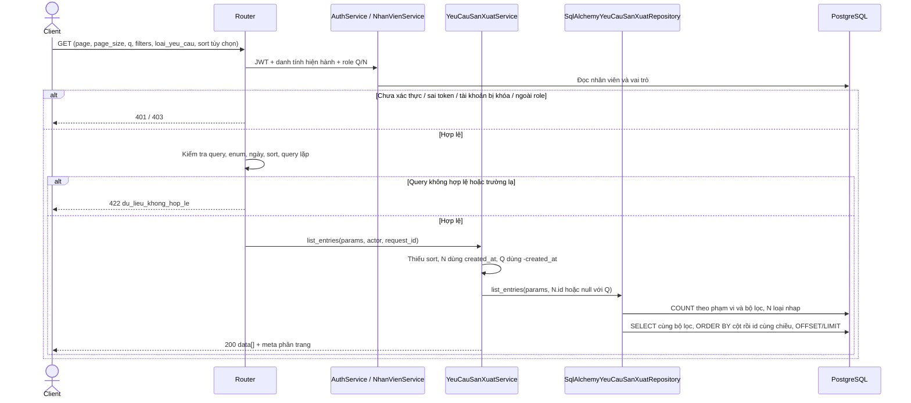

Filter `q` tìm mã yêu cầu bằng ILIKE tham số hóa, escape ký tự wildcard. Bộ lọc
`mat_hang_id`, `trang_thai`, `nhan_vien_duoc_giao_id`, `loai_yeu_cau` (`xuat_giao`/`nhap_kho`),
`tu_ngay`, `den_ngay` kết hợp
với phạm vi N. Ngày địa phương Asia/Ho_Chi_Minh chuyển sang khoảng UTC nửa mở.
Không gửi `sort`: N dùng `created_at` (cũ nhất trước), Q dùng `-created_at` (mới nhất trước).
Whitelist `id`, `created_at`, `ma_yeu_cau_san_xuat`, `han_hoan_thanh`, mỗi cột có chiều
tăng hoặc dấu `-` cho giảm; luôn thêm `id` cùng chiều làm khóa phụ.
Sai loại/sort trả 422. Bộ lọc người được giao không thay thế phạm vi N: lọc người khác
trả danh sách rỗng. Q vẫn thấy yêu cầu giao cho nhân viên bị khóa, không JOIN/lọc trạng thái NV.
Meta có `request_id`, `page`, `page_size`, `total`, `total_pages`.
Projection Q/N cùng các field, khác phạm vi dòng. Không audit, không ETag danh sách.

## GET /api/v1/yeu_cau_san_xuat/{id}

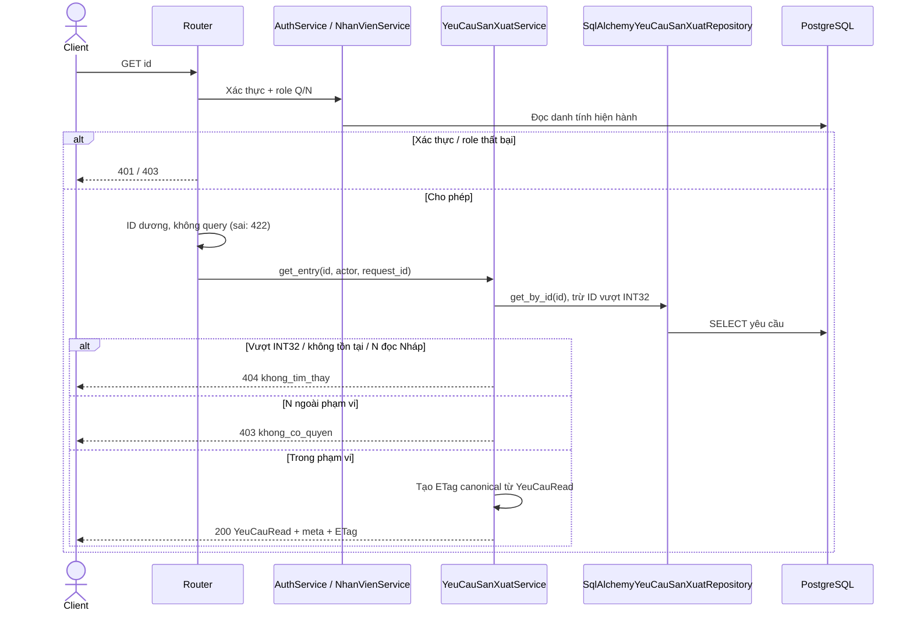

Không audit. Response và ETag dùng trực tiếp bản ghi yêu cầu, không truy vấn tiến độ xuất (D6).

## POST /api/v1/yeu_cau_san_xuat

Nguồn: UC-23 Main 4–6; A1. Loại mặc định `xuat_giao` hoặc `nhap_kho`; bắt buộc thành
phẩm, số lượng nguyên dương INT32, hạn kiểu date và nhân viên được giao.
Không chặn ngày quá khứ. Body không nhận mã, trạng thái, BOM hoặc token do client đặt.

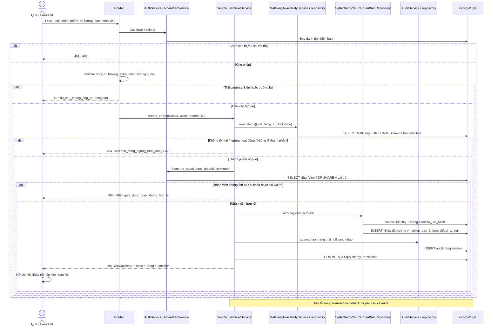

Không cần If-Match. Mã có phần số bằng ID 6 chữ số, không reset theo tháng;
giới hạn PoC 999999. `Location` trỏ GET chi tiết vừa tạo. Audit `tao` có người,
đối tượng, dữ liệu sau và `trang_thai_truoc=null`, `trang_thai_sau=nhap`.
Đóng hộp xác nhận không gọi gửi: yêu cầu giữ Nháp, N không thấy (A2).

## PATCH /api/v1/yeu_cau_san_xuat/{id}

Nguồn: UC-24 A1; R1–R3, R8–R10; D4. Body bắt buộc đủ 5 trường
`loai_yeu_cau`, `mat_hang_id`, `so_luong`, `han_hoan_thanh`,
`nhan_vien_duoc_giao_id`, không có mặc định, không nhận null hoặc trường lạ.
Thiếu/null → 422 trước khi gọi service, bản ghi và lịch sử giữ nguyên.
FE điền sẵn form khi bấm Sửa; Lưu nháp gọi PATCH ngay, không mở xác nhận.

```mermaid
sequenceDiagram
    actor C as Client
    participant R as Router
    participant A as AuthService / NhanVienService
    participant S as YeuCauSanXuatService
    participant P as SqlAlchemyYeuCauSanXuatRepository
    participant M as MatHangAvailabilityService / repository
    participant L as AuditService / repository
    participant D as PostgreSQL
    C->>R: PATCH đủ 5 trường + If-Match
    R->>A: Xác thực + role Q (sai: 401/403)
    A->>D: Đọc danh tính hiện hành
    R->>R: ID dương, không query; đủ 5 trường, không null/extra (sai: 422)
    R->>S: patch_entry
    S->>P: get_for_update(id)
    P->>D: SELECT yêu cầu FOR UPDATE
    Note over S,P: ID vượt INT32/không tồn tại: 404
    S->>S: So If-Match (thiếu: 428, không khớp: 412)
    alt Không còn nhap
        S-->>C: 409 trang_thai_khong_hop_le, rollback
    else Nháp
        S->>M: Kiểm tra thành phẩm hiện hành, lock=true
        M->>D: FOR SHARE, tồn tại/active/loại (404/409/422)
        S->>A: kiem_tra_nguoi_duoc_giao(lock=true)
        A->>D: FOR SHARE, tồn tại/trạng thái/vai trò (404/409)
        S->>P: update(đủ 5 trường)
        P->>D: UPDATE yêu cầu, phien_ban tăng 1, updated_at
        S->>L: append sua, dữ liệu trước/sau, trạng thái nhap sang nhap
        L->>D: INSERT audit
        S->>D: COMMIT; mọi lỗi rollback toàn bộ
        S-->>C: 200 YeuCauRead + meta + ETag mới
    end
```

Số lượng phải là số nguyên dương INT32; ID phải là số nguyên dương; loại chỉ
`xuat_giao`/`nhap_kho`; hạn kiểu date, không giới hạn ngày quá khứ. Thành phẩm ngừng
→ 409 `mat_hang_ngung_hoat_dong`, linh kiện → 422 `du_lieu_khong_hop_le`,
nhân viên khóa/sai vai trò → 409 `nguoi_duoc_giao_khong_hop_le`; không tồn tại → 404.
Chỉ sửa Nháp, đổi được loại và cả 5 trường; sau gửi trả 409 `trang_thai_khong_hop_le`.
Audit `sua` có người, đối tượng, snapshot trước/sau, trạng thái `nhap → nhap`.
Lưu vẫn Nháp, không chốt BOM, không gửi, không đổi tồn hoặc phần đang giữ.
Audit lỗi rollback cả cập nhật và lịch sử. Thành công trả ETag mới; FE về chế độ xem.

## DELETE /api/v1/yeu_cau_san_xuat/{id}

Nguồn: UC-24 A2; R1, R4, R8–R10; D1. FE xác nhận Xóa nháp với `danger`,
gửi DELETE bằng ETag đang xem; thành công điều hướng về danh sách.

```mermaid
sequenceDiagram
    actor C as Client
    participant R as Router
    participant A as AuthService / NhanVienService
    participant S as YeuCauSanXuatService
    participant P as SqlAlchemyYeuCauSanXuatRepository
    participant L as AuditService / repository
    participant D as PostgreSQL
    C->>R: DELETE id + If-Match
    R->>A: Xác thực + role Q (sai: 401/403)
    A->>D: Đọc danh tính hiện hành
    R->>R: ID dương, không query (sai: 422)
    R->>S: delete_entry
    S->>P: get_for_update(id)
    P->>D: FOR UPDATE yêu cầu (không có: 404)
    S->>S: If-Match (thiếu: 428, cũ/weak/*: 412)
    alt Không nhap
        S-->>C: 409 trang_thai_khong_hop_le
    else Nháp
        S->>P: delete(id), không kiểm phụ thuộc
        P->>D: DELETE YeuCauSanXuat, trigger chỉ cho xóa nhap
        S->>L: append xoa_nhap, dữ liệu trước, trạng thái nhap sang null
        L->>D: INSERT audit cùng session
        S->>D: COMMIT; lỗi rollback toàn bộ
        R-->>C: 204, không body
    end
```

Xóa cứng yêu cầu Nháp, không cần hủy; không kiểm phụ thuộc vì theo bất biến v4,
chứng từ/nhu cầu/giữ hàng chỉ phát sinh sau gửi. Trigger DB vẫn bảo vệ trạng thái;
nếu dữ liệu sai bất biến gây lỗi FK thì lỗi hệ thống và rollback. Audit `xoa_nhap`
có người, đối tượng, snapshot trước, `du_lieu_sau={}`, trạng thái `nhap → null`.
Audit lỗi rollback: bản ghi Nháp và lịch sử cũ vẫn còn. Không đổi tồn/giữ,
không xóa nhân viên/mặt hàng, không cascade sang chứng từ khác.
FE ẩn Hủy với Nháp; BE hủy giữ nguyên cho UC-28.

## POST /api/v1/yeu_cau_san_xuat/{id}/gui

Nguồn: UC-23 Main 7–9; A3. Body `{}`, `If-Match` là ETag của Nháp đã tạo.

```mermaid
sequenceDiagram
    actor C as QLK / Frontend
    participant R as Router
    participant A as AuthService / NhanVienService
    participant S as YeuCauSanXuatService
    participant P as SqlAlchemyYeuCauSanXuatRepository
    participant M as MatHangAvailabilityService / repository
    participant L as AuditService / repository
    participant D as PostgreSQL
    C->>R: POST body {} + If-Match sau khi xác nhận
    R->>A: Xác thực + role Q
    A->>D: Đọc danh tính hiện hành
    alt Chưa xác thực / sai vai trò
        R-->>C: 401 / 403
    else Cho phép
        R->>R: Validate ID, body rỗng, không query/extra
        alt Body/query/ID sai
            R-->>C: 422 du_lieu_khong_hop_le
        else Đầu vào hợp lệ
            R->>S: gui(id, actor, If-Match, request_id)
            S->>P: get_for_update(id)
            P->>D: SELECT YeuCauSanXuat FOR UPDATE
            alt Không có / ID vượt INT32
                S-->>C: 404 khong_tim_thay
            else Có yêu cầu
                S->>S: So If-Match, kiểm tra phải Nháp
                alt Thiếu/cũ ETag hoặc không còn Nháp
                    S-->>C: 428 / 412 / 409 trang_thai_khong_hop_le
                else Nháp và ETag khớp
                    S->>M: read_items([thành phẩm], lock=true)
                    M->>D: SELECT MatHang FOR SHARE, kiểm tra lại tồn tại/active/loại
                    alt Thành phẩm đã ngừng (A3)
                        S-->>C: 409 trang_thai_khong_hop_le, nêu lý do
                    else Thành phẩm hợp lệ
                        Note over S,M: Không tồn tại trả 404, sai loại trả 422
                        S->>A: kiem_tra_nguoi_duoc_giao(lock=true)
                        A->>D: SELECT NhanVien FOR SHARE, kiểm tra hoạt động/vai trò
                        alt Nhân viên bị khóa / không còn hợp lệ (A3)
                            S-->>C: 409 nguoi_duoc_giao_khong_hop_le, nêu lý do
                        else Nhân viên hợp lệ
                            S->>P: bom_dang_dung(mat_hang_id)
                            P->>D: SELECT Bom.id WHERE đúng thành phẩm AND is_active FOR SHARE
                            P->>P: scalar_one()
                            S->>P: update da_gui, bom_id, gui_at=now
                            P->>D: UPDATE yêu cầu, phien_ban + 1, updated_at=now
                            Note over P,D: Trigger kiểm BOM thuộc thành phẩm, ràng buộc v4
                            S->>L: append gui, trạng thái nhap sang da_gui
                            L->>D: INSERT audit cùng session
                            S->>D: COMMIT
                            S-->>C: 200 YeuCauRead + meta + ETag mới
                            C->>C: Báo đã gửi yêu cầu cho nhân viên
                        end
                    end
                end
            end
        end
    end
    Note over S,D: Lỗi ghi/audit rollback; A3 giữ Nháp, bom_id/gui_at null, không audit gui
```

Chốt đúng `Bom.id` đang dùng tại lúc gửi; mỗi thành phẩm luôn có đúng một BOM active
(D3). Không có nhánh nghiệp vụ thiếu BOM; sai bất biến gây lỗi hệ thống 500 và rollback.
Không tính nhu cầu, sinh lệnh, đọc số dư tồn, ghi giữ hàng hoặc ledger. Loại `nhap_kho`
cũng gửi theo cùng luồng; các số lượng kiểm tra lần đầu còn null. Response gửi có cùng
cấu trúc với chi tiết yêu cầu. Audit `gui` lưu trước/sau, người, thời điểm và đối tượng.
Hộp xác nhận hiển thị đủ loại, thành phẩm, số lượng, đơn vị, hạn, nhân viên và tác động
chưa đổi tồn; lỗi BE truyền ra `ErrorNotice`, đóng hộp ở lại chi tiết Nháp (A3).

## POST /api/v1/yeu_cau_san_xuat/{id}/huy

```mermaid
sequenceDiagram
    actor C as Client
    participant R as Router
    participant A as AuthService / NhanVienService
    participant S as YeuCauSanXuatService
    participant P as SqlAlchemyYeuCauSanXuatRepository
    participant X as PhieuXuatService / repository
    participant L as AuditService / repository
    participant D as PostgreSQL
    C->>R: POST ly_do + If-Match
    R->>A: Xác thực + role Q (401/403)
    A->>D: Đọc danh tính hiện hành
    R->>R: Validate ID, lý do trim không rỗng, không extra/query (422)
    R->>S: huy
    S->>P: get_for_update(id)
    P->>D: FOR UPDATE yêu cầu (không có/vượt INT32: 404)
    S->>S: If-Match (thiếu: 428, cũ/weak/*: 412)
    alt Yêu cầu hoan_thanh / da_huy
        S-->>C: 409 trang_thai_khong_hop_le
    else Trạng thái cho phép
        S->>P: lenh_cua_yeu_cau(lock=true), chung_tu_hoan_thanh_cua_lenh(lock=true)
        P->>D: FOR UPDATE lệnh theo ID rồi chứng từ hoàn thành theo ID
        S->>X: co_phieu_da_ghi_so(yeu_cau_id, lenh_ids)
        X->>D: FOR UPDATE phiếu xuất theo ID, lấy snapshot chi tiết
        alt Có phiếu xuất / chứng từ hoàn thành da_duyet
            S-->>C: 409 phu_thuoc_khong_hop_le; rollback
        else Chưa ghi sổ
            loop Lệnh sâu nhất trước, bỏ qua lệnh đã hủy
                S->>P: huy_lenh(id)
                P->>D: UPDATE lệnh da_huy
                S->>L: append huy (trước/sau + lý do)
            end
            S->>P: Xóa hoàn thành nhap; từ chối cho_duyet; giữ tu_choi
            P->>D: DELETE hoặc UPDATE chứng từ
            S->>L: append xoa_nhap / tu_choi + lý do
            S->>X: huy_phieu_chua_ghi_so(...)
            X->>D: Khóa/kiểm tra lại phiếu; DELETE chi tiết rồi nhap, UPDATE cho_duyet thành tu_choi
            X->>L: append xoa_nhap / tu_choi + lý do
            S->>P: update yêu cầu da_huy
            P->>D: UPDATE yêu cầu
            S->>L: append huy yêu cầu + lý do
            L->>D: INSERT audit cùng session
            S->>D: COMMIT; mọi lỗi rollback toàn bộ
            S-->>C: 200 YeuCauRead + meta + ETag mới
        end
    end
```

Hủy được cả nháp khi chưa ghi sổ. Chứng từ `tu_choi` và audit cũ giữ nguyên; snapshot
trước của chứng từ bị xóa được lưu audit. Service phiếu xuất không tự commit.

## Phạm vi và kiểm chứng

- Endpoint lệnh nằm ở mục *Lệnh sản xuất* bên dưới; `phieu_xuat` là collaborator nội bộ của luồng yêu cầu.
- Gỡ bốn endpoint `/production/work-orders`; frontend cũ chưa chuyển đổi, sẽ nhận 404.
- UC-23 kiểm chứng bằng repository/port giả có trạng thái qua ASGI và service, không DB/Docker.
- Chỉ ORM yêu cầu được đồng bộ v4; lệnh/chứng từ hoàn thành/hủy giữ code hiện tại (D1).
- UC-25 kiểm chứng danh sách bằng repository/port giả qua ASGI và service, cùng câu SQL
  repository thật được biên dịch PostgreSQL; không DB/Docker, không xác nhận E2E PostgreSQL.
- Các module cũ có thể còn phụ thuộc schema v3; UC-25 D6 không chuyển đổi module phiếu xuất
  hoặc repository lệnh. Không migration hoặc sửa database.

## Lệnh sản xuất — contract v3 §9, API-045–051

Bảy endpoint nằm trong module `san_xuat`, qua `lenh_sx_router` trong `router.py`, `LenhSanXuatService` (`service/lenh_san_xuat.py`) và `SqlAlchemyLenhSanXuatRepository` (`repository/lenh_san_xuat.py`). Lệnh chỉ sinh khi gửi yêu cầu, không có POST tạo thủ công hoặc endpoint hoàn tất trực tiếp. `AuditService.append → SqlAlchemyAuditRepository.append` dùng chung session/transaction. Không endpoint nào dưới đây ghi tồn/ledger. Hoàn tất vẫn do duyệt chứng từ đầu ra hiện có.

ORM `LenhSanXuat`/`ChiTietLenhSanXuat` chỉ khai báo một lần trong `san_xuat/models.py`, đăng ký qua `app/models.py`. `LenhContext` và `LenhSanXuatRepository` nằm trong `san_xuat/ports.py` (dùng chung port kiểm tra nhân viên `AssigneeReader`). Schema lệnh (input/output/envelope) nằm trong `san_xuat/schemas.py`, dùng chung `LenhRead` với kế hoạch yêu cầu. Yêu cầu/kế hoạch, phiếu xuất và hoàn thành dùng cùng các class này.

Q đọc toàn bộ, N chỉ đọc/bắt đầu lệnh có `nhan_vien_id` của mình, A bị chặn. Thiếu/sai/hết hạn/thu hồi JWT trả 401, tài khoản khóa hoặc sai role/phạm vi trả 403, ID không tồn tại 404, input/query/header lặp sai 422.

GET chi tiết và vật tư cùng trả strong ETag từ lệnh (BOM/nhu cầu/tiến độ/ID con), trạng thái yêu cầu và snapshot vật tư đã cấp/tồn hiện tại. Khi một phần snapshot đổi, tải lại để lấy ETag mới. PATCH/actions bắt buộc If-Match: thiếu/blank 428, cũ/weak/wildcard/list 412. So sánh dưới khóa `yêu cầu → lệnh`, cùng thứ tự phiếu xuất và hoàn thành sản xuất. GET dùng khóa chia sẻ, không thay đổi trạng thái.

`du_dieu_kien_bat_dau` chỉ true khi lệnh da_gui, nguồn cho phép và đã cấp đủ, không dựa vào tồn hiện tại. Lệnh bắt đầu chuyển yêu cầu da_gui sang dang_thuc_hien, nhưng giữ cho_bo_sung_linh_kien. Hủy chỉ đổi trạng thái lệnh và ghi lý do trong audit, không tự xóa hoặc đổi chứng từ nháp/chờ duyệt liên quan. Phân công không thay đổi là no-op, không audit trùng.

| Endpoint | Ảnh PNG |
|---|---|
| `GET /api/v1/lenh_san_xuat` | [danh-sach](assets/san_xuat/lenh-01-danh-sach.png) |
| `GET /api/v1/lenh_san_xuat/{id}` | [chi-tiet](assets/san_xuat/lenh-02-chi-tiet.png) |
| `PATCH /api/v1/lenh_san_xuat/{id}` | [phan-cong](assets/san_xuat/lenh-03-phan-cong.png) |
| `GET /api/v1/lenh_san_xuat/{id}/vat_tu` | [vat-tu](assets/san_xuat/lenh-04-vat-tu.png) |
| `POST /api/v1/lenh_san_xuat/{id}/gui` | [gui](assets/san_xuat/lenh-05-gui.png) |
| `POST /api/v1/lenh_san_xuat/{id}/bat_dau` | [bat-dau](assets/san_xuat/lenh-06-bat-dau.png) |
| `POST /api/v1/lenh_san_xuat/{id}/huy` | [huy](assets/san_xuat/lenh-07-huy.png) |

## GET /api/v1/lenh_san_xuat

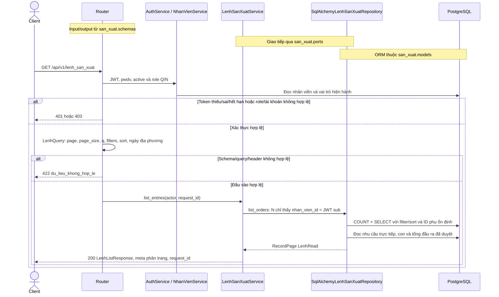

## GET /api/v1/lenh_san_xuat/{id}

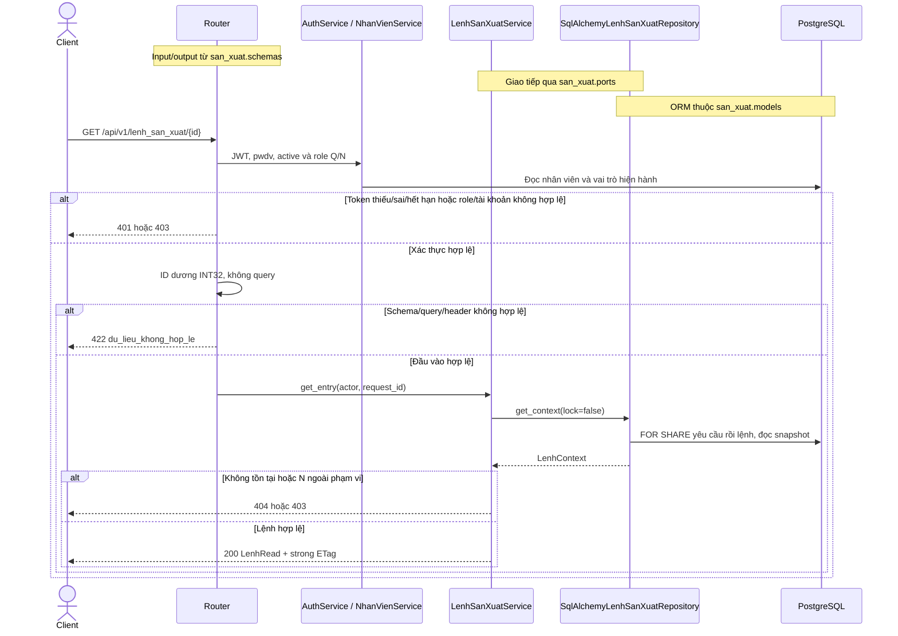

## PATCH /api/v1/lenh_san_xuat/{id}

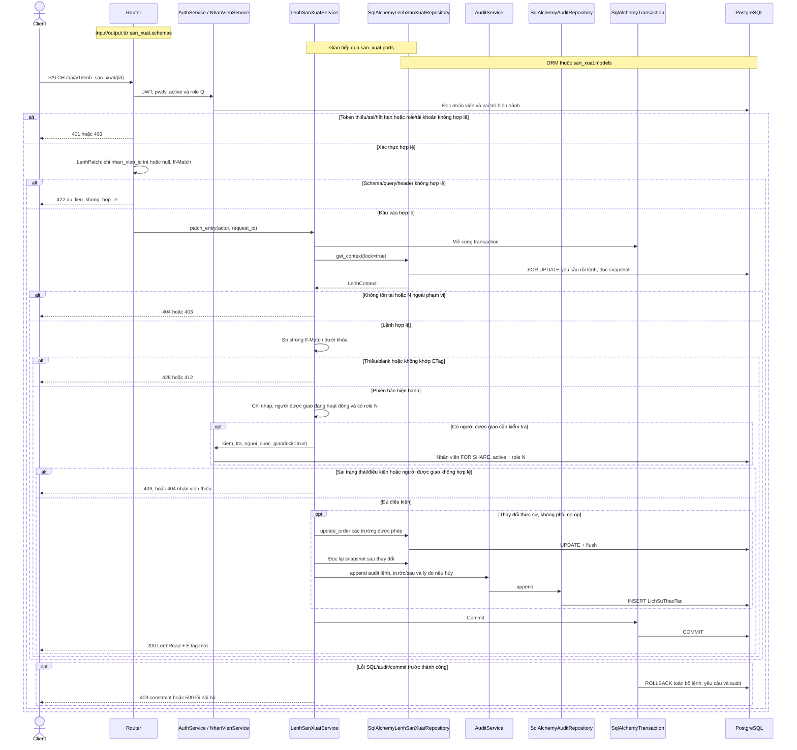

## GET /api/v1/lenh_san_xuat/{id}/vat_tu

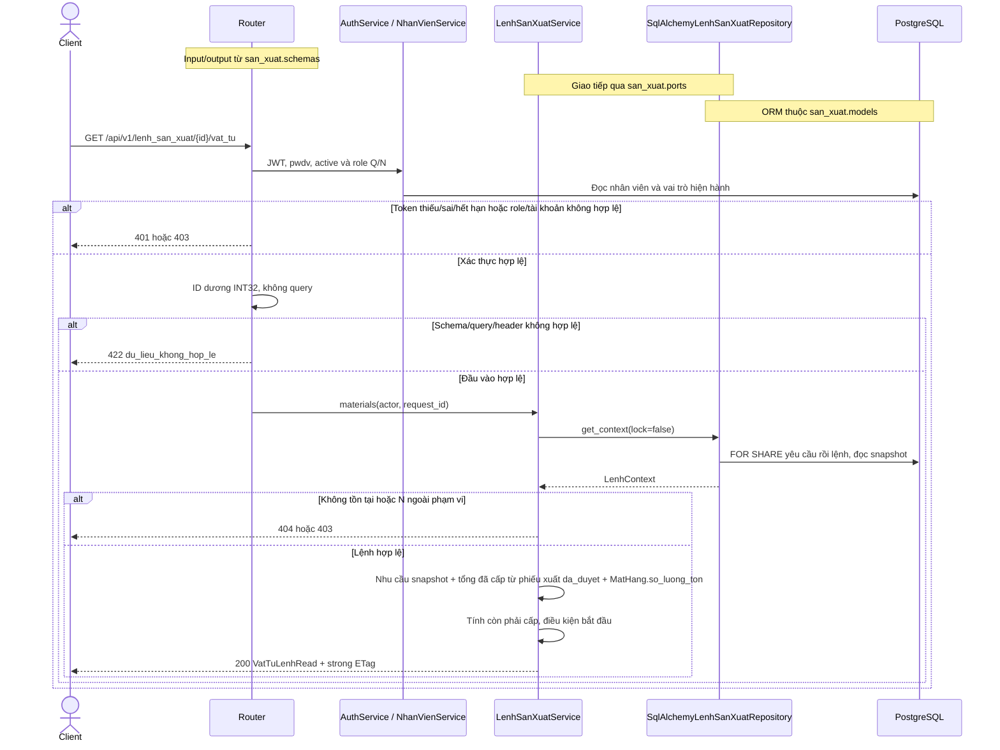

## POST /api/v1/lenh_san_xuat/{id}/gui

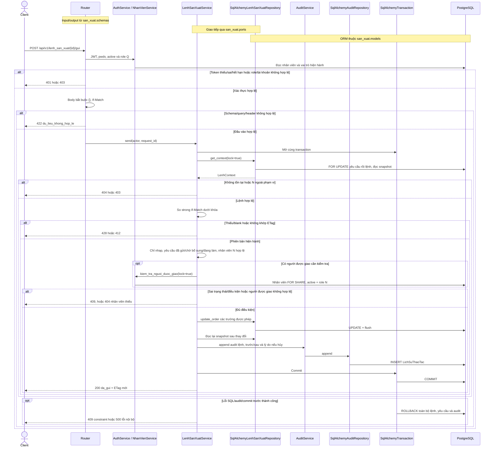

## POST /api/v1/lenh_san_xuat/{id}/bat_dau

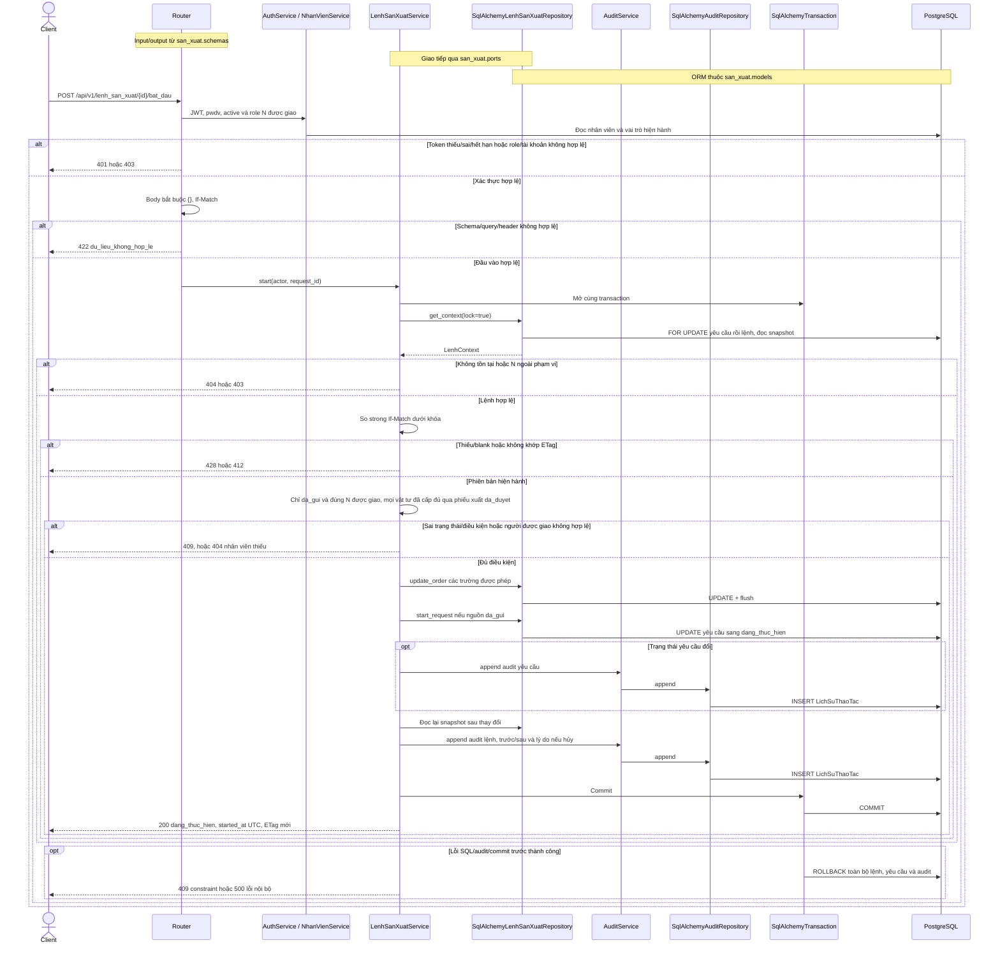

## POST /api/v1/lenh_san_xuat/{id}/huy

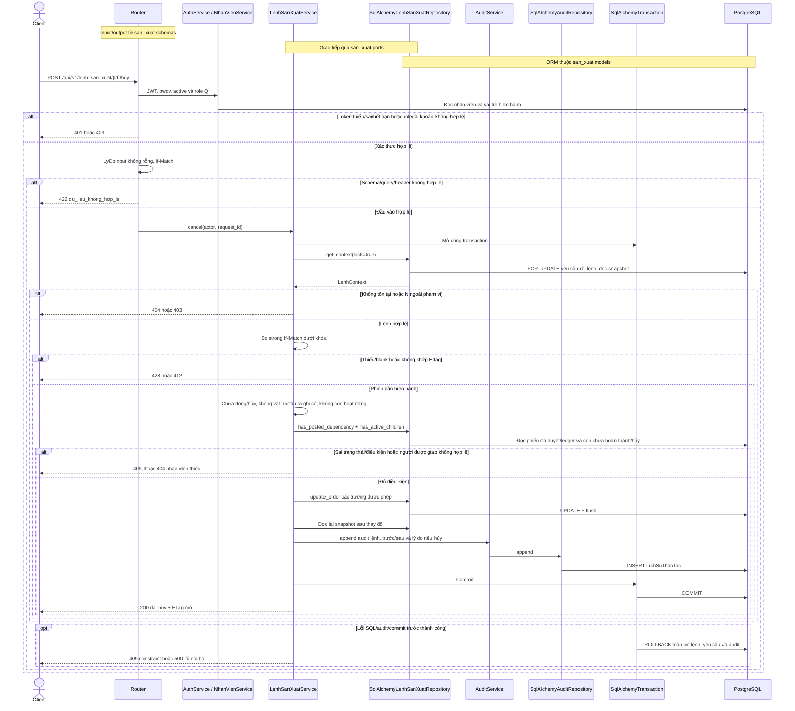

## Chứng từ hoàn thành sản xuất — quy ước chung

Chín endpoint API-061–069 dưới đây theo contract v3 §11 và
`.handoff/plan-chung-tu-hoan-thanh-sx.md`. `HoanThanhRead` thêm `mat_hang_id` từ lệnh;
giữ nguyên `ChungTuRead` dùng trong hủy yêu cầu. Q đọc toàn bộ, duyệt/từ chối;
N tạo cho lệnh được giao và chỉ đọc/sửa/xóa/gửi/về nháp chứng từ của mình khi vẫn
còn được giao lệnh. Admin 403. Đọc lịch sử không kiểm active mặt hàng.

Trong các sơ đồ, AuthService/NhanVienService đọc lại tài khoản, vai trò và phiên bản
mật khẩu từ DB: thiếu/sai/hết hạn JWT hoặc mật khẩu đã đổi trả 401; tài khoản bị khóa
hoặc sai vai trò trả 403. Không tự giải mã JWT trong service sản xuất.
Body/query lạ, query lặp, header If-Match lặp trả 422. Ngoài list cấm mọi query.
ID path phải dương (422), vượt INT32 được service trả 404 trước khi bind SQL.
Không có bản ghi trả 404; có nhưng ngoài owner/assignment trả 403.

PATCH/DELETE và bốn action cần If-Match: thiếu/blank 428; cũ/weak/wildcard 412.
Strong ETag từ JSON canonical `HoanThanhRead`, không gồm trường thêm của ActionRead.
Riêng duyệt lặp đã ghi sổ đúng cần header và Q, nhưng chấp nhận ETag cũ.
`gui`/`duyet` bắt buộc body `{}`; `tu_choi`/`ve_nhap` cần `ly_do` trim không rỗng.
ID/số lượng đầu vào phải integer dương INT32; `finish_time` ISO có múi giờ, chuẩn hóa UTC.

Mọi writer dùng chung AsyncSession/SqlAlchemyTransaction với AuditService.
Repository không commit. Thứ tự khóa yêu cầu → lệnh → chứng từ → mặt hàng,
giữ đến commit; tạo chưa có chứng từ nên chỉ khóa yêu cầu → lệnh trước mặt hàng.
Tạo/sửa/gửi đọc mặt hàng FOR SHARE; duyệt FOR UPDATE. Lỗi ghi, flush, audit hoặc
commit rollback toàn bộ; lỗi constraint trả 409, lỗi bất ngờ 500 qua envelope.
Luồng mới dùng SQL tham số hóa tới `"GiaoDichKho"`, không dùng ORM inventory cũ.
Chỉ duyệt cộng tồn; mọi thao tác còn lại không giữ chỗ và không ghi kho.

## GET /api/v1/chung_tu_hoan_thanh_sx

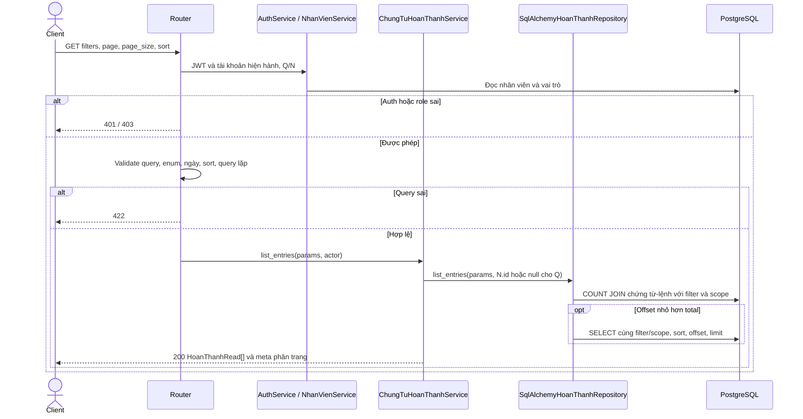

Phạm vi N lọc đồng thời chủ chứng từ và người đang được giao lệnh, trước COUNT/page.
Filter `q` tìm mã bằng ILIKE escape; thêm `lenh_san_xuat_id`, `mat_hang_id`,
`nhan_vien_id`, `trang_thai`, `tu_ngay`, `den_ngay`. Ngày theo `finish_time`,
Asia/Ho_Chi_Minh, đổi thành khoảng UTC nửa mở gồm ngày cuối bằng PostgreSQL timezone.
NULL không khớp filter ngày; không có filter vẫn đọc NULL. Sort mặc định `-id`,
whitelist `id`, `finish_time`, `ma_phieu` và chiều ngược; NULLS LAST, ID phụ tăng dần.
Q/N cùng projection. COUNT/SELECT là hai statement, có thể lệch total/page khi có
tạo/xóa đồng thời. Không ETag danh sách, audit hay ledger.

## GET /api/v1/chung_tu_hoan_thanh_sx/{id}

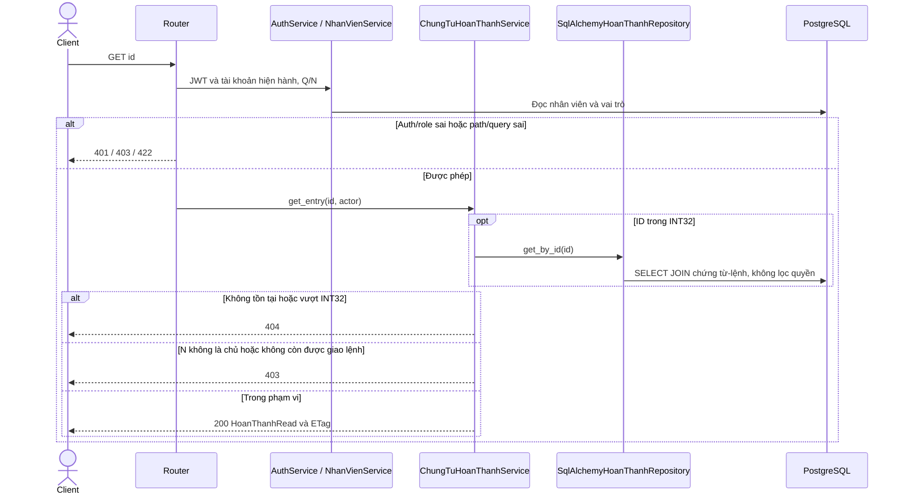

`finish_time=NULL` lịch sử vẫn đọc được; mặt hàng inactive vẫn đọc được.

## POST /api/v1/chung_tu_hoan_thanh_sx

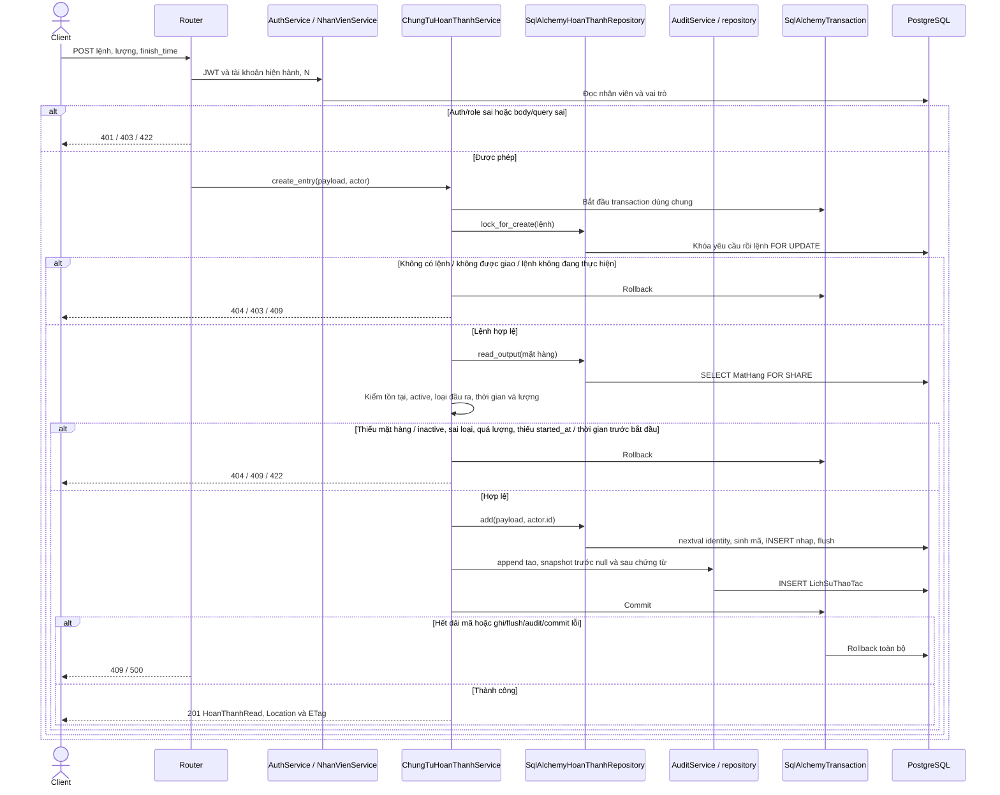

Mã `HTSX-YYYYMM-NNNNNN` dùng identity, tháng Asia/Ho_Chi_Minh; hậu tố không reset,
không tái sử dụng ID, có thể có khoảng trống; vượt 999999 trả 409.
Nháp có thể khai thời gian tương lai, nhưng không trước `started_at`.
Mỗi đợt không vượt lượng lệnh; nhiều nháp cùng lệnh không giữ chỗ lượng hoặc tồn.

## PATCH /api/v1/chung_tu_hoan_thanh_sx/{id}

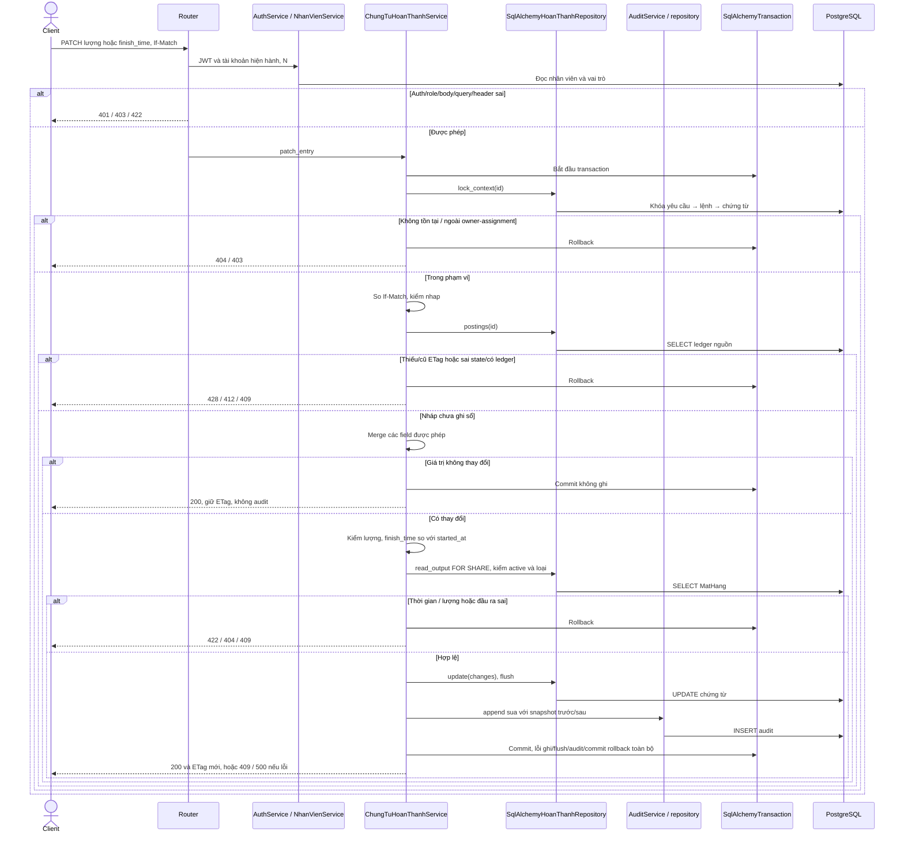

PATCH rỗng hoặc explicit null trả 422. Không yêu cầu lệnh đang thực hiện; không mở lại lệnh.

## DELETE /api/v1/chung_tu_hoan_thanh_sx/{id}

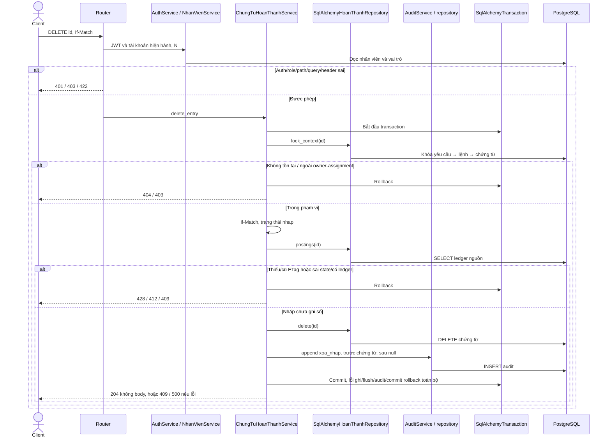

Không yêu cầu lệnh đang thực hiện; không xóa ledger hoặc hoàn tồn.

## POST /api/v1/chung_tu_hoan_thanh_sx/{id}/gui

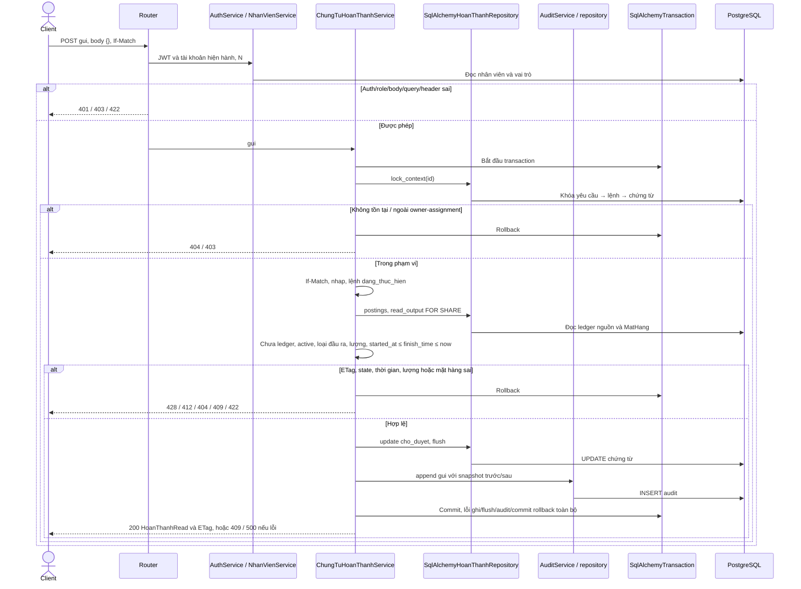

Thiếu `finish_time`/`started_at` trả 409; trước bắt đầu hoặc tương lai trả 422.
Gửi không ghi kho, không kiểm giữ chỗ giữa các nháp.

## POST /api/v1/chung_tu_hoan_thanh_sx/{id}/duyet

```mermaid
sequenceDiagram
    actor C as Client
    participant R as Router
    participant A as AuthService / NhanVienService
    participant S as ChungTuHoanThanhService
    participant P as SqlAlchemyHoanThanhRepository
    participant U as AuditService / repository
    participant T as SqlAlchemyTransaction
    participant D as PostgreSQL
    C->>R: POST duyet, body {}, If-Match
    R->>A: JWT và tài khoản hiện hành, Q
    A->>D: Đọc nhân viên và vai trò
    alt Auth/role/body/query/header sai
        R-->>C: 401 / 403 / 422
    else Được phép
        R->>S: duyet
        S->>T: Bắt đầu transaction
        S->>P: lock_context(id)
        P->>D: Khóa yêu cầu → lệnh → chứng từ
        alt Không tồn tại hoặc thiếu/blank If-Match
            S->>T: Rollback
            S-->>C: 404 / 428
        else Có header
            S->>P: postings(id)
            P->>D: SELECT ledger nguồn
            alt Chứng từ da_duyet
                S->>S: Đúng 1 ledger, khớp nguồn, mặt hàng, loại và lượng dương
                alt Thiếu hoặc sai ledger
                    S->>T: Rollback
                    S-->>C: 409, không tự sửa sổ
                else Khớp
                    S->>T: Commit không ghi
                    S-->>C: 200 ActionRead, replay true, ledger cũ và ETag hiện tại
                end
            else Chưa duyệt
                S->>S: So If-Match, cho_duyet, chưa ledger, lệnh đang thực hiện, thời gian
                alt ETag/state/thời gian sai
                    S->>T: Rollback
                    S-->>C: 412 / 409 / 422
                else Hợp lệ
                    S->>P: lock_output(mặt hàng)
                    P->>D: MatHang FOR UPDATE rồi SUM ledger mặt hàng
                    S->>S: Active, loại đầu ra, balance bằng ledger, không tràn INT32
                    S->>P: approved_quantity, material_quantities
                    P->>D: SUM lượng chứng từ da_duyet của lệnh
                    P->>D: Nhu cầu ChiTietLenhSanXuat, SUM ledger xuất vật tư đã duyệt
                    S->>S: Tổng không vượt lượng lệnh, đủ vật tư trực tiếp cả lệnh
                    alt Thiếu mặt hàng hoặc điều kiện đầu ra/vật tư/tổng sai
                        S->>T: Rollback
                        S-->>C: 404 / 409
                    else Cho phép ghi sổ
                        S->>P: update da_duyet và flush
                        P->>D: UPDATE trạng thái trước INSERT ledger
                        S->>P: post_output(actor Q, UTC now)
                        P->>D: Cộng tồn, cập nhật ton_kho_updated_at
                        P->>D: INSERT ledger nhap_san_pham_san_xuat dương
                        opt Tổng đã duyệt bằng lượng lệnh
                            S->>P: complete_order(now)
                            P->>D: Đọc snapshot lệnh trước/sau, UPDATE hoan_thanh và completed_at
                            S->>U: append lenh_san_xuat/hoan_tat trước/sau
                            U->>D: INSERT audit lệnh
                        end
                        S->>U: append chứng từ/duyet trước/sau
                        U->>D: INSERT audit chứng từ
                        S->>T: Commit
                        alt Ghi/flush/audit/commit lỗi
                            T->>D: Rollback state, stock, ledger, lệnh, audit
                            R-->>C: 409 constraint / 500
                        else Thành công
                            S-->>C: 200 ActionRead, replay false, ledger mới và ETag
                        end
                    end
                end
            end
        end
    end
```

Ledger và audit ghi ID Q; chủ chứng từ giữ nguyên N. Không trừ vật tư lần hai,
không đọc BOM hiện hành. Dùng nhu cầu đã đóng băng và ledger phiếu `xuat_vat_tu`
`da_duyet`; kiểm đủ toàn bộ nhu cầu cả lệnh. Quá lượng trả 409
`vuot_so_luong_hoan_thanh`; thiếu vật tư trả 409 `chua_du_vat_tu_da_cap`.
Khóa lệnh tuần tự hóa các đợt cùng lệnh; khóa output bảo vệ số dư giữa các lệnh.
Retry đúng không thêm audit/ledger/tồn và không yêu cầu lệnh vẫn đang thực hiện.
`completed_at` theo thời điểm duyệt cuối; `finish_time` vẫn là thời điểm N khai báo.
Không tự hoàn thành yêu cầu: yêu cầu hoàn thành theo thành phẩm đã xuất.

## POST /api/v1/chung_tu_hoan_thanh_sx/{id}/tu_choi

```mermaid
sequenceDiagram
    actor C as Client
    participant R as Router
    participant A as AuthService / NhanVienService
    participant S as ChungTuHoanThanhService
    participant P as SqlAlchemyHoanThanhRepository
    participant U as AuditService / repository
    participant T as SqlAlchemyTransaction
    participant D as PostgreSQL
    C->>R: POST tu_choi, ly_do, If-Match
    R->>A: JWT và tài khoản hiện hành, Q
    A->>D: Đọc nhân viên và vai trò
    alt Auth/role/body/query/header sai
        R-->>C: 401 / 403 / 422
    else Được phép
        R->>S: tu_choi, kiểm lý do
        S->>T: Bắt đầu transaction
        S->>P: lock_context(id)
        P->>D: Khóa yêu cầu → lệnh → chứng từ
        alt Không tồn tại
            S->>T: Rollback
            S-->>C: 404
        else Tồn tại
            S->>S: If-Match, cho_duyet
            S->>P: postings(id)
            P->>D: SELECT ledger nguồn
            alt Thiếu/cũ ETag hoặc sai state/có ledger
                S->>T: Rollback
                S-->>C: 428 / 412 / 409
            else Hợp lệ
                S->>P: update tu_choi, flush
                P->>D: UPDATE chứng từ
                S->>U: append tu_choi, lý do và snapshot trước/sau
                U->>D: INSERT audit
                S->>T: Commit, lỗi ghi/flush/audit/commit rollback toàn bộ
                S-->>C: 200 HoanThanhRead và ETag, hoặc 409 / 500 nếu lỗi
            end
        end
    end
```

Không yêu cầu lệnh đang thực hiện, không ghi kho hoặc hoàn vật tư đã xuất.

## POST /api/v1/chung_tu_hoan_thanh_sx/{id}/ve_nhap

```mermaid
sequenceDiagram
    actor C as Client
    participant R as Router
    participant A as AuthService / NhanVienService
    participant S as ChungTuHoanThanhService
    participant P as SqlAlchemyHoanThanhRepository
    participant U as AuditService / repository
    participant T as SqlAlchemyTransaction
    participant D as PostgreSQL
    C->>R: POST ve_nhap, ly_do, If-Match
    R->>A: JWT và tài khoản hiện hành, N
    A->>D: Đọc nhân viên và vai trò
    alt Auth/role/body/query/header sai
        R-->>C: 401 / 403 / 422
    else Được phép
        R->>S: ve_nhap, kiểm lý do
        S->>T: Bắt đầu transaction
        S->>P: lock_context(id)
        P->>D: Khóa yêu cầu → lệnh → chứng từ
        alt Không tồn tại / ngoài owner-assignment
            S->>T: Rollback
            S-->>C: 404 / 403
        else Trong phạm vi
            S->>S: If-Match, tu_choi
            S->>P: postings(id)
            P->>D: SELECT ledger nguồn
            alt Thiếu/cũ ETag hoặc sai state/có ledger
                S->>T: Rollback
                S-->>C: 428 / 412 / 409
            else Hợp lệ
                S->>P: update nhap, flush
                P->>D: UPDATE chứng từ
                S->>U: append ve_nhap, lý do và snapshot trước/sau
                U->>D: INSERT audit
                S->>T: Commit, lỗi ghi/flush/audit/commit rollback toàn bộ
                S-->>C: 200 HoanThanhRead và ETag, hoặc 409 / 500 nếu lỗi
            end
        end
    end
```

Không ghi kho, không tự mở lại lệnh. Gửi lại vẫn phải đáp ứng điều kiện lệnh,
mặt hàng, lượng và thời gian. Mã audit đối tượng là
`chung_tu_hoan_thanh_san_xuat`, khác hậu tố `_sx` trên URL.

### Giới hạn kiểm chứng của phần hoàn thành

Các sơ đồ được đối chiếu router, schema, service, repository, dependency và bootstrap.
Chưa render/kiểm cú pháp bằng Mermaid. Theo yêu cầu dev, không tiếp tục kiểm thử DB
riêng; chưa xác nhận tính atomic và xử lý đồng thời bằng PostgreSQL thực tế.
API giao/gửi/bắt đầu lệnh: xem mục *Lệnh sản xuất* ở trên.
