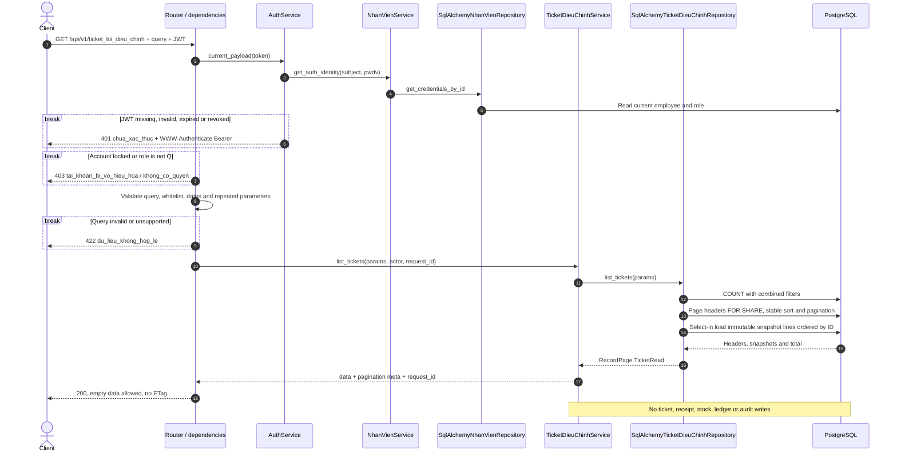
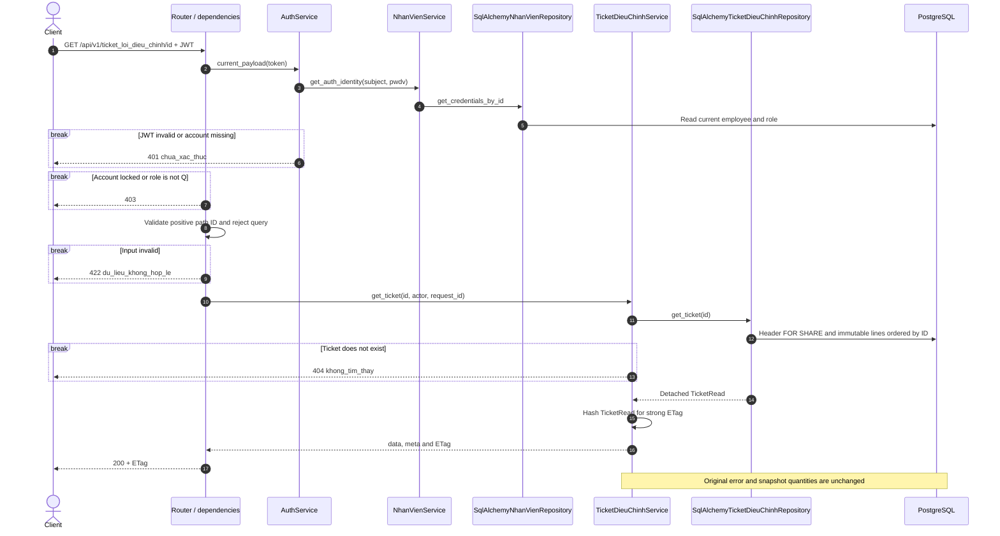
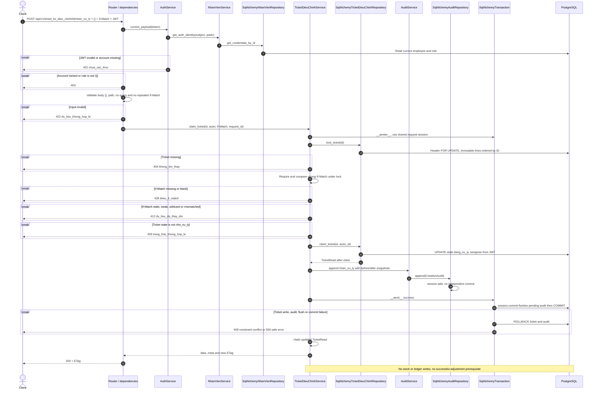
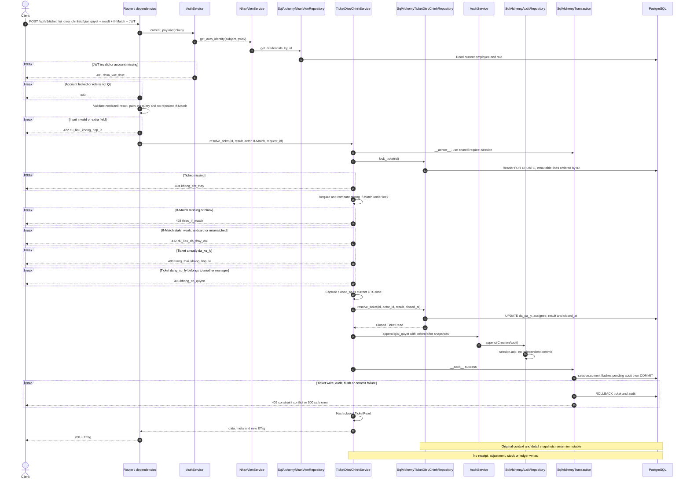

# Luồng API ticket lỗi điều chỉnh — contract v3

## Ảnh PNG cho từng endpoint

| Endpoint | Ảnh sequence |
|---|---|
| GET `/api/v1/ticket_loi_dieu_chinh` | [01 — Danh sách](assets/ticket_dieu_chinh/01-danh-sach.png) |
| GET `/api/v1/ticket_loi_dieu_chinh/{id}` | [02 — Chi tiết](assets/ticket_dieu_chinh/02-chi-tiet.png) |
| POST `/api/v1/ticket_loi_dieu_chinh/{id}/nhan_xu_ly` | [03 — Nhận xử lý](assets/ticket_dieu_chinh/03-nhan-xu-ly.png) |
| POST `/api/v1/ticket_loi_dieu_chinh/{id}/giai_quyet` | [04 — Giải quyết](assets/ticket_dieu_chinh/04-giai-quyet.png) |

Module `backend/app/modules/ticket_dieu_chinh/` triển khai bốn endpoint dưới tiền tố `/api/v1/ticket_loi_dieu_chinh`, theo `docs/api_contract_v3.md` §2, §3, §12.2, §14 và bảng `"TicketLoiDieuChinh"`, `"ChiTietTicketLoiDieuChinh"` trong `infra/postgres/init.sql`.

## Quy ước đang triển khai

- Chỉ Q (`quan_ly`) được gọi cả bốn endpoint. A và N nhận 403. Mỗi request xác minh JWT, phiên bản mật khẩu, trạng thái tài khoản và vai trò hiện tại trong DB thông qua AuthService → NhanVienService → SqlAlchemyNhanVienRepository.
- Response thành công `{data, meta: {request_id}}`; danh sách thêm page, page_size, total, total_pages vào meta. Lỗi `{error: {code, message, details}, meta: {request_id}}`; 401 có `WWW-Authenticate: Bearer`. Validation 422 không echo input nhạy cảm.
- TicketRead gồm header, người tạo/người xử lý, thời gian và các dòng snapshot. Dòng chi tiết sắp theo ID; trường số lượng là integer, `so_luong_bien_dong` có thể âm. Các timestamp trả UTC có `Z`. Không có trường tiền, giao dịch kho hoặc cờ ghi sổ trong response ticket.
- GET chi tiết và hai action trả strong ETag trên toàn bộ TicketRead, gồm trạng thái, người xử lý, kết quả, thời gian đóng và snapshot chi tiết. `request_id` không tham gia ETag.
- Hai action yêu cầu If-Match. Sau khi khóa và đọc resource, kiểm tra header và ETag trước điều kiện trạng thái/người xử lý. Thiếu/rỗng trả 428; stale, weak, wildcard hoặc không khớp trả 412. Header lặp trả 422. Ticket không thuộc nhóm action ghi sổ cho retry bỏ qua ETag: không có nhánh idempotent trả kết quả cũ khi header stale.
- `nhan_xu_ly` chỉ từ `cho_xu_ly` sang `dang_xu_ly`, người xử lý lấy từ JWT. `giai_quyet` đóng trực tiếp từ `cho_xu_ly`, hoặc từ `dang_xu_ly` nếu người gọi chính là người đã nhận. Khi đóng từ `cho_xu_ly`, người đóng trở thành người xử lý. Ticket đã `da_xu_ly` không sửa, đóng lại hoặc mở lại.
- Bối cảnh gốc và chi tiết snapshot bất biến. Không có endpoint tạo, PATCH, DELETE hoặc mở lại ticket. Việc hệ thống tạo ticket khi xác nhận điều chỉnh thất bại thuộc luồng phiếu điều chỉnh, ngoài phạm vi bốn endpoint này.
- Nhận xử lý/đóng ticket chỉ cập nhật header cho phép và audit. Không đọc điều kiện thành công của phiếu điều chỉnh mới, không cập nhật phiếu nhập, tồn kho, ledger hoặc tiến độ.
- GET giữ khóa FOR SHARE trên header; SQLAlchemy select-in load các dòng snapshot bất biến theo ID. Danh sách COUNT trước, sau đó truy vấn trang header và nạp chi tiết; tổng có thể thay đổi giữa các truy vấn nếu hệ thống tạo ticket đồng thời. GET không ghi trạng thái hoặc audit.
- Action giữ khóa FOR UPDATE trên header đến hết transaction, rồi đọc snapshot chi tiết. So sánh ETag và ghi dưới cùng khóa. Hai quản lý cùng nhận/đóng với một ETag: một request thành công, request còn lại đọc phiên bản mới và nhận 412.
- Luồng audit là TicketDieuChinhService → AuditService.append → SqlAlchemyAuditRepository.append. Repository audit chỉ session.add; SqlAlchemyTransaction.__aexit__ gọi session.commit, flush pending audit rồi COMMIT. Ticket và audit dùng chung session/transaction, bất kỳ lỗi ghi/flush/commit nào đều rollback cả hai. Các dependency của FastAPI có thể được giải quyết xen kẽ với validation trước handler.

## GET /api/v1/ticket_loi_dieu_chinh

Q đọc toàn bộ ticket. Query: `page` mặc định 1, `page_size` mặc định 20 (tối đa 100), `trang_thai`, `phieu_nhap_id`, `nguoi_tao_id`, `nguoi_xu_ly_id`, `tu_ngay`, `den_ngay`, `sort`. Sort cho phép `id`, `created_at`, `ma_ticket` và dạng giảm dần với tiền tố `-`; ID là tiêu chí phụ. Không có `q`, `search`, `sort_by` hoặc `sort_order`. Ngày lọc theo `created_at`, lấy cả hai đầu ngày Asia/Ho_Chi_Minh bằng khoảng UTC nửa mở. Query lặp, trường lạ, sort/enum/ngày không hợp lệ trả 422. Danh sách rỗng trả 200, không trả ETag.

## GET /api/v1/ticket_loi_dieu_chinh/{id}

Q đọc được ticket ở cả ba trạng thái. Không nhận query. ID path phải là integer dương; không tồn tại trả 404. Response chứa snapshot của sự việc thất bại, không tính lại số lượng hoặc tồn hiện tại.

## POST /api/v1/ticket_loi_dieu_chinh/{id}/nhan_xu_ly

Chỉ Q; body JSON object rỗng `{}` bắt buộc. Chỉ nhận ticket đang `cho_xu_ly`. Người nhận lấy từ JWT đã xác minh, client không được gửi người xử lý hoặc trạng thái. Thành công trả TicketRead ở `dang_xu_ly`, ETag mới và audit `nhan_xu_ly`.

## POST /api/v1/ticket_loi_dieu_chinh/{id}/giai_quyet

Chỉ Q; body bắt buộc `{ket_qua_xu_ly: string}`, trim không rỗng, cấm trường lạ. Đóng trực tiếp ticket `cho_xu_ly` hoặc ticket `dang_xu_ly` đã được chính người gọi nhận. Người xử lý là người đóng lấy từ JWT; ghi kết quả và `closed_at`, audit `giai_quyet`. Không mở lại ticket đã đóng và không yêu cầu điều chỉnh mới thành công.

