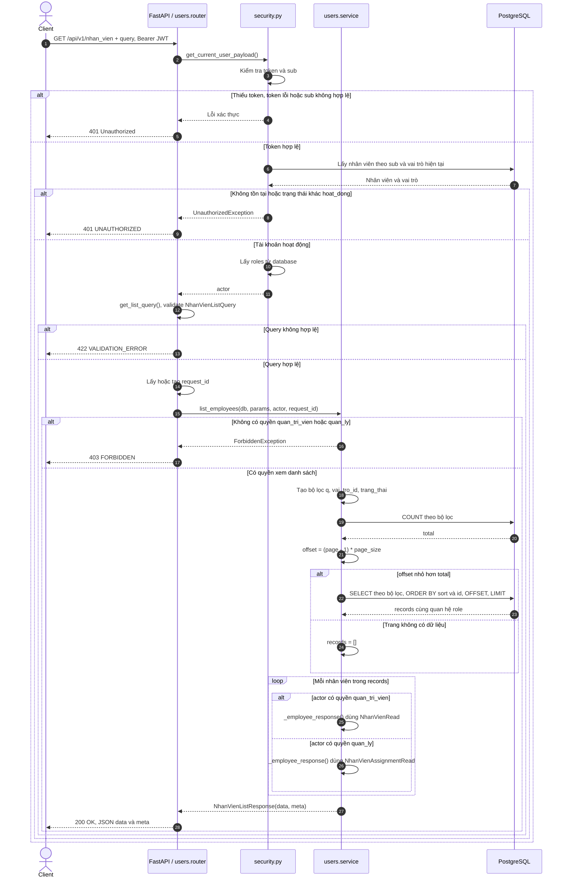
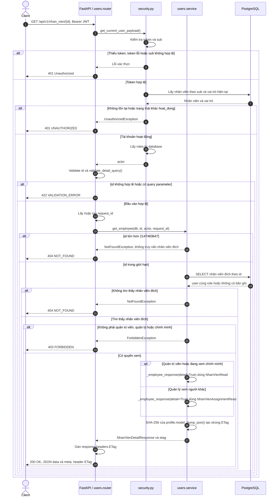

# Sequence diagram — users

Nguồn triển khai: `backend/app/modules/users/{router,service,schemas,models}.py`,
`backend/app/core/security.py`, `backend/app/core/exceptions.py` và `backend/app/main.py`.
Đối chiếu quyền truy cập với `api-contract-v2.md` trên Google Drive của project.

Các sơ đồ gom thao tác SQLAlchemy và tải quan hệ `User.role` (`lazy="selectin"`)
vào lời gọi database tương ứng. FastAPI cung cấp `AsyncSession` qua `get_db`.
Các nhánh validation mô tả kết quả khi xác thực thành công; không quy định thứ tự
ưu tiên lỗi nếu request đồng thời sai xác thực và đầu vào.

## GET /api/v1/nhan_vien — Lấy danh sách nhân viên

Query: `page` (mặc định 1, tối thiểu 1), `page_size` (mặc định 20, từ 1 đến 100),
`q`, `vai_tro_id` (số nguyên dương), `trang_thai` (`hoat_dong | bi_khoa`), `sort`
(mặc định `id`; hỗ trợ `id`, `ma_nhan_vien`, `ho_ten`, `ten_dang_nhap`, thêm `-` để giảm dần).
`q` tìm không phân biệt hoa thường theo mã nhân viên hoặc họ tên, escape ký tự wildcard.
Query lặp hoặc tham số không được khai báo bị từ chối.

- `meta`: `request_id`, `page`, `page_size`, `total`, `total_pages = ceil(total / page_size)`.
- Trang vượt kết quả trả `200` với `data: []`; không trả `404`. Khi `total = 0`, `total_pages = 0`.
- `vai_tro_id` lớn hơn số nguyên signed 32-bit được chuyển thành điều kiện không khớp bản ghi.
- Quản trị viên nhận `NhanVienRead`; quản lý chỉ nhận `NhanVienAssignmentRead`:
  `id`, `ma_nhan_vien`, `ho_ten`, `vai_tro_id`, `ma_vai_tro`, `trang_thai`.
- Không trả `mat_khau` hoặc `tai_khoan_id`.

## GET /api/v1/nhan_vien/{id} — Lấy chi tiết nhân viên

`id` phải là số nguyên dương. Endpoint không nhận bất kỳ query parameter nào.
Quản trị viên và quản lý được xem nhân viên khác; nhân viên thông thường chỉ được xem chính mình.

- `meta` chỉ chứa `request_id`. ETag có dấu ngoặc kép, được tính từ hồ sơ trả về,
  không bao gồm `meta`, nên không đổi chỉ vì `request_id` thay đổi.
- Code hiện tại trả `200` kèm ETag; chưa xử lý `If-None-Match` để trả `304`.
- Kiểm tra tồn tại nhân viên đích diễn ra trước kiểm tra quyền xem: ID không tồn tại trả `404`,
  nhân viên tồn tại nhưng ngoài quyền truy cập trả `403`.
- `NhanVienRead` gồm các trường của `NhanVienAssignmentRead` và `ten_dang_nhap`,
  `ngay_sinh`, `so_dien_thoai`, `email`, `ngay_vao_lam`, `he_so_luong`.
  Không trả mật khẩu hoặc `tai_khoan_id`.
