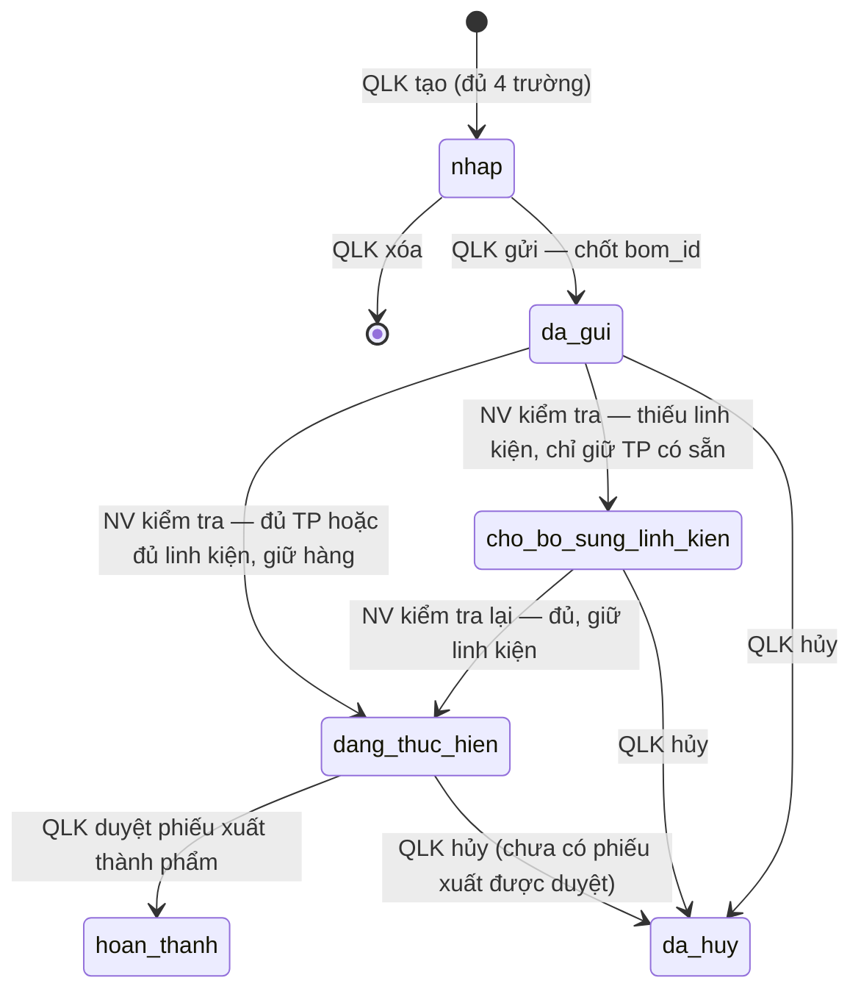
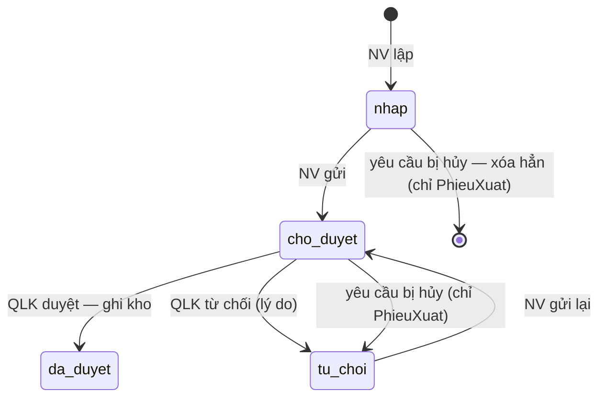

# xBike MRP v4.0 — Data model theo BR/UC giai đoạn 1

Ngày lập: 13/11/2026. Trạng thái: **đã chốt 11 quyết định ngày 13/11/2026 (mục 6)**. Chưa sửa `infra/postgres/init.sql`, ORM hay seed.

## Nguồn đã đọc

| Nguồn | Vị trí |
|---|---|
| BR giai đoạn 1 (BR-001 … BR-016) | `specs/business_requirements/BR-GIAIDOAN1.md` |
| 44 use-case (UC-01 … UC-44) | `specs/use_cases/{context}/UC-xx.md` |
| Data model cũ v3.1 | Drive `sgu-httt-source-of-true/xbike_mrp_data_model_v3.1_mermaid.md` |
| Schema đang chạy | `infra/postgres/init.sql` (đúng v3.1 + `VaiTro.mo_ta`, `LuuLuongTruyCap`) |

## Quy ước

- Tên bảng PascalCase, tên cột snake_case (AGENTS.md §9). Khóa chính `id INT GENERATED BY DEFAULT AS IDENTITY`, trừ bảng danh mục hành chính.
- Tiền là VND, kiểu `bigint` (BR-015). Thời điểm là `timestamptz`; kỳ báo cáo quy về `Asia/Ho_Chi_Minh` (BR-014).
- Mã trạng thái/loại dùng "linh kiện" cho khớp BR (chốt 13/11/2026): `cho_bo_sung_vat_tu` → `cho_bo_sung_linh_kien`, `xuat_vat_tu` → `xuat_linh_kien`, `nhap_vat_tu` → `nhap_linh_kien`. Backend, frontend và seed đang dùng mã cũ phải đổi theo.
- `phien_ban int NOT NULL DEFAULT 1` trên chứng từ là khóa lạc quan: mỗi lần ghi tăng 1; hộp xác nhận gửi kèm giá trị đã đọc, lệch thì báo "chứng từ đã bị thay đổi, xem lại" (BR-015).
- Ký hiệu Mermaid: `PK`, `FK`, `UK`; `||` đúng một, `|o` không hoặc một, `o{` không hoặc nhiều. Nhãn quan hệ là cột FK ở bảng con.

## 1. Thay đổi so với v3.1

### 1.1. Bỏ bảng

| Bảng v3.1 | Lý do |
|---|---|
| `LenhSanXuat`, `ChiTietLenhSanXuat` | BR-007, UC-23 R3: yêu cầu sản xuất kiêm lệnh sản xuất, không có lệnh riêng. BR-005: công thức một cấp nên không cần lệnh cha/con. Nhu cầu linh kiện chuyển sang `NhuCauLinhKien`. |
| `PhieuDieuChinhKho`, `ChiTietPhieuDieuChinhKho` | BR-006 Out of Scope: "Phiếu điều chỉnh số lượng sau khi hoàn tất". BR-014 Out of Scope: "Cột điều chỉnh tồn". |
| `TicketLoiDieuChinh`, `ChiTietTicketLoiDieuChinh` | Gắn với luồng điều chỉnh đã bỏ; không có BR/UC nào dùng. |

### 1.2. Thêm bảng

| Bảng mới | Nguồn | Vai trò |
|---|---|---|
| `NhuCauLinhKien` | BR-008, UC-26 R3–R4, UC-34 R3 | Nhu cầu linh kiện đã chốt ở lần kiểm tra đầu của một yêu cầu. |
| `GiuHang` | BR-004, BR-008, BR-011, BR-013, UC-09 R6, UC-26, UC-28 | Phần hàng đang giữ cho từng yêu cầu; nguồn của "đang giữ" và "còn dùng được". |

### 1.3. Sửa bảng

| Bảng | Thay đổi | Nguồn |
|---|---|---|
| `NhanVien` | + `phien_ban_dang_nhap` (kết thúc mọi phiên khi khóa, đổi vai trò, đổi mật khẩu); + `created_at` | BR-001, BR-002, UC-05 R4, UC-07 R5, UC-08 R6 |
| `NhaCungCap` | `ten_ncc`, `so_dien_thoai`, `dia_chi`, `phuong`, `tinh` → NOT NULL; `dia_chi`, `phuong`, `tinh` là thuộc tính văn bản nhập tay của NCC (không tách bảng danh mục, không kiểm tra); sửa được trừ `ma_ncc`; + `created_at` | BR-004, UC-14 R1–R3, UC-44 |
| `MatHang` | `loai_mat_hang` chỉ còn `thanh_pham`, `linh_kien`; `is_active` chỉ được `false` với thành phẩm; + `so_luong_dang_giu`, + cột sinh `so_luong_con_dung`; + `created_at` | BR-004, UC-09 R6, UC-12 R1 |
| `Bom` | Bỏ `start_time`/`end_time`; + `created_at`, + `kich_hoat_gan_nhat_at` để tìm "phiên bản đang dùng gần nhất" | BR-005, UC-12 R5, UC-18 |
| `PhieuNhap` | `tong_tien` → bigint; + `updated_at`, `hoan_thanh_at`, `nguoi_hoan_thanh_id`, `phien_ban` | BR-006, BR-015, UC-21 |
| `ChiTietPhieuNhap` | `don_gia_thuc`, `tong_gia` → bigint NOT NULL | BR-006 "đơn giá nhập thực tế", BR-015 |
| `YeuCauSanXuat` | + `han_hoan_thanh`, `bom_id` (chốt khi gửi), `so_luong_dung_thanh_pham`, `so_luong_can_san_xuat`, các mốc thời gian, thông tin hủy, `phien_ban`; `nhan_vien_duoc_giao_id` → NOT NULL; trạng thái `cho_bo_sung_vat_tu` → `cho_bo_sung_linh_kien` | BR-005, BR-007, BR-008, BR-011, BR-013, UC-23 R2 |
| `PhieuXuat` | `yeu_cau_san_xuat_id` → NOT NULL; bỏ `lenh_san_xuat_id`; `loai_phieu` `xuat_vat_tu` → `xuat_linh_kien`; + `gui_at`, `nguoi_xu_ly_id`, `xu_ly_at`, `ly_do_tu_choi`, `updated_at`, `phien_ban` | BR-010, BR-012, BR-013, UC-28 R4 |
| `ChiTietPhieuXuat` | Giá xuất chỉ ghi lúc duyệt | BR-010, UC-35 R2 |
| `ChungTuHoanThanhSx` | `lenh_san_xuat_id` → `yeu_cau_san_xuat_id` UNIQUE; + `nguoi_xu_ly_id`, `xu_ly_at`, `ly_do_tu_choi`, `updated_at`, `phien_ban` | BR-011, UC-30 – UC-32 |
| `GiaoDichKho` | Bỏ `chi_tiet_phieu_dieu_chinh_id` và loại `dieu_chinh_ton_kho`; đổi mã loại sang `nhap_linh_kien`, `xuat_linh_kien`; + `so_luong_ton_sau` | BR-014, UC-41, UC-42 |
| `LichSuThaoTac` | Cập nhật danh mục đối tượng/thao tác; + `trang_thai_truoc`, `trang_thai_sau`; bắt buộc lý do cho từ chối, hủy | BR-016, UC-43 |

Giữ nguyên: `VaiTro`, `ChiTietBom`, `LuuLuongTruyCap` (bảng kỹ thuật, ngoài BR).

Tổng: v3.1 có 20 bảng (init.sql có thêm `LuuLuongTruyCap`) → v4.0 có **17 bảng**.

## 2. Sơ đồ ERD đầy đủ

```mermaid
erDiagram
  direction TB
  VaiTro {
    int id PK "IDENTITY"
    varchar ma_vai_tro UK "NOT NULL; quan_tri_vien | quan_ly | nhan_vien"
    varchar ten_vai_tro "NOT NULL"
    varchar mo_ta "SQL: varchar(255); NULL"
  }
  NhanVien {
    int id PK "IDENTITY"
    int vai_tro_id FK "NOT NULL"
    varchar ten_dang_nhap UK "NOT NULL"
    varchar mat_khau "NOT NULL; hash"
    varchar ma_nhan_vien UK "NOT NULL; NV-xxxxxx"
    varchar ho_ten "NULL"
    date ngay_sinh "NULL"
    varchar so_dien_thoai "NULL"
    varchar email "NULL"
    date ngay_vao_lam "NULL"
    decimal he_so_luong "SQL: decimal(5,2); NULL"
    varchar trang_thai "NOT NULL; DEFAULT hoat_dong"
    int phien_ban_dang_nhap "NOT NULL; DEFAULT 0; MOI"
    timestamptz created_at "NOT NULL; DEFAULT now(); MOI"
  }
  NhaCungCap {
    int id PK "IDENTITY"
    varchar ma_ncc UK "NOT NULL; NCC-xxxxxx; he thong cap"
    varchar ten_ncc "NOT NULL; SUA"
    varchar so_dien_thoai "NOT NULL; SUA"
    varchar dia_chi "NOT NULL; so nha, duong; SUA"
    varchar phuong "NOT NULL; SUA"
    varchar tinh "NOT NULL; SUA"
    timestamptz created_at "NOT NULL; DEFAULT now(); MOI"
  }
  MatHang {
    int id PK "IDENTITY"
    varchar ma_mat_hang UK "NOT NULL; MH-xxxxxx; he thong cap"
    varchar ten_mat_hang "NOT NULL"
    varchar sku UK "NOT NULL"
    varchar loai_mat_hang "NOT NULL; thanh_pham | linh_kien"
    varchar don_vi_tinh "NOT NULL"
    varchar mau_sac "NULL"
    varchar mo_ta "NULL"
    bigint don_gia "NOT NULL; VND"
    bool is_active "NOT NULL; DEFAULT true"
    int so_luong_ton "NOT NULL; DEFAULT 0"
    int so_luong_dang_giu "NOT NULL; DEFAULT 0; MOI"
    int so_luong_con_dung "GENERATED ton - dang_giu; MOI"
    timestamptz ton_kho_updated_at "NULL"
    timestamptz created_at "NOT NULL; DEFAULT now(); MOI"
  }
  Bom {
    int id PK "IDENTITY"
    int mat_hang_id FK "NOT NULL; thanh pham"
    int version "NOT NULL"
    bool is_active "NOT NULL; DEFAULT true"
    timestamptz created_at "NOT NULL; DEFAULT now(); MOI"
    timestamptz kich_hoat_gan_nhat_at "NOT NULL; MOI"
  }
  ChiTietBom {
    int id PK "IDENTITY"
    int bom_id FK "NOT NULL"
    int mat_hang_id FK "NOT NULL; linh kien"
    int so_luong "NOT NULL; dinh muc 1 xe"
  }
  PhieuNhap {
    int id PK "IDENTITY"
    varchar ma_phieu_nhap UK "NOT NULL; PN-YYYYMM-xxxxxx"
    int nhan_vien_id FK "NOT NULL; nguoi lap"
    int ncc_id FK "NOT NULL"
    date ngay_nhap "NOT NULL"
    text ghi_chu "NULL"
    bigint tong_tien "NULL; SUA"
    varchar trang_thai "NOT NULL; DEFAULT nhap"
    timestamptz created_at "NOT NULL; DEFAULT now()"
    timestamptz updated_at "NOT NULL; DEFAULT now(); MOI"
    timestamptz hoan_thanh_at "NULL; MOI"
    int nguoi_hoan_thanh_id FK "NULL; MOI"
    int phien_ban "NOT NULL; DEFAULT 1; MOI"
  }
  ChiTietPhieuNhap {
    int id PK "IDENTITY"
    int phieu_nhap_id FK "NOT NULL"
    int mat_hang_id FK "NOT NULL; linh kien"
    int so_luong "NOT NULL"
    bigint don_gia_thuc "NOT NULL; SUA"
    bigint tong_gia "NOT NULL; SUA"
  }
  YeuCauSanXuat {
    int id PK "IDENTITY"
    varchar ma_yeu_cau_san_xuat UK "NOT NULL; YCSX-YYYYMM-xxxxxx"
    int mat_hang_id FK "NOT NULL; thanh pham"
    int so_luong "NOT NULL"
    date han_hoan_thanh "NOT NULL; MOI"
    int nhan_vien_id FK "NOT NULL; QLK lap"
    int nhan_vien_duoc_giao_id FK "NOT NULL; SUA"
    int bom_id FK "NULL; chot khi gui; MOI"
    varchar trang_thai "NOT NULL; DEFAULT nhap"
    int so_luong_dung_thanh_pham "NULL; MOI"
    int so_luong_can_san_xuat "NULL; MOI"
    timestamptz created_at "NOT NULL; DEFAULT now()"
    timestamptz updated_at "NOT NULL; DEFAULT now(); MOI"
    timestamptz gui_at "NULL; MOI"
    timestamptz kiem_tra_lan_dau_at "NULL; MOI"
    timestamptz started_at "NULL; MOI"
    timestamptz completed_at "NULL"
    timestamptz huy_at "NULL; MOI"
    int nguoi_huy_id FK "NULL; MOI"
    text ly_do_huy "NULL; MOI"
    int phien_ban "NOT NULL; DEFAULT 1; MOI"
  }
  NhuCauLinhKien {
    int id PK "IDENTITY; MOI"
    int yeu_cau_san_xuat_id FK "NOT NULL"
    int mat_hang_id FK "NOT NULL; linh kien"
    int so_luong_can "NOT NULL"
  }
  GiuHang {
    int id PK "IDENTITY; MOI"
    int yeu_cau_san_xuat_id FK "NOT NULL"
    int mat_hang_id FK "NOT NULL"
    varchar loai_giu "NOT NULL"
    int so_luong "NOT NULL"
    varchar trang_thai "NOT NULL; DEFAULT dang_giu"
    int chung_tu_hoan_thanh_sx_id FK "NULL"
    int phieu_xuat_id FK "NULL"
    timestamptz created_at "NOT NULL; DEFAULT now()"
    timestamptz ket_thuc_at "NULL"
  }
  PhieuXuat {
    int id PK "IDENTITY"
    varchar ma_phieu_xuat UK "NOT NULL; PX-YYYYMM-xxxxxx"
    int nhan_vien_id FK "NOT NULL; NV lap"
    varchar loai_phieu "NOT NULL; xuat_linh_kien | xuat_thanh_pham"
    int yeu_cau_san_xuat_id FK "NOT NULL; SUA"
    bigint tong_tien "NULL; ghi khi duyet"
    varchar trang_thai "NOT NULL; DEFAULT nhap"
    timestamptz created_at "NOT NULL; DEFAULT now()"
    timestamptz updated_at "NOT NULL; DEFAULT now(); MOI"
    timestamptz gui_at "NULL; MOI"
    int nguoi_xu_ly_id FK "NULL; MOI"
    timestamptz xu_ly_at "NULL; MOI"
    text ly_do_tu_choi "NULL; MOI"
    int phien_ban "NOT NULL; DEFAULT 1; MOI"
  }
  ChiTietPhieuXuat {
    int id PK "IDENTITY"
    int phieu_xuat_id FK "NOT NULL"
    int mat_hang_id FK "NOT NULL"
    int so_luong "NOT NULL"
    bigint don_gia_thuc "NULL; gia xuat luc duyet"
    bigint tong_gia "NULL"
  }
  ChungTuHoanThanhSx {
    int id PK "IDENTITY"
    varchar ma_phieu UK "NOT NULL; HTSX-YYYYMM-xxxxxx"
    int yeu_cau_san_xuat_id FK, UK "NOT NULL; SUA"
    int so_luong_hoan_thanh "NOT NULL"
    int nhan_vien_id FK "NOT NULL; NV lap"
    varchar trang_thai "NOT NULL; DEFAULT nhap"
    timestamptz finish_time "NULL; lan xac nhan gui gan nhat"
    timestamptz created_at "NOT NULL; DEFAULT now()"
    timestamptz updated_at "NOT NULL; DEFAULT now(); MOI"
    int nguoi_xu_ly_id FK "NULL; MOI"
    timestamptz xu_ly_at "NULL; MOI"
    text ly_do_tu_choi "NULL; MOI"
    int phien_ban "NOT NULL; DEFAULT 1; MOI"
  }
  GiaoDichKho {
    int id PK "IDENTITY"
    int mat_hang_id FK "NOT NULL"
    varchar loai_giao_dich "NOT NULL"
    int so_luong_bien_dong "NOT NULL"
    int so_luong_ton_sau "NOT NULL; MOI"
    int chi_tiet_phieu_nhap_id FK, UK "NULL"
    int chi_tiet_phieu_xuat_id FK, UK "NULL"
    int chung_tu_hoan_thanh_sx_id FK, UK "NULL"
    int nhan_vien_id FK "NOT NULL; nguoi ghi nhan"
    timestamptz posted_at "NOT NULL; DEFAULT now()"
  }
  LichSuThaoTac {
    int id PK "IDENTITY"
    int nhan_vien_id FK "NOT NULL"
    varchar loai_doi_tuong "NOT NULL"
    int doi_tuong_id "NOT NULL"
    varchar thao_tac "NOT NULL"
    varchar trang_thai_truoc "NULL; MOI"
    varchar trang_thai_sau "NULL; MOI"
    jsonb du_lieu_truoc "NULL"
    jsonb du_lieu_sau "NULL"
    text ly_do "NULL"
    timestamptz created_at "NOT NULL; DEFAULT now()"
  }
  LuuLuongTruyCap {
    timestamptz gio_bat_dau PK
    bigint so_request "NOT NULL; DEFAULT 0"
  }

  VaiTro ||..o{ NhanVien : "vai_tro_id"
  MatHang ||..o{ Bom : "mat_hang_id"
  Bom ||..o{ ChiTietBom : "bom_id"
  MatHang ||..o{ ChiTietBom : "mat_hang_id"
  NhanVien ||..o{ PhieuNhap : "nhan_vien_id"
  NhanVien |o..o{ PhieuNhap : "nguoi_hoan_thanh_id"
  NhaCungCap ||..o{ PhieuNhap : "ncc_id"
  PhieuNhap ||..o{ ChiTietPhieuNhap : "phieu_nhap_id"
  MatHang ||..o{ ChiTietPhieuNhap : "mat_hang_id"
  MatHang ||..o{ YeuCauSanXuat : "mat_hang_id"
  Bom |o..o{ YeuCauSanXuat : "bom_id"
  NhanVien ||..o{ YeuCauSanXuat : "nhan_vien_id"
  NhanVien ||..o{ YeuCauSanXuat : "nhan_vien_duoc_giao_id"
  NhanVien |o..o{ YeuCauSanXuat : "nguoi_huy_id"
  YeuCauSanXuat ||..o{ NhuCauLinhKien : "yeu_cau_san_xuat_id"
  MatHang ||..o{ NhuCauLinhKien : "mat_hang_id"
  YeuCauSanXuat ||..o{ GiuHang : "yeu_cau_san_xuat_id"
  MatHang ||..o{ GiuHang : "mat_hang_id"
  ChungTuHoanThanhSx |o..o| GiuHang : "chung_tu_hoan_thanh_sx_id"
  PhieuXuat |o..o{ GiuHang : "phieu_xuat_id"
  YeuCauSanXuat ||..o{ PhieuXuat : "yeu_cau_san_xuat_id"
  NhanVien ||..o{ PhieuXuat : "nhan_vien_id"
  NhanVien |o..o{ PhieuXuat : "nguoi_xu_ly_id"
  PhieuXuat ||..o{ ChiTietPhieuXuat : "phieu_xuat_id"
  MatHang ||..o{ ChiTietPhieuXuat : "mat_hang_id"
  YeuCauSanXuat ||..o| ChungTuHoanThanhSx : "yeu_cau_san_xuat_id"
  NhanVien ||..o{ ChungTuHoanThanhSx : "nhan_vien_id"
  NhanVien |o..o{ ChungTuHoanThanhSx : "nguoi_xu_ly_id"
  MatHang ||..o{ GiaoDichKho : "mat_hang_id"
  ChiTietPhieuNhap |o..o| GiaoDichKho : "chi_tiet_phieu_nhap_id"
  ChiTietPhieuXuat |o..o| GiaoDichKho : "chi_tiet_phieu_xuat_id"
  ChungTuHoanThanhSx |o..o| GiaoDichKho : "chung_tu_hoan_thanh_sx_id"
  NhanVien ||..o{ GiaoDichKho : "nhan_vien_id"
  NhanVien ||..o{ LichSuThaoTac : "nhan_vien_id"
```

Nhãn `MOI` = cột mới, `SUA` = đổi kiểu/nullable, `DOI TEN` = đổi tên so với v3.1.

## 3. Đặc tả bảng

Chỉ ghi ràng buộc và ý nghĩa; kiểu/nullable đã có trong ERD.

### 3.1. `identity_access`

**`VaiTro`** — giữ nguyên. Ba dòng cố định do seed tạo; không có CRUD vai trò.

**`NhanVien`**

| Ràng buộc / cột | Nội dung | Nguồn |
|---|---|---|
| `trang_thai` | `CHECK IN ('hoat_dong','bi_khoa')`; khóa thay cho xóa, không có DELETE | BR-002, UC-05 R2 |
| `ma_nhan_vien` | `CHECK ~ '^NV-[0-9]{6}$'` (giữ) | init.sql |
| `phien_ban_dang_nhap` | Tăng 1 khi khóa, đổi vai trò, đổi mật khẩu. Token đăng nhập mang giá trị này; mỗi request so lại với DB, lệch hoặc `bi_khoa` thì từ chối và buộc đăng nhập lại | BR-001, UC-05 R4, UC-07 R5, UC-08 R6 |
| `mat_khau` | Lưu hash; không bao giờ ghi vào `LichSuThaoTac` | BR-016 |
| Ràng buộc nghiệp vụ (service, trong transaction có khóa dòng) | Luôn còn ≥ 1 tài khoản `quan_tri_vien` đang `hoat_dong`; không đổi vai trò người có `YeuCauSanXuat.nhan_vien_duoc_giao_id` ở `nhap`, `da_gui`, `cho_bo_sung_linh_kien`, `dang_thuc_hien` | BR-002, UC-05 R3, UC-07 R3–R4 |
| `ngay_sinh`, `ngay_vao_lam`, `he_so_luong` | Giữ từ v3.1; BR không dùng | — |

### 3.2. `catalog`

**`NhaCungCap`** — địa chỉ (`dia_chi`, `phuong`, `tinh`) là thuộc tính của nhà cung cấp, không tách bảng danh mục hành chính (chốt 13/11/2026).

| Ràng buộc | Nội dung | Nguồn |
|---|---|---|
| `ma_ncc` | UNIQUE, `CHECK ~ '^NCC-[0-9]{6}$'` (giữ; chốt duy nhất 13/11/2026). Hệ thống cấp khi tạo: `'NCC-' \|\| lpad(id::text, 6, '0')`; API tạo không nhận trường này; không sửa (chốt 14/11/2026) | init.sql, BR-004, UC-14 R6 |
| `ten_ncc`, `so_dien_thoai`, `dia_chi`, `phuong`, `tinh` | Đều NOT NULL, mỗi cột có `CHECK (btrim(...) <> '')` (chốt 14/11/2026) | BR-004, UC-14 R1, UC-44 R3 |
| `dia_chi`, `phuong`, `tinh` | Văn bản nhập tay; lọc UC-13 theo giá trị `tinh`, `phuong` | BR-003, BR-004, UC-13 R2–R3 |
| Không kiểm tra tỉnh/phường | Không CHECK nội dung, không trigger, không danh mục: hệ thống không kiểm tính chính xác hay việc phường thuộc tỉnh | UC-14 R3 (sửa 13/11/2026) |
| UPDATE | QLK sửa `ten_ncc`, `so_dien_thoai`, `dia_chi`, `phuong`, `tinh`; không sửa `ma_ncc`. Ghi `LichSuThaoTac` thao tác `sua` kèm `du_lieu_truoc`/`du_lieu_sau`; không có trường nào đổi thì không UPDATE, không ghi lịch sử (chốt 14/11/2026) | BR-004, BR-016, UC-44 R6–R7 |
| Không chụp lên phiếu nhập | `PhieuNhap` chỉ lưu `ncc_id`; mọi phiếu, kể cả đã hoàn tất, hiển thị thông tin nhà cung cấp hiện tại (chốt 14/11/2026) | UC-44 R8 |
| Không DELETE | Service không cung cấp xóa | BR-004, UC-14 R4 |

**`MatHang`**

| Ràng buộc | Nội dung | Nguồn |
|---|---|---|
| `ck_mat_hang_loai` | `CHECK (loai_mat_hang IN ('thanh_pham','linh_kien'))` | BR-004 |
| `ck_mat_hang_active` | `CHECK (loai_mat_hang = 'thanh_pham' OR is_active)`: linh kiện luôn đang dùng | BR-004, UC-12 R1 |
| `ck_mat_hang_ton` | `CHECK (so_luong_ton >= 0 AND so_luong_dang_giu >= 0 AND so_luong_dang_giu <= so_luong_ton)` | BR-008, BR-015 |
| `so_luong_con_dung` | `GENERATED ALWAYS AS (so_luong_ton - so_luong_dang_giu) STORED` | BR-004, BR-008 |
| `so_luong_ton` | Chỉ đổi cùng một dòng `GiaoDichKho` trong cùng transaction; không API nào sửa tay | BR-004, UC-10 R4, UC-11 R2 |
| `so_luong_dang_giu` | Luôn bằng `SUM(GiuHang.so_luong) WHERE trang_thai = 'dang_giu'` của mặt hàng; cập nhật cùng transaction với `GiuHang` | BR-008 |
| `loai_mat_hang` | Bất biến sau khi tạo; không có tính năng đổi loại (chốt 13/11/2026) | UC-11 R1 |
| Khóa ĐVT | Không đổi `don_vi_tinh` khi mặt hàng đã có trong `ChiTietBom`, `Bom`, chi tiết chứng từ hoặc `YeuCauSanXuat` (service; có thể thêm trigger) | BR-004, UC-11 R1 |
| `is_active` của thành phẩm | `true` khi và chỉ khi có `Bom` đang dùng; đổi cùng transaction với `Bom.is_active` | BR-005, UC-12 R3–R5, UC-19 |
| `ma_mat_hang` | Hệ thống cấp khi tạo: `'MH-' \|\| lpad(id::text, 6, '0')`; API tạo và API sửa đều không nhận trường này (chốt 14/11/2026). Bất biến sau khi tạo (chốt 13/11/2026) | BR-004, UC-10 R3, UC-11 R5 |
| `sku` | Giữ `UNIQUE NOT NULL` như v3.1 (chốt 13/11/2026) | init.sql |
| Mã/tên/ĐVT/đơn giá | Giữ `ck_mat_hang_ma`, `ck_mat_hang_ten`, `don_gia >= 0` | init.sql |

### 3.3. `bom`

**`Bom`** — mỗi dòng là một phiên bản công thức của một thành phẩm. Các phiên bản không bao giờ sửa; sửa công thức là tạo phiên bản mới.

| Ràng buộc | Nội dung | Nguồn |
|---|---|---|
| `UNIQUE (mat_hang_id, version)`, `version > 0` | Giữ | BR-005 |
| Partial unique `(mat_hang_id) WHERE is_active` | Tối đa một phiên bản đang dùng | BR-005, UC-18 R2 |
| `kich_hoat_gan_nhat_at` | Ghi `now()` mỗi khi phiên bản trở thành đang dùng (tạo mới, dùng lại). Dùng lại thành phẩm → kích hoạt phiên bản có `kich_hoat_gan_nhat_at` lớn nhất | BR-005, UC-12 R5 |
| `mat_hang_id` | Phải là `thanh_pham` (service/trigger) | BR-005 |
| Tạo cùng thành phẩm | Thành phẩm mới và `Bom` version 1 (+ chi tiết) lưu trong một transaction | BR-004, UC-10 R6, UC-16 |

**`ChiTietBom`** — giữ nguyên: `UNIQUE (bom_id, mat_hang_id)`, `so_luong > 0`; `mat_hang_id` phải là `linh_kien` (BR-005, UC-16 R2–R4).

### 3.4. `goods_receipt`

**`PhieuNhap`**

| Ràng buộc | Nội dung | Nguồn |
|---|---|---|
| `trang_thai` | `CHECK IN ('nhap','hoan_thanh')` | BR-006 |
| `ck_phieu_nhap_hoan_thanh` | `(trang_thai = 'hoan_thanh') = (hoan_thanh_at IS NOT NULL AND nguoi_hoan_thanh_id IS NOT NULL)` | BR-006, UC-21 |
| Sửa/xóa | Chỉ khi `nhap` | BR-006, UC-20 R4 |
| Hoàn tất | `UPDATE … SET trang_thai='hoan_thanh', phien_ban = phien_ban + 1 WHERE id = ? AND trang_thai = 'nhap' AND phien_ban = ?`; 0 dòng → báo xem lại. Cùng transaction: tạo `GiaoDichKho` cho từng dòng, cộng `MatHang.so_luong_ton` | BR-006, BR-015, UC-21 R2, R4 |
| Không gắn `YeuCauSanXuat` | Không có FK; hoàn tất không đổi trạng thái yêu cầu | BR-006, UC-21 R3 |

**`ChiTietPhieuNhap`** — `UNIQUE (phieu_nhap_id, mat_hang_id)`; `so_luong > 0`; `don_gia_thuc >= 0`; `tong_gia = so_luong * don_gia_thuc`; `mat_hang_id` phải là `linh_kien` (BR-006, UC-20 R1–R2).

### 3.5. `production`

**`YeuCauSanXuat`** — yêu cầu sản xuất kiêm lệnh sản xuất.

| Ràng buộc | Nội dung | Nguồn |
|---|---|---|
| `trang_thai` | `CHECK IN ('nhap','da_gui','cho_bo_sung_linh_kien','dang_thuc_hien','hoan_thanh','da_huy')` | BR-007 |
| Bắt buộc khi tạo | `mat_hang_id`, `so_luong > 0`, `han_hoan_thanh`, `nhan_vien_duoc_giao_id` đều NOT NULL | UC-23 R2, UC-24 R2 |
| `ck_ycsx_bom_chot` | `trang_thai = 'nhap' OR (bom_id IS NOT NULL AND gui_at IS NOT NULL)` | BR-005, BR-007, UC-23 R7 |
| `ck_ycsx_so_luong_chot` | `(so_luong_dung_thanh_pham IS NULL AND so_luong_can_san_xuat IS NULL) OR (so_luong_dung_thanh_pham >= 0 AND so_luong_can_san_xuat >= 0 AND so_luong_dung_thanh_pham + so_luong_can_san_xuat = so_luong AND kiem_tra_lan_dau_at IS NOT NULL)` | BR-008, UC-26 R2, R4 |
| `ck_ycsx_da_kiem_tra` | `trang_thai NOT IN ('cho_bo_sung_linh_kien','dang_thuc_hien','hoan_thanh') OR so_luong_can_san_xuat IS NOT NULL` | BR-008 |
| `ck_ycsx_bat_dau` | `started_at IS NULL OR (so_luong_can_san_xuat > 0 AND trang_thai IN ('dang_thuc_hien','hoan_thanh'))` | BR-011, UC-29 |
| `ck_ycsx_hoan_thanh` | `(trang_thai = 'hoan_thanh') = (completed_at IS NOT NULL)` | BR-012 |
| `ck_ycsx_huy` | `(trang_thai = 'da_huy') = (huy_at IS NOT NULL AND nguoi_huy_id IS NOT NULL AND btrim(ly_do_huy) <> '')` | BR-013, UC-28 R1 |
| Index | `(nhan_vien_duoc_giao_id, trang_thai, created_at)` cho danh sách của nhân viên; `(trang_thai, created_at)` cho QLK và UC-27 | UC-25, UC-27 |
| Sửa/xóa | Chỉ khi `nhap`; sau khi gửi không đổi thành phẩm, số lượng, nhân viên, hạn | BR-007, UC-24 R8 |
| Hủy | Chỉ khi không có `PhieuXuat` nào `da_duyet` của yêu cầu | BR-013, UC-28 R2 |

**`NhuCauLinhKien`** — chụp nhu cầu linh kiện ở lần kiểm tra đầu; không sửa sau đó.

| Ràng buộc | Nội dung | Nguồn |
|---|---|---|
| `UNIQUE (yeu_cau_san_xuat_id, mat_hang_id)`, `so_luong_can > 0` | | BR-008 |
| Giá trị | `so_luong_can = ChiTietBom.so_luong × YeuCauSanXuat.so_luong_can_san_xuat` theo `YeuCauSanXuat.bom_id` | BR-005, UC-26 R3 |
| Có dòng khi | `so_luong_can_san_xuat > 0` | BR-008 |
| Dùng cho | Kiểm tra lại (UC-26 R8), nhu cầu bổ sung (UC-27), nội dung phiếu xuất linh kiện (UC-34 R3) | |

**`GiuHang`** — mỗi dòng là một lượng hàng giữ cho một yêu cầu.

| Cột / ràng buộc | Nội dung | Nguồn |
|---|---|---|
| `loai_giu` | `CHECK IN ('thanh_pham_co_san','linh_kien','thanh_pham_san_xuat')` | BR-008, BR-011 |
| `trang_thai` | `CHECK IN ('dang_giu','da_xuat','da_tra')` | BR-008 R "giữ đến khi xuất thật hoặc hủy" |
| `UNIQUE (yeu_cau_san_xuat_id, mat_hang_id, loai_giu)`, `so_luong > 0` | | |
| `ck_giu_hang_ket_thuc` | `(trang_thai = 'dang_giu') = (ket_thuc_at IS NULL)` | |
| `ck_giu_hang_da_xuat` | `(trang_thai = 'da_xuat') = (phieu_xuat_id IS NOT NULL)` | BR-010, BR-012 |
| `ck_giu_hang_nguon_sx` | `(loai_giu = 'thanh_pham_san_xuat') = (chung_tu_hoan_thanh_sx_id IS NOT NULL)` | BR-011, UC-31 R2 |
| Partial index | `(mat_hang_id) WHERE trang_thai = 'dang_giu'` để tính tổng giữ | |

Vòng đời giữ hàng:

| Sự kiện | Tác động trên `GiuHang` và `MatHang` |
|---|---|
| Kiểm tra lần đầu, có thành phẩm còn dùng được | Tạo dòng `thanh_pham_co_san` = `so_luong_dung_thanh_pham`; `MatHang.so_luong_dang_giu += …` |
| Kiểm tra (đầu hoặc lại), đủ toàn bộ linh kiện | Tạo một dòng `linh_kien` cho mỗi `NhuCauLinhKien` |
| Kiểm tra, thiếu linh kiện | Không tạo dòng `linh_kien` nào (BR-008) |
| Duyệt phiếu xuất linh kiện | Các dòng `linh_kien` → `da_xuat`; trừ `so_luong_ton` và `so_luong_dang_giu` |
| Duyệt chứng từ hoàn thành | Tạo dòng `thanh_pham_san_xuat`; cộng `so_luong_ton` và `so_luong_dang_giu` |
| Duyệt phiếu xuất thành phẩm | Các dòng thành phẩm → `da_xuat`; trừ `so_luong_ton` và `so_luong_dang_giu` |
| Hủy yêu cầu | Mọi dòng `dang_giu` → `da_tra`; trừ `so_luong_dang_giu`, tồn thực tế giữ nguyên |
| Từ chối phiếu xuất | Không đổi (hàng vẫn giữ) |

Chống tính trùng (BR-008 `double_counted_stock = 0`): thao tác kiểm tra khóa các dòng `MatHang` liên quan bằng `SELECT … FOR UPDATE` theo thứ tự `id` tăng dần trước khi đọc `so_luong_con_dung`.

**`ChungTuHoanThanhSx`**

| Ràng buộc | Nội dung | Nguồn |
|---|---|---|
| `yeu_cau_san_xuat_id` UNIQUE | Mỗi yêu cầu một chứng từ | BR-011, UC-30 R1 |
| `trang_thai` | `CHECK IN ('nhap','cho_duyet','da_duyet','tu_choi')`; `tu_choi → cho_duyet` trực tiếp, không về `nhap` | BR-011, BR-015 |
| `so_luong_hoan_thanh` | `> 0`, bằng `YeuCauSanXuat.so_luong_can_san_xuat` (service) | UC-30 R2 |
| `ck_htsx_finish_time` | `trang_thai = 'nhap' OR finish_time IS NOT NULL`; ghi lại mỗi lần xác nhận gửi | UC-30 R3 |
| `ck_htsx_xu_ly` | `trang_thai NOT IN ('da_duyet','tu_choi') OR (nguoi_xu_ly_id IS NOT NULL AND xu_ly_at IS NOT NULL)` | UC-31, UC-32 |
| `ck_htsx_ly_do` | `trang_thai <> 'tu_choi' OR btrim(ly_do_tu_choi) <> ''` | UC-32 R1 |
| Duyệt | `UPDATE … WHERE trang_thai = 'cho_duyet' AND phien_ban = ?`; cùng transaction: `GiaoDichKho` (`nhap_san_pham_san_xuat`), cộng tồn, tạo `GiuHang` | BR-011, UC-31 R4 |
| Index | `(trang_thai, finish_time)`, `(nhan_vien_id)` cho UC-33 | UC-33 R2 |

### 3.6. `goods_issue`

**`PhieuXuat`**

| Ràng buộc | Nội dung | Nguồn |
|---|---|---|
| `loai_phieu` | `CHECK IN ('xuat_linh_kien','xuat_thanh_pham')` | BR-010, BR-012 |
| `trang_thai` | `CHECK IN ('nhap','cho_duyet','da_duyet','tu_choi')` | BR-010, BR-015 |
| Hủy yêu cầu | Phiếu `nhap` bị xóa hẳn (cùng chi tiết), ghi `LichSuThaoTac` thao tác `xoa_nhap`, lý do `'Yêu cầu đã hủy'`; phiếu `cho_duyet` → `tu_choi` (chốt 13/11/2026) | BR-013, UC-28 R4 |
| Mỗi yêu cầu một phiếu mỗi loại | `UNIQUE (yeu_cau_san_xuat_id, loai_phieu)` | BR-010, BR-012 |
| `ck_px_gui` | `trang_thai = 'nhap' OR gui_at IS NOT NULL` | |
| `ck_px_xu_ly` | `trang_thai NOT IN ('da_duyet','tu_choi') OR (nguoi_xu_ly_id IS NOT NULL AND xu_ly_at IS NOT NULL)` | |
| `ck_px_ly_do` | `trang_thai <> 'tu_choi' OR btrim(ly_do_tu_choi) <> ''`; hủy yêu cầu ghi `'Yêu cầu đã hủy'` | BR-010, BR-013 |
| `ck_px_tien` | `trang_thai <> 'da_duyet' OR tong_tien IS NOT NULL`; `tong_tien >= 0` | BR-010 |
| Điều kiện lập (service) | Linh kiện: yêu cầu `dang_thuc_hien` và `so_luong_can_san_xuat > 0`. Thành phẩm: `so_luong_can_san_xuat = 0`, hoặc `ChungTuHoanThanhSx` `da_duyet` | UC-34 R1, UC-37 R1 |
| Duyệt | `UPDATE … WHERE trang_thai = 'cho_duyet' AND phien_ban = ?`; cùng transaction: ghi giá theo `MatHang.don_gia`, tạo `GiaoDichKho`, trừ tồn, kết thúc giữ; phiếu thành phẩm thì yêu cầu → `hoan_thanh` | BR-010, BR-012, UC-35, UC-38 |
| Index | `(trang_thai, loai_phieu, created_at)`, `(yeu_cau_san_xuat_id)` cho UC-40 | UC-40 |

**`ChiTietPhieuXuat`** — `UNIQUE (phieu_xuat_id, mat_hang_id)`; `so_luong > 0`; `(don_gia_thuc IS NULL AND tong_gia IS NULL) OR (don_gia_thuc >= 0 AND tong_gia = so_luong * don_gia_thuc)`. Số lượng lấy từ `NhuCauLinhKien` (linh kiện) hoặc `YeuCauSanXuat.so_luong` (thành phẩm); nhân viên không sửa (UC-34 R3, UC-37 R2).

### 3.7. `reporting`

**`GiaoDichKho`** — sổ cái biến động kho; chỉ INSERT.

| Ràng buộc | Nội dung | Nguồn |
|---|---|---|
| `loai_giao_dich` | `CHECK IN ('nhap_linh_kien','xuat_linh_kien','nhap_san_pham_san_xuat','xuat_thanh_pham')` | BR-014 |
| `ck_giao_dich_mot_nguon` | `num_nonnulls(chi_tiet_phieu_nhap_id, chi_tiet_phieu_xuat_id, chung_tu_hoan_thanh_sx_id) = 1` | |
| `ck_giao_dich_loai_dau` | Như v3.1, bỏ nhánh điều chỉnh | |
| UNIQUE trên từng cột nguồn | Mỗi chứng từ ghi nhận vào kho đúng một lần | BR-006, BR-015 `duplicate_posting = 0` |
| `so_luong_ton_sau` | `>= 0`; bằng `MatHang.so_luong_ton` ngay sau giao dịch. Tồn đầu kỳ = `so_luong_ton_sau` của giao dịch cuối trước kỳ (không có thì 0) | BR-014, UC-41 R1, R5 |
| Trigger | Chặn UPDATE/DELETE | BR-014 |
| Index | `(mat_hang_id, posted_at)`, `(loai_giao_dich, posted_at)`, `(nhan_vien_id, posted_at)` | UC-41, UC-42 |

Giao dịch chỉ sinh từ phiếu nhập hoàn tất, phiếu xuất đã duyệt, chứng từ hoàn thành đã duyệt, nên báo cáo không bao giờ chứa chứng từ nháp, chờ duyệt hay bị từ chối (BR-014 `unposted_document_in_report = 0`). Seed tồn ban đầu cũng phải đi qua chứng từ + giao dịch để tồn cuối kỳ khớp tồn thực tế.

### 3.8. `audit`

**`LichSuThaoTac`** — chỉ INSERT; trigger chặn UPDATE/DELETE (BR-016).

| Cột / ràng buộc | Nội dung | Nguồn |
|---|---|---|
| `loai_doi_tuong` | `CHECK IN ('nhan_vien','mat_hang','nha_cung_cap','cong_thuc','phieu_nhap','phieu_xuat','yeu_cau_san_xuat','chung_tu_hoan_thanh_san_xuat')` | BR-016 |
| `thao_tac` | `CHECK IN ('dang_nhap','tao','sua','xoa_nhap','gui','gui_lai','kiem_tra','duyet','tu_choi','hoan_tat','bat_dau','huy','khoa','mo_khoa','doi_vai_tro','doi_mat_khau','ngung','dung_lai','tao_phien_ban','dung_lai_phien_ban')` | BR-016, UC-43 R1–R2 |
| `trang_thai_truoc`, `trang_thai_sau` | Trạng thái đối tượng trước/sau thao tác, để lọc nhanh | BR-016 |
| `du_lieu_truoc`, `du_lieu_sau` | Thao tác sửa ghi giá trị từng trường trước/sau. Không bao giờ chứa mật khẩu | BR-016, UC-11 R4, UC-44 R6 |
| `ck_lstt_ly_do` | `thao_tac NOT IN ('tu_choi','huy') OR btrim(ly_do) <> ''`. Khóa, mở khóa, đổi vai trò không bắt buộc lý do; nếu nhập thì lưu vào `ly_do` (chốt 14/11/2026) | BR-002, BR-010, BR-011, BR-013 |
| Danh sách thiếu | Khi kiểm tra chuyển `cho_bo_sung_linh_kien`: `du_lieu_sau.danh_sach_thieu = [{mat_hang_id, ma_mat_hang, ten_mat_hang, don_vi_tinh, so_luong_can, so_luong_con_dung, so_luong_thieu}]` | BR-016, UC-26 R10, R12 |
| Đăng nhập | `loai_doi_tuong = 'nhan_vien'`, `doi_tuong_id` = chính người đăng nhập | BR-016, UC-01 R4 |
| Index | `(loai_doi_tuong, doi_tuong_id)`, `(nhan_vien_id, created_at)`, `(thao_tac, created_at)` | UC-43 R5 |

## 4. Vòng đời trạng thái

### 4.1. `YeuCauSanXuat`

### 4.2. `PhieuXuat` và `ChungTuHoanThanhSx`

### 4.3. `PhieuNhap`: `nhap` → `hoan_thanh` (QLK xác nhận); xóa được khi `nhap`.

### 4.4. Thành phẩm và công thức

| Thao tác | `MatHang.is_active` | `Bom` |
|---|---|---|
| Tạo thành phẩm (UC-10/16) | `true` | version 1 `is_active = true` |
| Tạo phiên bản mới (UC-17) | → `true` | phiên bản cũ `false`, mới `true` |
| Dùng lại phiên bản (UC-18) | → `true` | phiên bản chọn `true`, phiên bản đang dùng (nếu có) `false` |
| Ngừng công thức (UC-19) / ngừng thành phẩm (UC-12) | `false` | phiên bản đang dùng → `false` |
| Dùng lại thành phẩm (UC-12) | `true` | phiên bản có `kich_hoat_gan_nhat_at` lớn nhất → `true` |

## 5. Truy vết UC → bảng

| UC | Bảng đọc/ghi chính |
|---|---|
| UC-01 – UC-08 | `NhanVien`, `VaiTro`, `YeuCauSanXuat` (kiểm tra đổi vai trò), `LichSuThaoTac` |
| UC-09 – UC-12 | `MatHang`, `Bom`, `ChiTietBom`, `LichSuThaoTac` |
| UC-13 – UC-14, UC-44 | `NhaCungCap`, `LichSuThaoTac` |
| UC-15 – UC-19 | `Bom`, `ChiTietBom`, `MatHang`, `LichSuThaoTac` |
| UC-20 – UC-22 | `PhieuNhap`, `ChiTietPhieuNhap`, `NhaCungCap`, `GiaoDichKho`, `MatHang` |
| UC-23 – UC-25 | `YeuCauSanXuat`, `Bom`, `MatHang`, `NhanVien` |
| UC-26 | `YeuCauSanXuat`, `NhuCauLinhKien`, `GiuHang`, `MatHang`, `ChiTietBom`, `LichSuThaoTac` |
| UC-27 | `YeuCauSanXuat`, `NhuCauLinhKien`, `MatHang` (tính trực tiếp, không lưu) |
| UC-28 | `YeuCauSanXuat`, `GiuHang`, `MatHang`, `PhieuXuat` |
| UC-29 – UC-33 | `YeuCauSanXuat`, `ChungTuHoanThanhSx`, `GiaoDichKho`, `GiuHang`, `MatHang` |
| UC-34 – UC-40 | `PhieuXuat`, `ChiTietPhieuXuat`, `NhuCauLinhKien`, `GiuHang`, `GiaoDichKho`, `MatHang`, `YeuCauSanXuat` |
| UC-41 – UC-42 | `GiaoDichKho`, `MatHang` |
| UC-43 | `LichSuThaoTac` |

## 6. Quyết định đã chốt (dev, 13/11/2026)

| # | Điểm | Quyết định |
|---|---|---|
| 1 | `MatHang.sku` (BR-004 không nêu) | Giữ `UNIQUE NOT NULL` như v3.1 |
| 2 | `ma_ncc` duy nhất (UC-14) | Duy nhất |
| 3 | Sửa mã mặt hàng (UC-11) | Không sửa được sau khi tạo |
| 4 | Phiếu xuất nháp khi hủy yêu cầu (BR-013 "bị bỏ") | Xóa hẳn phiếu và chi tiết; dấu vết chỉ còn trong `LichSuThaoTac` (`xoa_nhap`, lý do `'Yêu cầu đã hủy'`). Không có trạng thái `da_bo` |
| 5 | Cơ chế kết thúc phiên | Cột `NhanVien.phien_ban_dang_nhap`, so trên mỗi request; không thêm bảng phiên |
| 6 | Mã trạng thái/loại | Đổi sang `cho_bo_sung_linh_kien`, `xuat_linh_kien`, `nhap_linh_kien` |
| 7 | Kiểu `han_hoan_thanh` | `date` |
| 8 | Trường nhân sự của `NhanVien` | Giữ nguyên, đều NULL được |
| 9 | Địa chỉ nhà cung cấp | `dia_chi`, `phuong`, `tinh` là thuộc tính văn bản nhập tay của `NhaCungCap`; không có bảng `Tinh`/`Phuong`; hệ thống không kiểm tra tính chính xác. BR-004 và UC-14 R3 đã sửa theo |
| 10 | Phiếu xuất bị từ chối | Gửi lại thẳng `tu_choi → cho_duyet`, không qua nháp (khớp BR-010, BR-015; UC-34 – UC-39 dùng bộ luồng cũ) |
| 11 | Đổi loại mặt hàng | Không có tính năng này; `loai_mat_hang` bất biến (BR-004 và UC-11 R1 đã sửa) |
| 12 | Ai cấp mã mặt hàng, mã nhà cung cấp (14/11/2026) | Hệ thống cấp từ `id` (`MH-` / `NCC-` + 6 chữ số); người dùng không nhập mã. Giữ `id` làm khóa chính và khóa ngoại; mã chỉ là định danh nghiệp vụ. BR-004, UC-10 R3, UC-14 R6 đã sửa |
| 13 | Lý do khi khóa, mở khóa, đổi vai trò (14/11/2026) | Không bắt buộc; nếu nhập thì lưu vào `LichSuThaoTac.ly_do`. BR-002, UC-05 R1, UC-06 R1, UC-07 R2 đã sửa |
| 14 | Thông tin nhà cung cấp (14/11/2026) | `ten_ncc`, `so_dien_thoai`, `dia_chi`, `phuong`, `tinh` đều bắt buộc, NOT NULL; địa chỉ là thuộc tính của `NhaCungCap`. BR-004, UC-13, UC-14 R1 đã sửa |
| 15 | Sửa nhà cung cấp (14/11/2026) | QLK sửa được mọi thông tin trừ `ma_ncc`; ghi lịch sử kèm giá trị trước/sau; lưu không thay đổi thì không ghi lịch sử; phiếu nhập luôn hiện thông tin nhà cung cấp hiện tại, không chụp lại. Thêm UC-44; BR-004, BR-016, UC-14 R4, UC-43 R2 đã sửa |

## 7. Việc tiếp theo (chưa làm)

- Cập nhật `infra/postgres/init.sql`, `seed.sql` (gồm công thức cho 4 thành phẩm; mã mặt hàng, nhà cung cấp khớp quy tắc sinh từ `id`), ORM và API theo bản đã chốt. API tạo mặt hàng, nhà cung cấp bỏ trường mã; frontend bỏ ô nhập mã. Nhà cung cấp: các cột thông tin NOT NULL (seed phải đủ điện thoại, địa chỉ), thêm API và màn hình sửa (UC-44). Khóa, mở khóa, đổi vai trò: API bỏ bắt buộc lý do. Theo AGENTS.md §6, chỉ bootstrap DB mới/trống, không migration.
- Chuyển file này thành DBML/Mermaid trên Drive nếu dev muốn thay bản v3.1.
